# Sleepy Liquid Glass

**An experimental liquid-glass runtime for Android / Jetpack Compose, calibrated against native iOS 26.5 controls.**

[简体中文](README.md) · [Architecture and API boundaries](docs/architecture.md) · [Experimental data and figures](docs/evidence/RESULTS.md) · [Panel material study](docs/panel-material-study.md) · [Controlled optical studies and assets](docs/controlled-optical-studies.md) · [Validation record](VALIDATION.md) · [Contributing](CONTRIBUTING.md) · [Research fixture sources](research/slider-fixtures/README.en.md)
[Research ownership and migration](research/sleepy-research-migration-20261116/README.en.md) — Sleepy retains application changes and necessary regressions; research entry points, reports and assets are published here.
[Four-round Android Slider acquisition archive](research/slider-android-response-20261116/README.en.md) — Original captures, the frozen analyzer's schema rejection, and its post-acquisition compatibility repair are preserved separately; response analysis and optical acceptance remain incomplete.

This project extracts Sleepy's input clock, spring motion, acceleration-driven deformation, continuous corners, AGSL materials, and external-backdrop sampling into independent source modules. Its purpose is to make position, shape, material, and interaction timing separately measurable and reproducible, so Compose developers can build glass interfaces that respond to real backgrounds and input.

This README is a technical report. It presents the standalone sample alongside historical native comparisons, including improvements, unsuccessful results, and measurement boundaries. **The repository currently supplies runtime primitives. Complete application adapters for Toggle, Tab, Dock, single- and dual-thumb sliders, and menus are still being extracted. Complete native equivalence has not been established.**

## Abstract

Liquid glass involves more than blur. A control interaction can combine the disappearance of a solid thumb, the rise of a glass lens, center translation, axial deformation, theme-colored track fill, and contraction. Rapid input adds acceleration, endpoint overdrag, and a release trajectory. One spring shared across all controls, or opacity tuned against one wallpaper, cannot account for these behaviors.

The work has three parts:

1. **Runtime implementation:** separate input receipt, frame advancement, motion state, exact contours, material rendering, and backdrop response. The independent library can be built, tested, and consumed by a sample.
2. **Native observation:** use a custom iOS 26.5 reference fixture to record actual delivered touches, public presentation geometry, and screenshots. Requested gesture speed is not treated as actual delivered speed.
3. **Paired experiments:** replay recorded paths on Android and separately compare carrier geometry, visible boundaries, and final pixels, retaining differences in input dispatch, frame phase, and rendering backend.

The experiments below report bounded, testable results rather than an undefined aggregate “similarity percentage.” For example, Dock parent-center error decreases on a fixed set of held observations; menu boundaries can be evaluated separately; and a slider's held endpoint displacement must be distinguished from its release peak. Each result identifies its metric, historical source stage, and limitations.

## 1. The standalone runtime in use

These are screenshots of **Sleepy Glass Lab** on a physical Android API 36 device. Each row shows, from left to right, a fine grid, saturated color stripes, tonal blocks, and a synthetic landscape. The backgrounds are drawn locally; the sample reads no user photographs or timetable data.


**Figure 1 · Light theme.** The grid exposes blur and edge displacement; stripes expose color transmission and dispersion; blocks expose contrast response; the landscape supplies structure at several scales.

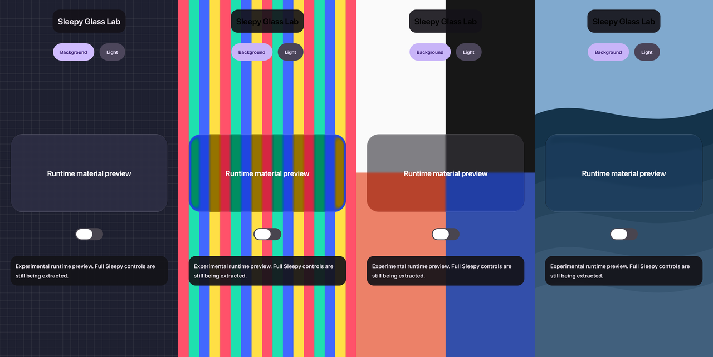

**Figure 2 · Dark theme.** These images show this public repository's own sample, not complete production controls or a native comparison. Original image identities, crops, and hashes are recorded in [sample image sources](docs/images/sources.json). Processing only removes system bars, resizes panels, and arranges them; materials were not retouched.

## 2. What the runtime provides

The repository has three modules: `runtime`, `backdrop`, and `sample`. The [runtime import manifest](provenance/runtime-import.json) lists production Kotlin, AGSL, tests and resources with their individual source identities and hashes. Controlled values, application navigation, persistence, and Material / Glass routing belong to the consumer application.

| Layer | Available functionality | Relationship to a finished control |
| --- | --- | --- |
| Input and frame clock | `DockInputClock`, `ActiveFrameLoop`; separate sample, receipt, and animation-frame times | Prevents one final event from standing in for an entire gesture; does not replace the platform input stack |
| Motion and deformation | `GlassControlMotion`, `GlassDockMotion`, `GlassPressMotion`, endpoint and acceleration models | Supplies state and trajectories; consumers still implement touch dispatch, cancellation, value updates, and accessibility semantics |
| Corners and contours | Superellipses, exact paths, dual contours, and contour caches | Supplies consistent geometry for clipping, optical normals, and highlights; a bounding rectangle does not replace the visible boundary |
| Optics and styles | `LiquidGlassStyle`, `LiquidGlassShader`, the `liquidGlass` effect, and AGSL | Processes backdrop transmission, refraction, dispersion, and tint; parameters still require control- and background-specific calibration |
| Backdrops and foreground response | External-scene recording, local preprocessing, explicit source notifications, luma sampling, caller-configured hysteresis and foreground primitives | Does not contain an identified iOS internal classifier or automatically determine correct adaptation thresholds |
| Sample | Four switchable backgrounds and light / dark themes | Demonstrates material consumption and press motion; its switch-shaped preview is not a complete Toggle |

See [architecture and API boundaries](docs/architecture.md) for the data flow, source links, and integration details.

### 2.1 Background hierarchy is part of the rendering input

When a glass button sits on a frosted panel, its lens should refract **the composited direct panel and the scene behind it**. Recording only the bottom wallpaper makes the lens appear to pass through the panel. Recording the button itself creates feedback and repeated refraction. The scene, direct backing, consumer, and foreground need explicit drawing order.

The public `backdrop` module starts from a pinned commit of Kyant's **official AndroidLiquidGlass 2.0.0**, retaining provenance and minimal local adaptations. Sleepy's historical experiments used a customized backend with additional capabilities. This repository does not include that fork's fixed bounds, downsampling, shared blur, frozen caches, viewport clipping, or transform compensation. **Historical application experiments do not automatically establish pixel equivalence for the public backend.**

### 2.2 Publication status by control

| Control | Primitives available in the public runtime | Complete drop-in public Compose control | Evidence and remaining work |
| --- | --- | --- | --- |
| Toggle | Press, rise/fall, selected-position, and motion primitives; a simplified sample shape | Not yet provided | Native hold→release reference frames are available; ordinary taps and matched Android natural-time / pixel validation remain outstanding |
| Tab / segmented control | Segmented endpoint and motion parameters | Not yet provided | Fast-drag center residuals remain; Dock results cannot be transferred to this control |
| Dock | Parent translation, lens motion, deformation, contour, and material primitives | Not yet provided | Parent-carrier translation improves quantitatively; platter optics, history-dependent foreground response, and release still differ |
| Single-thumb slider | Independent acceleration-driven deformation, endpoint response model, and material primitives | Not yet provided | Conditional axial deformation is measurable; the retrospective held-overdrag fit does not explain release peaks |
| Dual-thumb slider | Reusable motion, contour, and optical foundations | Not yet provided | The historical reference is a controlled combination of two native `UISlider` controls, not a system-native dual-thumb control |
| Menu / Alert / sheet | Exact contours, dual contours, and material foundations | Not yet provided | Boundary and multi-background experiments exist; windows, focus, button layout, and dismissal handoff remain application responsibilities |

“Available primitives” means the relevant classes can be found in this source tree. It does not mean that all behavior, visuals, and accessibility for the corresponding control are packaged.

## 3. Experimental method

### 3.1 Reference system and coordinates

The sole calibration reference is **iOS 26.5**. The endpoint-motion series cited here uses iOS 26.5 (**23F77**) in a 375 × 667 pt, 2× native fixture. Capture identities, input sources, and image hashes are recorded in the [evidence source inventory](docs/evidence/sources.json). Android pairs include historical Sleepy fixtures on physical API 36 hardware and are explicitly separated from this repository's standalone sample.

Motion replay preserves recorded input intervals and applies only a fixed start-position translation, using an explicit **1 pt = 1 dp** comparison convention. This is a logical-coordinate mapping, not a claim that the screens have the same physical size. Android resampling, receipt times, and display phase can still differ.

### 3.2 Four observations that answer different questions

| Observation | What it can answer | What it cannot establish |
| --- | --- | --- |
| Controlled values and callbacks | What was selected, when it committed, and whether cancellation committed incorrectly | Whether the lens has arrived or the animation looks natural |
| Public presentation / Android carrier geometry | How a specified carrier's position, bounds, and transform change | The visible glass contour, alpha support, or actual refracting edge |
| Visible-boundary extraction | How far edges and corners in a specified fixture differ from the reference | That the same segmentation rule works on every background |
| Final screenshots and pixel probes | Composited RGB, texture, and edge structure at specified locations | Unique material parameters, the internal classifier, or complete control parity |

The label **carrier** restricts a result to carrier geometry. **Native-only** means that no Android comparison is present. **Historical app backend** means that the result does not validate the public backend.

### 3.3 Timing, phases, and error

DOWN, motion, sustained holding (**HELD**), UP, and the release tail are reported separately. A stable held sample must have its entire property-read interval before UP. A displacement peak after UP is not counted as held behavior. Time origins use actual DOWN receipt on each system; curves are not shifted afterward to hide latency.

Center-position error is reported as root mean square error:

$$\mathrm{RMSE}_x = \sqrt{\frac{1}{N}\sum_{i=1}^{N}(x_{\mathrm{Android},i}-x_{\mathrm{iOS},i})^2}$$

This metric only describes the paired samples and timing rule in question. A dp error is not converted into “99.99% similarity,” and input checks or passing test counts are not optical metrics. Sparse display frames and event logs cannot prove agreement at every millisecond.

### 3.4 Backgrounds, ablations, and validation boundaries

Optical experiments should include a fine grid, saturated stripes, large tonal blocks, and a multiscale landscape, distinguishing light / dark themes, REST / HELD, and plain / frosted backings. Body transmission, edge refraction, dispersion, foreground contrast, and corners are inspected separately.

Training gestures, parameters, and validation rules should be frozen before fitting. The report retains the actual historical boundaries: some held-out trajectories were already inspected while investigating mechanisms, and the slider endpoint curve was selected retrospectively after viewing the data. These observations can test coverage of existing evidence; they are not new blind tests.

**Historical material checkpoint, 2026-11-14.** The previous four backgrounds × light/dark optical conditions were observed and used to select candidates. All eight conditions are **calibration**, not an independent holdout. Subsequent matched-background iOS 26.5 cap observations contradicted the `bevel 20→6` candidate, which has been withdrawn. Its Android-only mechanical experiment and failure images remain [available](docs/edge-profile-update.md). At that stage Sleepy's frozen production Dock candidate used actual `D=46.5pt / b=15.5pt`, with body, outer-dispersion and directional residuals. This identifies the historical candidate measured below; it does not imply that later source stayed unchanged, establish native equivalence or validate this independent backend.

A separately preregistered set of eight new synthetic images comprises about seven designed stimulus families and tests unseen render responses. **Fixed four-item Dock REST photometry is now complete, retaining 12 engineering review cells; the candidate is not accepted and there is no global score.** Overlapping ROI and normal-probe cells mean these are not twelve independent errors. For h01 light, bottom 2–6 pt ΔE00 median improves from 40.445 to 11.565 while top 2–6 pt worsens from 6.208 to 9.309; h02 dark tip 6–12 pt changes from 10.231 to 12.285 and h04 dark bottom 2–6 pt from 17.943 to 20.791. Local gains and regressions are both retained.

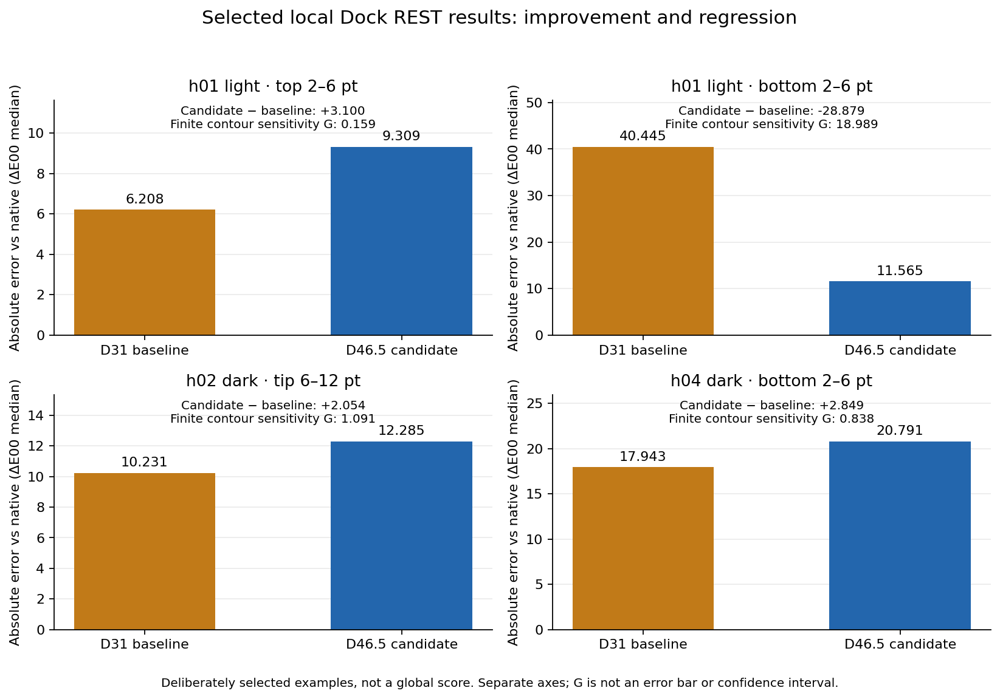

Each panel separately shows absolute ΔE00 median error against native. `G` is finite nominal-contour sensitivity under ±0.5 pt with observed pixels fixed, not a confidence interval. The four examples were selected to show gains and regressions. The [new-background Dock quantitative report](docs/holdout-dock-results.md) includes all 656 cells, the complete 12-cell review table, representative original luminance curves, hashes and a local renderer. These results concern the historical Sleepy application backend, not acceptance of the current independent public backend. Independent transport/topology review and **Sheet validation on that new-background set** remain outstanding; the current panel calibration does not replace them. Themes, depth bands, pixels and two REST captures are not independent population samples. Fixed-size REST data do not cover natural photographs, other sizes, other controls or dynamics. Stimuli and ROIs use geometry and problems learned during calibration, so the study is not blind from design onward and establishes neither 99.99% parity nor every-millisecond agreement. See [validation boundaries and candidate status](docs/validation-boundaries.md).

## 4. Results: motion, contours, and optics

All figures in this section derive from real records. Small tables, rendering scripts, original-source identities, and SHA-256 hashes are available through the [evidence atlas and reproduction entry point](docs/evidence/RESULTS.md). Historical stage numbers identify evidence, not releases or completion percentages.

### 4.1 Dock: when the parent carrier starts following the finger

The previous implementation primarily pulled the platter after overdrag. In the native four-item Dock, the parent carrier already moves while the finger remains inside the selectable range. The revision drives a separate parent motion from physical displacement after actual DOWN, rather than deriving it from the logical selection or the already-clamped lens position.

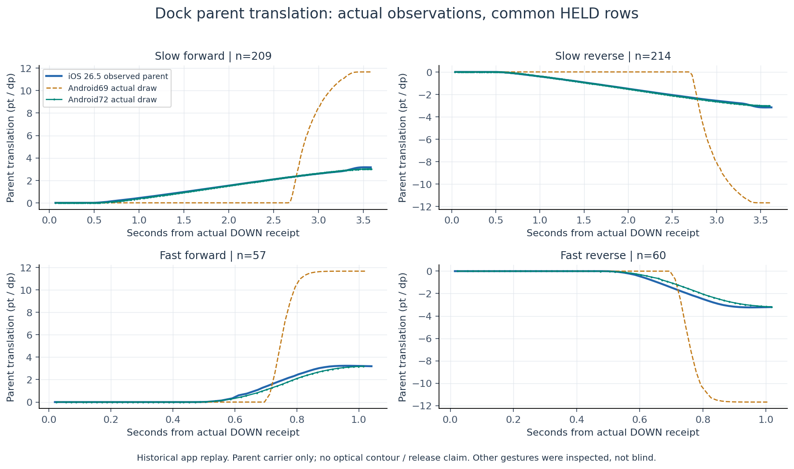

**Figure 3a · Measured parent-carrier trajectories.** Blue is public iOS 26.5 geometry; orange is Android69; green is Android72. Each uses its own actual DOWN receipt as time zero. The plotted quantity is parent translation, not the visible lens contour.

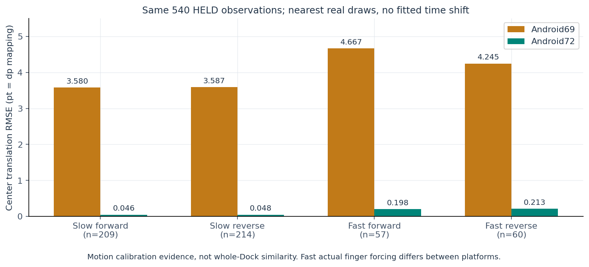

| Gesture | Common HELD rows | Android69 RMSE (dp) | Android72 RMSE (dp) | Android72 maximum absolute error (dp) |
| --- | ---: | ---: | ---: | ---: |
| Slow forward | 209 | 3.579757 | 0.046427 | 0.162079 |
| Slow reverse | 214 | 3.587388 | 0.047706 | 0.153100 |
| Fast forward | 57 | 4.666596 | 0.198231 | 0.390251 |
| Fast reverse | 60 | 4.245231 | 0.212943 | 0.423614 |

**Figure 3b · The same rows in both versions.** Both versions use the same 540 held observations. Slow forward calibrated the model; the other gestures had already been inspected and are observed holdouts, not blind tests. Actual finger forcing still differs during fast drags, and the nearest-draw phase difference reaches 25.711 ms. These rows are not 540 independent trials. The conclusion is limited to parent translation in this four-item fixture; it does not cover release, cancellation, interruption, other widths, a common rise/scale law, or optics.

### 4.2 Menu: corners require more than matching a bounding rectangle

Menus with the same width and height can still have visibly different corner tangents, transitions, and boundaries. We compare each physical corner row by row, according to depth from the outer edge, retaining a family of boundaries obtained from different color thresholds.

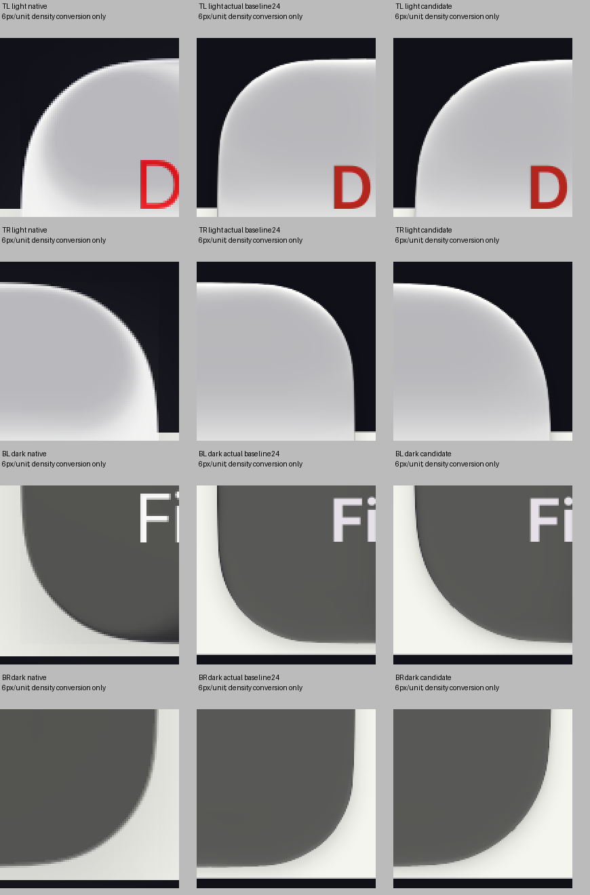

**Figure 4a · Left to right: native, Menu24, Menu32.** The images are density-converted and arranged for comparison; numerical measurements use original pixels. Text belongs to the synthetic test fixture. Color, shadows, and highlights were not retouched.

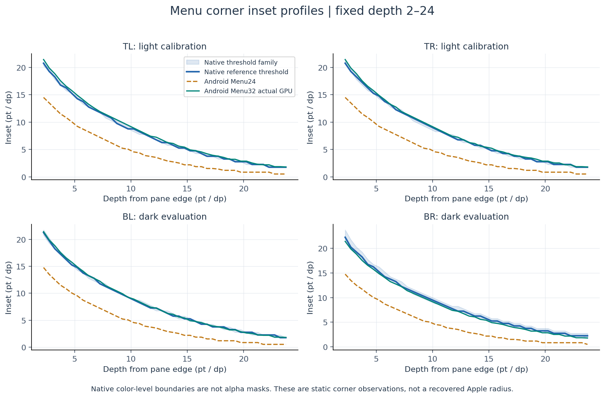

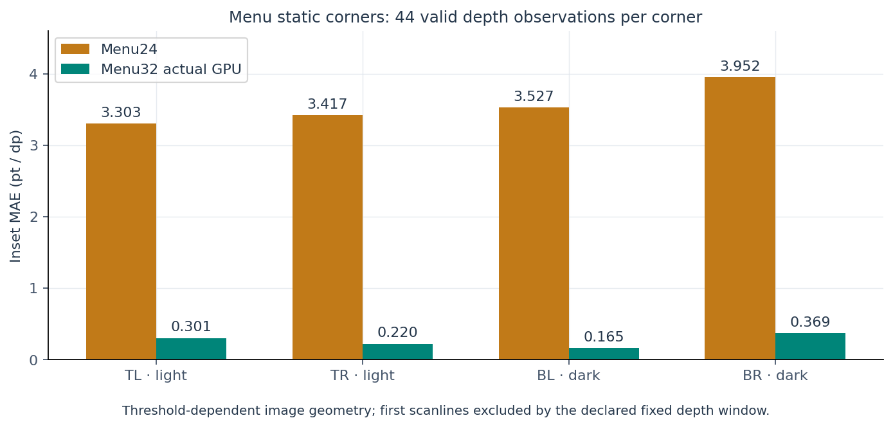

| Physical corner / theme | Rows per corner | Menu24 MAE (dp) | Menu32 MAE (dp) | Menu32 maximum absolute error (dp) |
| --- | ---: | ---: | ---: | ---: |
| Top-left / light | 44 | 3.303333 | 0.301327 | 0.792016 |
| Top-right / light | 44 | 3.416969 | 0.220349 | 0.670167 |
| Bottom-left / dark | 44 | 3.526929 | 0.164916 | 0.571428 |
| Bottom-right / dark | 44 | 3.951967 | 0.369175 | 0.829833 |

**Figures 4b–c · Improvement under a specified boundary rule.** The primary window is 2–24 logical units inward. The candidate was selected using the light top corners, then evaluated on real GPU images under frozen rules. The native measurement is a color-threshold crossing, not alpha; Android window coverage is not material opacity. Other thresholds still yield different results. A secondary fine-grid diagnostic retains a maximum residual of 15.004 dp. The table therefore does not recover an exact native corner radius or establish success across every background. Alert is a different surface and is not fixed by this result.

The secondary fine-grid [176 boundary rows](docs/evidence/data/menu-secondary-grid.csv) and [original file paths, hashes, and method summary](docs/evidence/data/historical-residual-summary.json) are retained separately. Their grid / rim / shadow contamination is not part of the primary validation conclusion.

### 4.3 Single-thumb slider: speed-dependent deformation needs its own model

Slow and fast drags cannot be represented by changing only the playback speed of one scale animation. This experiment separates isotropic rise from independent X/Y deformation. Complete forward slow / fast gestures train the model; complete reverse slow / fast gestures are retained for evaluation after train-only model selection.

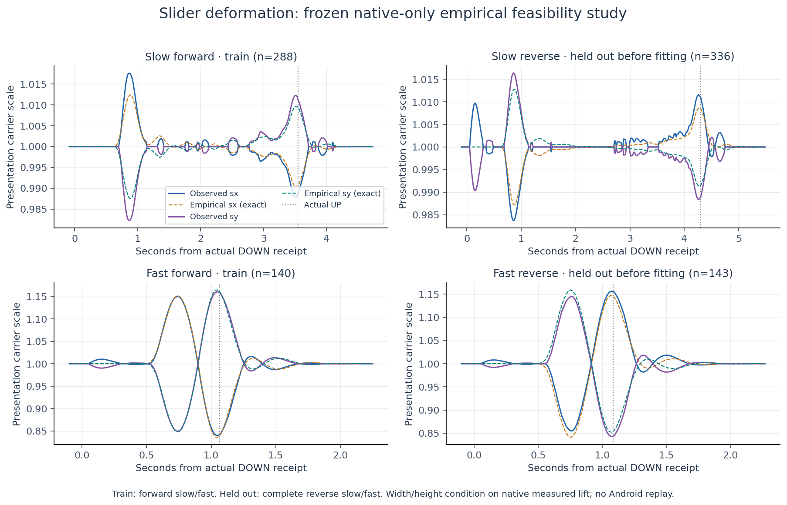

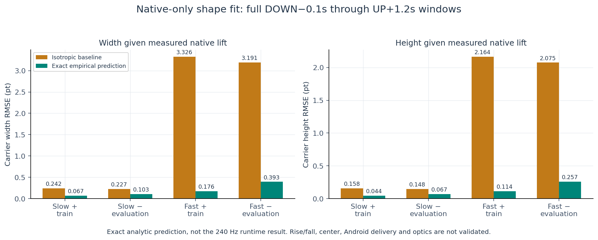

| Gesture / split | Isotropic width / height RMSE (pt) | Continuous empirical width / height RMSE (pt) |
| --- | ---: | ---: |
| Slow forward / train | 0.2418 / 0.1578 | 0.0674 / 0.0441 |
| Slow reverse / held out | 0.2269 / 0.1479 | 0.1029 / 0.0668 |
| Fast forward / train | 3.3262 / 2.1642 | 0.1756 / 0.1139 |
| Fast reverse / held out | 3.1912 / 2.0749 | 0.3933 / 0.2566 |

**Figures 5a–b · Native-only.** The plotted model is the saved continuous analytic prediction, not an Android device run or the runtime's 240 Hz numerical integration. Width and height are conditioned on **measured native lift**. This evaluates deformation, not center motion, rise/fall timing, transparency, or optics. The model has non-unique parameter representations, and one damping parameter reaches its search bound. These are empirical estimates, not recovered Apple physics constants.

Held endpoints and release need separate measurement. The single-thumb rubber family in the source was fitted after viewing the data. Even where it explains part of the held displacement, it does not explain native release peaks of approximately +8 / −7 pt. Dual-thumb sliders cannot inherit this single-thumb conclusion.

### 4.4 Sheet: similar body means do not establish similar edges

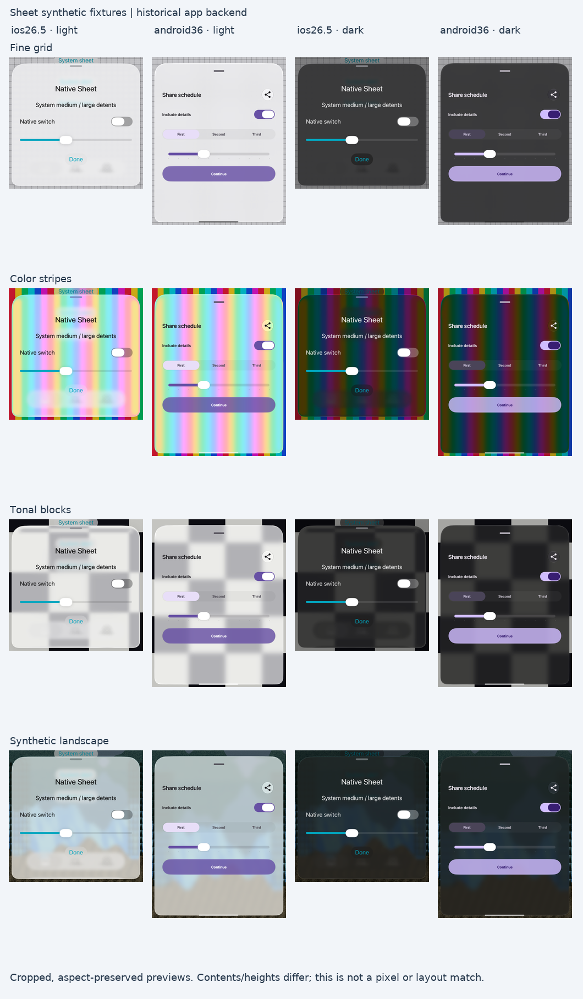

**Figure 6a · Eight background / theme conditions.** Crops retain each surface while removing system bars; complete screens are not stretched into registration. The historical body experiment explicitly specifies phase for periodic backgrounds and screen UV for the landscape. Its conclusion is limited to those sampling rules. Fixture contents, panel heights, controls, and typography visibly differ; the experiment evaluates a foreground-free material region, not a matched sheet layout.

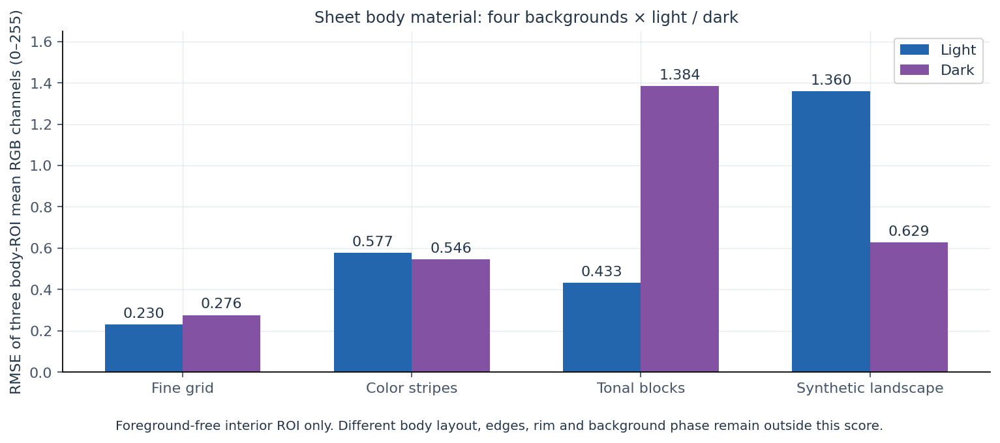

**Table · Two body statistics.** Figure 6b plots only the mean-color errors in the left column. The right column retains a separate historical full horizontal-profile summary; it is not a second plotted bar series.

| Background | Foreground-free body mean-RGB RMSE: light / dark | Full horizontal body-profile RGB RMSE: light / dark |
| --- | ---: | ---: |
| Fine grid | 0.230 / 0.276 | 0.412 / 0.303 |
| Color stripes | 0.577 / 0.546 | 3.582 / 2.403 |
| Tonal blocks | 0.433 / 1.384 | 1.234 / 1.554 |
| Synthetic landscape | 1.360 / 0.629 | 1.395 / 0.695 |

**Figure 6b · Units are 8-bit RGB code values.** The plotted metric averages a foreground-free strip, then compares its three channels. It is not a whole-surface per-pixel error. The table's separate full-profile statistic retains larger color-stripe residuals: a close mean can conceal local structural differences.

Edges remain a substantial gap. In the neutral-background rim3→rim4 adjustment, light-theme full top-edge profile RMSE **increases from 3.144 to 3.992**. Dark-theme edges remain around **7.759–10.280**. Some paired background inputs also differ, so not all residuals can be attributed to material. Both the body results and edge residuals come from the historical application backend. This independent repository does not yet provide a complete Sheet control or an equivalent paired-pixel validation.

The [eight body-profile summary rows](docs/evidence/data/sheet-historical-profiles.csv) and [16 rim3 / rim4 edge-summary rows](docs/evidence/data/sheet-historical-edges.csv) are direct extracts from the existing archive. Exact source paths, SHA-256, windows, and units are recorded in the [historical residual source summary](docs/evidence/data/historical-residual-summary.json). Public verification checks summary consistency; it does not remeasure these profiles from original pixels or produce new device results.

### 4.5 Slider optics: retain the visible refraction gap

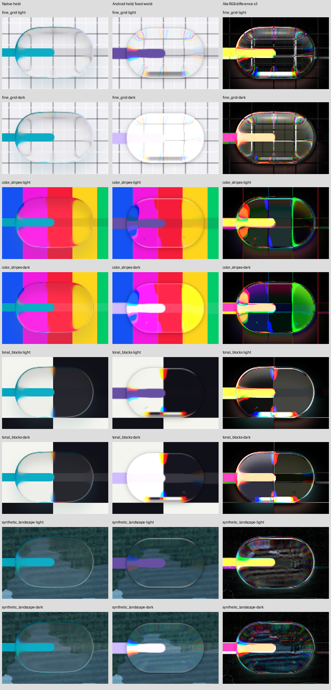

**Figure 7 · Frozen Slider72 baseline.** Left: native. Center: Android held fixture. Right: absolute RGB difference amplified ×3. The extra bright Android lower rim, local color bands, and dark-theme whitening remain visible. The difference image includes a visibly different rail theme color, so it is not assigned a whole-crop material score. Numerical diagnostics exclude the rail / halo and a conservative title-influence region.

Across four backgrounds and two themes, the specified lower-inner window has direct RGB MAE of **6.875–23.838**; the corresponding plain-background window has MAE of **0.482–1.338**. Thus the recorded difference is not solely plain-background input error. RGB difference is nevertheless not physical transparency, refractive index, or dispersion amplitude. This batch predates later material changes and is published as a historical problem baseline, not the final appearance of the public runtime.

The source pair is settled-state evidence: native capture occurs within real DOWN / UP after at least 0.65 s, while Android has a real active DOWN and a controlled settled Compose clock at 1.6 s. It is not a matched natural-time animation.

### 4.5.1 Historical slider material checkpoint: local frost

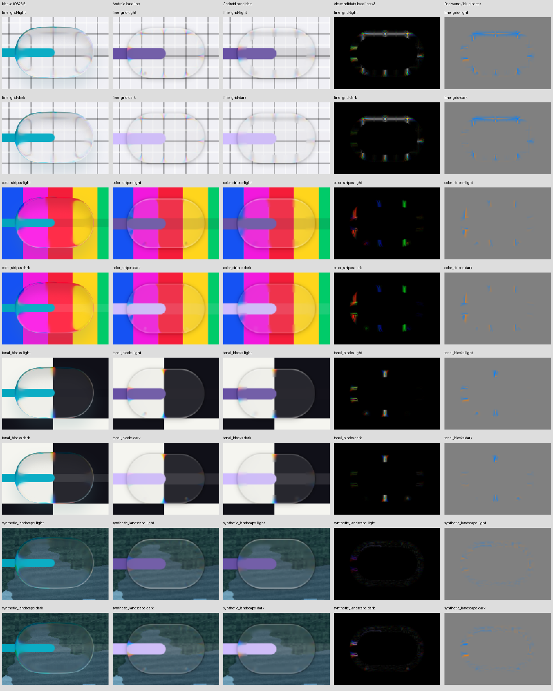

**2026-11-15 · Historical Sleepy application backend.** Adding a local total-frost replacement to the `+2.15 / bevel5.5 / D5W6.5` narrow-dispersion arm improves / regresses / leaves unchanged **68 / 26 / 18** of 112 overlapping direct-MAE records; own-source effect counts are **69 / 25 / 18**. The comparator is that already calibrated narrow-dispersion arm, not the original product baseline. These are not independent trials or a similarity score. Four previously observed backgrounds in two themes remain calibration conditions, not an independent holdout.

This is a **checkpoint experiment with residuals, not an accepted material**. Cap and lower-rim regressions remain. Frost cannot replace the required clear center, edge magnification/refraction or dispersion confined to the narrowest outer band. Historical application-backend images do not validate the independent public backend; endpoint evidence reaches holder/carrier geometry, not the fully raised visible outer edge. The [checkpoint report](docs/slider-material-checkpoint.md) retains the complete regional data, method, plateau diagnostic and rejected raised-shoulder counterexample.

### 4.5.2 Current r2: separate single and range profiles, retain native gaps

**This remains an unaccepted checkpoint.** The single-thumb common refraction is **7.8 dp**, with a **7.5 dp** quadratic shoulder. Range retains **2.15 dp and no new shoulder**. The earlier frost report describes a historical comparison arm; its 2.15 value is not the current single-thumb setting. These are static application-backend observations, not independent public-backend or dynamic acceptance.


The [five-point calibration](docs/glass-slider-star-calibration.md) publishes the implemented displacement and near-edge sampling fold. The [original frozen six/eight-point evaluation](docs/glass-slider-holdout-validation.md) retains failures; those inputs were subsequently consumed as regression data and are no longer independent holdouts. [r3/r4 alternatives](docs/glass-slider-shoulder-experiments.md) have multishape regressions and do not replace r2. Seven-point data remain unconsumed.

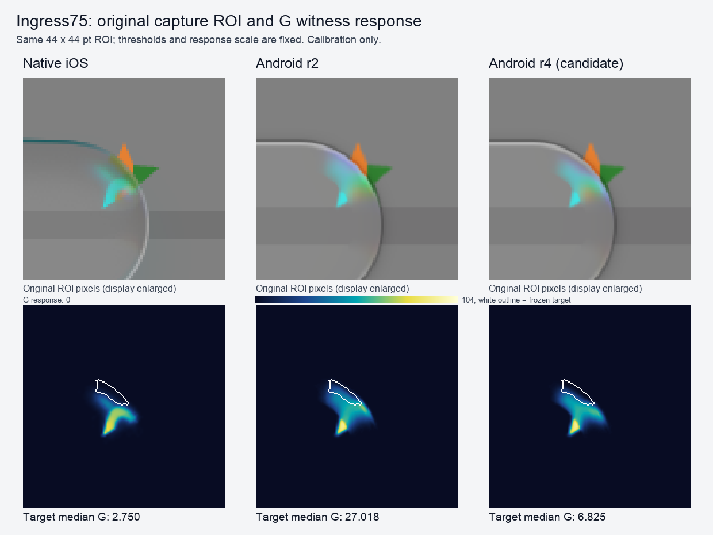

The [G-only diagnostic](docs/glass-slider-green-witness.md) retains all four thresholds, actual new errors, and unobserved Android opacity. The [third-G-amplitude observation](docs/glass-slider-midpoint-diagnostic.md) keeps the same multicolor star. All four rounds have zero observed geometry drift and the repeated control is byte-identical. Above the rail, five full100 red pixels exceed a 1.5-byte midpoint residual; three exceed 4, with maximum 7.5. Near-midpoint responses elsewhere do not establish universal linearity, and those exceptions do not identify native internal nonlinearity.

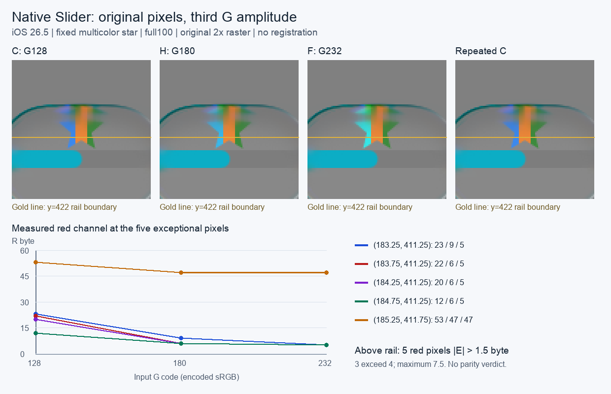

The five prior studies and new midpoint packet retain relative paths, original pixels, SHA-256 inventories, and local replay tools, without APKs, build caches, or large traces. They do not complete Dock, panel, highlight, Toggle, or full-motion acceptance.

**2026-11-16 · Finite RGB response diagnostic.** The [eight-round native report](docs/glass-slider-rgb-response-diagnostic.md) publishes 16 formal screenshots of the same multicolor five-point star, global/masked RGB perturbations, and six analysis figures. Recorded geometry, flat controls, and pre/post baseline drift are all zero. At the prespecified T=4 bytes, the shared-alpha model is incompatible at 49 full-ROI pixels, including 32 in the primary domain. All become compatible at T=8, and both input-column and output-row families are compatible in the primary domain. This identifies neither native processing order nor production refraction settings. The portable packet replays pixel-exactly; this remains calibration, with product r2 unchanged and unaccepted.

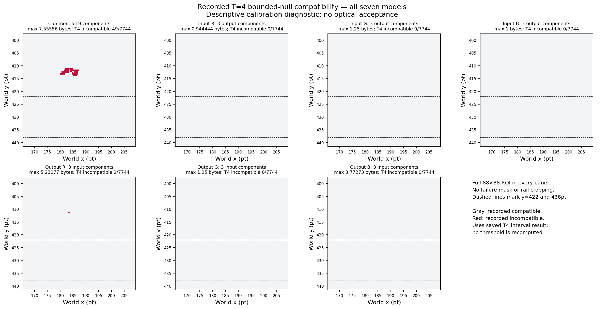

**Same-day follow-up · Signed G response.** The [four-round native supplement](research/slider-signedG-response-20261116/README.md) publishes eight additional original PNGs, frozen inputs, receipts, and portable replay. The fixed control/flat ROIs are byte-identical and recorded geometry range is zero. With the existing G+20 endpoint, per-pixel affine responses have 16 / 7 / 0 incompatible pixels at T1 / 4 / 8, all in the outermost 0–1pt. Clipped-affine and general monotone families remain compatible throughout. This corrects the interpretation boundary of the [unclipped matrix fits](research/slider-color-model-20261116/README.md); it identifies neither the native pipeline nor new production parameters.

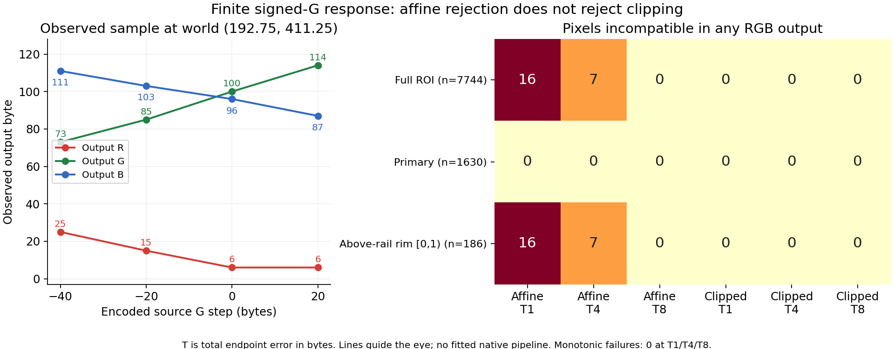

The [external Android research entry point](research/slider-android-host/README.md) also lives solely in this asset repository and requires explicit Gradle init arguments to use the application test host. Preparation and static checks passed; Gradle compilation through this entry point remains unverified. Sleepy consumer PRs contain application code and necessary regressions only; the [publication-scope record](provenance/publication-boundary-20261116.json) records the eight files in merged PR #442.

### 4.6 Toggle: publish the visible native hold→release reference

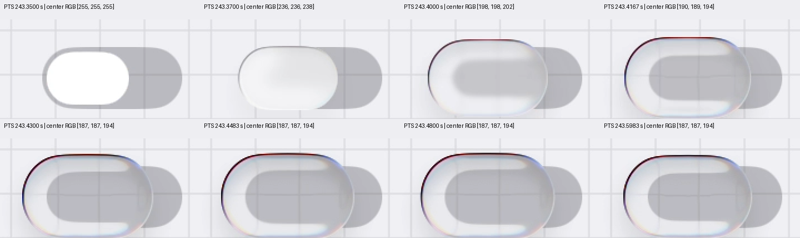

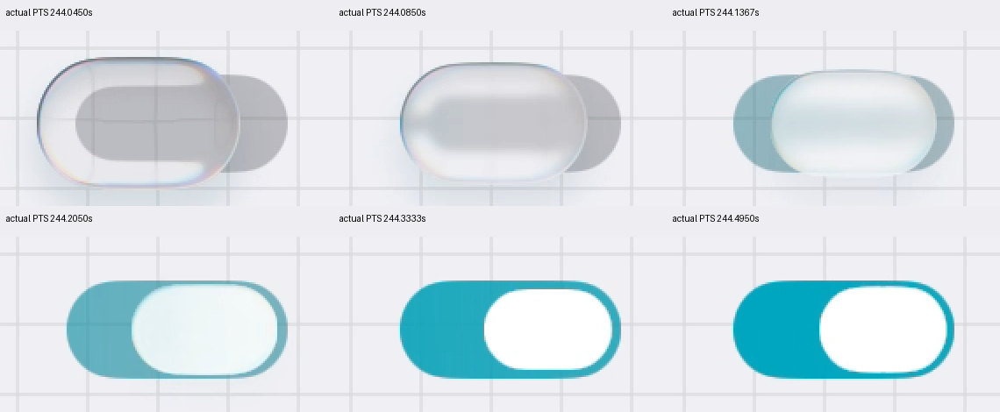

**Figures 8a–b · Native-only hold→release, not a tap comparison.** These are cropped and enlarged decoded frames from a clean UIKit hold in the custom light fine-grid fixture. The first sequence uses video PTS 243.350–243.598 s; the release sequence uses 244.045–244.495 s. No frames were generated or interpolated. The stationary white thumb becomes a larger transmitting lens; release then combines movement, theme-colored track fill, and recovery of the solid-white body during contraction.

A fixed 10 × 10 source-pixel center patch, while the lens is stationary, gives approximate white-mixture proxies of **0.72, 0.15, 0.03, and 0.00** at about **50, 84, 100, and 117 ms** after DOWN. The proxy projects observed RGB between settled HELD color and white. It is **not native layer alpha or physical transmittance**; the traced native holder itself remains opacity 1. Video / trace registration has roughly one frame of uncertainty, and decoded-video quantization and backdrop response affect the values.

That fixed patch cannot measure release opacity while the lens crosses different background and track colors. Position, rise, white-body disappearance, theme fill, and contraction need separate observations. This subset has no matching Android optical run, and the simplified sample does not establish Toggle parity. Source records and the small proxy table are linked from the [evidence atlas](docs/evidence/RESULTS.md#6-toggle-visible-rise-and-release-reference-native-only).

### 4.7 Alert / Sheet: a bounded highlight budget, with refraction still unresolved

**2026-11-15 · Application-backend experiment.** This stage fixes panel layout, source backgrounds, blur and refraction parameters, then separately compares Alert rim-light composition. The five columns are native iOS 26.5, body8, additive light, screen-only light and the current budget-normalized candidate. Fixed crops, luma curves, original samples and regression indices are described in the [panel material report](docs/panel-material-study.md). These captures use Sleepy's application backend and do not validate the independent public backend.

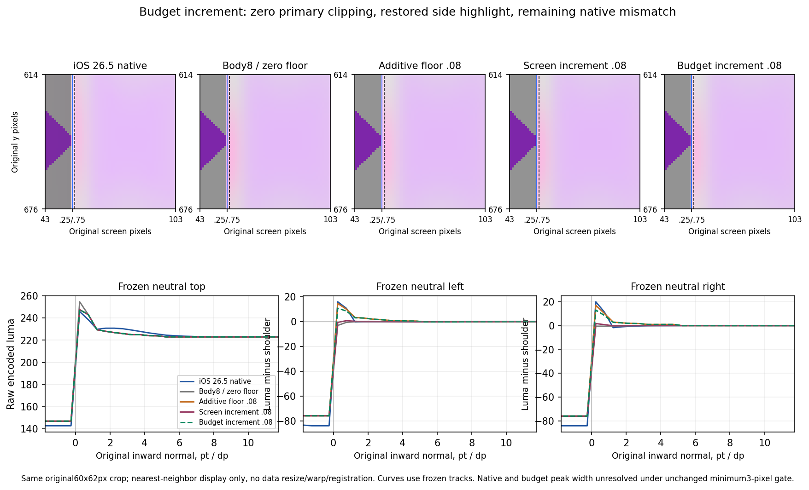

The candidate bounds added light by the current color's remaining coverage headroom; no new strength or width parameter was fitted. The prescribed **124 original colored-side pixels** no longer contain channels at 0/255, while all original 124×8×3 shoulder channel values remain unchanged. Neutral-side raw peaks return to **0.25 pt** from the edge, but their contrast remains too low: left / right peak-minus-shoulder is **10.854 / 13.082**, compared with native **16.002 / 19.995** encoded luma counts. Only two original pixels lie at half height, below the preregistered three-pixel minimum. **FWHM remains unresolved**; interpolation does not add resolution.

The metrics are mixed. Against additive light, original RGB MAE improves / regresses / stays unchanged on **22 / 22 / 4** of 48 fixed new-probe corner tracks; first- and second-derivative errors regress on **39 / 40** tracks. All four historical landscape straight-edge RGB RMSE tracks regress, as do three tonal-block tracks. Zero-change checks retain the central top, deep body, specified Sheet10 and dark controls. These controls establish the scope of the increment, not Sheet parity, physical thickness, a complete displacement map or universal optical improvement.

The current Sheet API-input **12→10** local calibration has been analyzed, rather than remaining an unexecuted analysis: only **one of 14 rows** passes the original local-feature gates, with apparent width **12.324 pt** against native **9.648 pt**. The other 13 rows still fail. Input 12 uses shared preblur while 10 uses a local fallback, so this is also not a pure radius experiment along one Gaussian route. The result is unaccepted and does not complete Sheet validation on the new-background set above.

A separate [native clean-r2 feasibility run](docs/evidence/panels-20261115/archive/analysis-mapping-audit/native-clean-analysis/RESULTS.md) removes the source trigger buttons. Each of four **750×1334** full-image REST/repeat pairs contains **1,000,500 pixels** with zero decoded RGBA difference; 68 fixed source-footprint comparisons are exact, and public / AX carrier geometry is unchanged. The frozen overall result remains **false** under its original ICC-only gate. A separate supplement records a legal sRGB chunk, without iCCP, in all 16 screenshots. The old gate was not rewritten to obtain a pass, and nonzero full before/after system-context differences remain recorded.

The [paired-slope stage](docs/evidence/panels-20261115/archive/analysis-mapping-audit/paired-slope-feasibility-analysis/README.md) in that historical publication contains a frozen plan, handoff schema and notes only. A later supplement freezes an analyzer with **69 synthetic checks**, but no real paired-slope capture or optical pass exists; see the next section. Clean-r2 stability cannot establish a unique 2D source map, actual blur support, refraction parameters or physical thickness. See [validation boundaries](docs/validation-boundaries.md) for status and provenance limits.

### 4.8 Alert / Sheet: stronger lateral sampling, with inner and lower-edge errors retained

**2026-11-15 · Later application experiment on the same historical calibration set.** The positive-refraction Alert / Sheet branch adds a lateral backward-sampling term with preset coefficient 0.45; other presets retain zero. At the fixed upper stripe row y520, left / right apparent harmonic displacement changes from baseline **0.176 / 0.159 px** to **−14.731 / 13.757 px**, against native **−14.394 / 12.928 px**. That row is closer, while inner-row direction and lower-edge residuals remain. This is not source-point tracking, physical thickness or an overall similarity measurement.

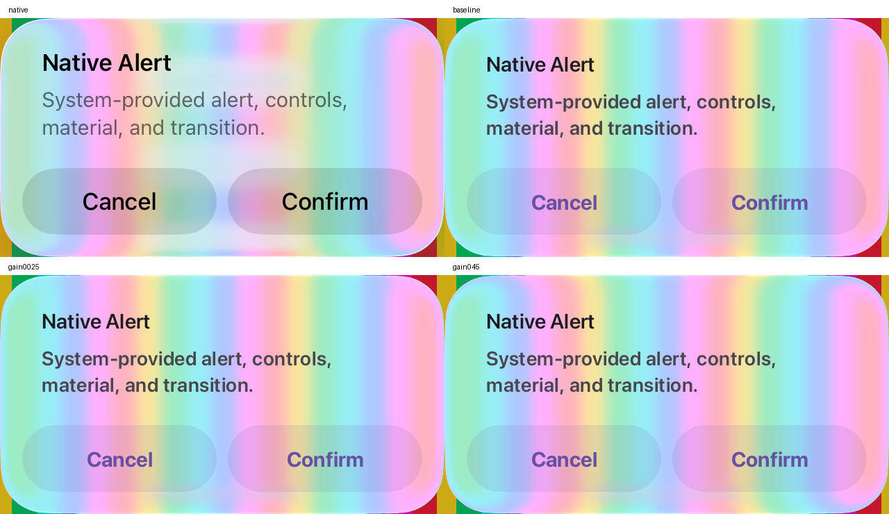

The [supplement report](docs/panel-lateral-sampling-study.md) retains the frozen stripe diagnostic's **8,256 failed / eligible row records**, all **80 descriptive harmonic observations**, component crops from 16 static panels, and separate application receipts for 76 JVM, three device-button, and another 18 button / date-picker checks. A portable script recomputes all 80 harmonic rows from retained component pixels; full phone exports and UI XML are omitted. The later analyzer's 69 synthetic checks are not a real paired-slope optical pass. Application checks and the independent runtime's 56 host checks have distinct scopes, without independent-backend optical acceptance. Sharpness, outermost highlights, size families and dynamics remain separate open measurements.

## 5. Known gaps and intended use

The runtime is intended for research, experimental interfaces, and Compose developers who want to participate in calibration. It currently offers no Maven package, stable API, or all-device compatibility commitment.

| Scope | Current conclusion |
| --- | --- |
| Overall native equivalence | Incomplete; no every-frame, every-millisecond, or aggregate similarity verdict |
| Toggle tap and held dynamics | Published frames cover native hold→release only; ordinary taps and matched Android natural-time / pixel validation remain outstanding, and the sample is not production-control acceptance |
| Fast segmented switching | Some historical center errors are worse than an earlier version; clock and model investigation must retain those results |
| Single-thumb endpoints | Held displacement has a retrospective fit; native release peaks around +8 / −7 pt remain unexplained by that model |
| Dual-thumb dynamics | No independent complete speed / release validation; single-thumb measurements are not dual-thumb results |
| Dock material | Nonlinear rim improvements are implemented; historical photometry and adaptation gaps remain tied to their source stages, without comprehensive quantitative acceptance or a measured similarity percentage |
| Alert / Sheet material | The light increment fixes specified side clipping; corner derivatives, background dependence, near-edge displacement and other sizes remain unaccepted |
| Nesting and transforms | Consumers must manage direct backings and external sources; the public backend lacks the app's custom transform compensation |
| Performance | Targeted frame / sampling observations exist, but no cross-device product benchmark for responsiveness, memory, or power |
| Older Android versions | `minSdk 26` is a declaration; API 26–30 lacks this RenderEffect blur chain and does not provide the full glass effect |

For Dock in particular, controlled native brightness round trips show different output at the same input brightness depending on the preceding path. One memoryless luma curve cannot explain that observation. The runtime supplies configurable hysteresis and foreground primitives; **it does not publish a recovered iOS internal classification algorithm**.

## 6. Build, integration, and reproduction

### 6.1 Run the standalone sample

The current source snapshot targets JDK 17 and pins Android SDK 37, Gradle 9.8.2, Kotlin 2.4.21, Compose 1.12.1, and Material3 1.5.0-rc01. These are the repository's configuration, not a recommendation about the latest tool versions. Put the local SDK path in an untracked `local.properties`, or set `ANDROID_HOME`.

```sh
./gradlew :runtime:assemble :runtime:testAndroidHostTest :sample:assembleDebug
./gradlew :sample:installDebug
```

The application is named **Sleepy Glass Lab**. Use Background to change the scene, Dark / Light to switch theme, and press the lower lens to inspect motion. The sample does not access the network or write timetable data, and does not showcase every finished control.

### 6.2 Integrate into a Compose project

Include `runtime` and `backdrop` as source modules, then declare the runtime dependency in the consuming module:

```kotlin
dependencies {
    implementation(project(":runtime"))
}
```

[MainActivity.kt](sample/src/main/java/com/lingion/liquidglass/sample/MainActivity.kt) shows the actual integration: first record an external scene, consume its material through `drawPlainBackdrop`, and draw foreground content separately above the consumer. The historical compatibility package remains `com.lingion.sleepy.ui.component.liquidglass`.

API 33+ uses RuntimeShader. API 31–32 can use the RenderEffect blur / vibrancy fallback. On API 26–30, the corresponding effect branches return without these effects, preserving source drawing. A declared minimum SDK does not establish device acceptance for each path.

### 6.3 Re-render the figures and audit the evidence

The figures use Matplotlib and Pillow. Small committed tables and processing records let readers recalculate numerical figures without building Android or rerunning a device matrix:

```sh
python3 -m pip install matplotlib Pillow
python3 docs/evidence/render_figures.py
python3 docs/evidence/verify_evidence.py
```

See the [evidence atlas](docs/evidence/RESULTS.md) for the protocol. The renderer reads committed CSV / JSON / crops and recalculates common-row selection and reported figure statistics. It does not refit the original models or recapture a device. Full raw screenshot and video archives are not distributed with the library. Source records retain crop, resize, and hash information; omitted originals are not claimed to be independently recoverable. This is **figure reproducibility**, distinct from independent experimental replication.

The current [runtime manifest](provenance/runtime-import.json) binds 38 files to the scope-corrected Sleepy commit `5f3ea867ed173520c80515c5482263efe1c21433`; the [reconciliation record](provenance/scope-cleanup-20261116.json) retains file-by-file byte equivalence and application tests actually rerun. The historical `386d4c09a78234c4bc04507f6ef4952d856de3f4` stage also imported 28 production Kotlin files, one shader, seven tests and two resources. At that stage, independent `runtime:assemble`, 56 host checks and `sample:assembleDebug` passed with zero failures, errors or skips across seven classes. Its [historical validation receipt](provenance/validation-20261115-lateral.json) remains bound to the manifest used then; it is not relabeled as a rerun of the new HEAD. The earlier `ddbf20e` [receipt](provenance/validation-20261115.json) binds only the [pre-lateral manifest](provenance/runtime-import-20261115-pre-lateral.json). Neither build adds new independent-sample device optics acceptance. The initial 38 checks and API 36 device record retain their historical 2026-11-14 scope in [VALIDATION.md](VALIDATION.md).

## 7. Contributing and next steps

A useful minimal report identifies the **control, input, background, theme, OS / API, expected result, and actual result**. Keep numerical / callback regressions, actual carrier motion, visible contours, and optics distinct. Each can form a focused PR; contributors are not required to run a lengthy full matrix.

Current work prioritizes Alert / Sheet static materials and source-coordinate identifiability, retaining the Dock improvements already made. Genuine native sizing support and complete adapters / paired validation follow in stages. The new dynamic v4 study remains an unfrozen, uncaptured plan: body size, layout, and content are separate axes, and every complete action retains all actual frames and component instances from pre-input through observed settle. Unsupported native sizes remain explicit limitations; transforming a control or screenshot does not create support. Historical motion subsets and passing protocol checks do not complete this coverage or establish dynamic acceptance. Entry requirements and focused commands are in [CONTRIBUTING.md](CONTRIBUTING.md).

## 8. License, provenance, and citation

The library is distributed under **GNU GPL v3**. Third-party portions retain their original licenses and attribution; see [LICENSE](LICENSE), [NOTICE.md](NOTICE.md), and `third-party/notices`. The implementation is not wholly original. iOS 26.5 is a behavioral and visual reference. This project is not affiliated with Apple and does not include Apple's control implementation code.

| Source | Use in this project | Pinned record |
| --- | --- | --- |
| Sleepy | Direct source of the runtime modules; historical package retained | [Imported files and hashes](provenance/runtime-import.json) |
| FLClash / chen08209 | Kotlin / AGSL port of shaders, optics, styles, and some motion / geometry; GPL-3.0 | [NOTICE](NOTICE.md) |
| Flutter | Kotlin adaptation of rounded-superellipse geometry and spring physics; BSD-3-Clause | [Sources, versions, and hashes](provenance/flutter-sources.json) |
| Kyant0 / AndroidLiquidGlass | Official 2.0.0 backdrop; Apache-2.0, with four minimal adaptations | [Pinned commit and file inventory](provenance/backdrop-baseline.json) |

The Flutter engine's 2013 notice and framework's [2014 notice](third-party/notices/Flutter-Framework-BSD-3-Clause.txt) are both retained. Imported comments contain historical notice paths; their mapping is documented in [NOTICE.md](NOTICE.md#imported-notice-paths). Those source paths do not imply that AARs or APKs automatically package the notices.

Native reference images in this report are experimental captures from a custom fixture. Only synthetic backgrounds and cropped controls without personal content are published, with processing and provenance recorded. Complete device videos, user pages, and account information are excluded. When citing a result, include the repository commit, figure identity, and evidence record, preserving its calibration / evaluation scope instead of describing a local result as complete iOS equivalence.
