# Sleepy Liquid Glass

**面向 Android / Jetpack Compose、以 iOS 26.5 原生控件为参考的实验性液态玻璃运行库。**

[English](README.en.md) · [实现与 API](docs/architecture.md) · [实验数据与图表](docs/evidence/RESULTS.md) · [面板材质研究](docs/panel-material-study.md) · [受控光学研究与资产](docs/controlled-optical-studies.md) · [验证记录](VALIDATION.md) · [贡献指南](CONTRIBUTING.md) · [研究夹具源码](research/slider-fixtures/README.md)

本项目把 Sleepy 中的输入时钟、弹簧运动、速度形变、连续圆角、AGSL 材质与外部背板采样拆成独立源码模块。目标是让控件的位置、形状、材质和交互节奏能够分别测量、校准与复现，帮助 Compose 开发者构建会响应真实背景与手势的玻璃界面。

这份 README 是项目的技术报告：既展示独立示例，也公开历史原生对照中的改进、失败和测量边界。**当前提供运行原语，完整 Toggle、Tab、Dock、单双头滑杆和菜单的应用适配器仍在提取；没有完成全控件原生等效验收。**

## 摘要

液态玻璃的难点不止是模糊。一次点击同时涉及实心滑块退场、玻璃镜片升起、中心位移、轴向形变、主题填色和回落；快速拖动还改变加速度、越界拉伸与释放轨迹。把所有控件套进同一个弹簧，或者只在一张壁纸上调透明度，都不足以重现这些行为。

我们的工作分为三层：

1. **运行实现**：将输入接收、帧推进、运动状态、精确轮廓、材质渲染与背景响应分离，独立库可构建、测试并由 sample 消费。
2. **原生观察**：使用自建 iOS 26.5 原生测试程序，记录实际触摸、公开 presentation 几何与截图；不把请求的手势速度当作系统实际收到的速度。
3. **配对实验**：在 Android 上回放记录的路径，分别比较载体几何、可见边界和最终像素，保留输入派发、刷新相位与后端差异。

以下实验给出局部可检验的结果，而不汇总为一个没有定义的“相似度百分比”。例如，Dock 父载体在一组共同 held 观测上的中心误差明显下降；菜单的可见边界可以单独测量；滑杆的稳定顶住位置与释放峰值则必须分开讨论。每项结果的指标、源码阶段和限制都随图提供。

## 1. 独立运行效果

以下为 **Sleepy Glass Lab** 在真实 Android API 36 设备上的截图。每行从左到右是细网格、饱和彩条、明暗色块、合成山景；背景全部由本地绘制，不读取用户照片或课表。


**图1 · 浅色主题。** 细网格暴露模糊与边缘位移，彩条暴露色彩透射和色散，明暗色块暴露对比响应，山景提供多尺度结构。


**图2 · 深色主题。** 这是公开仓库自身的运行效果，不是完整生产控件，也不是原生对照图。原图、裁切和哈希见[示例图片来源](docs/images/sources.json)。仅裁去系统栏并缩放拼排，未修饰材质。

## 2. 运行库到底提供什么

仓库包含 `runtime`、`backdrop` 和 `sample` 三个模块。生产 Kotlin、AGSL、测试与资源的逐文件来源及哈希见[运行库导入清单](provenance/runtime-import.json)；控制值、业务导航、持久化与 Material / Glass 模式路由由应用负责。

| 层 | 提供的能力 | 与最终控件的关系 |
| --- | --- | --- |
| 输入与帧时钟 | `DockInputClock`、`ActiveFrameLoop`，区分采样时间、接收时间、动画帧时间 | 防止用最后一次事件覆盖整段手势；不是系统输入栈的替代品 |
| 运动与形变 | `GlassControlMotion`、`GlassDockMotion`、`GlassPressMotion`、端点与速度形变模型 | 提供状态和轨迹；调用方仍需实现触摸、取消、值回写和无障碍语义 |
| 圆角与轮廓 | 超椭圆、精确路径、双轮廓与轮廓缓存 | 为裁切、光学法线和高光提供一致几何；不靠包围盒代替可见边界 |
| 光学与样式 | `LiquidGlassStyle`、`LiquidGlassShader`、`liquidGlass` effect 与 AGSL | 处理源背景、折射、色散与着色；材质参数仍需按控件和背景校准 |
| 背板与前景响应 | 外部场景录制、局部预处理、显式源通知、亮度采样、调用方配置的迟滞与前景原语 | 不包含已识别的 iOS 内部分类器，也不会自动给出正确的适应阈值 |
| 示例 | 可切换四种背景、浅深主题的独立应用 | 演示材质消费与点击运动；开关状示例不是完整 Toggle 组件 |

完整数据流、源码链接和 API 边界见[实现与 API](docs/architecture.md)。

### 2.1 背景层级是渲染输入的一部分

玻璃按钮位于磨砂底板上时，镜片应折射**直接底板与其下方场景的合成结果**。只录最底层壁纸，会让按钮“穿过”底板；把按钮自己录进源，又会形成反馈与重复折射。场景、直接背板、消费者和前景必须有明确的绘制顺序。

本库的公开 `backdrop` 从 Kyant **官方 AndroidLiquidGlass 2.0.0** 固定提交开始，保留原始来源与最小适配。Sleepy 历史实验中的定制 backend 具有额外能力；公开库不含其中的固定 bounds、降采样、共享 blur、冻结缓存、viewport 裁剪与 transform compensation。**历史应用实验不能自动证明公开后端得到相同像素。**

### 2.2 各控件的发布状态

| 控件 | 公开运行层已有内容 | 完整可直接替换的公共 Compose 控件 | 本文证据与当前缺口 |
| --- | --- | --- | --- |
| Toggle | 按压、起落、选中位移及运动原语；sample 有简化形状 | 尚未提供 | 原生长按→释放已有参考；普通点击、Android 自然时序与像素对照仍待验收 |
| Tab / 分段选择 | 分段端点与运动参数 | 尚未提供 | 快拖存在中心残差；不能借用 Dock 的结果 |
| Dock | 父平移、镜片运动、形变、轮廓及材质原语 | 尚未提供 | 父载体平移有定量改进；底座光学、前景历史响应和释放仍有差距 |
| 单头滑杆 | 独立加速度形变、端部响应模型与材质原语 | 尚未提供 | 条件轴向形变可测；held 外移拟合不解释释放峰值 |
| 双头滑杆 | 可复用运动、轮廓与光学基础 | 尚未提供 | 历史参考是两个原生 UISlider 的受控组合，不能称为系统原生双头控件 |
| 菜单 / Alert / 半幅弹窗 | 精确轮廓、双轮廓和材质基础 | 尚未提供 | 有边界和多背景实验；窗口、焦点、按钮布局与退出交接仍由应用适配 |

“已有原语”表示这些类可以在本库中找到，不表示相应控件的全部行为、视觉与无障碍功能已经封装完成。

## 3. 实验方法

### 3.1 参考与坐标

唯一校准参考为 **iOS 26.5**。本轮引用的端部运动系列使用 iOS 26.5（23F77）的 375 × 667 pt、2× 原生夹具；具体捕获身份、输入与图片哈希以[证据清单](docs/evidence/sources.json)为准。Android 配对包含真实 API 36 设备上的历史 Sleepy 夹具，与本仓库独立 sample 明确分开。

运动回放保留源记录的采样间隔，只做固定起点平移，并使用 `1 pt = 1 dp` 的比较约定。这是逻辑坐标对照，不宣称两块屏幕的物理尺寸相同。Android 的重采样、事件接收时刻和刷新相位仍可能不同。

### 3.2 四种不能互相替代的观察

| 观察 | 能回答的问题 | 不能由此推出 |
| --- | --- | --- |
| 业务值与回调 | 选择了什么、何时提交、取消后是否误提交 | 镜片是否已经到位、画面是否自然 |
| 公开 presentation / Android carrier 几何 | 某个载体的位置、bounds 与变换如何变化 | 可见玻璃轮廓、alpha 支持域、实际折射边缘 |
| 可见边界提取 | 指定测试图中边缘/四角离参考有多远 | 任意背景下都能得到同样分割结果 |
| 最终截图与像素探针 | 指定位置的合成 RGB、纹理、边缘结构 | 唯一的材质参数、内部分类器或整个控件已匹配 |

图中若写 **carrier**，就只讨论几何载体；写 **native-only**，就没有 Android 对照；写 **historical app backend**，就不是公开后端验收。

### 3.3 时间、阶段与误差

同一手势分别报告 DOWN、移动、持续按住（held）、UP 和释放尾段。稳定 held 样本要求整个属性读取区间都落在 UP 之前；UP 后的外移峰值不计入 held。按各系统实际 DOWN 接收时间建立时间原点，不用事后平移曲线来隐藏延迟。

中心位置误差用均方根误差表示：

$$\mathrm{RMSE}_x = \sqrt{\frac{1}{N}\sum_{i=1}^{N}(x_{\mathrm{Android},i}-x_{\mathrm{iOS},i})^2}$$

它只描述给定配对样本与时间规则中的误差。没有把 dp 误差转换成“99.99% 相似”；也没有把输入检查或测试通过率当成光学指标。只有稀疏显示帧和事件记录时，不能证明每一毫秒一致。

### 3.4 背景、消融与验证边界

每项光学实验应覆盖细网格、饱和彩条、大块明暗和多尺度风景，并区分浅/深主题、REST/HELD、普通背板/磨砂背板。主体透射、边缘折射、色散、前景对比和圆角分别检查。

拟合前应冻结训练手势、参数和验证规则。本文保留历史工作中的实际边界：部分留出轨迹曾用于机制观察；滑杆端部曲线是看过数据后的回顾拟合。它们能检验解释是否覆盖已有数据，不能称为全新的盲测。

**2026-11-14 历史材质检查点。** 先前四背景 × 浅深主题的八场光学条件已经用于观察与候选选择，全部属于 **calibration（校准集）**，不是独立 holdout。`bevel 20→6` 候选随后被 iOS 26.5 同背景端部对照否定，已撤回；其 Android-only 机械实验和失败图仍[完整保留](docs/edge-profile-update.md)。该阶段 Sleepy 应用生产路径冻结的 Dock 候选是实际 `D=46.5pt / b=15.5pt`，仍有面心材质、外圈色散及方向残差，未获原生等效结论。这是下文新背景测量所用的历史身份，不代表后续源码没有变化，也不自动证明本独立后端的结果。

另行预注册的八张新合成背景约为七类人工刺激，属于未见渲染响应的定向挑战集。**固定四项 Dock 的 REST 光度分析现已完成，保留 12 个触发工程复核的单元；候选尚未验收，没有总分。** 这 12 个单元包含重叠 ROI 与法向探针，不能称为 12 个独立错误。h01 浅色 bottom 2–6 pt 的 ΔE00 median 从 40.445 降至 11.565，但同图 top 2–6 pt 从 6.208 升至 9.309；h02 深色 tip 6–12 pt 为 10.231→12.285，h04 深色 bottom 2–6 pt 为 17.943→20.791。局部改善与退化同时保留。

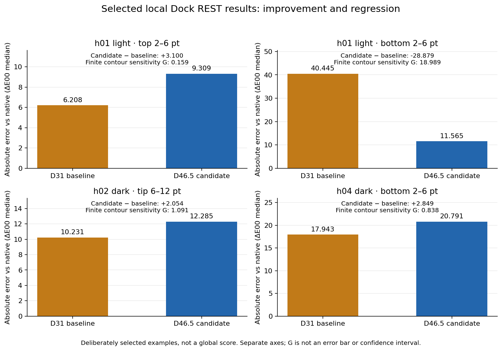

图中每格纵轴分别显示相对原生的绝对 ΔE00 median，`G` 是固定像素下名义轮廓 ±0.5 pt 的有限敏感性，不是置信区间。四格按展示改善与退化的目的选取；全部 656 单元、完整 12 项复核表、代表性原始亮度曲线、哈希与本地重绘脚本见[新背景 Dock 定量结果](docs/holdout-dock-results.md)。这些是 Sleepy 应用历史后端的结果，不是当前独立公开后端的验收。独立输运/拓扑审阅与**该新背景集的 Sheet 验证**仍待完成，本轮面板校准不替代它；主题、深度层、像素和两次 REST 截图不能乘成独立总体样本。这组固定尺寸 REST 数据不覆盖真实照片、其他尺寸、其他控件或动态；设计依赖旧校准的几何和问题发现，不能宣称全流程盲测、99.99% 或每毫秒一致。详见[验证边界与候选状态](docs/validation-boundaries.md)。

## 4. 结果：运动、轮廓与光学

本节图片均由真实记录生成。小数据、脚本、原图来源与 SHA-256 见[实验结果及复现入口](docs/evidence/RESULTS.md)。历史阶段编号用于定位证据，不是版本号或完成度。

### 4.1 Dock：父载体何时开始跟随手指

旧实现主要在越界后拉动底座；原生四项 Dock 在手指仍处于选项范围内时，父载体已经开始移动。修正使用实际 DOWN 后的物理位移驱动独立父运动，而不是从逻辑选项或已夹住的镜片位置反推底座。

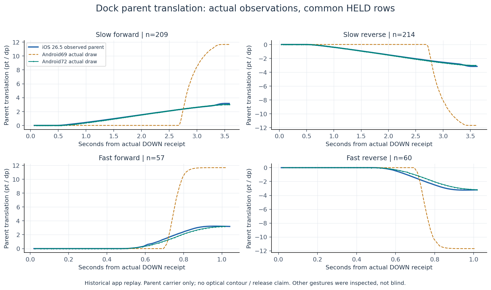

**图3a · 真实父载体轨迹。** 蓝色为 iOS 26.5 公开几何观察，橙色为 Android69，绿色为 Android72；各自以实际 DOWN 接收时间为零点。这里画的是父载体平移，绝不是可见镜片轮廓。

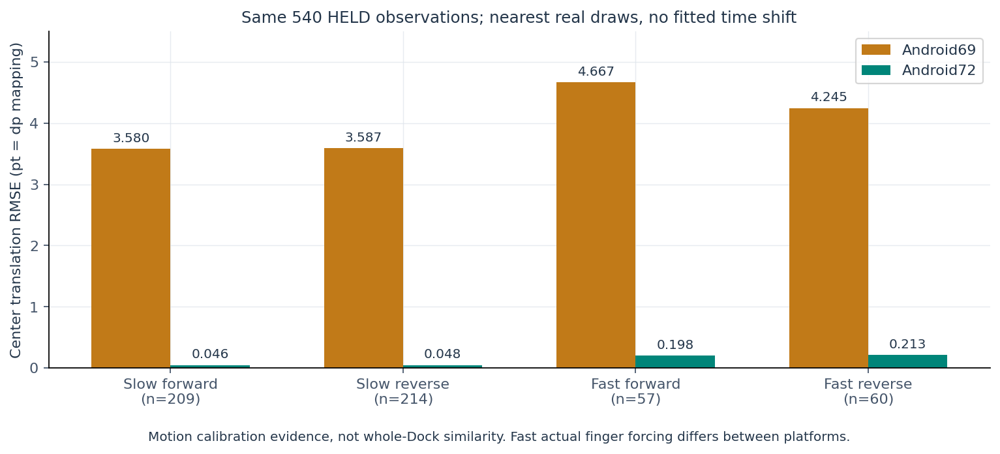

| 手势 | 共同 held 行数 | Android69 RMSE（dp） | Android72 RMSE（dp） | Android72 最大绝对误差（dp） |
| --- | ---: | ---: | ---: | ---: |
| 慢正向 | 209 | 3.579757 | 0.046427 | 0.162079 |
| 慢反向 | 214 | 3.587388 | 0.047706 | 0.153100 |
| 快正向 | 57 | 4.666596 | 0.198231 | 0.390251 |
| 快反向 | 60 | 4.245231 | 0.212943 | 0.423614 |

**图3b · 同行比较。** 两版共同使用 540 条 held 观察，避免换样本制造进步。慢正向用于拟合；其余轨迹曾被查看，属于已观察留出计算，不是盲测。快拖中实际手指输入仍不同，最近绘制相位差可达 25.711 ms；这些行也不是 540 次独立试验。结论限于该四项夹具的父平移，未覆盖释放、取消、打断、其他宽度、共同起落或光学。

### 4.2 菜单：圆角不能只对包围盒

菜单的宽高相同，圆角切线、过渡与可见边缘仍可能明显不同。我们把四个物理角按距外缘的深度逐行比较，并保留不同颜色阈值给出的边界区间。

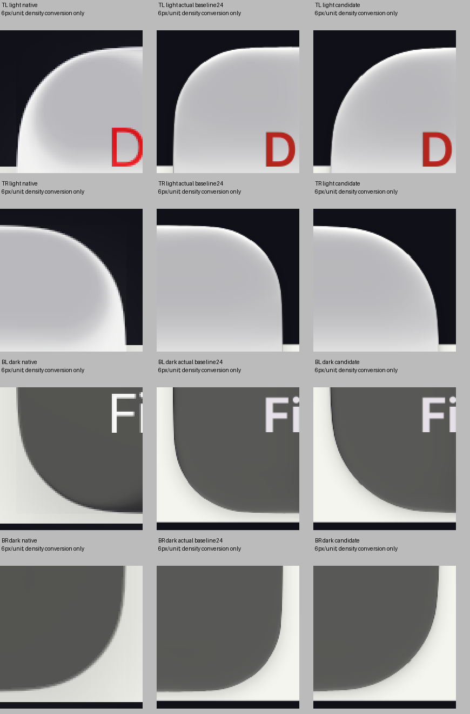

**图4a · 从左到右：原生、Menu24、Menu32。** 图像只做密度换算和拼排，数值来自原像素。图中文字是测试夹具内容；颜色、阴影和高光未被修饰。

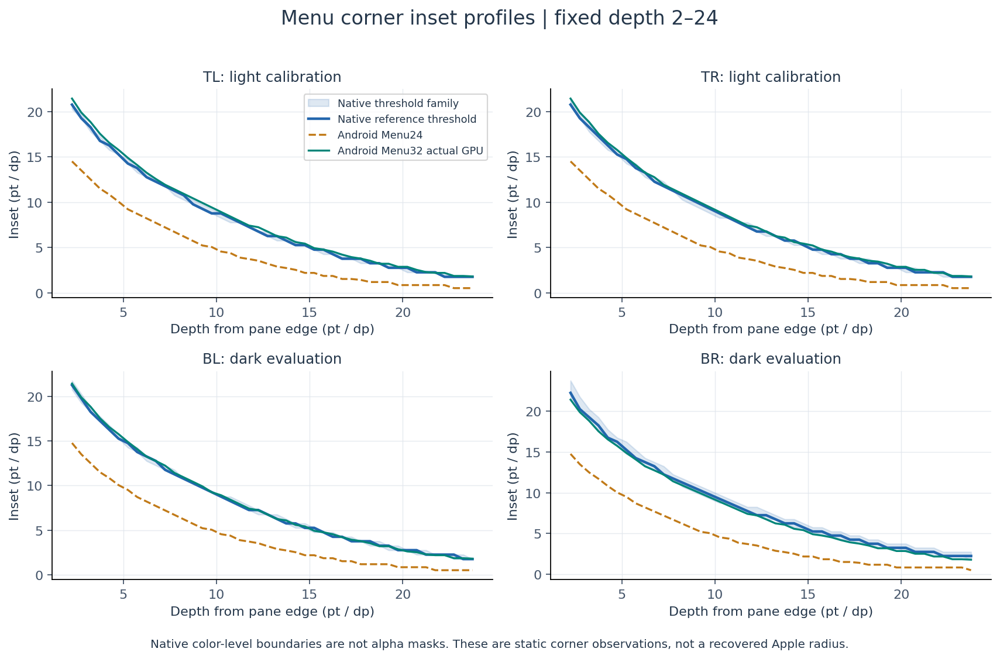

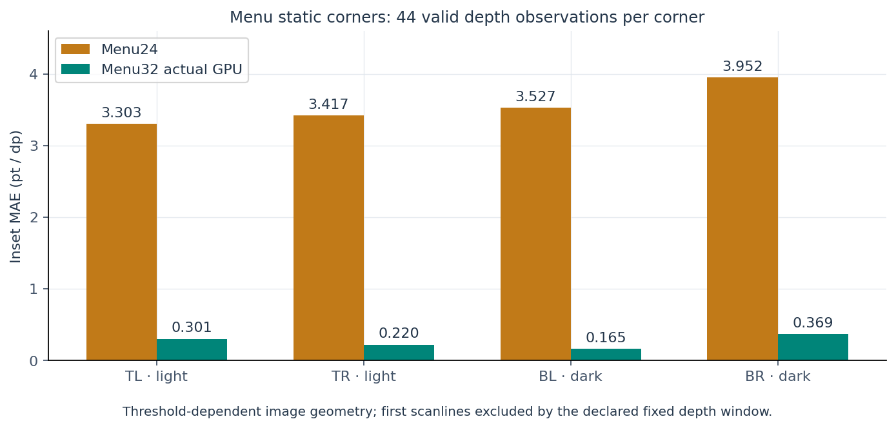

| 物理角与主题 | 每角行数 | Menu24 MAE（dp） | Menu32 MAE（dp） | Menu32 最大绝对误差（dp） |
| --- | ---: | ---: | ---: | ---: |
| 左上 · 浅色 | 44 | 3.303333 | 0.301327 | 0.792016 |
| 右上 · 浅色 | 44 | 3.416969 | 0.220349 | 0.670167 |
| 左下 · 深色 | 44 | 3.526929 | 0.164916 | 0.571428 |
| 右下 · 深色 | 44 | 3.951967 | 0.369175 | 0.829833 |

**图4b–c · 特定阈值的边界改进。** 主窗口为向内 2–24 个逻辑单位；候选由浅色顶部几何选择后，再以冻结规则检查真实 GPU 图。原生测得的是颜色阈值交点，不是 alpha；Android Window 的覆盖值也不是材质不透明度。不同阈值仍给出不同结果，细网格的次级诊断还出现 15.004 dp 最大残差，不能把上表解释为原生精确圆角半径或所有背景通过。Alert 是另一种表面，本结果没有同时修复它。

次级细网格的 [176 行边界数据](docs/evidence/data/menu-secondary-grid.csv)与[原始文件路径、哈希及方法摘要](docs/evidence/data/historical-residual-summary.json)另行保留；其网格/边光/阴影干扰不能混入主验证结论。

### 4.3 单头滑杆：速度形变有独立模型

慢拖与快拖不能只改变同一个缩放动画的播放速度。这里从原生记录中分离等比升起与 X/Y 轴形变，用完整正向慢/快手势训练，保留完整反向慢/快手势，在训练内选定模型后再评估。

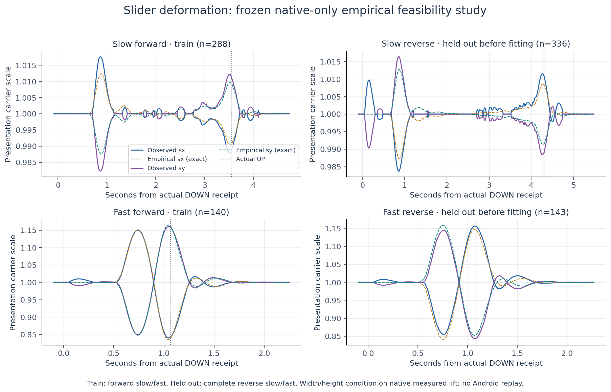

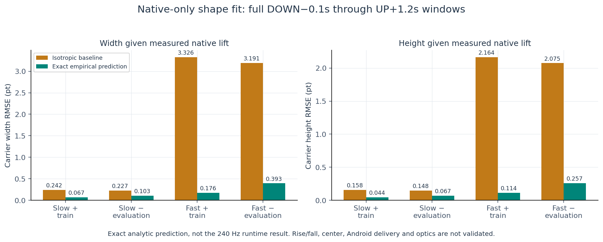

| 手势 / 分组 | 等比基线宽 / 高 RMSE（pt） | 连续经验模型宽 / 高 RMSE（pt） |
| --- | ---: | ---: |
| 慢正向 / 训练 | 0.2418 / 0.1578 | 0.0674 / 0.0441 |
| 慢反向 / 留出 | 0.2269 / 0.1479 | 0.1029 / 0.0668 |
| 快正向 / 训练 | 3.3262 / 2.1642 | 0.1756 / 0.1139 |
| 快反向 / 留出 | 3.1912 / 2.0749 | 0.3933 / 0.2566 |

**图5a–b · Native-only。** 图中模型是已保存的连续解析预测，不是 Android 设备执行，也不是运行库的 240 Hz 数值积分结果。宽高计算以**实测原生 lift**为条件，因此只评估形变，不检验中心位移、起落节奏、透明度或光学。模型阶段存在非唯一参数表达，一项阻尼触及搜索边界；这些数字是经验拟合，不能当作 Apple 内部物理常数。

稳定顶住和松手还要另外测。源码中的单头端部 rubber family 是看过数据后的拟合；即使解释了部分 held 位移，也尚未解释原生约 +8 / −7 pt 的释放峰值。双头滑杆更不能直接继承本组单头结论。

### 4.4 半幅表面：主体均值接近不代表边缘接近

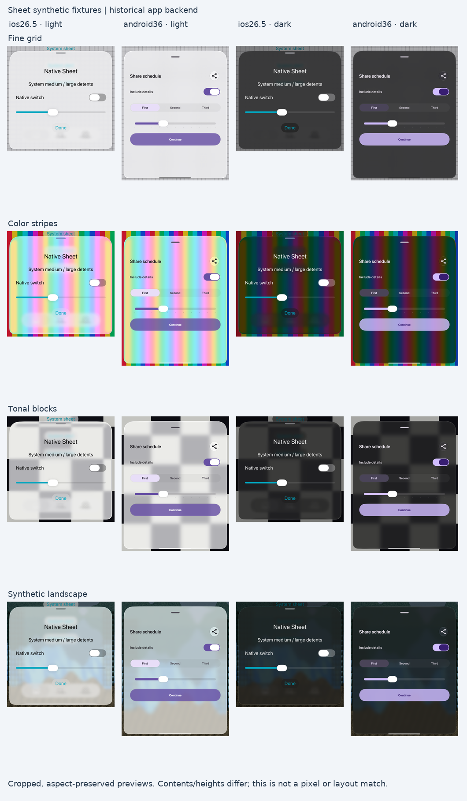

**图6a · 八个背景/主题条件。** 局部图保留各自表面，去除系统栏；不对整块屏幕拉伸配准。历史主体实验明确规定周期图的相位与山景的屏幕 UV，因此其结论限于这些采样规则。

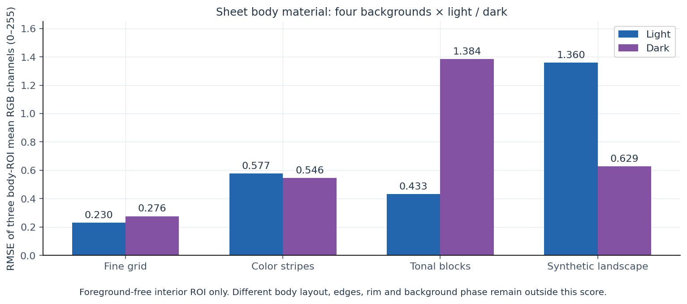

**表 · 主体的两种统计。** 图6b只画左列均值误差；右列是另行保留的历史完整横向 profile 摘要，不是图中的第二组柱。

| 背景 | 无前景主体均值 RGB RMSE：浅 / 深 | 完整横向主体 profile RGB RMSE：浅 / 深 |
| --- | ---: | ---: |
| 细网格 | 0.230 / 0.276 | 0.412 / 0.303 |
| 饱和彩条 | 0.577 / 0.546 | 3.582 / 2.403 |
| 明暗色块 | 0.433 / 1.384 | 1.234 / 1.554 |
| 合成山景 | 1.360 / 0.629 | 1.395 / 0.695 |

**图6b · 单位是 8-bit RGB 通道值。** 图中先对无字形条带取均值，再比较三通道；它不是整个表面的逐像素误差。表中另列的彩条完整 profile 残差较大，均值会掩盖局部结构。

边缘另有明显差距：中性背景 rim3→rim4 调整中，浅色顶部完整边缘 profile RMSE **3.144→3.992，反而变差**；深色四边仍约 **7.759–10.280**。部分背景的两端输入不匹配，也不能全算到材质头上。这些主体结果和残差均来自历史应用 backend，独立仓库还没有完整 Sheet 控件或相同像素的配对验收。

右列 [8 行主体 profile 摘要](docs/evidence/data/sheet-historical-profiles.csv)与 [16 行 rim3/rim4 边缘摘要](docs/evidence/data/sheet-historical-edges.csv)直接取自原有档案。精确来源、SHA-256、窗口和单位见[历史残差来源摘要](docs/evidence/data/historical-residual-summary.json)。公开脚本可检查摘要一致性，不会从原始像素重测这些 profile，也不产生新的设备结果。

### 4.5 滑杆光学：公开仍然存在的折射差距

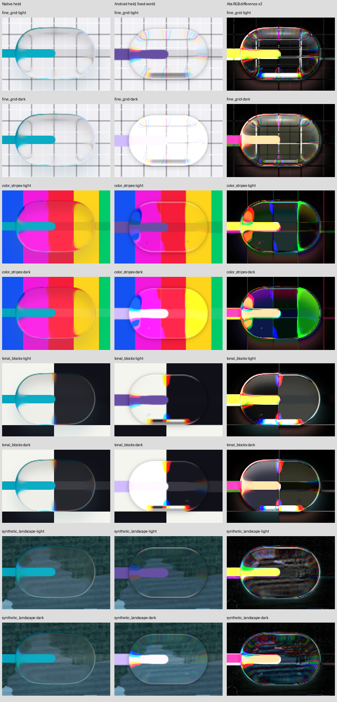

**图7 · Slider72 冻结基线。** 左为原生，中央为 Android held 夹具，右为绝对 RGB 差的 3 倍显示。Android 多出的明亮下沿、局部色带与深色白化可以直接看到。右图包含明显不同的轨道主题色，不能把整幅差图当成镜片材质分数；数值分析排除轨道/光晕和保守的标题源区域。

四背景×浅深主题的指定 lower-inner 窗口，直接 RGB MAE 为 **6.875–23.838**；纯背景对应窗口为 **0.482–1.338**。这说明该记录中的差距不只是纯背景输入误差，但 RGB 差仍不是物理透明度、折射率或色散幅度。该批次早于后续材质修改，是用于解释问题的历史基线，不能标成独立公开库的最终画面。

### 4.5.1 历史滑杆材质检查点：局部 frost 实验

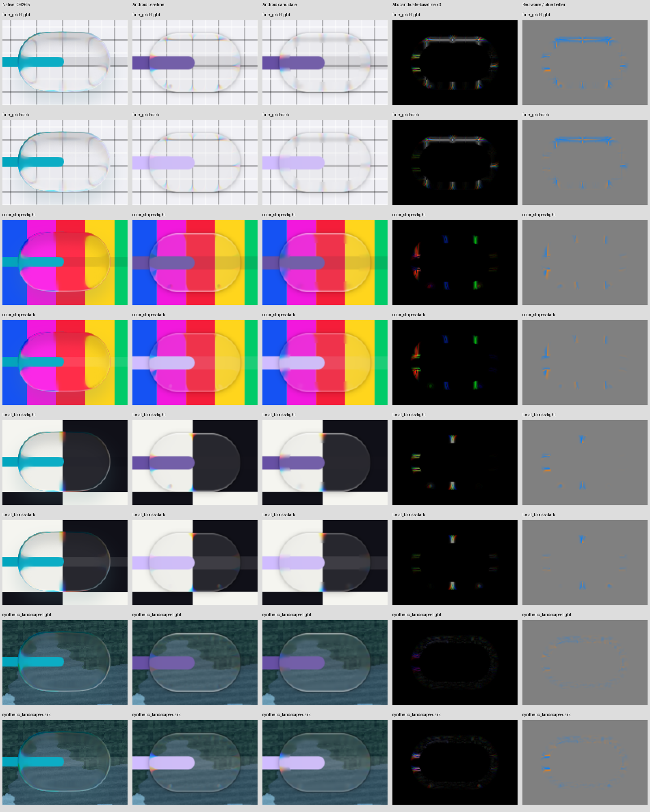

**2026-11-15 · Sleepy 历史应用 backend。** 在 `+2.15 / bevel5.5 / D5W6.5` 的窄色散基线上加入局部总 frost 替换后，112 条重叠区域记录的直接 MAE 为 **68 改善 / 26 退化 / 18 不变**，own-source effect 为 **69 / 25 / 18**。这些数字相对已校准的窄色散臂，不是原始产品基线，也不是独立样本或相似度分数。四背景×浅深主题属于已观察校准条件，不能称为 holdout。

这仍是**有残差、未验收的 checkpoint 实验**。端帽与下缘有退化；平台模糊不能代替中心清晰、边缘放大/折射和最窄外圈色散的源场要求。配图和数据来自历史应用 backend，不能验收公开独立 backend；端点证据仅到 holder/carrier，未覆盖完整升起后可见外缘。[检查点报告](docs/slider-material-checkpoint.md)保留完整区域数据、方法、平台诊断与被否决的 raised-shoulder 反例。

### 4.5.2 当前 r2：单头与双头分开，保留原生差距

**当前仍是未验收检查点。** 单头滑杆的 common refraction 为 **7.8 dp**，二次 shoulder 宽 **7.5 dp**；双头保持 **2.15 dp、无新 shoulder**。旧 frost 报告记录历史比较臂，不能把其中的 2.15 当成当前单头参数。样本是实际应用后端的静态证据，不能验收独立公开后端或动态。


[五角星标定](docs/glass-slider-star-calibration.md)公开实际位移公式及近边采样折返；[六／八角星原冻结验证](docs/glass-slider-holdout-validation.md)保留失败。它们之后已被用作回归数据，不能继续当独立留出。[r3/r4 实验](docs/glass-slider-shoulder-experiments.md)存在多形状退化，均未替代 r2。七角星仍未消费。

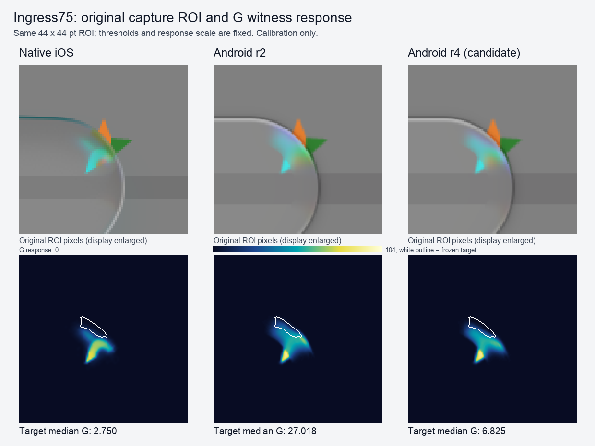

[G-only 诊断](docs/glass-slider-green-witness.md)保留所有四阈值、实际新增错误和 Android opacity 未观测的限制。[第三 G 幅度实测](docs/glass-slider-midpoint-diagnostic.md)继续使用相同多色五角星：四轮几何与重复 control 零漂移；轨道上方仅 full100 红通道五个像素的中点残差超过 1.5 byte，其中三个超过 4、最大 7.5。其余近中点响应不能证明全局线性，异常也不能唯一定位 native 内部非线性。

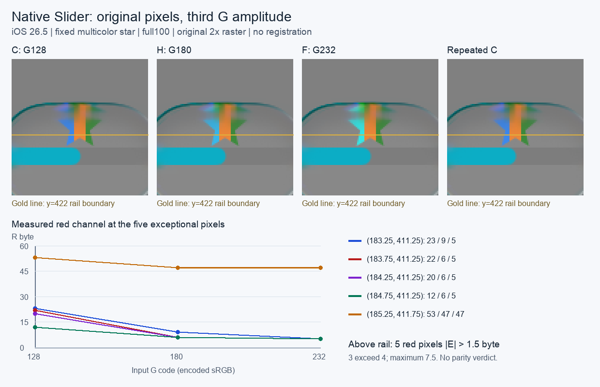

五份既有研究与新增中点小包均使用相对路径、原像素、SHA-256 和本地复现入口；不包含 APK、构建缓存或庞大 trace。它们没有完成 Dock、背板、高光、Toggle 或全动态对齐的验收。

**2026-11-16 · RGB 有限响应诊断。** [八轮原生实测报告](docs/glass-slider-rgb-response-diagnostic.md)公开同一多色五角星的 16 张正式截图、全局／局部 RGB 扰动与六张分析图。记录几何、灰底和前后基线漂移均为零；在预设 T=4 byte 下，共用单一响应比例的模型在完整 ROI 有 49 个不相容像素，含主区域 32 个。T=8 时全部相容，且主区域的输入通道与输出通道模型均相容，不能据此确定原生内部顺序或生产折射参数。便携包可逐像素重放，仍是校准诊断，产品 r2 未改、未验收。

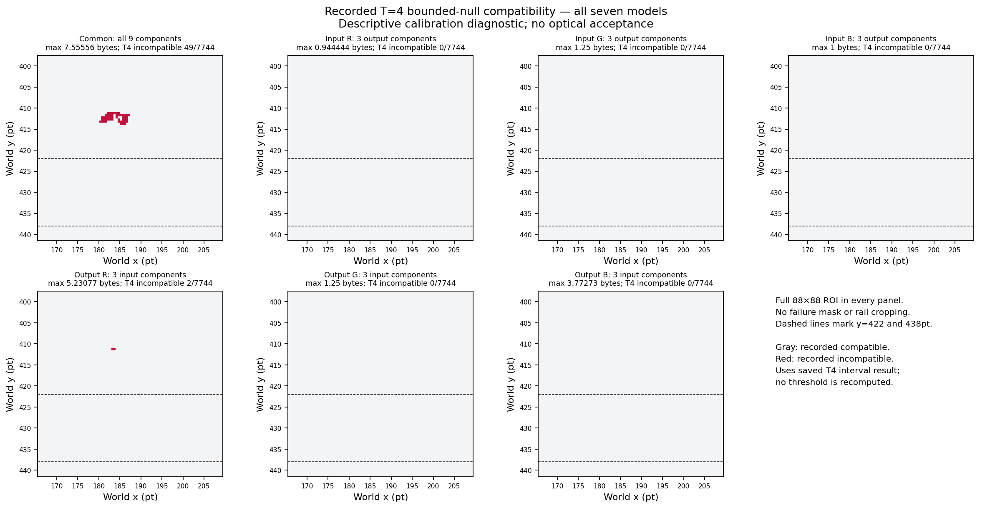

### 4.6 Toggle：升起、填色与回落的原生观察

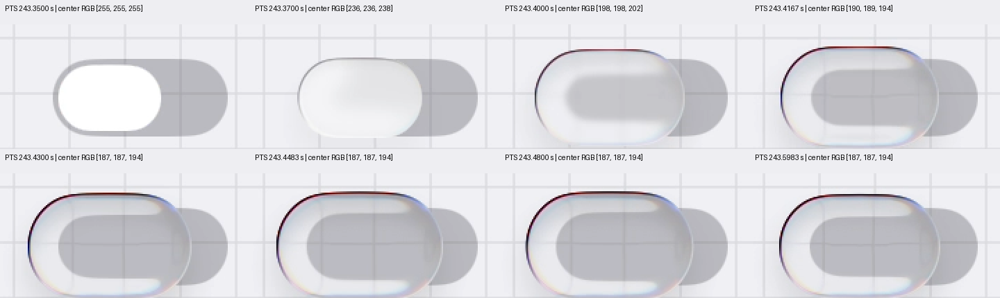

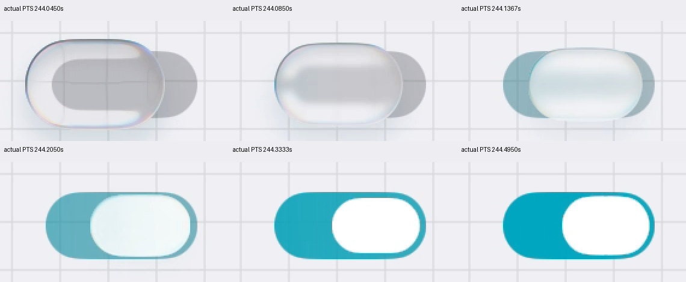

**图8a–b · Native-only 长按→释放。** 关键帧来自真实视频 PTS，不插帧；不能把这段长按过程写成单击轨迹。固定中心小窗口的白色混合代理，在 DOWN 后约 50 / 84 / 100 / 117 ms 为 0.72 / 0.15 / 0.03 / 0.00。它是图像颜色投影，**不是原生层 alpha 或物理透过率**；视频与 trace 约有一帧配准不确定度。释放后镜片移动，固定窗口不能继续衡量其不透明度。

这组记录原生长按与释放时可见的材质交接，不构成 Android 对齐结论，也不覆盖完整单击行为。位置、升起、实心白体淡出、主题填色与回落需分别记录；缺少匹配 Android 像素采证的部分继续保留为待完成项。

### 4.7 Alert / Sheet：边缘亮度预算与尚未解决的折射问题

**2026-11-15 · 应用路径实验。** 本轮先固定面板布局、输入背景、模糊与折射参数，再单独比较 Alert 的边缘补光合成。五列依次为 iOS 26.5、body8、加法补光、screen-only 补光和当前预算归一化候选。图中的固定裁切、亮度曲线、逐像素数据与失败索引见[面板材质报告](docs/panel-material-study.md)。这些截图来自 Sleepy 应用后端，不能用来验收独立公开 backend。

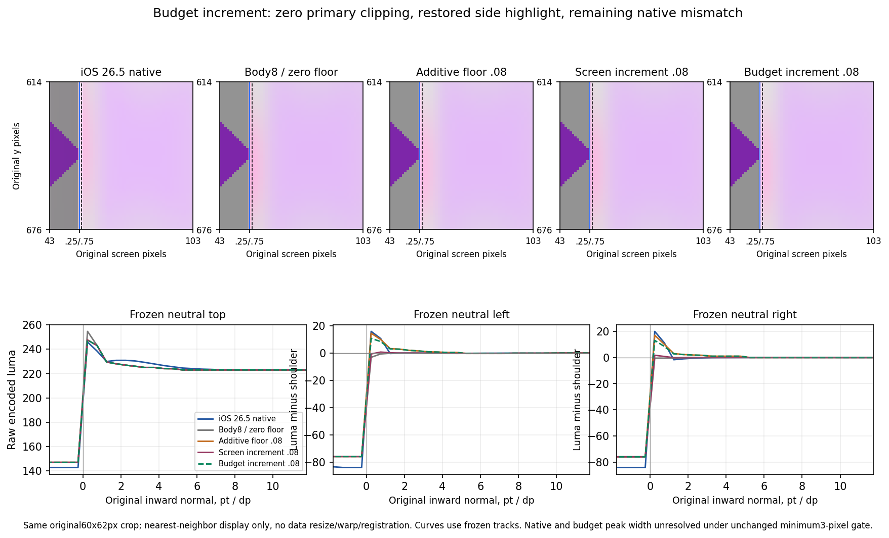

候选按当前颜色距覆盖上限的剩余空间限制额外补光；它没有重新拟合强度或宽度。固定有色侧边的 **124 个原像素**不再出现通道 0/255，原来 124×8×3 个肩部通道值保持不变。中性侧边的原始峰值恢复到距边 **0.25 pt**，但强度仍不足：左 / 右峰减肩部为 **10.854 / 13.082**，原生为 **16.002 / 19.995** 个编码亮度值。峰的半高仅有两个原像素，未达到预先规定的三个像素门槛，**半高宽仍不可分辨**；插值不能补出分辨率。

改善没有覆盖所有指标。相对加法补光，48 条固定新探针角部轨迹的原始 RGB MAE为 **22 改善 / 22 退化 / 4 不变**，一阶 / 二阶导数误差分别在 **39 / 40** 条轨迹上退化。历史风景背景的四条直边 RGB RMSE 全部退化；色块背景有三条退化。中央顶部、深部主体、指定 Sheet10 和深色控制的零变化检查均保留。这里的控制检查只确认改动范围，没有证明 Sheet 已对齐，也没有给出物理厚度、完整折射映射或全面光学改善。

Sheet 本轮应用 API 输入 **12→10** 已完成局部校准分析，不再是“尚未分析”：14 行只有 **1 行**通过原先的局部特征门槛，该行宽度为 **12.324 pt**，原生为 **9.648 pt**，其余 13 行仍失败。12 与 10 分别走共享与局部预模糊路径，因此也不是单一 Gaussian 路径上的纯半径实验。此结果未验收，且没有完成上文新背景集的 Sheet 验证。

为后续追踪源坐标，另外完成了去除触发按钮的[原生 clean-r2 可行性采证](docs/evidence/panels-20261115/archive/analysis-mapping-audit/native-clean-analysis/RESULTS.md)：四对 **750×1334** 全图 REST/repeat 各有 **1,000,500 像素**且 RGBA 差为零，68 项固定源区域比较为零，原生 AX / 公开载体坐标保持不变。原先仅检查 ICC 的冻结总门槛仍为 **false**；补充检查记录全部 16 张截图均有合法 sRGB chunk，而无 iCCP。没有修改旧门槛来制造通过，也没有把完整 before/after 中保留的非零系统上下文差异抹去。

这份旧发布快照中的[成对斜线探针](docs/evidence/panels-20261115/archive/analysis-mapping-audit/paired-slope-feasibility-analysis/README.md)停留在计划、交接 schema 和说明阶段。后续补充已冻结分析器并完成 **69 项合成检查**，但未采集、通过真实成对斜线实验；见下节。clean-r2 的稳定性不能直接变成唯一二维映射、真实模糊支持域、折射参数或厚度结论。完整状态与来源边界见[验证边界](docs/validation-boundaries.md)。


### 4.8 Alert / Sheet：增强横向取样，保留内侧与下缘偏差

**2026-11-15 · 同一历史校准集上的后续应用实验。** Alert / Sheet 的正折射分支加入横向逆采样项，预设系数为 0.45；其他预设仍为零。固定上缘条纹行 y520 的左 / 右表观相位位移从 baseline 的 **0.176 / 0.159 px** 变为 **−14.731 / 13.757 px**，原生为 **−14.394 / 12.928 px**。这行更接近原生；内侧仍有方向不符，下缘也并非一致改善。这不是源坐标追踪、实际厚度或整体相似度测量。

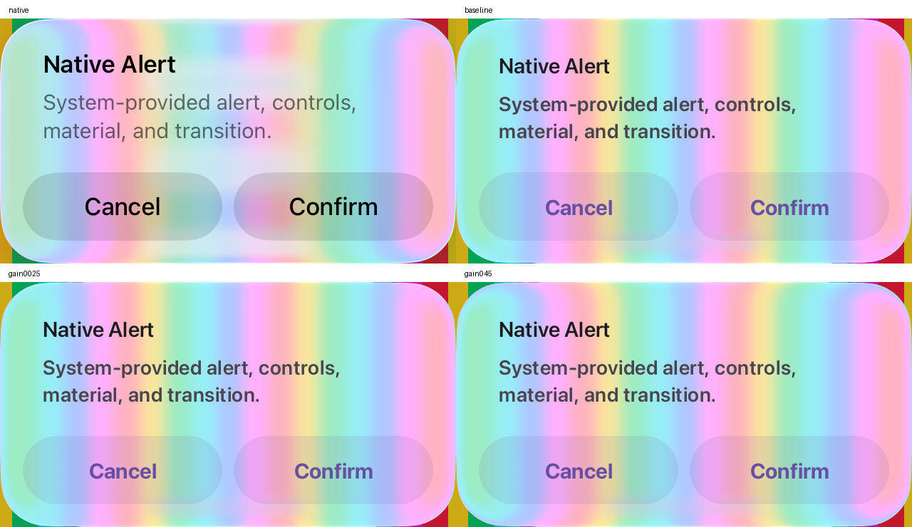

[补充报告](docs/panel-lateral-sampling-study.md)保留冻结条纹诊断的 **8,256 行失败/可用记录**、全部 **80 行**描述性谐波观测、16 个静态面板的组件裁切，以及应用 76 项 JVM、3 项设备按钮、另 18 项按钮/日期选择器回归收据。公开脚本可从保留组件像素复算 80 行；原全屏手机导出与 UI XML 不入库。后续分析器的 69 项合成检查不等于真实成对斜线实验通过。这些应用检查与独立运行库的 56 项检查范围不同，均不构成独立后端光学验收。颜色锐度、最外缘高光、尺寸族与动态仍需分别检验。

## 5. 已知差距与适用范围

本库适合研究、实验界面及愿意参与校准的 Compose 开发者。当前不提供 Maven 发行包、稳定 API 或全设备兼容承诺。

| 范围 | 当前结论 |
| --- | --- |
| 原生整体等效 | 未完成；本文没有逐帧、每毫秒或统一接近度结论 |
| Toggle 点击与长按动态 | 已公开帧只覆盖原生长按→释放；普通点击与 Android 自然时序/像素对照仍待验收，sample 不能代替生产控件 |
| 快速分段切换 | 部分历史中心误差比早期版本更大，需保留并继续查时钟和模型 |
| 单头端部 | held 位移有回顾拟合；约 +8 / −7 pt 的原生释放峰值未由该模型解释 |
| 双头动态 | 缺少独立、完整速度和释放验证；不能把单头数据直接算作双头结果 |
| Dock 材质 | 已有非线性边缘改进；历史光度残差与前景适应问题仍须按源码阶段解释，没有全面定量验收或测量意义上的接近百分比 |
| Alert / Sheet 材质 | 补光候选修复特定侧边 clipping；角部导数、背景依赖、近边折射与不同尺寸仍未验收 |
| 嵌套与变换 | 调用方必须管理直接背板与外部源；公开 backend 无 app 定制 transform compensation |
| 性能 | 有定向帧与采样观察，没有覆盖各设备的产品流畅度、显存或功耗基准 |
| 低版本 | `minSdk 26` 是声明范围；API 26–30 没有这里的 RenderEffect 模糊链，不代表具有完整玻璃效果 |

特别是 Dock：原生受控亮度往返序列显示，同一输入亮度可因之前的路径不同而出现不同输出。单纯一条无记忆亮度曲线不能解释这组观察。运行库提供可配置迟滞与前景原语，**并未公开一个已经恢复的 iOS 内部分类算法**。

## 6. 构建、集成与复现

### 6.1 运行独立示例

仓库当前固定 JDK 17 目标、Android SDK 37、Gradle 9.8.2、Kotlin 2.4.21、Compose 1.12.1 与 Material3 1.5.0-rc01。它们是本源码快照的配置，不表示对这些工具的最新版推荐。将 SDK 位置写入未入库的 `local.properties`，或设置 `ANDROID_HOME`。

```sh
./gradlew :runtime:assemble :runtime:testAndroidHostTest :sample:assembleDebug
./gradlew :sample:installDebug
```

应用名为 **Sleepy Glass Lab**。按 Background 切换背景，按 Dark / Light 切换主题，点击下方镜片观察运动。该示例不联网、不写课表数据，也不提供全部控件展示。

### 6.2 在 Compose 项目中使用

将 `runtime` 与 `backdrop` 作为源码模块加入项目，在消费模块声明：

```kotlin
dependencies {
    implementation(project(":runtime"))
}
```

实际集成示例见 [MainActivity.kt](sample/src/main/java/com/lingion/liquidglass/sample/MainActivity.kt)：先录制外部场景，再用 `drawPlainBackdrop` 消费材质，把前景绘制放在消费者之上。历史兼容包名暂保留 `com.lingion.sleepy.ui.component.liquidglass`。

API 33+ 使用 RuntimeShader；API 31–32 可使用 RenderEffect 模糊/鲜艳度路径；API 26–30 对应 effect 分支直接返回，保留源绘制。最低 SDK 声明不等于这些路径已在每个设备上验收。

### 6.3 重画图表与检查证据

图表使用 Matplotlib / Pillow 生成，提供窄数据表与处理记录，不需要构建 Android 或重跑设备采证矩阵。命令与依赖见[证据目录](docs/evidence/RESULTS.md)。数值图应能从入库数据重画；截图拼图的原始全量私有资料不随库发布，清单保留裁切、缩放与哈希，不把未包含的原图说成可独立恢复。

当前[运行库清单](provenance/runtime-import.json)将 38 个文件绑定到范围纠正后的 Sleepy `5f3ea867ed173520c80515c5482263efe1c21433`；[来源纠正记录](provenance/scope-cleanup-20261116.json)保留逐文件字节一致检查和实际重新执行的应用测试。历史 `386d4c09a78234c4bc04507f6ef4952d856de3f4` 阶段同样导入 28 份生产 Kotlin、一个 shader、7 份测试和 2 份资源；该阶段独立 `runtime:assemble`、56 项 host 检查及 `sample:assembleDebug` 通过，7 类测试零失败、错误或跳过。[历史验证凭据](provenance/validation-20261115-lateral.json)仍绑定当时清单，不冒称新 HEAD 的重新执行。更早 `ddbf20e` 同步的[旧凭据](provenance/validation-20261115.json)只绑定[横向取样前清单](provenance/runtime-import-20261115-pre-lateral.json)。两次构建都没有新独立 sample 真机光学验收。初版 38 项检查与 API 36 真机记录仍保留 2026-11-14 范围，见 [VALIDATION.md](VALIDATION.md)。

## 7. 贡献与接下来的工作

欢迎提交包含**控件、输入、背景、主题、系统/API、预期与实际结果**的最小问题。修复应区分数值/回调回归、真实载体运动、可见轮廓和光学；每项都能单独形成小 PR，不要求贡献者运行长时间的全矩阵。

当前先完成 Alert / Sheet 的静态材质与源坐标可辨识性工作，保留 Dock 已有改进，再核查原生尺寸能力，分阶段补齐各控件的完整适配与配对验证。新动态 v4 仍是未冻结、未采集的计划：分别登记真实本体尺寸、布局与内容，记录每项完整动作从输入前到回稳的所有实际帧及全部组件实例。原生不支持的尺寸必须如实保留限制，不能缩放控件或截图伪造支持。现有历史运动子集不算这项覆盖完成，协议检查通过也不等于动态验收。准入与检查命令见 [CONTRIBUTING.md](CONTRIBUTING.md)。

## 8. 许可、来源与引用

本库按 **GNU GPL v3** 分发。第三方部分保留各自原许可与署名，见 [LICENSE](LICENSE)、[NOTICE.md](NOTICE.md) 和 `third-party/notices`；并非全部原创实现。iOS 26.5 只作为行为与外观参考，本项目与 Apple 没有隶属关系，也不包含 Apple 控件的实现代码。

| 来源 | 具体使用范围 | 固定记录 |
| --- | --- | --- |
| Sleepy | 运行模块的直接来源，保留历史包名 | [导入文件及哈希](provenance/runtime-import.json) |
| FLClash / chen08209 | Shader、光学、样式及部分运动/几何的 Kotlin / AGSL 移植；GPL-3.0 | [NOTICE](NOTICE.md) |
| Flutter | 圆角超椭圆与弹簧物理的 Kotlin 适配；BSD-3-Clause | [来源、版本与哈希](provenance/flutter-sources.json) |
| Kyant0 / AndroidLiquidGlass | 官方 2.0.0 backdrop；Apache-2.0，含四份最小适配 | [固定提交与文件清单](provenance/backdrop-baseline.json) |

Flutter engine 的 2013 notice 与 framework 的 [2014 notice](third-party/notices/Flutter-Framework-BSD-3-Clause.txt) 分别保留。导入注释中的历史 notice 路径与本仓库路径映射见 [NOTICE.md](NOTICE.md#imported-notice-paths)；这些源码路径不表示 AAR/APK 自动打包了 notice。

文中原生参考图来自项目自编测试程序的实验捕获，仅发布无个人内容的合成背景与局部控件对照，并记录处理与来源。完整设备录像、用户页面和账号资料不公开。引用结果时请同时给出仓库 commit、图表编号与证据记录，保留其校准/验证范围，勿将局部结果转述为完整 iOS 等效。
