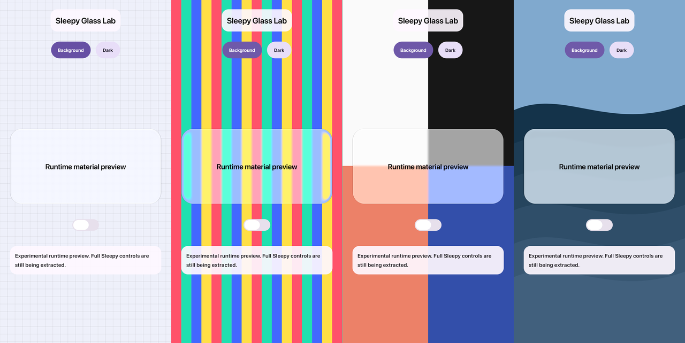
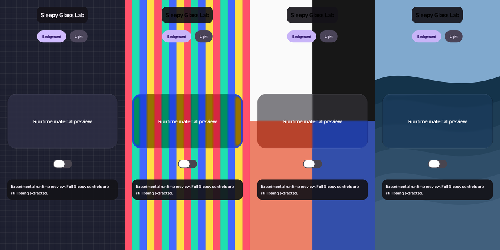

# Sleepy Liquid Glass

Android / Jetpack Compose 的实验性液态玻璃运行库，来自 Sleepy 的运动、几何和渲染实现，以 iOS 26.5 原生外观和交互为校准参考。当前开放代码供共同开发，**尚未达到完整原生等效，也没有 99.99% 接近度或每毫秒一致的验收结论**。

当前包含 26 份运行源码、AGSL 材质、输入帧调度、各类运动参数、轮廓与圆角、外部背板采样、分层预处理和一个可独立运行的 Android 示例。完整 Toggle、Tab、Dock、单双头滑杆、菜单及应用主题适配仍在从 Sleepy 提取；示例中的开关形状用于展示运行原语，不是完整生产控件，也不代表其光学已经验收。包名暂保留兼容的 `com.lingion.sleepy.ui.component.liquidglass`。

## 示例画面

以下为 **Sleepy Glass Lab sample** 的真实 API 36 截图，来自 A98 `standalone-publication-98`，仅裁去系统栏并缩放拼排。每行从左到右依次为细网格、彩条、明暗色块和合成山景；不含课表、照片等用户数据。



浅色主题，展示同一材质在不同空间频率、色彩和对比度背景上的表现。



深色主题；网格一格采用 A98 最后的标题修正截图，其余保留原背景矩阵采证画面。这些是运行原语的静态示例，**不是完整控件展示，也不证明 iOS 26.5 的逐帧、运动或 1:1 光学等效**。原图文件名、哈希、裁切范围和输出尺寸见 [图片来源记录](docs/images/sources.json)。

## 构建与运行

需要 JDK 17+、Android SDK 37、Gradle 9.8.2；Compose 1.12.1、Material3 1.5.0-rc01、Kotlin 2.4.21。将本机 SDK 位置放入未入库的 `local.properties`，或设置 `ANDROID_HOME`。

```sh
./gradlew :runtime:assemble :runtime:testAndroidHostTest :sample:assembleDebug
./gradlew :sample:installDebug
```

应用名称为 **Sleepy Glass Lab**。示例提供细网格、彩条、明暗色块和合成山景四种背景、浅深主题、静止材质和按压运动预览。背景都是本地绘制，不读取照片、不联网、不写入课表数据。

在自己的多模块项目中使用 `runtime` 与 `backdrop` 源码模块：

```kotlin
dependencies {
    implementation(project(":runtime"))
}
```

`sample/src/main/java/com/lingion/liquidglass/sample/MainActivity.kt` 展示外部场景录制、材质消费和输入驱动。场景源必须排除消费者自身和前景；嵌套玻璃需要显式包含直接背板，不能跳过背板或回采自身。Material 路由、主题选择、文案和数据持久化由调用方负责。

## 支持范围与现有差距

模块声明 minSdk 26；RuntimeShader 需要 API 33，低版本走现有模糊/鲜艳度降级。声明的最低 SDK 不等于已完成全设备验收。材质、轮廓、透明度、不同加速度和端部回弹需要分项校准；示例运行和单测通过不能代替原生逐帧或多背景验收。

本仓库的 backdrop 从 Kyant **官方 2.0.0** 固定提交开始，保留原始来源和最小局部适配，不包含 Sleepy 中由 SleepDown 导入的定制 fork。它仅提供常规局部 pane、独立 GPU 预处理和已录制源 revision；不提供该 fork 的固定 bounds、降采样、共享 blur、冻结缓存、viewport 裁剪或 transform compensation。不能把 Sleepy 原有 GPU 测量直接当成此独立后端的等效证明。

本仓库只发布源码；尚未发布 Maven 包、正式版本或兼容性承诺。欢迎在 Issue 中附上设备/API、背景、真实操作和可复现样例。提交前运行上面的定向构建与 host 测试；设备光学/视频采证按需进行，不要求贡献者运行长时间全矩阵。

## 许可与来源

本库按 GNU GPL v3 分发；原始第三方部分继续保留各自许可与署名，见 [LICENSE](LICENSE)、[NOTICE.md](NOTICE.md) 及 `third-party/notices`。这不是全部原创实现，也不是 Apple 官方代码或官方组件。

- Sleepy：运行模块的直接来源，保留历史兼容包名；[运行文件导入清单](provenance/runtime-import.json)。
- FLClash（chen08209）：液态玻璃着色器、光学、样式与部分运动/几何的 Kotlin / AGSL 移植，GPL-3.0。
- Flutter：圆角超椭圆算法与弹簧物理的 Kotlin 适配，BSD-3-Clause。分别保留 engine 的 2013 notice 与 framework 的 [2014 notice](third-party/notices/Flutter-Framework-BSD-3-Clause.txt)；[固定来源、许可与哈希](provenance/flutter-sources.json)。
- Kyant0 / AndroidLiquidGlass：官方 backdrop 2.0.0，Apache-2.0；[原始文件与固定提交](provenance/backdrop-baseline.json)。在四份官方源码上新增的适配有独立修改说明，原始部分的 Apache 许可保持。

导入的 runtime 文件保留原字节。源码注释中的历史 `assets/third_party/notices/Flutter-BSD-3-Clause.txt` 对应本库的 [third-party/notices/Flutter-BSD-3-Clause.txt](third-party/notices/Flutter-BSD-3-Clause.txt)；原应用 `app/src/main/assets/third_party/notices/` 下的同名声明统一对应本库 `third-party/notices/`。AGSL 注释中的 `third-party/notices/FLClash-GPL-3.0.txt` 路径仍直接有效。完整映射见 [NOTICE.md](NOTICE.md#imported-notice-paths)。这些是源码发行中的文档路径，不表示 AAR 或示例 APK 已自动打包 notice。

iOS 26.5 是行为参考；本仓库不打包 Apple 的实现、截图或设备录像。数值回归资源保留其测量用途和测试范围。
