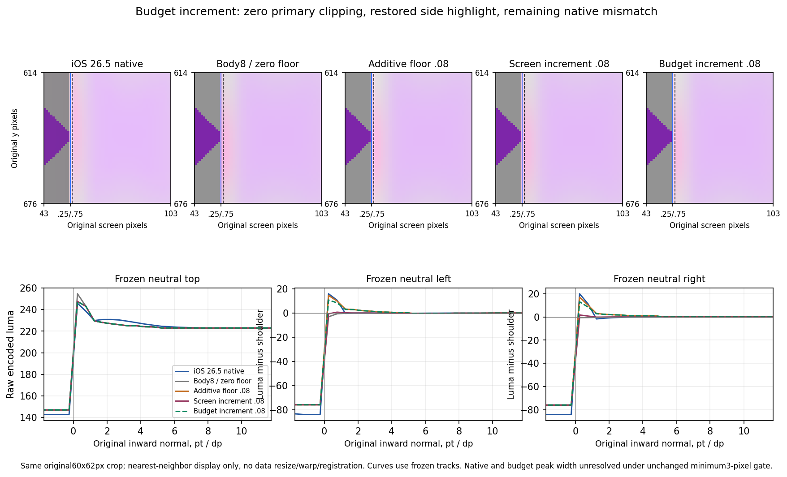

# Experimental source and evidence validation

The [controlled optical study index](docs/controlled-optical-studies.md) links related research assets and their individual stage boundaries. A prepared input or protocol does not inherit the build, capture or analyzer results recorded here.

## Runtime sync and independent build — 2026-11-15

The current [runtime manifest](provenance/runtime-import.json) imports 38 files byte-for-byte from Sleepy commit `ddbf20e63ea39b4b202531fe427b0d5f548fe60b`: 28 production Kotlin files, one AGSL shader, seven host-test files and two resources. The [previous manifest](provenance/runtime-import-20261114.json) retains the original source identity. The independent public backend retains its four locally adapted official-baseline files; it does not copy the application's custom backend.

```sh
./gradlew :runtime:assemble :runtime:testAndroidHostTest :sample:assembleDebug --console=plain --max-workers=2
```

The command completed successfully. Seven host-test classes ran **56 tests, zero failures, errors or skips**. The [machine-readable receipt](provenance/validation-20261115.json) records exit code 0, the imported-manifest SHA-256 and the independently adapted backend source hashes. Its recording allocation uses `ceil(size + 2 × padding)`, and its final draw exactly cancels floating-point recording padding rather than truncating it to an integer layer offset. The command was rerun after both geometry corrections. These checks cover numerical / source behavior and assembly. **No new independent-sample device optical acceptance was performed for this sync.** Application screenshots below cannot supply that missing public-backend validation.

## Initial publication — 2026-11-14

Validated on 2026-11-14 before initial public publication:

- JDK 17 target, Android SDK 37, installed Gradle 9.8.2, no project-local SDK paths committed.
- `:runtime:assemble :runtime:testAndroidHostTest :sample:assembleDebug`: passed.
- Runtime host tests: 38 tests across five classes, zero failures/errors. These cover numerical motion endpoints, parent motion, foreground selection and hysteresis; they do not prove complete visual parity.
- Sample APK installed and launched on a physical PKX110 / Android API 36. Host and installed APK SHA-256 matched. Four synthetic backgrounds (grid, saturated stripes, contrasting blocks, layered hills) were inspected in light and dark themes, with direct and held motion input. The pane visibly responds to the recorded background. A dark-theme title contrast issue found during inspection was fixed and the sample rebuilt.
- Imported runtime manifest: all 34 source/resource hashes match the recorded Sleepy commit. Official backdrop baseline: 30 of 34 files unmodified; four locally documented adaptations.
- At initial publication, the source scan excluded credentials, developer-local paths, build outputs, APKs and raw device captures. The later research report adds explicitly documented synthetic-fixture control crops; see `docs/evidence/sources.json`.

The initial build exposed and corrected a graphics-layer CompositingStrategy import in the independent backend. The app still uses its separate existing backend. No iOS native equivalence, every-frame timing match, full production-control extraction, API 26 device acceptance, package release or Maven distribution is claimed.

No hosted workflow is configured for this initial source publication. Contributors can run the focused commands in README and CONTRIBUTING; a successful source build is separate from device optics acceptance.

## Research status update — 2026-11-14


The initial checks above remain historical build/sample validation. They do not validate subsequent material candidates. The earlier four backgrounds × light/dark optical matrix is entirely **calibration**, because those images were inspected and used in candidate selection.

The `bevel 20→6` candidate was contradicted by subsequent matched-background iOS 26.5 cap observations and has been **withdrawn**. Its [mechanical GPU report](docs/edge-profile-update.md) is retained as a rejected experiment; unchanged center pixels and an altered edge do not establish a better native match. At this historical checkpoint Sleepy's frozen production-path Dock candidate used actual `D=46.5pt / b=15.5pt`, with remaining photometric, outer-edge and direction-dependent differences. That application candidate does not automatically validate the public backend or identify all later source revisions.

Fixed-size four-item Dock REST photometry on eight preregistered synthetic inputs is complete, with the 12 engineering-review cells retained and no accepted candidate or aggregate score. Independent transport/topology review and Sheet validation on that new-background set remain outstanding; the later panel calibration is a separate study. These studies do not cover natural photographs, size families, interactions, acceleration or elastic release. Requested themes, depth bands, correlated pixels and REST repeats are not independent trials. No 99.99% or every-millisecond equivalence is claimed. The new multi-size, complete-action, all-actual-frame dynamic v4 study is still a draft; protocol consistency checks are not native sizing, collector, tracker, or dynamic acceptance. [Validation boundaries](docs/validation-boundaries.md) records the freeze identities and limitations; no unfinished holdout results have been promoted to a published score.

## Panel materials and clean-fixture feasibility — 2026-11-15



The [panel material study](docs/panel-material-study.md) retains its original frozen regions and comparisons. The budget increment removes 0/255 clipping at the specified 124 colored-side pixels and restores a visible neutral-side peak, while retaining substantial native contrast deficits and corner-derivative regressions. Against additive, 48 new corner tracks give 22/22/4 improved/regressed/unchanged raw-MAE results; D1 and D2 regress on 39 and 40 tracks. Existing body, central-top, dark and specified Sheet controls are unchanged. This is a bounded composition result, not complete Alert / Sheet acceptance or a thickness / refraction measurement.

Sheet API-input 12→10 local analysis is complete but unaccepted: one of 14 original rows is eligible and has apparent width 12.324pt versus native 9.648pt; 13 retain secondary-peak failures. Its shared-to-local preblur routing change stays explicit. This calibration is not completion or acceptance of the historical new-background Sheet validation.

The separate native clean-r2 analyzer completed, but its frozen overall result remains **false** under its original ICC-availability gate. Four full REST/repeat pairs have exactly zero decoded RGBA difference; 68 fixed source-footprint comparisons are exact, and public / AX geometry is unchanged. Supplemental PNG inspection records a valid sRGB chunk in all 16 native screenshots, without an iCCP chunk. That supplement does not retrospectively replace the original gate. Full before/after system-context differences are retained separately.

The proposed paired-slope stage has a frozen prospective plan, capture-handoff schema and README only: **uncollected, analysis not implemented, unexecuted, not passed**. Neither clean-fixture stability nor a valid future handoff schema establishes optical identifiability, a unique 2D source map, actual native blur support, physical thickness or parity. These application/native-fixture records remain separate from the independent build validation at the top of this file.
