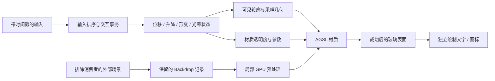

# 运行库架构与集成边界

本文说明当前仓库实际提供的实现。它把触摸事件、运动状态、可见轮廓和背景光学分开处理：一个状态可以驱动多个视觉量，但任何一项的测量通过都不能替代其他项的验收。`Native` 前缀表示以原生观测作经验校准，不表示调用 Apple 实现或取得原生内部参数。

[当前证据与图片索引 · 2026-11-16](current-evidence-20261116.md)区分运行库 sample、历史应用截图、已执行模型回放和仅编译的研究入口；本页 API 说明以仓库源码为准。

## 1. 模块与数据流

| 模块 | 输入与职责 | 输出与边界 |
| --- | --- | --- |
| [`backdrop`](../backdrop/src/commonMain/kotlin/com/kyant/backdrop) | 保留外部 Compose 场景的绘制记录；把源坐标映射到消费 pane；装配 GPU effect、裁切、高光和阴影 | 提供可被重复绘制的 `Backdrop`；不识别 Toggle、Tab 或课表业务 |
| [`runtime`](../runtime/src/androidMain/kotlin/com/lingion/sleepy/ui/component/liquidglass) | 输入排序、运动状态、轮廓几何、材质参数、AGSL 装配和背景响应 | 提供运动及渲染原语；完整控件的指针分发、语义、布局和主题路由仍须适配 |
| [`sample`](../sample/src/main/java/com/lingion/liquidglass/sample/MainActivity.kt) | 本地合成四种背景、浅深主题和按压输入 | 展示静态 pane 与开关外形的运动预览；不是完整 Toggle、Tab、Dock 或滑杆组件集 |



这里有两条独立链路。运动链路回答“此刻玻璃在哪里、升起多少、向哪个方向拉伸”；采样链路回答“这块玻璃应当看到哪一层背景”。修改弹簧系数无法修复采错背板，降低不透明度也无法修复不正确的圆角。

## 2. 场景录制与嵌套玻璃

[`rememberLayerBackdrop` 与 `layerBackdrop`](../backdrop/src/commonMain/kotlin/com/kyant/backdrop/backdrops/LayerBackdrop.kt) 将源内容保留到 `GraphicsLayer`。消费者通过 [`drawPlainBackdrop`](../backdrop/src/commonMain/kotlin/com/kyant/backdrop/DrawBackdropModifier.kt) 绘制它，并由 `effects` 提供材质。源与消费者必须分离；把玻璃、图标及其自适应填色一起录进自身背景会形成反馈，造成重复模糊、颜色污染或持续重绘。

一个静态 pane 的最小结构如下。完整可运行入口见 [sample](../sample/src/main/java/com/lingion/liquidglass/sample/MainActivity.kt)；示例使用当前仓库已有 API，不要求应用定制的后端扩展。

```kotlin
val scene = rememberLayerBackdrop()
val context = LocalContext.current
val style = LiquidGlassStyle.regular(MaterialTheme.colorScheme, dark)

Box {
    Canvas(Modifier.matchParentSize().layerBackdrop(scene)) {
        // 只画外部背景；不画下方 pane 或它的文字。
        drawRect(backgroundColor)
    }
    Box(
        Modifier.size(240.dp, 120.dp).drawPlainBackdrop(
            backdrop = scene,
            shape = { RoundedCornerShape(28.dp) },
            effects = { liquidGlass(context, style) },
        ),
    ) {
        // 前景位于材质之后，不回采进 scene。
        Text("Glass surface")
    }
}
```

嵌套关系应明确为“场景 → 父背板 → 子控件”，子控件需要看到已经合成的父背板。若它仍直接消费原场景，就会穿过父磨砂层。[`drawPlainBackdrop` 的 `exportedBackdrop`](../backdrop/src/commonMain/kotlin/com/kyant/backdrop/DrawBackdropModifier.kt) 可以导出父 pane 的 `onDrawBehind`、材质、`onDrawSurface` 与 `onDrawFront`；源码有意不把 `drawContent()` 加入导出记录。这里的 `onDrawFront` 是导出表面的一部分，因此不要用它绘制不应被子玻璃采到的文字或徽标。普通前景应留在内容层。

[`rememberCombinedBackdrop`](../backdrop/src/commonMain/kotlin/com/kyant/backdrop/backdrops/CombinedBackdrop.kt) 按参数顺序绘制多个源，它不分析遮挡关系，也不自动扣除重复区域。父 pane 的导出表面已经含有其背景；再次叠加整张相同场景之前，应检查透明区域和合成范围，避免背景被重复叠色。弹窗、局部 pane 和滚动容器均须核对其实际坐标及裁切。

`LayerBackdrop.recordingRevision` 只表示一次显示列表录制已完成，**不是屏幕呈现时间、GPU fence 或新帧已显示的证明**。[`BackdropContentSignal`](../runtime/src/androidMain/kotlin/com/lingion/sleepy/ui/component/liquidglass/BackdropContentSignal.kt) 可由独立保留的源叶节点显式通知后续采样；它不会侦测任意子树变化，也不能由消费者自己的重绘触发。

当前官方基线后端会处理局部位置及传入 `layerBlock` 的逆变换，但不提供应用 fork 的 `withTransformCompensation()`。导入源码中的历史注释提到该适配器，不代表本仓库提供同名 API。相对旋转、缩放以及跨窗口定位需要调用方明确处理并采证；不要把仅平移下的正确结果外推到这些情况。

本轮为运行层显式补齐记录元数据：[`BackdropEffectScope`](../backdrop/src/commonMain/kotlin/com/kyant/backdrop/BackdropEffectScope.kt) 的 `captureSize` 在独立后端返回 `size`，`captureAllocationPadding` 返回 `null`。它们描述此后端实际使用的完整局部源与默认 padding，没有引入应用 fork 的 bounded capture、固定分配或 viewport 裁剪。消费方应使用自己的真实记录尺寸与源原点，不能把应用夹具的数值直接复制到独立后端。

分数像素也属于这个接口契约。独立 [`DrawBackdropModifier`](../backdrop/src/commonMain/kotlin/com/kyant/backdrop/DrawBackdropModifier.kt) 按每轴 `ceil(size + 2 × padding)` 分配完整记录栅格，与运行层输入几何保持一致；实际画布原点仍平移浮点 `padding`。不能先分别截断尺寸和 padding，再把结果当作同一栅格。该调整仍位于原有四份适配文件内，不引入应用的固定分配策略。

## 3. 输入、运动与形变

### 3.1 时间与交互事务

[`DockInputClock`](../runtime/src/androidMain/kotlin/com/lingion/sleepy/ui/component/liquidglass/DockInputClock.kt) 同时保留事件接收的纳秒时间与可选硬件样本 uptime。接收时间约束事件最早何时能影响应用；旧硬件样本不能让新到达的命令追溯到已经呈现的过去。一次 press 在首个符合条件的 frame 原子生效，其后的命令保持队列顺序。

[`runTimestampedActiveFrameLoop`](../runtime/src/androidMain/kotlin/com/lingion/sleepy/ui/component/liquidglass/ActiveFrameLoop.kt) 仅在仍有输入或运动时请求动画帧，静止后等待状态变化，唤醒时建立新基准，不补算休眠期间的动画。其 delta 兼容包装 `runActiveFrameLoop` 把非首帧步长限制到 1–50 ms；这与时间戳版本应分开理解，不能据此声称真实屏幕每 1 ms 有一次采样。

[`TimedGlassControlMotion`](../runtime/src/androidMain/kotlin/com/lingion/sleepy/ui/component/liquidglass/GlassControlMotion.kt) 通过 epoch 区分 press、drag、release 和 cancel，过滤旧事务的尾事件，并把受控值同步与用户激活分开。Compose 的 `rememberTimedGlassControlMotion` 接入输入时间源和 `MotionDurationScale`；动画关闭时完成当前事务，而非继续隐藏的弹簧运动。

### 3.2 位移与升降

[`GlassControlMotion`](../runtime/src/androidMain/kotlin/com/lingion/sleepy/ui/component/liquidglass/GlassControlMotion.kt) 分别保存 `position`、`elevation` 和 `jelly`。`lift` 被限制在 0–1，便于控制材质与透明度；`geometryLift` 允许小幅越界以保留几何回弹，二者不应混用。起落不是单段固定时长插值：它可在到达目标附近、首次峰值或松手时切换下降阶段。

`GlassControlMotionSpec` 提供 `Dock`、`Native`、`NativeSegmented` 与 `NativeSlider` 配置。这些是不同观测下的经验参数，并非一个通用 spring 能覆盖所有控件。完整 Toggle 的实心块淡出、主题轨道填色、命中范围、禁用态和拖动语义不由这些参数自动生成；sample 只示范其中一部分。

[`GlassDockMotion`](../runtime/src/androidMain/kotlin/com/lingion/sleepy/ui/component/liquidglass/GlassDockMotion.kt) 进一步维护 Dock 的位置、升起、膨胀、拉动、形变、光晕和扩散状态，以及独立的父容器平移。调用方应在测量后提供 `distancePerPosition`（席位间距 dp），并持续使用同一状态对象，才能保留打断和反向操作时的速度。

### 3.3 加速度形变与端部越界

[`NativeGlassDragDeformation`](../runtime/src/androidMain/kotlin/com/lingion/sleepy/ui/component/liquidglass/NativeGlassDragDeformation.kt) 用三阶段经验模型近似输入跟随、加速度滤波和形变：

```text
p'' = kf (input − p) − cf p'
a'' = ki (p'' − a) − ci a'
q'' = a − cd q' − kd q
scaleX = 1 + gain · q
```

位置单位为 dp，时间单位为秒。匀速输入趋于零形变；加速、制动和反向留下有符号响应，第一峰值可能在手指停住后出现。数值推进使用不大于约 1/240 秒的子步；它是积分策略，**不是 240 Hz 录屏或原生每帧匹配结论**。Segment、Dock 与 Slider 使用独立参数。代码对超出 1 秒的恢复间隔直接重置，不能用作长时间离屏运动的重放器。

[`NativeDockDeformation`](../runtime/src/androidMain/kotlin/com/lingion/sleepy/ui/component/liquidglass/NativeDockDeformation.kt) 为直接选择与拖动保留同一物理状态，切换模式时重表达位移和动量，并用衰减残差维持纵向连续；直接选择的命令能量有界，下降过程另产生 release force。它不是在松手后启动一段独立预设抖动动画。

业务选择值与可见越界目标也必须分离。端部的可见回弹可以越界，选中值仍留在有效范围内。

| 原语 | 当前行为 | 不能外推的范围 |
| --- | --- | --- |
| [`nativeDockDragPosition`](../runtime/src/androidMain/kotlin/com/lingion/sleepy/ui/component/liquidglass/NativeDockEndpoint.kt) | 测得的四项 Dock 使用 4 dp 局部目标越界；父容器拉动单独处理 | 其他数量采用工程策略；不是同等实测结论 |
| [`nativeSegmentedDragPosition`](../runtime/src/androidMain/kotlin/com/lingion/sleepy/ui/component/liquidglass/NativeSegmentedEndpoint.kt) | 端部用 12 dp 上限的 rubber-band 候选目标 | held / 较晚中心观测，不代表整个瞬态或 UIKit 内部算法 |
| [`nativeSliderVisualPosition`](../runtime/src/androidMain/kotlin/com/lingion/sleepy/ui/component/liquidglass/NativeSliderEndpoint.kt) | held 越界由物理拉动量换算，渐近界限 13.62 dp | 看过数据后选择的函数族；不是独立盲测，也不是释放速度模型；其他宽度策略未获原生独立测量 |

## 4. 轮廓、材质与前景响应

轮廓不是统一的 `RoundedCornerShape` 参数。[`LiquidGlassSuperellipse`](../runtime/src/androidMain/kotlin/com/lingion/sleepy/ui/component/liquidglass/LiquidGlassSuperellipse.kt) 和 [`FlClashGlassShape`](../runtime/src/androidMain/kotlin/com/lingion/sleepy/ui/component/liquidglass/FlClashGlassShape.kt) 提供连续曲线；[`LiquidGlassExactContour`](../runtime/src/androidMain/kotlin/com/lingion/sleepy/ui/component/liquidglass/LiquidGlassExactContour.kt) 保存可复用的精确路径描述；[`LiquidGlassDualContourShape`](../runtime/src/androidMain/kotlin/com/lingion/sleepy/ui/component/liquidglass/LiquidGlassDualContourShape.kt) 为双轮廓留出接口。圆弧胶囊的距离模型、非圆轮廓和多轮廓路径在 shader 装配时分别处理。布局矩形、运动 carrier 矩形和最后可见玻璃边缘是三个不同测量对象。

[`liquidGlass`](../runtime/src/androidMain/kotlin/com/lingion/sleepy/ui/component/liquidglass/LiquidGlassEffect.kt) 在有真实、有限的尺寸后装配 uniforms。它结合 [`LiquidGlassStyle`](../runtime/src/androidMain/kotlin/com/lingion/sleepy/ui/component/liquidglass/LiquidGlassStyle.kt)、[`LiquidGlassShader`](../runtime/src/androidMain/kotlin/com/lingion/sleepy/ui/component/liquidglass/LiquidGlassShader.kt) 与 [AGSL](../runtime/src/androidMain/assets/shaders/liquid_glass.agsl)，分别控制折射、色散、边缘光、触控光晕、透射和雾化。`regular`、`pill`、`menu`、`alert`、`sheet`、`controlLens`、`sliderLens` 等是材质配置，名称本身不创建对应布局或交互控件。

雾化路径将清晰源与模糊源打包为不重叠的 GPU atlas 槽位，由独立输入层先完成预处理，再供材质采样；[`createLiquidGlassHazeAtlasEffect`](../runtime/src/androidMain/kotlin/com/lingion/sleepy/ui/component/liquidglass/LiquidGlassEffect.kt) 不进行 bitmap 回读或 CPU blur。`sampledBlurPx` 用于计算剩余模糊，调用方必须传入真实的既有模糊量。它不能补偿错误的采样层级。

### 4.1 显式输入模糊与源栅格

`liquidGlass` 的可选 `inputBlurPx` 指定输入的总 Gaussian sigma；它只能增加模糊，不能恢复被父背板抹去的细节。[`LiquidGlassInputBlur`](../runtime/src/androidMain/kotlin/com/lingion/sleepy/ui/component/liquidglass/LiquidGlassInputBlur.kt) 区分已有 sigma、追加 sigma 和实际保留 sigma，并在 Android radius 接口与 sigma 间转换。小于等于 0.5 px 的正追加量无法由该 radius 转换精确表达，因此此分支跳过它并保留原有真实 sigma。这里的 padding 是工程记录支持，不是从 iOS 测得的真实模糊支持域。

[`LiquidGlassInputGeometry`](../runtime/src/androidMain/kotlin/com/lingion/sleepy/ui/component/liquidglass/LiquidGlassInputGeometry.kt) 使用真实 `effectOriginPx`、完整 `captureSizePx`、绘制 padding 与可选 allocation padding，计算输入纹理的原点、整数栅格尺寸和 clamp。pane 的大小与相对位置不等于完整输入栅格。字段的合法性与数值检查不能证明 GPU 取样层级、光学表现或设备实际像素已经等效。

### 4.2 轮廓、高光与“厚度感”是不同问题

当前 shader 保留 Dock 的独立有符号 rim、连续方向响应、有限支撑的非线性肩部和可选剩余颜色空间合成。它们用于减轻机械亮线与硬截断；原始分支及零权重端点仍可比较。参数是可校准的工程模型，不能把非线性曲线名称或边缘看起来更柔和当作恢复了 iOS 的物理厚度。

Alert 的预算归一化补光又是另一条受控路径：从原始加法结果计算剩余颜色空间，限制额外的角向补光。2026-11-15 的[应用路径报告](panel-material-study.md)显示它修复指定侧边 clipping，但角部导数和部分背景仍退化。该实验没有重新估计源位移、模糊或 refraction profile。公开运行层支持这些机制，并不意味着 sample 提供完整面板布局、选用了应用全部参数或通过相同光学验收。

### 4.3 前景响应

前景响应有两条不同路径：

| 路径 | 实现与用途 | 时间及颜色含义 |
| --- | --- | --- |
| [`backdropAwareForeground`](../runtime/src/androidMain/kotlin/com/lingion/sleepy/ui/component/liquidglass/BackdropAwareForeground.kt) | 小区域内容的 alpha mask 与外部场景置于独立 GPU atlas；根据五个采样点重着色 | 同次绘制的 GPU 响应；阈值、低/高背景颜色和透明像素底色由调用方明确传入，不含原生自动分类器 |
| [`sampleBackdropLuma`](../runtime/src/androidMain/kotlin/com/lingion/sleepy/ui/component/liquidglass/BackdropLumaSampler.kt) | 将外部源五个像素打包为 5×1 层，UI 线程快照、worker 回读、UI 回调；最多一个请求在途 | 有序历史观测，可跳过中间版本，不保证代表当前呈现帧；直接使用 sRGB 通道加权，非线性光亮度 |

[`BackdropAppearanceHysteresis`](../runtime/src/androidMain/kotlin/com/lingion/sleepy/ui/component/liquidglass/BackdropAppearanceHysteresis.kt) 只在调用方指定的两个阈值间保留状态。它是工程防抖策略，不是 UIKit 分类器或原生时间模型。5×1 回读目标也不保证 GPU 工作或 UI 延迟恒定：`toImageBitmap` 仍可能遍历保留的 RenderNode 并重建失效记录。

## 5. 原语与完整控件的对应关系

| 控件族 | 本仓库已有的支撑 | 尚未作为独立完整控件提供 |
| --- | --- | --- |
| Toggle | `GlassControlMotionSpec.Native`、时间戳驱动、`controlLens` 材质；sample 运动预览 | 生产 Toggle 的完整输入/禁用/无障碍/主题适配及全状态呈现 |
| Tab / 分段选择 | `NativeSegmented`、独立拖动形变、端部函数 | 席位布局、选中文字与图标、长按/点击手势仲裁及完整控件 API |
| Dock | `GlassDockMotion`、父平移、直接选择/拖动形变、`DockPlatterShape`、端部函数 | 含图标和标签的完整导航容器、页面路由及生产手势接入 |
| 单头滑杆 | `NativeSlider`、Slider 形变参数、端部函数与 `sliderLens` | 值域、刻度、触达区、语义、完整 thumb/track 绘制及手势组合 |
| 双头滑杆 | 可复用运动和几何原语；`rangeSliderLens` 使用旧 checkpoint 的 refraction 2.15、无新 shoulder；single `sliderLens` 为 7.8/7.5dp shoulder | 两端抢占、交叉限制、精细椭圆 thumb 尺寸、双端轨道及完整 RangeSlider API |
| 菜单、按钮、半幅表面 | `menu` / `alert` / `sheet` 材质、`GlassPressMotion`、轮廓和背板原语 | 弹出定位、窗口、展开/收起状态机、焦点/返回处理及应用文案布局 |

这里的“已有”指可以在源码中调用的原语，不代表稳定 API 承诺或整件控件已经通过原生验收。应用内后续修复不会自动进入这个独立仓库，必须通过源清单和实际提交核对。

## 6. 源码导航

| 责任 | 文件 |
| --- | --- |
| 时间与运动 | [`ActiveFrameLoop`](../runtime/src/androidMain/kotlin/com/lingion/sleepy/ui/component/liquidglass/ActiveFrameLoop.kt)、[`DockInputClock`](../runtime/src/androidMain/kotlin/com/lingion/sleepy/ui/component/liquidglass/DockInputClock.kt)、[`LiquidGlassPhysics`](../runtime/src/androidMain/kotlin/com/lingion/sleepy/ui/component/liquidglass/LiquidGlassPhysics.kt)、[`GlassControlMotion`](../runtime/src/androidMain/kotlin/com/lingion/sleepy/ui/component/liquidglass/GlassControlMotion.kt)、[`GlassDockMotion`](../runtime/src/androidMain/kotlin/com/lingion/sleepy/ui/component/liquidglass/GlassDockMotion.kt)、[`GlassPressMotion`](../runtime/src/androidMain/kotlin/com/lingion/sleepy/ui/component/liquidglass/GlassPressMotion.kt) |
| 经验形变与边界 | [`NativeGlassDragDeformation`](../runtime/src/androidMain/kotlin/com/lingion/sleepy/ui/component/liquidglass/NativeGlassDragDeformation.kt)、[`NativeDockDeformation`](../runtime/src/androidMain/kotlin/com/lingion/sleepy/ui/component/liquidglass/NativeDockDeformation.kt)、[`NativeDockParentMotion`](../runtime/src/androidMain/kotlin/com/lingion/sleepy/ui/component/liquidglass/NativeDockParentMotion.kt)、[`NativeDockEndpoint`](../runtime/src/androidMain/kotlin/com/lingion/sleepy/ui/component/liquidglass/NativeDockEndpoint.kt)、[`NativeSegmentedEndpoint`](../runtime/src/androidMain/kotlin/com/lingion/sleepy/ui/component/liquidglass/NativeSegmentedEndpoint.kt)、[`NativeSliderEndpoint`](../runtime/src/androidMain/kotlin/com/lingion/sleepy/ui/component/liquidglass/NativeSliderEndpoint.kt) |
| 轮廓与几何 | [`LiquidGlassSuperellipse`](../runtime/src/androidMain/kotlin/com/lingion/sleepy/ui/component/liquidglass/LiquidGlassSuperellipse.kt)、[`FlClashGlassShape`](../runtime/src/androidMain/kotlin/com/lingion/sleepy/ui/component/liquidglass/FlClashGlassShape.kt)、[`LiquidGlassExactContour`](../runtime/src/androidMain/kotlin/com/lingion/sleepy/ui/component/liquidglass/LiquidGlassExactContour.kt)、[`LiquidGlassDualContourShape`](../runtime/src/androidMain/kotlin/com/lingion/sleepy/ui/component/liquidglass/LiquidGlassDualContourShape.kt)、[`LiquidGlassOutlineProfile`](../runtime/src/androidMain/kotlin/com/lingion/sleepy/ui/component/liquidglass/LiquidGlassOutlineProfile.kt)、[`LiquidGlassGeometry`](../runtime/src/androidMain/kotlin/com/lingion/sleepy/ui/component/liquidglass/LiquidGlassGeometry.kt)、[`DockPlatterShape`](../runtime/src/androidMain/kotlin/com/lingion/sleepy/ui/component/liquidglass/DockPlatterShape.kt) |
| 材质与输入栅格 | [`LiquidGlassEffect`](../runtime/src/androidMain/kotlin/com/lingion/sleepy/ui/component/liquidglass/LiquidGlassEffect.kt)、[`LiquidGlassInputBlur`](../runtime/src/androidMain/kotlin/com/lingion/sleepy/ui/component/liquidglass/LiquidGlassInputBlur.kt)、[`LiquidGlassInputGeometry`](../runtime/src/androidMain/kotlin/com/lingion/sleepy/ui/component/liquidglass/LiquidGlassInputGeometry.kt)、[`LiquidGlassShader`](../runtime/src/androidMain/kotlin/com/lingion/sleepy/ui/component/liquidglass/LiquidGlassShader.kt)、[`LiquidGlassStyle`](../runtime/src/androidMain/kotlin/com/lingion/sleepy/ui/component/liquidglass/LiquidGlassStyle.kt)、[`liquid_glass.agsl`](../runtime/src/androidMain/assets/shaders/liquid_glass.agsl) |
| 源感知与前景 | [`BackdropContentSignal`](../runtime/src/androidMain/kotlin/com/lingion/sleepy/ui/component/liquidglass/BackdropContentSignal.kt)、[`BackdropLumaSampler`](../runtime/src/androidMain/kotlin/com/lingion/sleepy/ui/component/liquidglass/BackdropLumaSampler.kt)、[`BackdropAwareForeground`](../runtime/src/androidMain/kotlin/com/lingion/sleepy/ui/component/liquidglass/BackdropAwareForeground.kt)、[`BackdropAppearanceHysteresis`](../runtime/src/androidMain/kotlin/com/lingion/sleepy/ui/component/liquidglass/BackdropAppearanceHysteresis.kt) |

## 7. 平台与后端限制

[`runtime` 配置](../runtime/build.gradle.kts) 声明 Android minSdk 26、compileSdk 37。实际效果按功能分层：

| Android API | 代码路径 |
| --- | --- |
| 33+ | `RuntimeShader` AGSL 材质；shader 装配失败时退回可用的 blur / vibrancy 路径 |
| 31–32 | 没有 AGSL，使用 `RenderEffect` blur / vibrancy 降级，失去折射、色散等 shader 特征 |
| 26–30 | [`blur`](../backdrop/src/commonMain/kotlin/com/kyant/backdrop/effects/Blur.kt) 与 [`colorFilter`](../backdrop/src/commonMain/kotlin/com/kyant/backdrop/effects/ColorFilter.kt) 在无 `RenderEffect` 支持时直接返回；不提供该 GPU 模糊/鲜艳度，保留可绘制源及调用方表面 |
| 28+ | 异步 luma 快照路径可运行，仍取决于几何、源录制与设备支持；API <28 不产生样本 |

[`Platform.kt`](../backdrop/src/androidMain/kotlin/com/kyant/backdrop/Platform.kt) 是这些 feature gate 的依据。声明支持范围不能代替各 API、GPU、主题和输入状态的设备验收。

本仓库后端以 Kyant 官方 AndroidLiquidGlass **2.0.0 / `bebb11a91bd97bf1dabde479f3b332ad9898731f`** 为基线，精确原文件和局部修改见 [provenance](../provenance/backdrop-baseline.json) 与 [NOTICE](../NOTICE.md)。四份本地适配文件保留局部 `effectOffset`、独立 `inputRenderEffect` 预处理、完成录制 revision；本轮的两项 capture 元数据位于已经适配的 `BackdropEffectScope.kt`，不增加第五份后端适配文件。应用定制 fork 的固定 bounds、降采样、共享 blur、冻结缓存、viewport 裁剪与 transform compensation 不在此后端中。即使 runtime 导入时保持原字节，**应用中定制后端的 GPU 结果也不是本独立后端的光学等效证明**。

当前测试覆盖的是特定输入和模型性质：端部函数、Dock 父运动、前景 atlas 几何和状态防抖等。[host 测试目录](../runtime/src/androidHostTest/kotlin/com/lingion/sleepy/ui/component/liquidglass) 不能证明完整控件触摸可用、所有轮廓正确或所有背景下材质等效。运动轨迹、可见轮廓和光学必须分别报告其数据源及验证范围。

截至 2026-11-16，[当前导入清单](../provenance/runtime-import.json)将 38 个运行层文件绑定到范围清理后的 Sleepy `5f3ea867ed173520c80515c5482263efe1c21433`；[核对记录](../provenance/scope-cleanup-20261116.json)保留逐文件等同关系。[最近的 slider 独立构建回执](../provenance/validation-20261115-slider.json)实际使用 `9533cf7f` 和[原 slider 清单](../provenance/runtime-import-20261115-slider-original.json)，七类 56 项 host 测试通过，不能改称对新 HEAD 的重跑。`386d4c0` 的[横向取样构建](../provenance/validation-20261115-lateral.json)与 `ddbf20e` 的[更早构建](../provenance/validation-20261115.json)各自保留历史身份。这些构建均未新增独立 sample 设备光学验收。

当前 style 增加默认零的横向逆采样系数；Alert / Sheet 正折射预设选择 0.45，host 将有效值限制在 `[0,0.5]`，负折射分支不使用它。[面板补充报告](panel-lateral-sampling-study.md)保留这项工程场的局部改善和残差；它不是恢复的原生光学方程。应用按钮的可见本体 / 触摸目标、日期选择器路由和其 76 / 18 / 3 检查并未随 38 项 runtime 导入变成独立库完整控件。

相关实验资产、输入和阶段入口见[受控光学研究](controlled-optical-studies.md)。这些研究记录用于区分模型、夹具与实际运行证据，不能替代本页的真实后端与 API 边界。
