# Dock 受控光学试验：输入、测量与否证记录

这份记录公开可复现的合成输入、已完成的静态分析和失败结果，解释 Dock 的底色、扩散、折射与边界高光为什么需要分别测量。原生对照来自归档中声明的 iOS 26.5 系统 SwiftUI TabView Dock。这里没有宣称整体外观达到某个相似率，也没有宣称机械高光、边缘厚度或动态交互已经对齐。

当前最明确的问题仍是：部分背景的绝对材质响应偏差较大；若只看形状与灰底的条件差分，会把共有误差抵消；新的边界合成候选虽然改善部分平均误差，却仍增加角点导数误差和错误的 255 输出。因此，新候选保持显式启用，不能由一条漂亮的曲线直接变成默认材质。

本文整理于 2026-11-15。归档文件保持原字节，名称里的日期表示原实验批次；[源码身份快照](evidence/optical-inputs-20261115/runtime-source-identities.json)单独绑定本文讨论的公开运行时。历史 D46.5 模型与后来的肩部、高光合成路径分开陈述。已有源码里出现的其他系统版本注释，也不构成 iOS 26.5 验收证据。

2026-11-16 新增的[滑杆 RGB 响应诊断](glass-slider-rgb-response-diagnostic.md)单列原生八轮／16 张正式截图、六图、冻结协议、独立区间核查及便携重放。该研究不改变本文 Dock 历史结论，也不代表滑杆产品验收。所有研究入口、采集夹具、报告、图像与曲线只发布在本独立资产仓库；Sleepy 应用 PR 仅包含应用代码与必要回归测试。

同日的[有符号 G 补充](../research/slider-signedG-response-20261116/README.md)增加四轮／8 张原生截图，区分有限步进下的仿射、裁切仿射与单调相容性；[原矩阵拟合说明](../research/slider-color-model-20261116/README.md)保留未裁切假设及其解释纠正。[Android 外置入口](../research/slider-android-host/README.md)只在显式 opt-in 时加载，静态准备通过，尚未通过入口编译或设备采集。

## 1. 证据边界

[2026-11-16 控件回归诊断](../research/control-regression-diagnostics-20261116/README.md)保留时钟／轨道探针的真实失败与尚未执行的语言 GPU 外置入口。研究入口和记录仅在本资产库发布；它们不构成新的光学验收，也不进入 Sleepy 默认源码或构建。

| 项目 | 已有证据 | 仍然缺少的证据 |
| --- | --- | --- |
| 合成噪声与已知点输入 | 冻结生成器、种子、ICC、PNG/像素哈希、每个点的源坐标与身份 | 输入可知不等于玻璃内每个点可识别 |
| 静态点追踪 v2 | 4 个点场、24 个角色/主题任务、完整状态表和拒绝原因 | 可用交集过小，不能估计全点折射场 |
| 孤立形状与纯滚动上下文 | 4 对形状、浅深主题、控制图、固定取样、条件与绝对误差 | 新测试输出、其他尺寸、动态、完整产品验收 |
| 历史材质与折射模型 | 灰阶/彩色响应、幂指数否证、叠加边线诊断 | 唯一物理厚度、折射率或原生内部模型 |
| 新边界函数 | 有限支撑肩部和有界合成的运行时实现 | 肩部函数本身的独立原生验收 |
| 正向 headroom GPU 诊断 | 27 个深色输入组、54 张 REST 捕获、控制门禁和独立数值复核 | 左角、其他尺寸、测试集和动态；现有角点结果还在退步 |
| 完整动作、多尺寸动态研究 | v4 草案保留分组、时钟、原始帧和组件生命周期要求 | 生成器、驱动、能力测量、冻结、实际采集与逐帧分析 |

本次公开包只发布已打开并讨论过的静态结果。RGB 噪声 `n01–n04` 的捕获输出、孤立形状 test 的捕获输出仍未打开；下面展示的 test 源图、几何和种子是生成输入，不是渲染后的测试结果。历史上已有局部动作记录；它们不能代替本文最后一节尚未执行的完整动态设计。

## 2. 输入坐标、随机性与可重建性

所有这两批源图都是 750×1334 像素、375×667 逻辑点、2 像素/点、不透明 RGB，嵌入同一份 sRGB ICC。原点在图像左上角边缘，像素 `(i,j)` 的中心是 `(i+0.5,j+0.5)`。不缩放输入来适配另一种真实尺寸；真实视口变化需要新的坐标契约。

噪声批次分别包含 4 个校准 RGB 噪声、4 个校准点场，以及不同种子的 4 个测试 RGB 噪声、4 个测试点场。每个点保存持久 ID、中心、半径、颜色、绘制顺序、重叠和裁剪状态；点簇还保存邻域签名。种子独立只约束源的生成过程，并不保证自然场景代表性，也不表示实验设计者没看过先导结果。

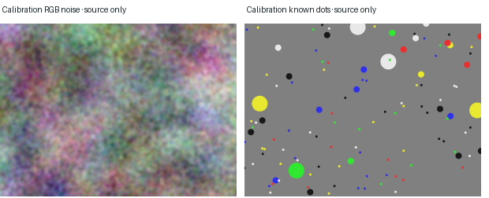

图 1。两张校准**输入**的同坐标裁片，源坐标为 `[210,1030,510,1250]`，未重采样；不是玻璃输出。原始 PNG 身份、裁片边界和制图脚本登记在[图清单](evidence/optical-inputs-20261115/figure-manifest.json)。源图中的细节并不预设系统磨砂后还能逐点恢复。

孤立形状批次选择圆形上边缘、三角形主体、五角星右侧和非对称形状下侧四个位置，每个形状内部有 3 种颜色。配对控制图全为 RGB128，布局由已知的历史 Dock 位置指导。每个像素使用 4×4 子像素采样，几何文件保存解析顶点/圆锥、每行整数覆盖 RLE、分母 16、面积和矩。这个覆盖 oracle 描述源栅格化，不是系统材质的实测透明度。

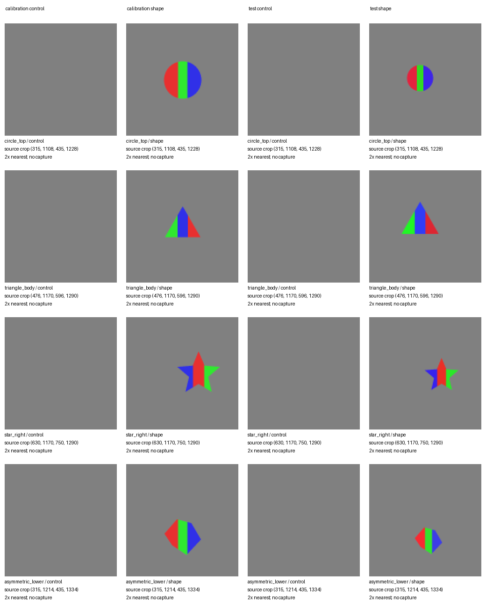

图 2。原始源图集同时展示 calibration 和 test 的**输入**。图中为便于阅读保留了原生成器的 2 倍最近邻裁片；不用于测量渲染输出。校准/test 布局扰动、种子、几何和每个源像素身份都能从冻结包恢复。

源文件入口：[噪声协议](evidence/optical-inputs-20261115/archive/glass-noise-20261114/protocol.json)、[噪声冻结身份](evidence/optical-inputs-20261115/archive/glass-noise-20261114/freeze.json)、[形状协议](evidence/optical-inputs-20261115/archive/glass-isolated-shapes-20261114/protocol.json)、[形状冻结身份](evidence/optical-inputs-20261115/archive/glass-isolated-shapes-20261114/freeze.json)。[纯输入重建说明](evidence/optical-inputs-20261115/PUBLICATION.md)解释如何在另一台设备上恢复完整源图，不需要历史 APK 或构建设备。

## 3. 已知每个点的位置，仍可能无法辨认玻璃内的点

冻结追踪器 v2 处理 4 个测试点场：6,720 个独立源 ID，两个主题和三个角色合计 24 个任务、40,320 个点/角色/主题观测。40,320 不是独立样本量。名义 Dock 内有 544 个源点，跨主题得到 1,088 个源点观测。

在这些名义 Dock 源点中，原生只有 10 个通过追踪判定，其中 9 个输出中心仍在 Dock 内；Android baseline 和 candidate 分别是 20、18 个。两端都能识别同一 ID 且输出中心都在 Dock 内的交集，仅为 7 个主题观测、4 个不同源 ID。空交集和拒绝识别不等于误差为零。

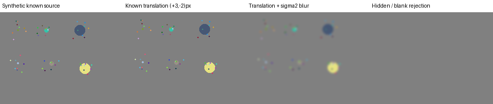

图 3。合成方法检查用于检验算法能否在已知变换中恢复中心，不是原生玻璃通过证据。

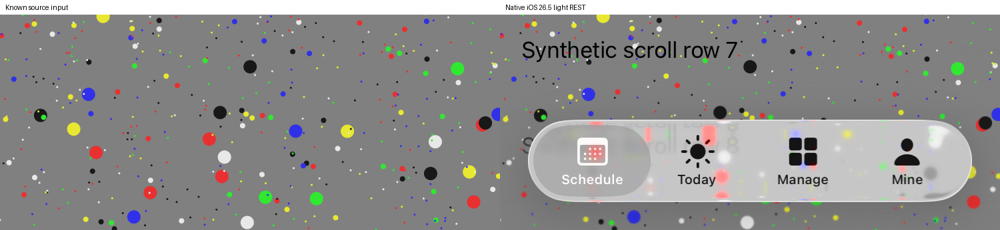

图 4。先导 `n05/light/native` 的 140 个名义 Dock 源点中，138 个为 unidentified，2 个为 multiple_lobes，没有 tracked。追踪器也没有输出 disappeared：找不到可信峰值不能证明某个点已经消失。

先导保留的 420 个候选中，371 个未通过上下文 NCC、240 个未通过 RGB NCC、95 个未通过形状规则，这些原因可重叠。108 个最高 NCC 候选落在 Dock 之外。尽管半径 64 的源点簇签名唯一，小模板仍可能选择外部相似纹理，不能强行最近邻配对，也不能靠放宽阈值把不可识别变成“成功”。

因此，这轮结果是对现有追踪方法适用范围的否证。它没有产出全点折射场，也不足以反演厚度或折射率。公开包保留[完整状态汇总](evidence/optical-inputs-20261115/archive/glass-noise-20261114/analysis/tracking-summary-v2/summary.json)、[所有点状态压缩表](evidence/optical-inputs-20261115/archive/glass-noise-20261114/analysis/tracking-summary-v2/all-point-statuses.csv.gz)、[同 ID 比较压缩表](evidence/optical-inputs-20261115/archive/glass-noise-20261114/analysis/tracking-summary-v2/same-id-comparisons.csv.gz)、[原始失败说明](evidence/optical-inputs-20261115/archive/glass-noise-20261114/analysis/STATIC-RESULTS.md)和[先导拒绝审计](evidence/optical-inputs-20261115/archive/glass-noise-20261114/analysis/rejection-audit-n05-light-native/README.md)。原工作区的大型逐点 JSON 不再重复复制；汇总中保留其原始身份。

RGB 噪声分析另有[方法提案与源代码](evidence/optical-inputs-20261115/archive/glass-noise-20261114/noise-analysis/README.md)。它尚无完成的捕获输出评估命令，源/合成检查不能被写成噪声测试集通过。

## 4. 条件形状响应与绝对材质响应必须分开

形状分析用同一渲染器的配对差 `D = shape − control`，再比较 `D_android − D_native`。这是有符号条件响应，能检查形状造成的局部扰动；如果 shape 与 control 共同偏亮，差分会抵消这部分错误。故同时保留原生与 Android 控制图之间的绝对 RGB 误差。

原八场景静态分析使用历史 D46.5 候选。原生 synthetic-scroll 的标题与行文字、Android 前景等并不相同；旧三角形原生控制/形状截图的状态栏时钟还分别为 20:56/20:57，远场变化不能解释为局部光学。随后 plain-scroll 批次仅隐藏标题和 24 行文字，仍保留布局、真实 ScrollView、系统 TabView 和父 controller，并固定状态栏 9:41。其 16 个会话、32 张 PNG、32 份无障碍快照减少了已知前景干扰，但独立进程、系统自适应、原生标签/图标等差异仍存在。

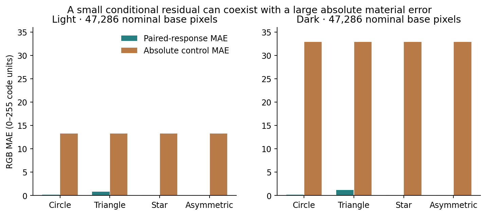

图 5。plain-scroll 中全部 8 个固定场景的名义 base 区域，47,286 个相关像素。纵轴是 0–255 代码值的 RGB MAE。低条件误差与较大绝对控制误差并存；不能只引用前一根柱子。

| 源形状 | 原批次条件 MAE，浅/深 | plain-scroll 条件 MAE，浅/深 |
| --- | ---: | ---: |
| 圆形/上边缘 | 0.150 / 0.154 | 0.149896 / 0.153788 |
| 三角形/主体 | 0.844 / 1.186 | 0.843604 / 1.185524 |
| 五角星/右侧 | 0.098 / 0.086 | 0.098183 / 0.085614 |
| 非对称形/下侧 | 0.114 / 0.086 | 0.113656 / 0.086347 |
| 绝对控制 RGB MAE | 13.838 / 33.874 | 13.257067 / 32.896530 |

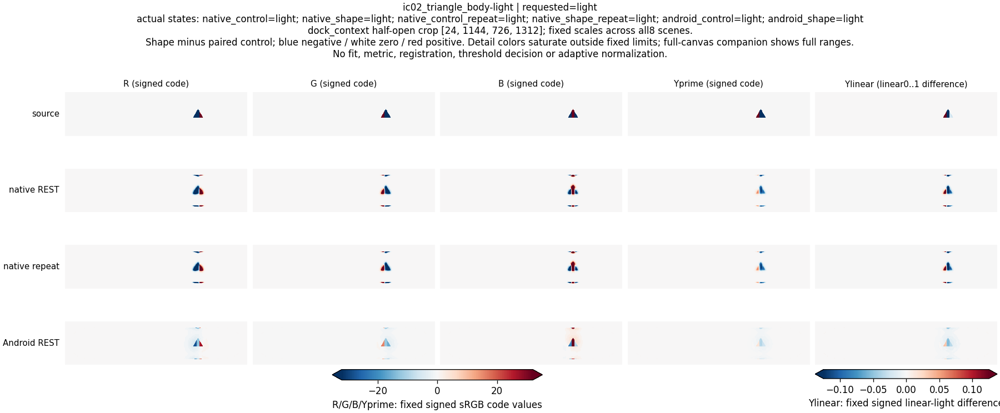

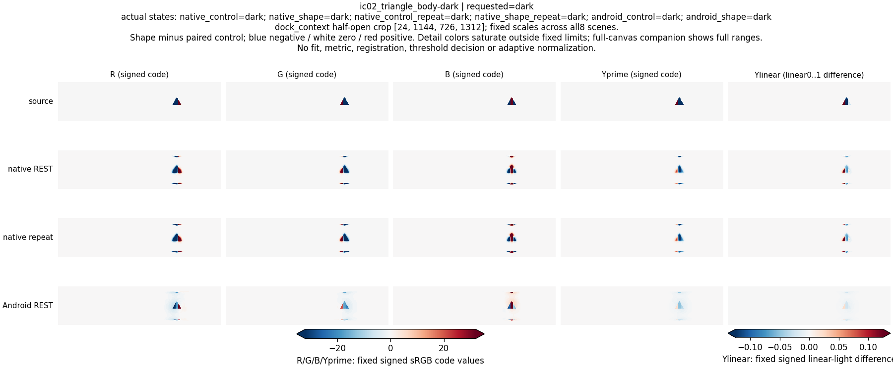

图 6–7。固定同一裁片同时显示源、原生 REST/repeat 与历史 Android 候选的细节。显示用的符号和放大规则随原图保留；数值来自固定取样表，不从展示缩略图重新测量。两种主题均保留，避免只展示有利背景。

其他原图：[圆形浅色](images/optical-inputs-20261115/plain-ic01_circle_top-light-signed-dock-detail.png)、[圆形深色](images/optical-inputs-20261115/plain-ic01_circle_top-dark-signed-dock-detail.png)、[五角星浅色](images/optical-inputs-20261115/plain-ic03_star_right-light-signed-dock-detail.png)、[五角星深色](images/optical-inputs-20261115/plain-ic03_star_right-dark-signed-dock-detail.png)、[非对称形浅色](images/optical-inputs-20261115/plain-ic04_asymmetric_lower-light-signed-dock-detail.png)、[非对称形深色](images/optical-inputs-20261115/plain-ic04_asymmetric_lower-dark-signed-dock-detail.png)。

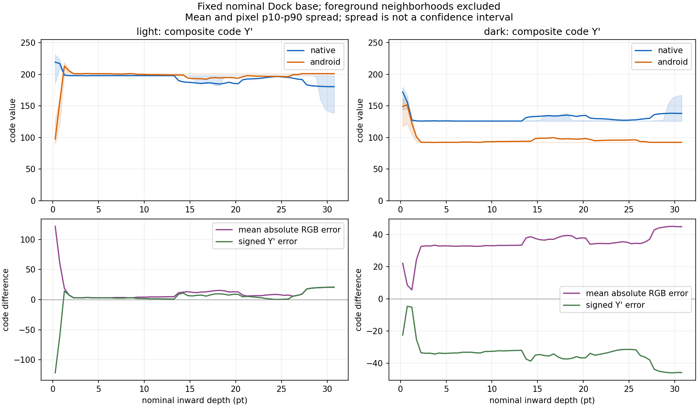

图 8。62 个互不重叠的固定深度分箱，带内 p10–p90 描述空间分布，不是置信区间。边缘、主体和选中镜片使用不同分层，不能把前景、底板和镜片误差混为一个平均数。repeat 的条件响应为零只约束这些实际静帧，不能证明跨会话、运动或生命周期稳定。

原始入口：[孤立形状报告](evidence/optical-inputs-20261115/archive/glass-isolated-shapes-20261114/analysis/CALIBRATION-RESULTS.md)、[plain-scroll 报告](evidence/optical-inputs-20261115/archive/glass-plain-context-20261114/CALIBRATION-RESULTS.md)、[固定分析协议](evidence/optical-inputs-20261115/archive/glass-isolated-shapes-20261114/analysis/analysis-protocol.json)、[plain-scroll 逐分层数值压缩表](evidence/optical-inputs-20261115/archive/glass-plain-context-20261114/calibration-results/native-android-differential.csv.gz)。这些完成的是静态诊断，产品阶段仍未验收。

## 5. 历史折射、边线与材质模型的否证

### 5.1 增大位移不等于修正非线性变薄

历史正折射路径以短边半长 `m`、`b=min(bevel,m/2)` 和 `D=min(refraction,refractionLimit*m)` 定义：

```text
u = inset / b
Q(u) = 1 − sqrt(2u − u²),  0 ≤ u ≤ 1
shift = −normal · D · Q(u)^gamma
```

62dp 高 Dock 的 `m=31dp`、`b=15.5dp`。把位移上限从 1 倍改为 1.5 倍，使 D 从 31dp 增为 46.5dp，主要改变幅度，不能单独修复边缘截面。Q 的外缘斜率发散；幂指数改变尾部，也不改变 b。它是图像位移参数化，不是量到了原生内部的玻璃表面。

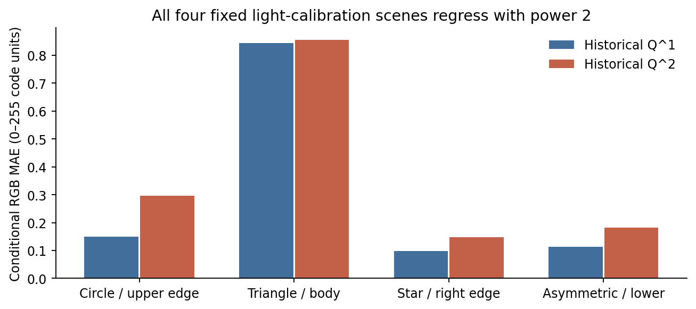

图 9。固定浅色校准的四个 base 条件 MAE，gamma1→gamma2 分别为 0.149896→0.297107、0.843604→0.855757、0.098183→0.147810、0.113656→0.181668。四个场景都退步，不能以“边缘更陡”的解释替代渲染结果。[原始幂响应数据](evidence/optical-inputs-20261115/archive/glass-dock-model-20261114/mechanism-analysis/profile-power-response.json)保留完整候选与分层。

### 5.2 重复边线会变硬，但直接删除也不普遍正确

历史路径同时有从原始背景生成的 shader hairline 和 Compose border，可能叠加暗边，还绕过已完成的材质响应。移除两者后，灰 128 的 base MAE 从 13.257067 降为 8.128995，灰 230 从 16.739535 降为 13.314061；但灰 26 从 144.685777 恶化到 150.899900。改善一种灰色不能证明所有背景的边缘都更自然。

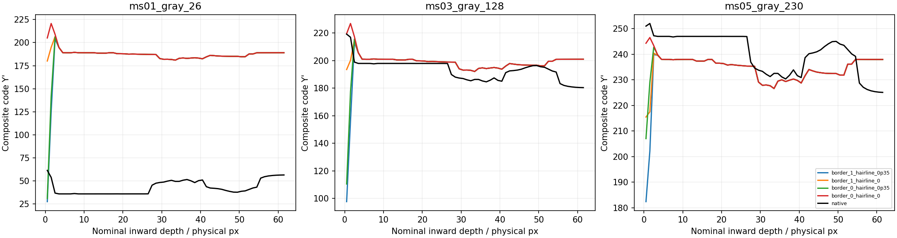

图 10。历史边线诊断曲线。细节见[边缘根因审计](evidence/optical-inputs-20261115/archive/glass-dock-model-20261114/dock-edge-root-cause.md)和[材质根因审计](evidence/optical-inputs-20261115/archive/glass-dock-model-20261114/dock-material-root-cause.md)。这是机械边界的具体来源之一，还不足以描述完整角点、透明度、磨砂或折射。

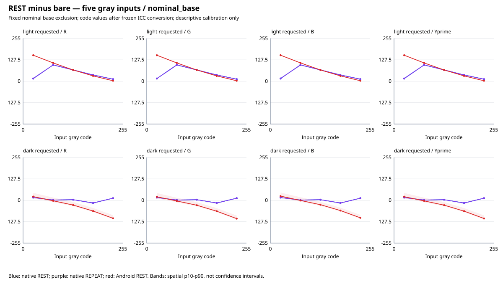

图 11。既有固定背景的灰色传递结果。单个常量背景不能分离透明度与 tint；磨砂的空间扩散、底色响应与边缘高光需要各自保留受控对照。

### 5.3 幅度模型与扩散模型也有独立失败

旧深色签名幅度模型 `e0+e1Y+e2(c−Y)` 配合 1.2dp 的有限半余弦，在 13 个 RGB 组、前两行的拟合 MAE 为 7.2001，按 RGB 组留一后的 MAE 为 8.0714，最大误差分别 31.5431/33.6933，并有 4 个符号错误。完整 16 行中大量零响应会稀释错误；不能引用稀释后的平均数掩盖模型结构失配。[三系数结构失败记录](evidence/optical-inputs-20261115/archive/glass-dock-model-20261114/material-correction-20261115/dark-rim-runtime-20261115/analysis/signed-three-coeff-summary.md)随包保留。

扩散候选 σ3.9 保持 haze=.72、tone/rim/Q/几何不变，在 4 组 shape/control 的 8 个 REST 场景中改善了较强响应的主体与尾部，但三角形最外 `[0,1)` 深度层的 1,496 个像素退步，因此没有变成默认值。[σ3.9 负结果](evidence/optical-inputs-20261115/archive/glass-dock-model-20261114/material-correction-20261115/haze-sigma39-20261115/SUMMARY.md)保留具体数值和范围。

## 6. 从曲线结构到当前运行时，不能跳过 GPU 反证

### 6.1 有限半余弦只证明条件轮廓更合适

既有顶边和右侧 16 点曲线，对每个原生通道减去各自局部主体中位数。比较有限线性 `max(1−d/w,0)` 与截断半余弦 `cos(pi*d/(2w)) if d<w else0`。宽度格点是 0.80–2.00dp、步长 0.01dp；源 RGB 完整分组留一，重复锚点和主题留在同一组内。

14 个独特 RGB 组中，13 组可识别；灰 230 的外缘通道全为 255，保留 null。每个被留出的组仍重新投影其幅度，因此这是**条件轮廓结构**比较，不是未知背景下的幅度预测，也不是独立盲测。线性/半余弦 full16 MAE 为 0.300280003/0.106574227，MSE 为 0.456611995/0.089231165；半余弦各折选 1.19dp，线性选 1.27 或 1.28dp。

这支持继续测试短尾、无平台的轮廓，不能证明角向幅度、颜色合成或完整材质正确。截断半余弦本身也不保证支撑边界的一阶导数连续。664 个拟合通道轮廓的独立标量重算只验证已报告计算，未增加样本。[原始结构比较和限制](evidence/optical-inputs-20261115/archive/glass-dock-model-20261114/material-correction-20261115/rim-cosine-structure-20261115/REVIEW.md)保留这些条件。

### 6.2 当前公开的肩部与有界合成是可选工程函数

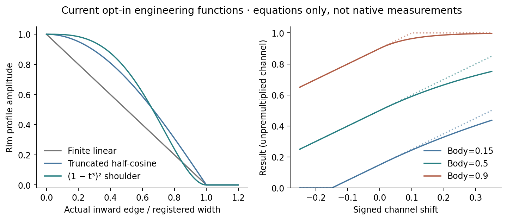

图 12。**数学图示，不是拟合的原生曲线。** 左侧以实际轮廓向内距离/登记宽度为 t；右侧比较几种主体亮度的有界 headroom 与裁剪加法。曲线没有使用未打开的输出，也不能反推出原生物理厚度。

当前 `dockCubicShoulder` 在 `0≤t<1` 使用 `(1−t³)²`，否则为零。在内部区间两端的单侧斜率为零，内侧支撑终点连续归零；它不消除外部轮廓覆盖的跃迁，也不是折射 Q 的替换。该参数可分别作用于底板白色 rim 和签名 rim。`cubicShoulderBlend=0` 与 `dockBaseRimCubicShoulderBlend=0` 保留继承路径。

签名 rim 的 logit 候选对非端点主体 `c` 使用稳定的 `logistic(logit(c)+s)` 等价式，精确 0/1 端点保持原值。headroom 候选为：

```text
s ≤ 0:  max(c+s,0)
s > 0 and c < 1:  c + (1−c) · (1−exp(−s/(1−c)))
s > 0 and c ≥ 1:  1
```

实现先按实际覆盖反预乘，在材质空间计算，再预乘一次。AGSL 的 `1−exp(−x)` 在 x<0.01 处使用固定四阶展开减少相消，连接处仍可能有浮点舍入差，不能写成实现保证 C1。数学值有界也不保证量化后不出现 255。

快照中的 `logitBlend`、`headroomBlend`、肩部两个开关均默认 0；`dockToneResponse` 默认 null，工厂没有自动启用这些新增候选。参数存在、插值存在、语法正确，与原生外观已经通过是不同层次的证据。上层镜片还必须以实际底板/内容合成作为输入；不能穿过磨砂背板直接折射裸背景。

### 6.3 实际正向 headroom GPU 诊断仍然未通过

后于历史 D46.5 的这批诊断使用 27 个深色输入组、54 张 REST 捕获。历史控制和 27 个机制控制按原门禁通过；报告保留 67 个区域、21,708 条 metric、7,236 条 regression 和 44,712 个 strip 样本。此处引用独立审计重算的 ICC 取样值，不声称本次重新解码了原捕获 PNG。

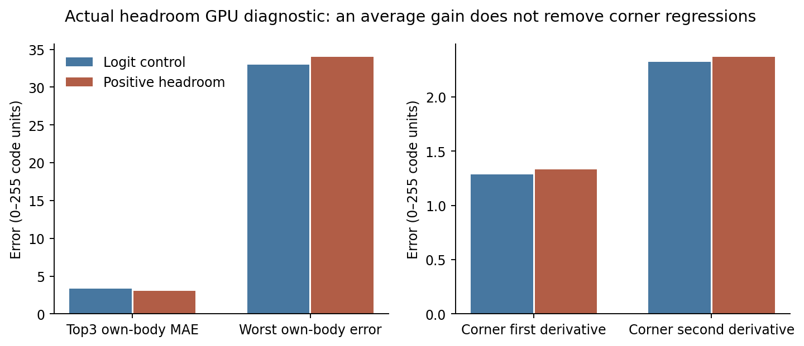

图 13。正向 headroom 与 logit 控制比较。左侧并列平均误差和最大误差，右侧保留角点一、二阶导数误差。平均改善不能覆盖极值和角点退步。

| 指标 | Logit 控制 | 正向 headroom |
| --- | ---: | ---: |
| 顶部前三行、各自减主体 RGB MAE | 3.370370 | 3.074074 |
| 顶部全部 16 行、各自减主体 RGB MAE | 0.698302 | 0.642747 |
| 顶部各自减主体最大绝对误差 | 33 | 34 |
| 6 条右角扫描线 RGB MAE | 3.434884 | 3.452876 |
| 右角一阶导数误差 MAE | 1.287900 | 1.334599 |
| 右角二阶导数误差 MAE | 2.321261 | 2.368300 |
| 错误的 0 代码输出 | 0 | 0 |
| 错误的 255 代码输出 | 0 | 2 |

新增的两个 false-255 都在 `(375,1168)`：`chroma_b_pos` 的 B 通道原生 247、候选 255；`chroma_r_pos` 的 R 通道原生 246、候选 255。这是量化结果，单靠 CSV 不能判定 shader 内部哪一步发生裁剪。六条右角线的一阶组计数为 305 退步/108 改善/73 相等；二阶为 285/159/42。左角没有测量，不能把右角证据扩大为全角点覆盖。

独立重算核对了 162 个顶部汇总、357,696 个一/二阶字段和 28,944 个 regression 字段，均无差异；这证明表格与已有样本一致，不是新的外观通过。完整的场景表、局部极值和失败案例见[GPU 独立审计](evidence/optical-inputs-20261115/archive/glass-dock-model-20261114/material-correction-20261115/dark-rim-runtime-20261115/positive-headroom-runtime-gpu-v1/independent-review.md)。该候选继续默认关闭，软化高光、完整角点、厚度、光学和动态均不能标记为完成。

## 7. 完整动作、多尺寸与多方向：下一阶段仍是草案

[动态受控形状协议 v4](evidence/optical-inputs-20261115/archive/glass-noise-20261114/next-stage-dynamic-controlled-shapes-protocol.md)把两个实验明确分开。T 臂由公共容器携带真实系统 TabView Dock，向静止已知源接近、经过、离开；容器轨迹是夹具干预，不能称为原生自由拖拽或原生弹簧。I 臂固定容器，以真实原生输入分别操作 Dock、分段 Tab、Toggle、单头滑杆、单选菜单、对话框/半幅面板和按钮。底板、滑块、填充、高光、标签和弹出体需要分别登记。

草案登记 108 个源几何条件，来自 4 个形状族×3 个尺度×3 个纵横因子×3 个朝向，分在 18 张板、每板 6 个形状。源对象的三色区域、变换、理想/栅格面积、边界身份和失败都要保留。源的非等比变换不作用于原生控件；计划的 47 个原生配置是待测请求，不能当成已经支持的尺寸。Toggle 的固有主体尺寸、布局空间和内容尺寸也不能混计。

每个实际捕获帧需要原始 PTS、顺序、输入/回调/显示时钟支持、组件实际实例和生命周期。动作从输入前持续到观察到稳定；中断、反转、掉帧、无法识别和未稳定结果均保留。不能只挑关键帧，也不能插值补帧来宣称每毫秒一致。多色源、帧、主题与重复不构成独立场景样本。

初始 64×6 秒是 acquisition budget，不是所有尺寸、方向和动作的完成量。方案的生成器、真实能力测量、驱动、追踪器冻结和全帧采集尚未完成；协议检查通过只代表草案内部一致。静态 Dock/背板的绝对材质、边缘和高光仍应先解决。[尺寸能力审计](evidence/optical-inputs-20261115/archive/glass-dock-model-20261114/native-size-capability-audit.md)与[既有动态/尺寸声明审计](evidence/optical-inputs-20261115/archive/glass-dock-model-20261114/dynamic-size-claims-audit.md)保留了不能放大的范围。

## 8. 公开资产与在另一台设备上继续

[sources.json](evidence/optical-inputs-20261115/sources.json)逐个记录原始命名空间、源 SHA-256/字节数、公开路径、处理方式和公开 SHA-256/字节数。CSV/JSON 使用确定性无损 gzip；解压后的原始身份必须匹配。后续 headroom 的完整 strips、metrics、regressions 数值也随包压缩公开，供另一台设备继续分析。APK、缓存、视频、原始设备全屏截图与未打开测试输出不在这个包内。

[PUBLICATION.md](evidence/optical-inputs-20261115/PUBLICATION.md)提供校验、解压、纯输入重建和制图命令。本次发布验证包含源码/哈希/文件链接，并实际在冻结依赖下重建全部 40 张源图：4 份 manifest 和 8 张固定 RGB 的 PNG/像素身份全部匹配，原始 generate/verify 全部返回 0。收据见[输入重建验证](evidence/optical-inputs-20261115/rebuild-verification.json)，临时源图已删除。本次没有构建、设备操作、光学分析器或重新拟合。原始协议 Markdown 保持原字节，其中指向未公开大文件或旧工作区的历史相对链接不被伪装成完整可用的公开目录。

能够据此恢复的是声明过的输入、方法和数值结论。还需完成的是材质与边缘候选的实际改进、独立测试和完整动作证据；本文不以文档数量、曲线数量或一次平均误差下降替代它们。
