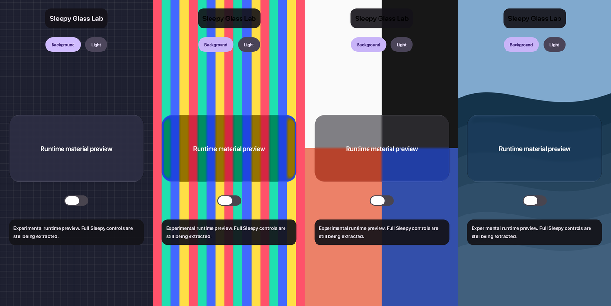
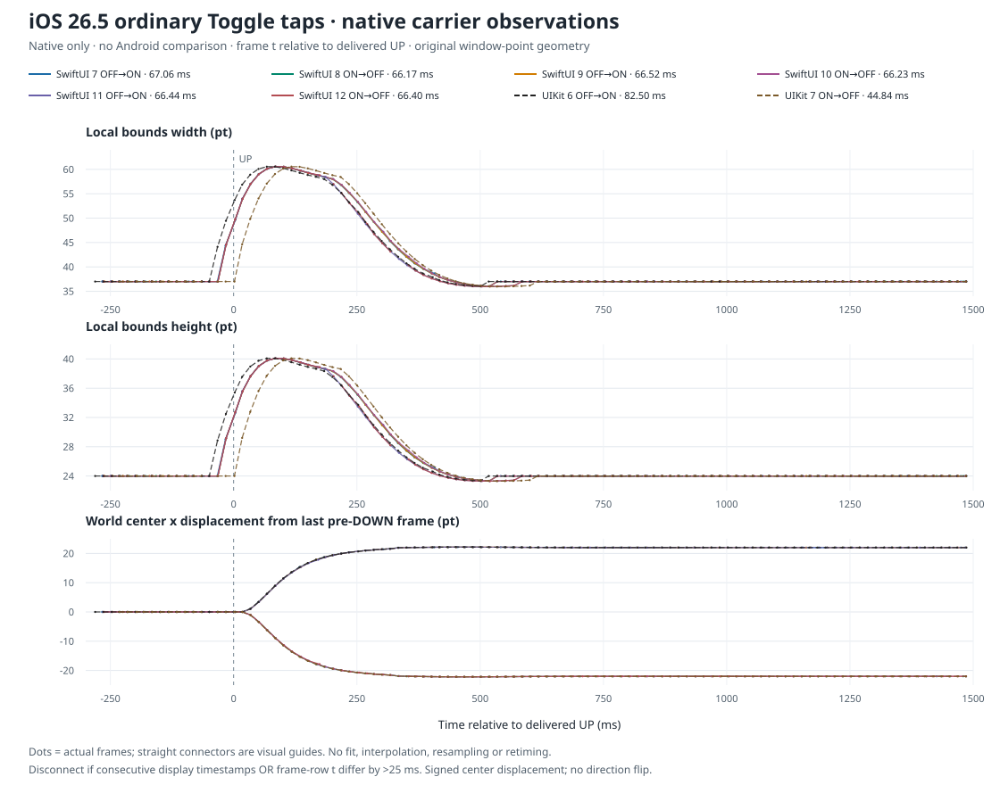
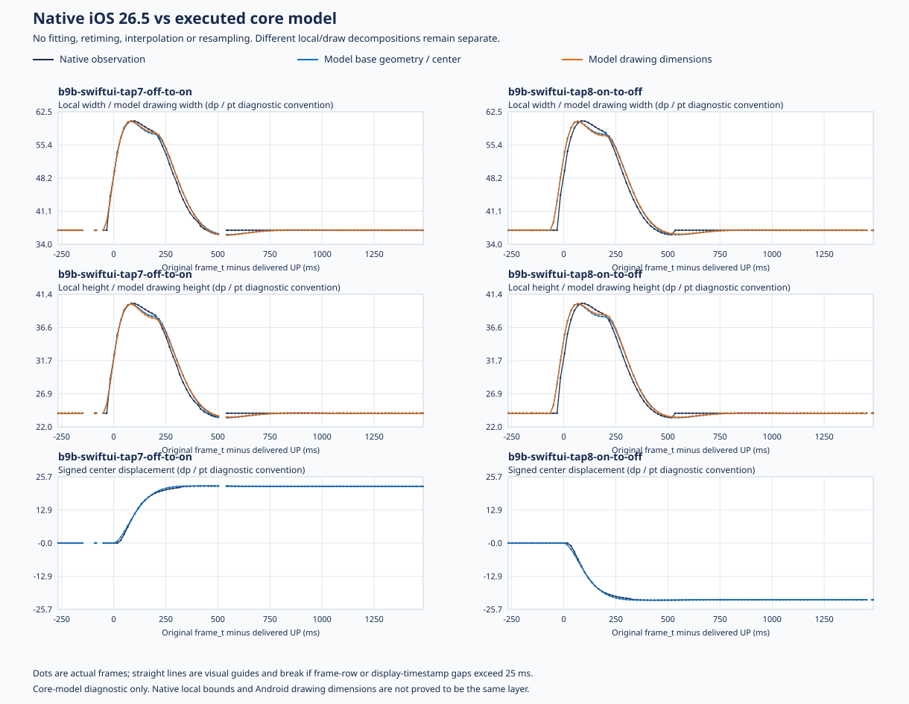
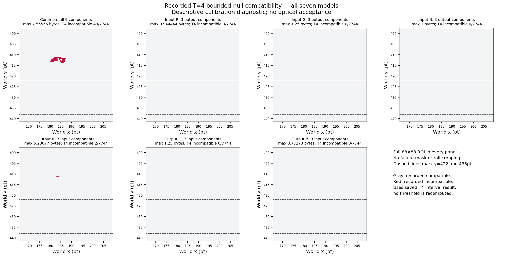
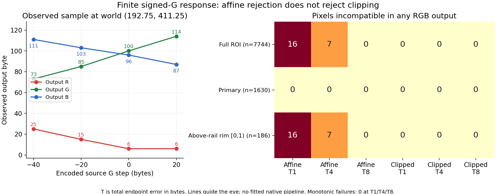
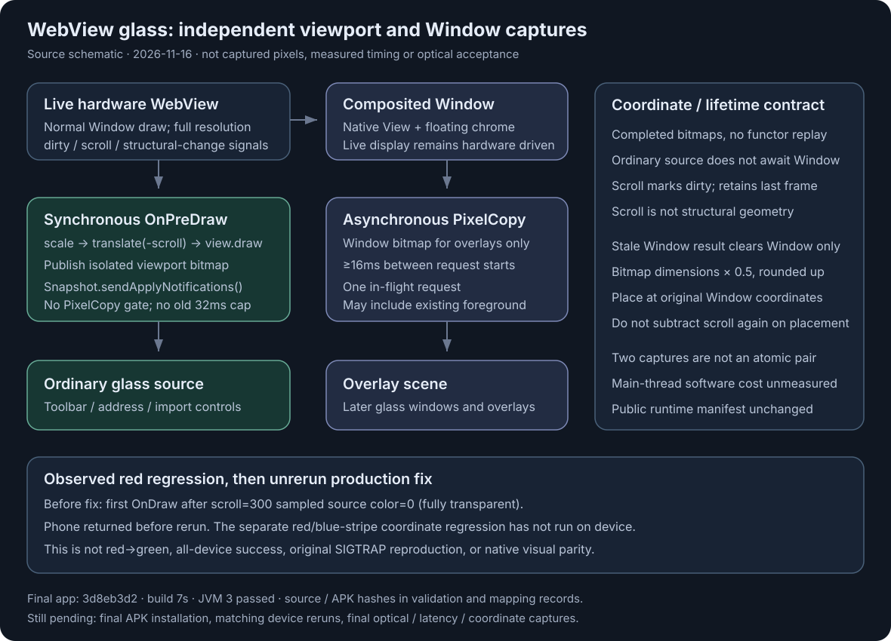

# 当前证据与图片索引 · 2026-11-16

[English summary](#english) · [主 README](../README.md) · [验证记录](../VALIDATION.md) · [架构与 API](architecture.md)

本页是当前导航，复用历史图片、数据和回执，同时补入本轮教务导入的应用构建、较早候选布局实拍与首帧空白 red。原生观察、模型回放、应用 GPU、源码/编译检查分别说明；其他历史图组没有重新采集，不新增全控件光学验收。图片日期沿用原采集批次，历史失败与冻结原件保留。

| 当前记录 | 已有成果 | 真实缺口 |
| --- | --- | --- |
| 独立运行库 | 当前 manifest 绑定 `5f3ea867` 的 38 个导入；历史 slider 构建通过 56 项 host 检查 | 构建实际绑定 `9533cf7f`/原清单；没有对新 HEAD 重跑或新 sample 实拍 |
| Toggle | 原生八次普通点击、16 个事件、838 帧；真实 runtime 的 JVM replay 已执行 | 瞬态差异、时钟/层级差异、材质 alpha 与 Android 自然时序/像素对照 |
| 原生 Slider RGB/signed G | 八轮16图 RGB 与四轮8图 signed G；便携分析及相容性核查已完成 | 不能识别唯一内部管线、位移、模糊核、物理厚度或光学 alpha |
| Android Slider | 四轮采集、采后兼容分析和几何分解完成 | 原 bounds/matrix 门限仍失败，有效 opacity 未观测；无确证产品几何 bug |
| 单选菜单 | 半像素载体错误已有修复；5 项 red 后 48 项 green，instrumentation 编译成功 | 无修复后 GPU 图；旧材质门限失败与退出问题仍在 |
| 终态/实际层 observer | 显式组合编译成功 | 现存 APK 为历史基线，尚无本轮 observer 设备输出 |
| 教务导入 WebView | 真机首帧 `color=0` 的 red；最终 `3d8eb3d2` 应用修复完成7秒构建、3项 JVM 通过，绑定4源码与主/test APK哈希；有官方坐标源码、示意和旧候选布局实拍 | 手机交还后最终修复未安装/设备重跑，条纹坐标回归仅编译；旧图不代表最终同步实现，原始 SIGTRAP 尚未本地复现 |

## 独立 sample：历史公开实拍

这两张是 2026-11-14 发布的 API36 真机图，不代表后续源码重新拍摄。原图裁切/缩放与哈希见[图片来源](images/sources.json)；当前导入身份见[runtime manifest](../provenance/runtime-import.json)，历史执行见[slider build receipt](../provenance/validation-20261115-slider.json)及[范围核对](../provenance/scope-cleanup-20261116.json)。完整公共控件适配器尚未提供。

## Toggle：普通点击与已执行模型对照

[原生研究](../research/toggle-tap-native26-20261116/README.md)保留实际 DOWN/UP、采样缺口与原始时间。没有用长按代替普通点击，也没有把载体 opacity=1 当作玻璃不透明。

[回放报告](../research/toggle-tap-model26-20261116/README.md)、[execution](../research/toggle-tap-model26-20261116/execution.json)与[analysis](../research/toggle-tap-model26-20261116/analysis.json)绑定真实 runtime。八段均保留误差；六段宽度峰值早一个观察样本，最大基础宽度误差6.943pt。图展示预先选定的两个方向，全部段的数值在报告内。时钟与层级分解没有证明等价，不能由此调整起落参数或宣称 GPU/自然时序通过。

原生长按/释放的[白体到玻璃](images/research/switch-white-to-glass.png)、[释放填色](images/research/switch-release-theme-fill.png)继续作为历史 native-only 像素证据；固定窗口白色混合代理不是光学 alpha。

## Slider：已完成的原生有限响应

[RGB 报告](glass-slider-rgb-response-diagnostic.md)与[研究 README](../research/slider-color-response-20261116/README.md)记录八轮、16张正式原图。公共比例模型在 T4 下完整 ROI 49点不相容，主域32点；T8 全相容。输入列与输出行模型在主域都相容，不能选择唯一内部顺序。

| 原生 RGB 六图 | 用途 |
| --- | --- |
| [八轮 shape/flat 完整 ROI](../research/slider-color-response-20261116/figures-response/native-eight-rounds-full-ROI.png) | 16张原始ROI，轨道与边缘保留 |
| [U 全局九分量](../research/slider-color-response-20261116/figures-response/U-global-all-nine-components-full-ROI.png) | encoded +20 全画布有限响应 |
| [M 掩模九分量](../research/slider-color-response-20261116/figures-response/M-mask-all-nine-components-full-ROI.png) | coverage16 局部有限响应 |
| [七模型 minimax](../research/slider-color-response-20261116/figures-response/minimax-error-all-models-full-ROI.png) | 全量极值与残差 |
| [T4 相容性](../research/slider-color-response-20261116/figures-response/T4-compatibility-all-models-full-ROI.png) | 原闭区间判定，非浮点残差直接计数 |
| [固定 inset 分箱](../research/slider-color-response-20261116/figures-response/fixed-inset-minimax-error-curves.png) | 原分箱、空箱与最大误差 |

[图源 manifest](../research/slider-color-response-20261116/figures-response/figure-manifest.json)绑定分析与图哈希；这些图不能当作光学验收。

[四轮 signed-G 研究](../research/slider-signedG-response-20261116/README.md)新增8张原图；[四个输入步进的原生 ROI](../research/slider-signedG-response-20261116/figures/signed-G-native-ROI.png)及[图源记录](../research/slider-signedG-response-20261116/figures/figure-sources.json)保留原始数值。普通仿射在 T1/T4/T8 分别16/7/0点不相容，裁切仿射与单调描述相容；相容不证明原生实际采用该管线。对应[矩阵解释纠正](../research/slider-color-model-20261116/README.md)和[有限模型边界](../research/slider-linear-response-20261116/README.md)另列。

## Android Slider：采集成功，几何仍混杂

[四轮归档](../research/slider-android-response-20261116/README.md)保留48个 held 端点、196个原始文件。[采后兼容结果](../research/slider-android-response-20261116/analysis-v2-post-acquisition-compatible-20261116/RESULTS.md)为 `DIAGNOSTIC_COMPOSITE_RESPONSE_GEOMETRY_CONFOUNDED`，`optical_acceptance=false`、`inference_allowed=false`；原冻结分析器的格式失败另行保留。

[原始 control-pre full100 屏幕图](../research/slider-android-response-20261116/evidence/rounds/control-pre/android-r2/trace/st01_rgb_star_d16-light-full100-held-screen.png)是本次几何分解的已有上下文，不是新的 observer 图。`full100` 表示源覆盖，业务值0.50064063，不测试业务端点。

| 宽 / 高分解 | dp |
| --- | ---: |
| 理想37×24 ×1.55 | 57.35 /37.2 |
| Owner 布局量化 | +0.128990 /+0.110923 |
| Carrier−owner 残差 | +0.007708 /−0.005008 |
| Carrier−native 总差 | +0.136697 /+0.105915 |

[几何审计](../research/slider-layer-observation-20261116/geometry-audit/README.md)从原角点重算171×111px，并对照7个源码/vendor哈希。原0.10pt/0.001门限仍失败；近似中心 pivot 的解释是 hypothesis，不能叫 raw translation 实测。下一步是原样执行[实际层 observer](../research/slider-layer-observation-20261116/README.md)，观察 raw/pivoted/total、placement 与 alpha ancestry。当前没有 `observation.json` 或其三张运行截图。

## 单选菜单：修复前 GPU 失败与载体坐标修复

[修复前 E_stable](../research/control-regression-diagnostics-20261116/language-gpu/results/language-triplet-20261115T222128Z/E_stable.png) · [E_late](../research/control-regression-diagnostics-20261116/language-gpu/results/language-triplet-20261115T222128Z/E_late.png) · [C/U/restored 与完整八图目录](../research/control-regression-diagnostics-20261116/language-gpu/results/language-triplet-20261115T222128Z)

[首轮 GPU 结果](../research/control-regression-diagnostics-20261116/language-gpu/results/language-triplet-20261115T222128Z/README.md)的 JUnit 失败：精确终态几何仍差约0.0102px，第一行的原差分门限也未满足。截图不能改称修复后效果。

后续[carrier 修复](../research/language-carrier-alignment-20261116/README.md)解决材料整数放置与前景浮点原点之间的0.5px错位；5项测试先按预期失败，随后48项通过。720个模型样本是布局算术，没有新GPU图。[终态 observer](../research/language-settled-observation-20261116/README.md)、[组合构建和 binary audit](../research/control-regression-diagnostics-20261116/host-integration-observed/README.md)说明旧APK未绑定该修复；后续须使用匹配的主/test APK。退出路径的[只读审查](../research/language-settled-observation-20261116/close-path-review.md)也不等于卡顿已解决。

## 教务导入：live WebView 与玻璃快照隔离

上图是 2026-11-16 16:30 较早候选的真实布局示例，WIP 二进制 SHA 未采；不能绑定最终提交，也不能用于最终光学、滚动坐标或延迟验收。

[本轮应用适配报告](../research/native-webview-isolation-20261116/README.md)记录历史 `RenderThread` / Vulkan 原生崩溃链、真实滚动空白与后续修复。live WebView 继续硬件渲染；普通 source 在 `OnPreDraw` 由 dirty/scroll 驱动，同步独立执行 `scale → translate(-scroll) → view.draw`，发布并通知 Compose draw 观察者，不等待 PixelCopy。Window copy 只供 overlay，单独保留 16ms 最小请求间隔和单 in-flight 限制；普通 source 不再受旧 32ms 门槛阻塞。scroll 不进入结构 geometry，也不清空已有 frame；过期 Window 回调只能清 Window frame。两张 bitmap 每方向半尺寸并还原 Window 坐标，普通 source 不回采浮动控件，也不把 live WebView 切成软件层。

手机交还前，`glassBackdropIsNotBlankOnTheFirstScrolledFrame` 在 scroll=300 后首个 `OnDraw` 直接采样 source，实际得到 **`color=0`（完全透明）**。随后修复尚未设备重跑；新增红蓝条纹坐标回归也未执行。报告附固定提交的官方 AOSP/Chromium 坐标依据，说明为何独立软件快照要先减 scroll，放回 Window 时不再重复减去；它不代替设备验证。主线程软件 composition 的成本也没有新测量。

顶行返回、地址、编辑/确认、可选入口、UA、刷新不换行，学校名单独下一行；底部提示与导入分离。最终应用 [PR #447](https://github.com/lingion/sleepy/pull/447) 为 `3d8eb3d22c351dbfe9ed66d7b0cfee004d1606f7`；[验证记录](../research/native-webview-isolation-20261116/validation.json)绑定7秒成功构建、3项 JVM 零失败和已构建主/test APK哈希，[来源映射](../research/native-webview-isolation-20261116/source-mapping.json)绑定4源码。最终版本尚未安装/设备重跑；[较早2项测试通过](../research/native-webview-isolation-20261116/evidence/pre-continuity-two-tests.txt)不能覆盖[新增 red](../research/native-webview-isolation-20261116/evidence/scroll-first-frame-red.txt)，本地 HTML 也尚未复现原始 SIGTRAP。不能写成 red→green、全设备通过、相同根因已完全证明或 Android 运行 UIKit。当前 38 项公共 runtime manifest 不因应用 adapter 自动换身份。

## 历史图组与完整原件

| 图组 | 现成图片 / 报告 | 保留口径 |
| --- | --- | --- |
| Dock / Menu / Slider运动 / Sheet / Toggle长按 | [历史 atlas](evidence/RESULTS.md)、[19张研究图](images/research) | 原样本、坐标、时间和误差；不是当前全控件验收 |
| Dock新背景挑战 | [四图](images/holdout)、[结果](holdout-dock-results.md) | 12个相关复核单元、656项表；候选未验收 |
| 撤回 bevel 候选 | [四图](images/edge-profile)、[报告](edge-profile-update.md) | 失败与撤回保留 |
| Dock受控输入与方法图 | [23张图](images/optical-inputs-20261115)、[索引](controlled-optical-studies.md) | 生成输入与合成检查不能当作捕获输出 |
| Panel高光/轮廓 | [66张图](images/panels-20261115)、[报告](panel-material-study.md) | 参数校准、失败门限、导数退化保留 |
| Panel lateral | [八张展示图](images/panels-lateral-20261115)、[裁片包](evidence/panels-lateral-20261115)、[报告](panel-lateral-sampling-study.md) | 80项描述性相位结果，无唯一输运场或光学验收 |
| Slider frost / rail / star / holdout / shoulder / G / midpoint | [frost图](images/slider-material-20261115)、[原证据包](design/evidence)、[r2入口](glass-slider-star-calibration.md) | r2未验收，r3/r4被拒；已消费回归不重标独立留出 |
| Sleepy研究迁出 | [迁出说明](../research/sleepy-research-migration-20261116/README.md)、[历史原件](../research/sleepy-research-migration-20261116/sources)、[第三批图文](../research/sleepy-research-migration-20261116/third-pass/sources) | 来源提交、原文和旧相对路径保持原样 |

[中点报告](glass-slider-midpoint-diagnostic.md)末尾“尚未准备 RGB source/冻结/采集”是当时下一步；后续已由本页原生 RGB 八轮研究完成。该历史句不再是当前待办，原报告结论与数据未改。

## 全部公开 README 的导航归属

当前入口已有相关图或图文索引链接。受哈希绑定的 README、`archive/` 和迁出的 `sources/` 原文不加入新导航，以免破坏原件；下表给这些历史文档提供对应图组。其“当前”“待执行”只指原归档时点，不能作为现状。

| README | 身份 | 对应图组 |
| --- | --- | --- |
| [README.en.md](../README.en.md) | 当前入口 / current entry | [图组 / figures](#sample) |
| [README.md](../README.md) | 当前入口 / current entry | [图组 / figures](#sample) |
| [docs/design/evidence/glass-slider-green-witness-20261115/README.md](../docs/design/evidence/glass-slider-green-witness-20261115/README.md) | 历史原件 / historical original | [图组 / figures](#historical) |
| [docs/design/evidence/glass-slider-holdout-20261115/README.md](../docs/design/evidence/glass-slider-holdout-20261115/README.md) | 历史原件 / historical original | [图组 / figures](#historical) |
| [docs/design/evidence/glass-slider-midpoint-20261115/README.md](../docs/design/evidence/glass-slider-midpoint-20261115/README.md) | 历史原件 / historical original | [图组 / figures](#historical) |
| [docs/design/evidence/glass-slider-shoulder-experiments-20261115/README.md](../docs/design/evidence/glass-slider-shoulder-experiments-20261115/README.md) | 历史原件 / historical original | [图组 / figures](#historical) |
| [docs/design/evidence/glass-slider-star-20261115/README.md](../docs/design/evidence/glass-slider-star-20261115/README.md) | 历史原件 / historical original | [图组 / figures](#historical) |
| [docs/evidence/optical-inputs-20261115/archive/glass-isolated-shapes-20261114/README.md](../docs/evidence/optical-inputs-20261115/archive/glass-isolated-shapes-20261114/README.md) | 历史原件 / historical original | [图组 / figures](#historical) |
| [docs/evidence/optical-inputs-20261115/archive/glass-isolated-shapes-20261114/analysis/README.md](../docs/evidence/optical-inputs-20261115/archive/glass-isolated-shapes-20261114/analysis/README.md) | 历史原件 / historical original | [图组 / figures](#historical) |
| [docs/evidence/optical-inputs-20261115/archive/glass-noise-20261114/README.md](../docs/evidence/optical-inputs-20261115/archive/glass-noise-20261114/README.md) | 历史原件 / historical original | [图组 / figures](#historical) |
| [docs/evidence/optical-inputs-20261115/archive/glass-noise-20261114/analysis/README.md](../docs/evidence/optical-inputs-20261115/archive/glass-noise-20261114/analysis/README.md) | 历史原件 / historical original | [图组 / figures](#historical) |
| [docs/evidence/optical-inputs-20261115/archive/glass-noise-20261114/analysis/rejection-audit-n05-light-native/README.md](../docs/evidence/optical-inputs-20261115/archive/glass-noise-20261114/analysis/rejection-audit-n05-light-native/README.md) | 历史原件 / historical original | [图组 / figures](#historical) |
| [docs/evidence/optical-inputs-20261115/archive/glass-noise-20261114/noise-analysis/README.md](../docs/evidence/optical-inputs-20261115/archive/glass-noise-20261114/noise-analysis/README.md) | 历史原件 / historical original | [图组 / figures](#historical) |
| [docs/evidence/optical-inputs-20261115/archive/glass-plain-context-20261114/README.md](../docs/evidence/optical-inputs-20261115/archive/glass-plain-context-20261114/README.md) | 历史原件 / historical original | [图组 / figures](#historical) |
| [docs/evidence/panels-20261115/archive/analysis-alert-baseline/README.md](../docs/evidence/panels-20261115/archive/analysis-alert-baseline/README.md) | 历史原件 / historical original | [图组 / figures](#historical) |
| [docs/evidence/panels-20261115/archive/analysis-alert-frost8/README.md](../docs/evidence/panels-20261115/archive/analysis-alert-frost8/README.md) | 历史原件 / historical original | [图组 / figures](#historical) |
| [docs/evidence/panels-20261115/archive/analysis-alert-profile-half/README.md](../docs/evidence/panels-20261115/archive/analysis-alert-profile-half/README.md) | 历史原件 / historical original | [图组 / figures](#historical) |
| [docs/evidence/panels-20261115/archive/analysis-mapping-audit/README.md](../docs/evidence/panels-20261115/archive/analysis-mapping-audit/README.md) | 历史原件 / historical original | [图组 / figures](#historical) |
| [docs/evidence/panels-20261115/archive/analysis-mapping-audit/native-clean-analysis/README.md](../docs/evidence/panels-20261115/archive/analysis-mapping-audit/native-clean-analysis/README.md) | 历史原件 / historical original | [图组 / figures](#historical) |
| [docs/evidence/panels-20261115/archive/analysis-mapping-audit/paired-slope-feasibility-analysis/README.md](../docs/evidence/panels-20261115/archive/analysis-mapping-audit/paired-slope-feasibility-analysis/README.md) | 历史原件 / historical original | [图组 / figures](#historical) |
| [docs/evidence/panels-20261115/archive/analysis-mapping-audit/probe-preparation/README.md](../docs/evidence/panels-20261115/archive/analysis-mapping-audit/probe-preparation/README.md) | 历史原件 / historical original | [图组 / figures](#historical) |
| [docs/evidence/panels-20261115/archive/analysis-rim-evidence/README.md](../docs/evidence/panels-20261115/archive/analysis-rim-evidence/README.md) | 历史原件 / historical original | [图组 / figures](#historical) |
| [docs/evidence/panels-20261115/archive/analysis-rim-evidence/body8-self-comparison-error/README.txt](../docs/evidence/panels-20261115/archive/analysis-rim-evidence/body8-self-comparison-error/README.txt) | 历史原件 / historical original | [图组 / figures](#historical) |
| [docs/evidence/panels-20261115/archive/panel-probes-preparation/README.md](../docs/evidence/panels-20261115/archive/panel-probes-preparation/README.md) | 历史原件 / historical original | [图组 / figures](#historical) |
| [docs/evidence/panels-lateral-20261115/README.md](../docs/evidence/panels-lateral-20261115/README.md) | 当前入口 / current entry | [图组 / figures](#historical) |
| [docs/evidence/panels-lateral-20261115/archive/analysis-mapping-audit/paired-slope-feasibility-analysis/README.md](../docs/evidence/panels-lateral-20261115/archive/analysis-mapping-audit/paired-slope-feasibility-analysis/README.md) | 历史原件 / historical original | [图组 / figures](#historical) |
| [research/control-regression-diagnostics-20261116/README.md](../research/control-regression-diagnostics-20261116/README.md) | 当前入口 / current entry | [图组 / figures](#toggle) |
| [research/control-regression-diagnostics-20261116/host-integration-observed/README.md](../research/control-regression-diagnostics-20261116/host-integration-observed/README.md) | 当前入口 / current entry | [图组 / figures](#menu) |
| [research/control-regression-diagnostics-20261116/language-gpu/README.md](../research/control-regression-diagnostics-20261116/language-gpu/README.md) | 当前入口 / current entry | [图组 / figures](#menu) |
| [research/control-regression-diagnostics-20261116/language-gpu/results/language-triplet-20261115T222128Z/README.md](../research/control-regression-diagnostics-20261116/language-gpu/results/language-triplet-20261115T222128Z/README.md) | 当前入口 / current entry | [图组 / figures](#menu) |
| [research/native-webview-isolation-20261116/README.md](../research/native-webview-isolation-20261116/README.md) | 当前应用适配说明 / application adapter in progress | [结构示意 / schematic](#webview) |
| [research/language-carrier-alignment-20261116/README.md](../research/language-carrier-alignment-20261116/README.md) | 当前入口 / current entry | [图组 / figures](#menu) |
| [research/language-settled-observation-20261116/README.md](../research/language-settled-observation-20261116/README.md) | 当前入口 / current entry | [图组 / figures](#menu) |
| [research/sleepy-research-migration-20261116/README.en.md](../research/sleepy-research-migration-20261116/README.en.md) | 当前入口 / current entry | [图组 / figures](#historical) |
| [research/sleepy-research-migration-20261116/README.md](../research/sleepy-research-migration-20261116/README.md) | 当前入口 / current entry | [图组 / figures](#historical) |
| [research/sleepy-research-migration-20261116/sources/libraries/liquid-glass/README.md](../research/sleepy-research-migration-20261116/sources/libraries/liquid-glass/README.md) | 历史原件 / historical original | [图组 / figures](#historical) |
| [research/sleepy-research-migration-20261116/sources/tools/native-glass-reference/README.md](../research/sleepy-research-migration-20261116/sources/tools/native-glass-reference/README.md) | 历史原件 / historical original | [图组 / figures](#historical) |
| [research/slider-android-host/README.md](../research/slider-android-host/README.md) | 当前入口 / current entry | [图组 / figures](#slider-android) |
| [research/slider-android-response-20261116/README.en.md](../research/slider-android-response-20261116/README.en.md) | 当前入口 / current entry | [图组 / figures](#slider-android) |
| [research/slider-android-response-20261116/README.md](../research/slider-android-response-20261116/README.md) | 当前入口 / current entry | [图组 / figures](#slider-android) |
| [research/slider-color-model-20261116/README.md](../research/slider-color-model-20261116/README.md) | 当前入口 / current entry | [图组 / figures](#slider-native) |
| [research/slider-color-response-20261116/README.md](../research/slider-color-response-20261116/README.md) | 当前入口 / current entry | [图组 / figures](#slider-native) |
| [research/slider-fixtures/README.en.md](../research/slider-fixtures/README.en.md) | 当前入口 / current entry | [图组 / figures](#historical) |
| [research/slider-fixtures/README.md](../research/slider-fixtures/README.md) | 当前入口 / current entry | [图组 / figures](#historical) |
| [research/slider-fixtures/tools/native-glass-reference/README.md](../research/slider-fixtures/tools/native-glass-reference/README.md) | 历史原件 / historical original | [图组 / figures](#historical) |
| [research/slider-layer-observation-20261116/README.md](../research/slider-layer-observation-20261116/README.md) | 当前入口 / current entry | [图组 / figures](#slider-android) |
| [research/slider-layer-observation-20261116/geometry-audit/README.md](../research/slider-layer-observation-20261116/geometry-audit/README.md) | 当前入口 / current entry | [图组 / figures](#slider-android) |
| [research/slider-linear-response-20261116/README.md](../research/slider-linear-response-20261116/README.md) | 当前入口 / current entry | [图组 / figures](#slider-native) |
| [research/slider-signedG-response-20261116/README.md](../research/slider-signedG-response-20261116/README.md) | 当前入口 / current entry | [图组 / figures](#slider-native) |
| [research/toggle-tap-model26-20261116/README.md](../research/toggle-tap-model26-20261116/README.md) | 当前入口 / current entry | [图组 / figures](#toggle) |
| [research/toggle-tap-native26-20261116/README.md](../research/toggle-tap-native26-20261116/README.md) | 当前入口 / current entry | [图组 / figures](#toggle) |

## English summary

Updated November 16, 2026 with existing repository evidence plus the new academic-import application build, an earlier candidate layout capture and a reproduced red first-frame regression. Other historical figures have not been recaptured; original pixels, dates, source records and failed gates remain. This does not add complete-control optical acceptance.

- **Sample:** the light/dark four-background images are the November 14 publication captures, not new screenshots of later revisions. The current import manifest identifies 38 files at `5f3ea867`; the 56-test slider build receipt ran `9533cf7f` with its original manifest. Source reconciliation and execution identity remain separate.
- **Toggle:** eight actual native taps, 16 events and 838 frames are available. Runtime JVM replay executed and retains transient residuals, including 6.943 pt maximum base-width error. Native logger time, model clocks and layer decomposition are not proven equivalent. Android GPU pixels, material alpha and natural-time parity remain unvalidated.
- **Native Slider:** eight-round RGB and four-round signed-G diagnostics completed. At T4 the common RGB model has 49 incompatible full-ROI pixels; the ordinary signed-G affine model has 7. Larger allowances and compatible alternative families are retained. These finite encoded responses do not recover a unique internal optical pipeline.
- **Android Slider:** four rounds were acquired; post-acquisition compatible analysis completed with `GEOMETRY_CONFOUNDED`, optical acceptance false and inference disallowed. The 171×111 px owner decomposition preserves the original gates. `full100` has business value 0.50064063 and is not a domain-endpoint experiment. Pivot compensation is a hypothesis, not measured raw translation. The unmodified layer observer has compiled but has no device result.
- **Menu:** historical triplet GPU failure remains visible. The later half-pixel carrier fix has five expected red regressions followed by 48 green checks and compilation, with no fix-bound GPU capture. Terminal/layer observer APKs in the inventory remain historical baselines.
- **Academic-import WebView:** the real first-draw scroll regression observed source `color=0` at scroll=300. Final application PR #447 / `3d8eb3d2` built in 7 seconds with three passing JVM checks; manifests bind four source snapshots and both APK hashes. Its ordinary source captures synchronously in OnPreDraw with scale/negative-scroll compensation and draw-observer notification, independent of Window PixelCopy. Only overlay copying retains the 16ms/single-in-flight limits. Scroll retains frames; stale Window callbacks clear Window only. Official pinned AOSP/Chromium source documents the coordinate contract. The final APK was not installed or rerun after the phone was returned; the stripe-coordinate regression compiled but has no device result. The schematic is not captured output; the 16:30 layout screenshot belongs to an earlier asynchronous candidate with unrecorded WIP binary SHA. Software-composition cost remains unmeasured. No red→green, final optical or latency acceptance, original-SIGTRAP reproduction, all-device success or public-runtime update is claimed.
- **Historical material studies:** Dock photometry, panel highlight/lateral fields, slider r2 and rejected alternatives retain their original figures and limits. Frozen README/source originals are listed above without changing their bytes or conclusions.

[Chinese main report](../README.md) · [English main report](../README.en.md) · [Validation](../VALIDATION.md) · [Historical atlas](evidence/RESULTS.md)
