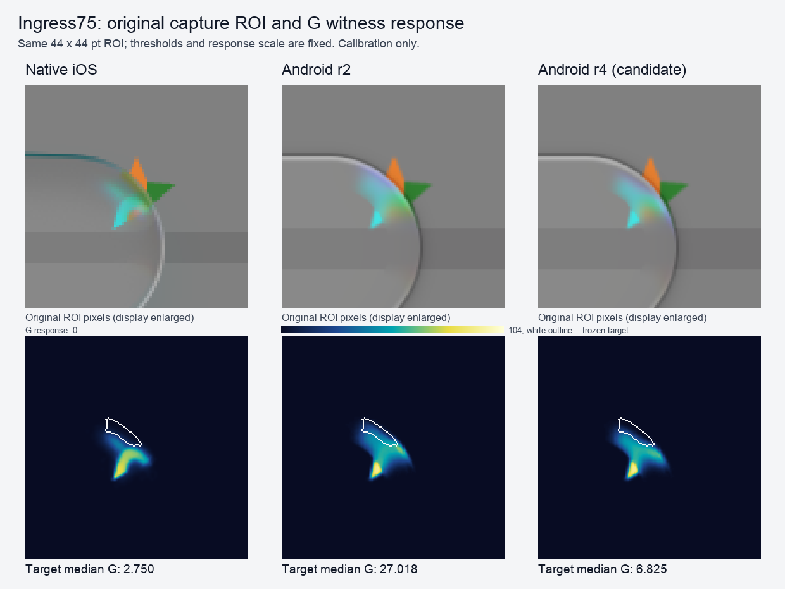

# Slider G 差分证据包：2026-11-15

这是可搬移的 **G 通道扰动诊断**，不是玻璃全部外观的验收。当前结论：r3（将磨砂 sigma 从 1.1 减到 0.55）已拒绝；r4（窄肩 common transport 候选）有实质 G 改善，但原 RGB 的 5/6/8 多形状测试存在局部退化，因此不作为通用默认替代，生产恢复 r2 的 A=7.8、W=7.5。r2 仍是未验收 checkpoint；全部是标定数据，没有独立验收。



上排是实际截图 ROI 原始像素的最近邻放大，未做颜色配准。下排是相同 0–104 量程的 `witness − control` G 响应；白线标记冻结目标。图只用于理解数据，统计以原始字节和冻结脚本为准。

## 包内有什么

- `crops/`：4 版本 × 2 轮 × 6 姿态 × shape/flat，共 **96 张**原始像素 ROI 裁片。带双线性插值所需的保护边，不缩放、不转换颜色；原 RGB/RGBA 字节及不透明 alpha 保留。没有全屏截图。
- `sources/`：原始 witness/control PNG、flat、其他 manifest 列出的 source、manifest 和 shape spec。
- `metadata/`：8 份原接受 index、原生严格验证回执、Android source-result/host receipt，均以 gzip 无损保留原文件字节。
- `frozen/`：原 protocol、analysis plan、v1/v1.1 工具、v1.1 修正说明、原素材验证、93 项 CLI 合成检查与脚本、原生成/冻结工具。它们的原有绝对路径是历史记录；本地重放使用下面的便携入口。
- `masks/`：冻结目标与只由 r2 构造的 reverse68、neutral138、frost-band222 子集。没有用 r4 重选目标。
- `summaries/analysis-summary.json`：native/r2/r3/r4 全六姿态、全部原有区域、RGB、原始像素与 world grid、阈值 4/8/16/24 的正/负/中性支持。
- `summaries/*-official-analysis.json.gz`：4 份冻结 v1.1 完整输出原文，逐字节归档。
- `summaries/target-wholeROI-G-thresholds.csv`：目标与完整 ROI 的四阈 G 表。
- `summaries/ingress75-subgroups.json`、`native-relative-G-errors.json`：全部版本的子集分位数、RMSE/MAE 及变亮/变暗数量。
- `summaries/r3-r4-actual-support-sets.json`：r3/r4 相对 r2 的真实新增/移除支持和误差集合，分开保留，不能用净值代替新增错误。
- `summaries/current-decision.json`：结合原 RGB 后的当前决定。归档的 `r4-review.md` 保留 G 分析当时的原文字节；当前决定以本 README 和此 JSON 为准。
- `manifest.json`：包内文件 ↔ 原 root、原路径、原 SHA、裁片原始像素坐标与 world mapping 对照。`checksums.json` 验证包内全部固定文件。

## 在另一台设备重放

需要 Python 3、NumPy、Pillow；不需要原电脑、ADB、Xcode 或全屏截图。

```sh
python3 tools/replay-roi.py --output /absolute/path/to/new-replay-output
```

输出目录必须不存在。脚本首先校验包内哈希和无损归档的原文件哈希，再通过原始 receipt/result 解析实际几何。它仅适配路径读取，直接调用**未修改的 v1.1** 几何门槛、区域定义、阈值、插值、原字节差分与统计函数。保护边使裁片能重建完整固定 ROI 的所有分析样本。它逐一比对 24 个 stage 的全部官方统计，重建 r2 子集，并验证 r3/r4 的真实 added/removed 集合。临时 NPZ 在结束时删除，只保留小型重放结果。

本包的第一次重放已通过，结果保留在 [`validation/replay-summary.json`](validation/replay-summary.json)。同机从包内数据重建的对照图与发布图逐像素一致。需要重画图时执行：

```sh
python3 tools/render-comparison.py --output /absolute/path/to/new-comparison.png
```

图中字体优先使用 Arial，否则选择本机可用字体；这不会改变裁片或差分统计。

**重放边界：**裁片不能反推出原完整 PNG，因此不能独立重新证明原全屏 PNG 的哈希、采集就绪性或手机状态。原 hash、接受 index 和回执均作为可查证的历史来源保留。这里能在异机重新计算并核对 ROI 统计，不把裁片重放冒充新一轮采集验收。原 root 未拷贝数据的位置在 `manifest.json` 明确列出。

## 不能省略的限制

Android 六姿态的 effective opacity 没有直接观测，所有 r2/r3/r4 正式状态仍为 `MAPPING_UNKNOWN_PIXEL_DIAGNOSTICS_ONLY`。每轮的几何、source mapping 与双域 flat 门槛已保留；已知字段一致不代表补齐了 opacity。

G 输入只包含 neutral/positive，没有负 G 源。R/B 输入完全相同，但原生存在 R/B 输出变化；这说明通道耦合，不能仅凭两个振幅证明非线性、唯一 native sampler 或物理厚度。Android R/B 固定 ROI 的差分仍逐原始像素为零。

目标是早期标定选出的，不是 holdout。full100 是正 G 对照，也不是零位移证明。r4 没有被选为默认不否定本包记录的 G 改善；恢复 r2 也不代表 r2 通过验收。不要将本包解释为 Dock/背板厚度、高光、动态、所有尺寸或“99.99%”对齐结果。
