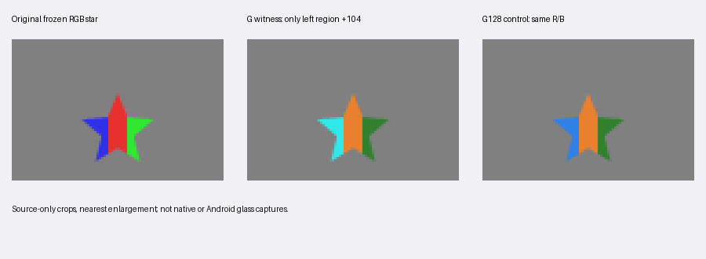

# Multicolor-star G witness: bounded calibration diagnostic

Status: source assets verified; **no captures and no optical conclusion yet**. This is an independent calibration packet. Existing frozen validation sources and their analysis remain unchanged.

The preview enlarges source crops with nearest sampling. It is not native or Android evidence.

## Two independent rounds

| Round | Scheduled multicolor star | G stimulus | Required ordinary flat |
| --- | --- | --- | --- |
| Witness | `witness/shape-spec.json` | G128 everywhere; G232 only in the inherited left-blue polygon | `st00_flat128` |
| Control | `control/shape-spec.json` | G128 everywhere | `st00_flat128` |

Both sources preserve the original five-point star, its 16pt diameter, center (187.5,419.5), all vertices and all R/B source pixels. The witness has three region colors [48,232,232], [232,128,48], [48,128,48]. The control has [48,128,232], [232,128,48], [48,128,48]. The original geometric region IDs remain identifiers and do not describe these new hues.

The ordinary flat is always RGB128 and retains its original ID and hash in both specs. The multicolor G128 control is **not** the flat. Run each spec separately with its own ordinary-flat captures. Both manifests retain eight input entries for loader compatibility; six reserved star inputs are not scheduled or analyzed.

The unchanged collector may require all six stages in each round: ingress01, ingress10, ingress50, ingress75, full100, far50. That is 12 captures per round and 24 per platform. Do not silently claim a two-pose acquisition. Only ingress75 and full100 are preregistered primary comparisons; the remaining four poses are exploratory diagnostics.

## Acquisition acceptance, before subtraction

1. Freeze the source specs, manifests, PNGs, source-control identities, implementation build and analysis plan hashes before acquisition. Record actual OS/device/scale. The two rounds use the same native public control, motion policy and Android implementation. Do not change optical parameters between rounds.
2. Apply the existing strict endpoint verifier separately to each native round: require all 12 captures and six shape/flat pairs; exact external manifest/PNG hashes, original decoded sRGB sources, actual delivered DOWN/MOVE/UP receipts and held capture intervals; stable public owner/lens geometry spanning the full PNG acquisition; no private control mutation. Keep failed sessions.
3. The independent Android acquisition audit must pass each round, including actual producer/source dimensions, world origins, all four transformed carrier corners, channel semantics, true held pointer and screenshot readiness. Derive Android target poses from the corresponding accepted native round. Do not equate requested coverage with actual pose.
4. Before pairing witness with control, require the same platform's observed carrier center and each bound to agree within 0.10 world pt, observed presentation linear/local transform elements within 0.001, opacity within 0.01, and actual source world origin and source sampling matrix to match. Differences above these gates mark the pair non-comparable. Do not repair a mismatch by source-content registration or a fitted translation. If effective opacity alone is unobserved, retain raw byte/flat-residual diagnostics with an explicit mapping-unknown label; do not declare full optical mapping acceptance or discard valid recorded geometry.
5. Compute witness-round-flat minus control-round-flat over the common interior of the actual carrier, inset >=1pt. Require the 99th percentile of absolute residual in each encoded RGB channel <=3/255. If this gate fails, retain the residual and mark the photometric pairing uncertain; do not enlarge thresholds until it passes.
6. No source, background, parent, title or rail may be translated to make a result fit. Use each actual screenshot scale and world origin. Android source scaling is separately x=actualSourceWidth/375 and y=actualSourceHeight/667; it is not assumed equal to output display density.

## Registered arithmetic and domains

For each accepted pose and platform retain all of:

- `A_W = witness - witnessRoundFlat`, `A_C = control - controlRoundFlat`;
- raw finite difference `Z_raw = witness - control`;
- flat drift `F = witnessRoundFlat - controlRoundFlat`;
- difference of differences `Z = A_W - A_C = Z_raw - F`.

Report raw and corrected results together. Flat subtraction cannot be used to hide geometry, temporal or color drift. All differences are signed encoded-sRGB 8-bit differences; also retain original RGB pixels. Do not label these values radiance or physical transmission.

Use the inherited world ROI [165.5,397.5,209.5,441.5]. Report top/side unconfounded y<422 separately from the inherited rail-confounded y422..438 band; retain both. Use actual carrier inset >=1pt for primary field inference; show the boundary band separately. The sparse primary target mask is frozen from earlier calibration acquisition: ingress75 Android r2 DeltaB>30 and native DeltaB<10, y<422, inset1..7.5. It selects the known excess-blue region before new captures and is **not a held-out test**. Also report the complete fixed ROI so target selection cannot conceal new false support.

At each of the four frozen thresholds T=4,8,16,24 encoded byte levels, report positive `Z_G>T`, negative `Z_G<-T`, and neutral `|Z_G|<=T` support. Report **all four**, for raw finite differences, flat residuals and corrected differences; apply the same signed thresholds to R/B to expose cross-channel responses without old RGB-star dominance/direction classes. Do not choose a threshold after viewing the witness. Report areas, absolute-signal weighted centroids, support bounds, every four-connected component and signed distributions. Retain both direct integer differences on the original pixel lattice and a separately labeled 0.25pt world grid of bilinearly sampled encoded bytes; interpolated grid values are not original pixel bytes. Compare both systems in world coordinates, using actual carrier normals only as declared geometry. A contour-normal ray may constrain an interval of source locations; do not turn one positive region into a unique displacement or physical lens thickness.

full100 is a positive G-response/contrast control. Its star lies under the flat-top sampling region, so it also controls against an alleged cap-only intervention. It is **not** a negative G-stimulus control. ingress75 is the cap transport diagnostic. Require a detectable full100 G finite difference before interpreting an absent ingress75 response.

## What is and is not identifiable

Input witness-minus-control is exactly [0,+104*leftBlueCoverage,0]. Its G positive support is known; there is no G negative source support. The source masks record positive, negative (empty) and neutral G coverage. Thus strong negative observed Z_G is an observed rendering/coupling/noise outcome, not evidence of a negative source region.

Input R and B are pixel-identical between the rounds. Nonzero output Z_R or Z_B above the accepted flat-noise threshold therefore demonstrates that changing G altered another output channel. This may be a linear color matrix, luminance-conditioned tint/highlight, clipping, compositing, or nonlinear processing. **Two G amplitudes cannot distinguish linear cross-channel mixing from nonlinearity.** A later preregistered third G amplitude would be necessary to test additivity; none is generated or claimed here.

Likewise, native G is not proven to be a pure, unsplit internal sampling channel. Android's current shader uses G as its common sampler, but the native implementation is unknown. The control removes fixed R/B-conditioned contributions under an additive model; it cannot remove responses whose gain or geometry changes when G changes. Report Z_R/Z_B and any shape change alongside Z_G before treating Z_G as common mapping evidence.

A positive, spatially coherent native G witness in the early r2 excess-blue region would establish that this G perturbation can influence those output pixels. If its boundary agrees with Android G while native B is absent, a channel/contrast-conditioned explanation becomes more plausible than a blanket common displacement reduction; it still does not identify the native B vector uniquely.

An absent ingress75 G witness, even with a good full100 response, **cannot uniquely prove a common cap mapping error**. Angular contrast suppression, different blur, tint, clipping and nonlinear response remain possible. A negative or strongly cross-coupled result must be reported as ambiguous, not repaired with a large separation coefficient. No production optical change is accepted from this packet alone unless it also preserves all preregistered positive, negative, neutral and complete-ROI constraints and is confirmed by rendered captures.

## Frozen offline entrypoint

`python3 analyze-witness-control.py --witness-index /absolute/witness/index-strict.json --control-index /absolute/control/index-strict.json --output /absolute/new-analysis-directory`

Run once per platform. The entrypoint reads only sources, accepted indexes and acquisition evidence. It writes signed original-byte arrays, separately labeled world-grid arrays, complete ROI/domain statistics and explicit gates to the requested output directory. A rejected carrier/source mapping produces no subtraction. A missing effective opacity alone permits labeled pixel diagnostics, while mapping acceptance remains unknown. No image registration is implemented.

Native indexes bind captures to their strict receipt by image SHA, six stage IDs and flat IDs; the receipt must pass all 12 delivered endpoints and six pairs and match the frozen spec/manifest hashes. Presentation samples provide observed carrier matrices and opacity; externalInput provides the actual source canvas, source dimensions and origin.

Android indexes use the existing independent adapter status `original_hashes_pointer_and_pair_checks_passed` plus hash-bound adapter, source-result and host receipt; an additional `independent_acquisition_audit` path/SHA with status passed is also accepted. Actual held `affine_visual_carrier` four corners and local unit basis, owner, parent, producer/source layout dimensions and screen origin are read from result.json. Presentation local transform is observed basis plus carrier-origin minus owner-origin in world units; carrier translation is separately checked by actual bounds/center. Actual producer x/y sampling is width/375 and height/667, separately from output display density. Current Android observations may lack effective opacity; it remains unknown.

An enriched index may instead supply `pairing_geometry` and `flat_pairing_geometry`: `observed:true`, `carrier_bounds_world_xywh`, `presentation_matrix_samples` (rows of six affine elements), `effective_opacity_samples`, `actual_source_origin_world_xy`, `actual_source_world_to_source_pixel_matrix` (2×2), and a nonempty `evidence` list of actual observation path/SHA pairs. This is an evidence format, not permission to invent missing values.

The script and protocol hashes freeze the criteria before any witness captures are read. Synthetic-only validation is separate from optical evidence. Neither sources nor acquisition specs are rewritten by the entrypoint.
