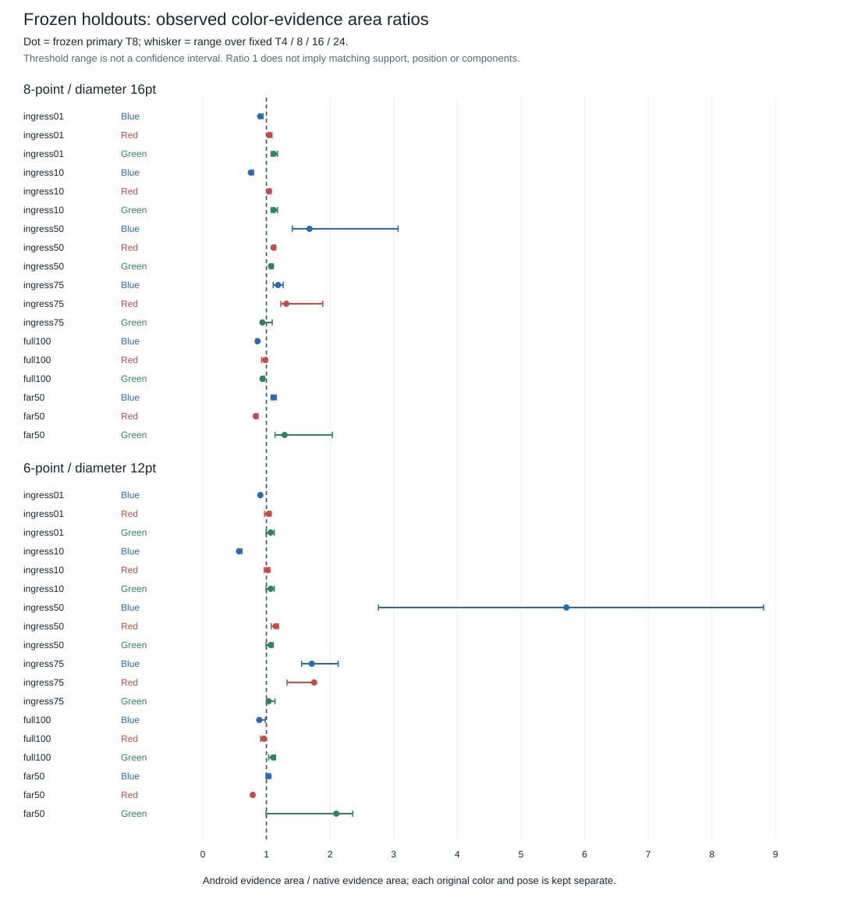
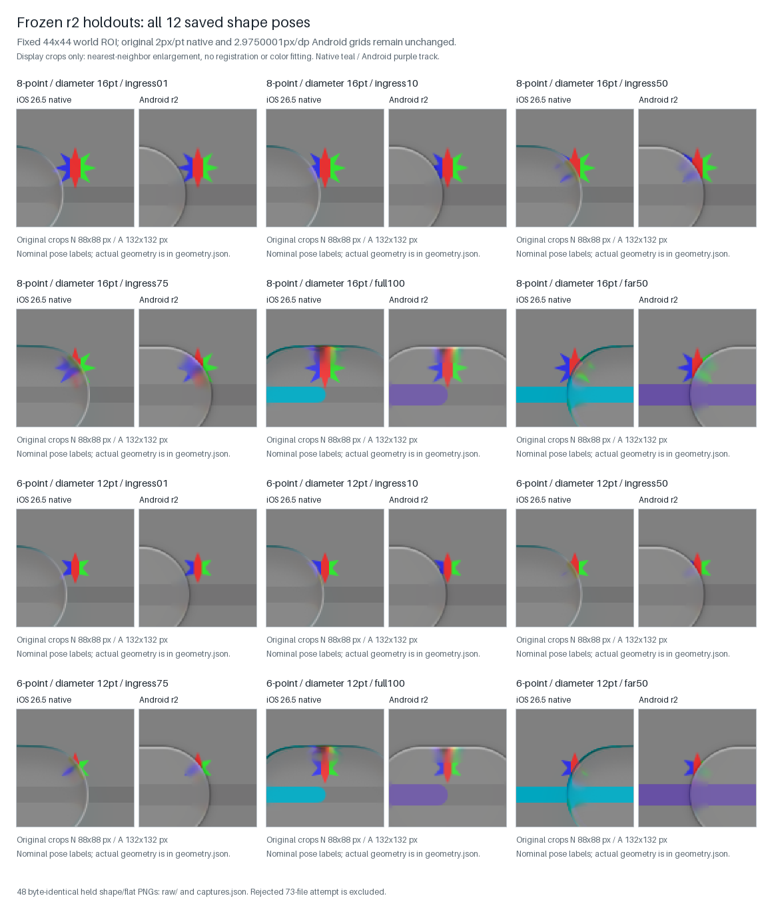

# Frozen r2 holdout evidence — 2026-11-15

**Both holdouts retain unresolved native/Android differences.** This portable report covers the frozen eight-point 16pt star and six-point 12pt star. Material parameters, source roles and analysis criteria were unchanged; neither source was used to fit r2. The [full report](../../../glass-slider-holdout-validation.md) explains failures, capture provenance and limitations.



Dots use predeclared threshold8; whiskers span fixed thresholds4/8/16/24 and are not confidence intervals. Equal area is not equal support, location, components or native parity. There is no pooled acceptance score.

## Packet contents

| File | Meaning |
|---|---|
| [numerical-primary.json](numerical-primary.json) | All 36 primary color/pose rows, with the actual native/Android areas and component counts. |
| [numerical-fixed.json](numerical-fixed.json) | All 144 fixed color/pose/threshold rows and 48 whole-evidence rows, extracted without rounding from frozen comparisons. |
| [geometry.json](geometry.json) | Actual carrier/source mappings, residuals, approximate capsule overlaps and ambiguity flags for both shapes. |
| [captures.json](captures.json) / [raw](raw) | 48 original held PNGs: native/Android × two shapes × six poses × shape/flat. No screenshot is reencoded. |
| [sources/star8](sources/star8) / [sources/star6](sources/star6) | Byte-identical frozen holdout specs/manifests, derived Android pose specs, derivation receipts and source asset maps. |
| [shared-assets.json](shared-assets.json) | Original source PNG/mask dependencies in the sibling calibration packet, all hash-verified. |
| [frozen-policy.json](frozen-policy.json) / [frozen-tools](frozen-tools) | Exact frozen holdout measurement policy and five tool snapshots; explicit holdout role required. |
| [verification.json](verification.json) | Native strict endpoints, Android 49-file receipts, unchanged source/APK identities and clean-six-point audit. |
| [rejected-six-point-incident.json](rejected-six-point-incident.json) | Bounded summary of the rejected reused-directory attempt; no rejected PNGs or optical measurements are included. |
| [provenance.json](provenance.json) | Archival overview/conclusion hashes and explicit exclusion of later witness/control diagnostics. |
| [manifest.json](manifest.json) / [SHA256SUMS](SHA256SUMS) | File inventory and integrity checks, including shared source dependencies. |



The figure is a nearest-neighbor display crop. Original native2× and Android2.9750001-density pixels remain unchanged for measurement. Flat PNGs are retained alongside every shape capture.

## Interpretation and provenance

Eight-point ingress50 blue evidence area is 39.000 native versus 65.419 Android at threshold8 (1.677×), and full100 blue remains too small. Six-point ingress50 blue is 3.500 versus 19.999 (5.714×), with components3/2; its small denominator is explicit. Six-point far50 green is 7.000 versus14.688 (2.098×). Its threshold24 areas look close, but centroids and components still disagree. All colors, poses and thresholds remain in the JSON.

Actual carrier/source residuals and rail ambiguity remain. In particular, six-point ingress75 approximate capsule overlap is 0.7657 native versus0.7311 Android. All captures retain the conservative rail-confounded-domain flag. These descriptors are not physical thickness, alpha or unique optical-ray measurements.

Native8/native6 each passed12/12 endpoints and6/6 pairs. Android8 has49 current files. Formal Android6 is only `android-quadratic-validation-clean-r1`:49 current files, no residues,17 identity checks and frozen pointer/readiness/settling/six-pair checks passed. Its first73-file reused-directory attempt is rejected and excluded. Correcting that acquisition is not a new independent sample or a parameter change.

The original specs/manifests retain their exact bytes and historical provenance strings, including pre-capture `UNSAMPLED` state. That historical state records when they were frozen; it does not claim they remain unmeasured. Current evidence is in this packet. Resolve immutable source PNG/mask references through each `sources/*/assets.json`; preserve the sibling [calibration source packet](../glass-slider-star-20261115/README.md) when moving these files. Its image/mask bytes are identical, but its calibration manifest is never substituted for the local holdout manifests.

## Reproduce and verify

Python3 and Pillow11.3.0 were used. No device, Xcode, ADB or network is needed after the image dependency is installed.

```sh
python3 -m pip install -r requirements-figures.txt
python3 reproduce-figures.py
shasum -a 256 -c SHA256SUMS
```

The script verifies all48 original PNGs and the shared source hashes, then regenerates the SVG and PNG from frozen JSON/original pixels. It performs no registration, fitting, new optical analysis or capture. SVG output is standard-library text; display PNG bytes are deterministic in the recorded pinned Pillow environment. The frozen measurement tools retain their full original acquisition/trace contracts; the compact receipts are not replacements for those large trace inputs.

The manifest inventories every local packet file except itself and `SHA256SUMS`, plus the shared dependencies and companion report. The SHA list covers those files, the manifest, shared original source assets and the report. This is a bounded holdout disclosure for two static light-theme sources, not full dynamic/all-control acceptance. Future candidates that use these observations require disclosed reuse and an untouched evaluation set.
