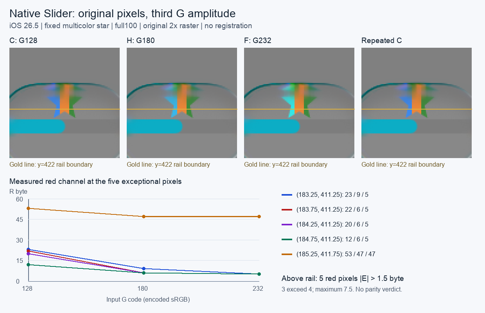

# 第三个 G 幅度：便携原像素证据

本包是 iOS 26.5 native Slider 在同一多色五角星上的颜色诊断。**r2 仍未验收，七角星未消费。** [完整报告](../../../glass-slider-midpoint-diagnostic.md)列出五个例外及解释限制。



| 文件 | 含义 |
|---|---|
| `crops/` | H（G180）和 repeat C 两轮的 24 张原像素 ROI；94×94 原栅格，不缩放、不变更 RGB/RGBA 字节。 |
| [manifest.json](manifest.json) | 四轮共 48 个 shape/flat ROI 的路径与哈希；C/F 原 ROI 复用相邻 G 证据包，另有全 PNG 原哈希和裁切坐标。 |
| `metadata/` | 四轮原接受 index、source spec/manifest，以及两轮新增严格回执，gzip 无损保存。旧 C/F 回执复用相邻包。 |
| `original/*-midpoint-original-byte.npz` | 六姿态原 x/y、inset、中点残差、flat 残差、重复 control 和有限差分数组。 |
| [官方输出](original/analysis.json.gz) / [v1.1 计划](original/analysis-plan-v1_1.json) | 完整既有统计；逐轮 flat p99 门槛与修订时点。旧 v1 计划和原始结果说明也无损归档。 |
| `frozen/` | 原分析器与冻结 native parser 的原字节副本；未改动阈值、几何或统计函数。 |
| [replay-roi.py](tools/replay-roi.py) | 仅适配包内文件读取；重放全部官方统计、inset 分箱与原 NPZ 数组。 |
| [render-figure.py](tools/render-figure.py) | 从原 ROI 重画展示图与五条曲线；字体可能因设备不同，不影响原像素或统计。 |
| [checksums.json](checksums.json) / [复算记录](validation/replay-summary.json) | 本包文件完整性与首次便携复算结果。 |

需保留相邻 [glass-slider-green-witness-20261115](../glass-slider-green-witness-20261115/README.md)。所有导航及复算依赖使用相对路径；manifest 中旧电脑绝对路径仅作历史来源键，不用于读取旧电脑文件。

```sh
python3 -m pip install numpy pillow
python3 tools/replay-roi.py --output /absolute/path/to/new-summary.json
python3 tools/render-figure.py --output /absolute/path/to/new-figure.png
```

输出路径必须不存在。重放核对全部六姿态官方统计、固定 inset 分箱、四轮原几何回执及原数组。轨道上方实际有 **5 个红像素 |E|>1.5，3 个>4，最大7.5**；G/B 全六姿态不超过1.5。无总体通过、物理非线性或原生等效声明。

归档严格回执是原采集证据，裁片重放不重新验证省略的完整 trace，也不能恢复原全屏 PNG 哈希。243,079,685 bytes 原 trace 及其压缩包、APK、构建缓存均不随本包复制。encoded-sRGB 中点不等于线性光中点；单个 G 方向不能识别完整颜色矩阵、唯一 sampler 或折射厚度。普通 flat 始终为 `st00_flat128`。
