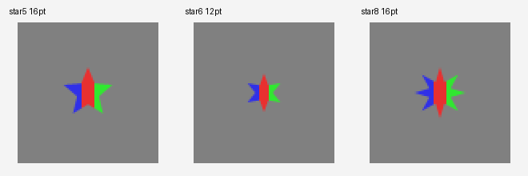
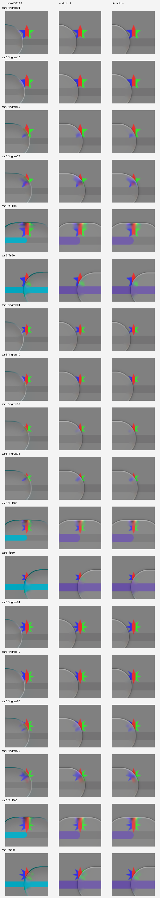

# Single-slider shoulder experiments — 2026-11-15

**r3 and r4 are rejected as universal replacements.** Restored r2 A7.8/W7.5/frost1.1 is an **unaccepted checkpoint**. Seven-point data are not acquired. The [full report](../../../glass-slider-shoulder-experiments.md) retains all failures and finite-model tradeoffs.



This is a bounded increment over the sibling [five-point calibration packet](../glass-slider-star-20261115/README.md) and [original r2 holdout packet](../glass-slider-holdout-20261115/README.md). Keep all three folders together when moving devices. Six/eight-point captures are **already-consumed regression data, not independent validation**; historical manifests and consumer roles remain `holdout`.



| Item | Contents |
|---|---|
| [captures.json](captures.json) / [raw](raw) | 48 new byte-identical held Window shape/flat PNGs; 72 native/r2 original PNGs referenced in sibling packets. Actual mappings, geometry, original Screen archive hashes and RGB ROI equivalence are explicit. |
| [sources.json](sources.json) / [shared-dependencies.json](shared-dependencies.json) | Relative original source/spec/manifest/frozen-tool paths with SHA-256 and sizes. Source PNGs and native/r2 large images are not duplicated. |
| [measurements/index.json](measurements/index.json) / [all-thresholds.tsv](measurements/all-thresholds.tsv) | Four complete96-row comparisons (three colors plusWhole × six poses ×4/8/16/24),384 rows total; compressed existing unrounded descriptor records. |
| [replayed-actual-support.tsv](measurements/replayed-actual-support.tsv) | All288 original-pixel color-set additions/removals, including r3. Existing r4 signed/support and normal-localization reports are preserved separately under measurements. |
| [provenance/acquisitions.json](provenance/acquisitions.json) | Original source/spec/manifest/package hashes and acquisition49-file identity checks, with acquisition-bound saved checks in compressed siblings. |
| [provenance/restored-r2-checkpoint.json](provenance/restored-r2-checkpoint.json) | Saved34-check/build/install restoration receipt; no optical acceptance is inferred. |
| [check-evidence.py](check-evidence.py) / [validation.json](validation.json) | Minimal bounded replay and recorded scope. It imports existing frozen ROI/geometry helpers rather than introducing another measurement framework. |
| [manifest.json](manifest.json) / [SHA256SUMS](SHA256SUMS) | Local and shared dependency integrity inventory; includes companion report. |

## Reproduction boundaries

The checker verifies120 complete retained original PNG hashes (48 local Window +72 shared native/r2) and replays fixed-ROI area, centroid, bounds and error arithmetic for all384 rows. It recomputes288 actual support-set rows. The retained new Android Window RGB ROI is byte-identical to its archived analysis Screen ROI; opaque RGBA alpha is verified before using the original RGB channels. This permits ROI replay without copying redundant Screen screenshots.

The omitted full Screen image hashes are historical archive identities. A crop, Window image or resized figure **cannot** reverify an omitted full-screen hash. Full native endpoint/presentation traces and the complete49-file acquisition sets are not duplicated, so this package does not rerun their full acquisition verifier. Saved checks and original report hashes are explicitly identified as historical receipts. Signed-grid/source-target and capsule-normal diagnostics retain all existing values and hashes; this minimal checker does not rerun those exploratory models.

Figure crops use original actual grids, nearest-neighbor display scaling, no registration, fitting or color adjustment. They are not substitute measurement PNGs. The declared capsule normal is an engineering geometry approximation, not recovered native optical alpha or lens thickness. Settled light-theme captures do not validate dynamic timing, all backgrounds, dark mode or other controls.

## Verify

Python3, NumPy and Pillow are required; no device, Xcode, ADB, network acquisition or GPU build is invoked.

```sh
python3 -m pip install -r requirements.txt
python3 check-evidence.py
shasum -a 256 -c SHA256SUMS
```

Numerical replay tolerance is absolute1e-10/relative1e-12 for floating arithmetic; original image and dependency hashes must match exactly. `manifest.json` inventories local files excluding itself and SHA256SUMS, shared dependencies, and the companion report. SHA256SUMS also covers the manifest. The local increment is capped at8MB and carries no APK, build cache or full per-pixel analysis arrays.
