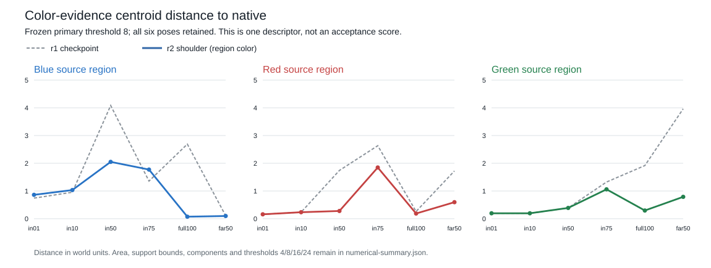
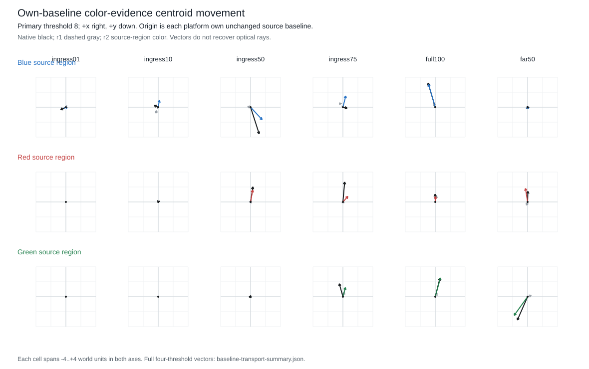
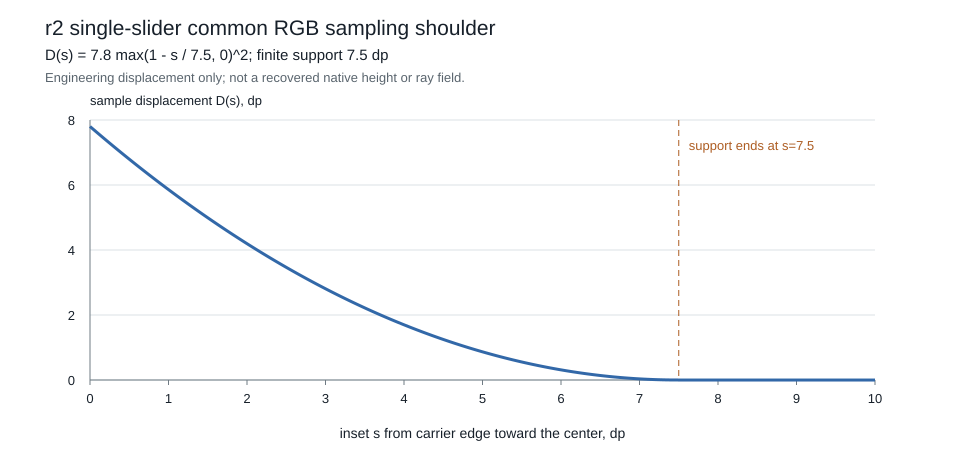
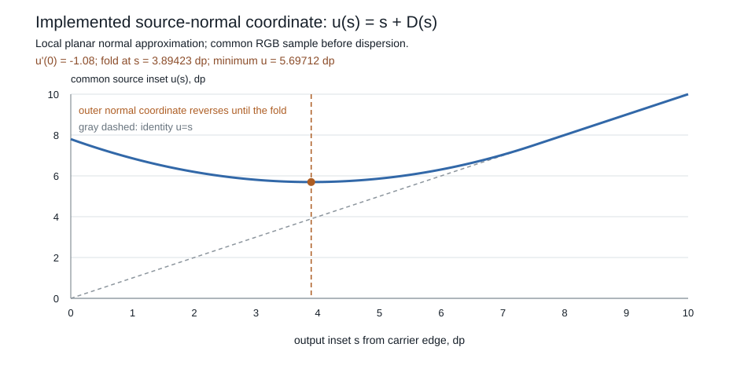

# First-star single-slider calibration evidence — 2026-11-15

This portable packet records the actual **r2 calibration checkpoint** against an iOS 26.5 native Slider. It is a research checkpoint with retained failures, not a parity or acceptance score. The [full report](../../../glass-slider-star-calibration.md) explains the source, protocol, implementation and limits. The earlier [rail checkpoint](../../../glass-slider-rail-checkpoint.md) remains historical.


## What is here

| File or directory | Meaning |
|---|---|
| [source/shape-spec.json](source/shape-spec.json) | Exact original specification, including historical provenance references. |
| [source/inputs/manifest.json](source/inputs/manifest.json) | Original source hashes and calibration split. First input is a 16pt five-point RGB star; reserved original assets remain for spec integrity. |
| [source/masks](source/masks) | Exact full-canvas original coverage-count/support masks. They describe known sources, not glass alpha. |
| [raw/ios](raw/ios) / [raw/android-r2](raw/android-r2) | 12 native and 12 Android original held PNGs, plus two Android source baseline PNGs. No screenshot is reencoded. |
| [captures.json](captures.json) | Portable relative file names, hashes, actual density/mapping, carrier bounds and capture timing checks. |
| [numerical-summary.json](numerical-summary.json) | Frozen r1/r2/native region and whole-evidence descriptors at thresholds 4/8/16/24. |
| [baseline-transport-summary.json](baseline-transport-summary.json) | All four thresholds of own-source-baseline movement and area ratios. |
| [verification.json](verification.json) | Compact existing native endpoint, actual Android capture and 93-test receipts, with original archival hashes. |
| [frozen-calibration-policy.json](frozen-calibration-policy.json) / [frozen-calibration-tools](frozen-calibration-tools) | Frozen thresholds, geometry rules and exact original measurement script snapshots. |
| [r1-r2-provenance-checks.json](r1-r2-provenance-checks.json) | Identical held values, geometry and source-baseline ROI checks across r1/r2. |
| [profile.json](profile.json) / [source-support.md](source-support.md) | Implemented 7.8dp / 7.5dp single-slider shoulder formula, code excerpts and actual recorded source hashes. |
| [manifest.json](manifest.json) / [SHA256SUMS](SHA256SUMS) | Packet integrity inventory. |

The large original per-pixel analysis arrays, native trace streams, presentation frame samples and acquisition-private host/device identifiers are not duplicated. Compact derived JSON identifies those historical source reports by archive ID and SHA-256. The original specification retains its exact bytes, including historical absolute provenance strings; current navigable links and portable capture references are relative. The frozen scripts are reference snapshots; their original full-trace input contract is not replaced by this compact receipt summary.

## Result

At the frozen primary threshold 8, `full100` blue centroid error changes from 2.690 to 0.073 and green from 1.917 to 0.296 world units. At `far50`, green changes from 3.964 to 0.789, with the direction corrected. These are specific descriptive improvements, not an overall similarity score.



Failures are retained: blue worsens at every threshold in `ingress01` and `ingress75`; `ingress10` blue worsens at primary 8 and at 16/24; area and centroid improvements disagree at `ingress50`. `ingress75` blue over-expands upward, red compression is incomplete and green's matching area hides a wrong left boundary. `far50` green remains too large and too high. The numerical summaries retain every component, all thresholds and every pose.



## Actual implementation and scope



The displacement curve alone hides an important fold: under a locally planar normal, common source inset u=s+D(s) has u′(0)=−1.08, turns at output inset 3.89423dp and reaches minimum source inset 5.69712dp. The source-normal coordinate reverses in this outer interval. This is the actual Android engineering mapping before channel-specific dispersion, not an identified native curve or physical thickness.



Only `sliderLens` uses the finite quadratic shoulder. `rangeSliderLens` retains the earlier 2.15 checkpoint profile. This does not change Dock, sheet, dialog, Toggle or Tab optics. The curve is a common RGB sampling displacement fit; it does not identify native physical height, alpha or optical rays. Dispersion, frost and rim parameters remain at their prior checkpoint values.

The native strict verifier passed 12 held endpoints and six shape/flat pairs. The Android production GPU capture passed one instrumentation test; all 49 recorded host/device file hashes agree. The saved focused build passed 93 JVM checks with zero failures, errors or skips. Captures are settled states, not millisecond motion measurements. Native teal and Android theme-purple tracks remain visible in originals and [flat controls](figures/six-pose-flat-controls.png).

The packet covers one reused 16pt calibration star, six settled poses and the light theme. Separate six-/eight-point holdouts have frozen roles/specifications and belong in a separate validation report; no result from them is used to tune this checkpoint or included in these calibration measurements. It does not establish every-background, dark-theme, every-speed or all-control equivalence.

## Reproduce figures and verify integrity

Python 3 and Pillow 11.3.0 were used. The four SVGs are generated from frozen JSON using the standard library; Pillow is used only for display images. No native/Android runtime, Xcode, ADB or network is required.

```sh
python3 -m pip install -r requirements-figures.txt
python3 reproduce-figures.py
shasum -a 256 -c SHA256SUMS
```

The figure script verifies raw input SHA-256 before cropping. It uses nearest-neighbor display crops from each actual grid, without registration or color fitting. No figure is a substitute for the original full PNGs. Regeneration with the pinned image dependency is deterministic in the recorded environment; other Pillow/font implementations can change display PNG bytes without changing any underlying measurement.

`manifest.json` inventories packet files except itself and `SHA256SUMS`. `SHA256SUMS` covers those files plus the manifest itself. Numerical summaries are exact extracted descriptors from the frozen full analyses; the figure script does not rerun measurement or choose new thresholds.
