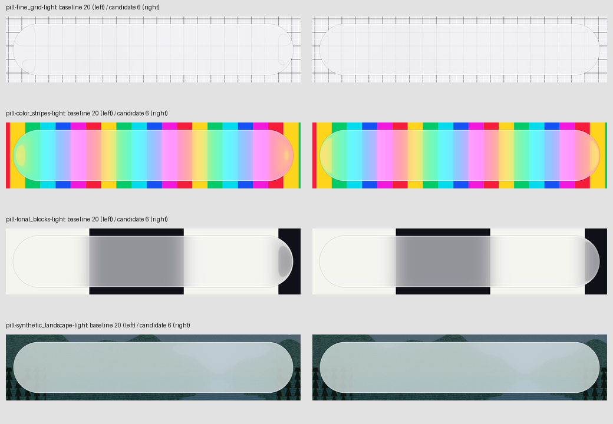
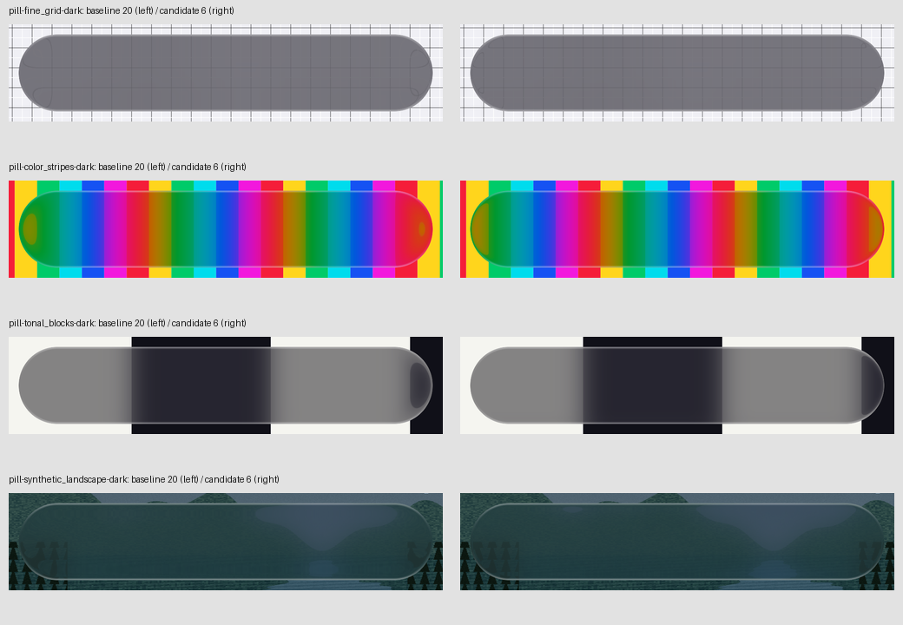
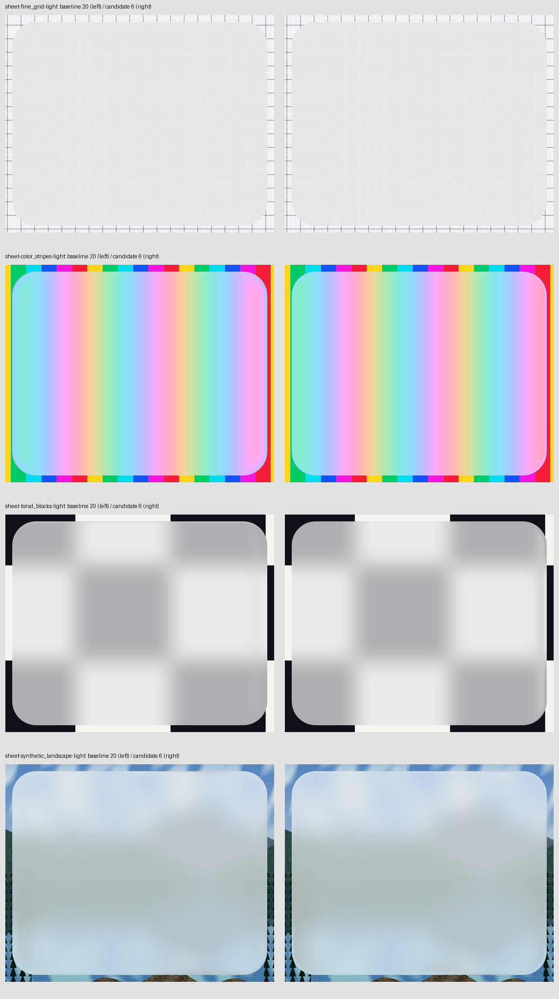
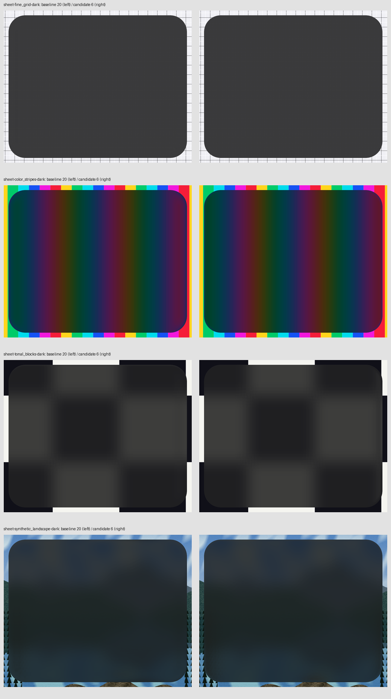

# 已撤回的边缘折射带候选：Android GPU 实验记录

**2026-11-14 · Android-only candidate experiment · 不是 iOS 原生对齐结论**

**后续状态：`bevel 20→6` 已撤回。** 随后的 iOS 26.5 同背景端部对照显示 b6 破坏了原生的源色延伸；机械检查通过不能支持采用。以下原始实验、32 张捕获身份和四张比较图保留，作为失败候选记录。此前四背景 × 主题均为已观察校准条件。Sleepy 应用当前冻结的 Dock 生产路径候选为实际 D46.5/b15.5；新八图、约七族定向合成挑战集的[固定 Dock REST 光度分析已完成](holdout-dock-results.md)，局部改善同时保留 12 个相关的工程复核单元，候选未验收、无总分。独立输运审阅、Sheet 与动态验证仍待完成；详见[验证边界](validation-boundaries.md)。

本次实验只回答一个窄问题：在既有正折射材质中，把 `bevel` 参数从 20 改成 6，是否确实改变 GPU 输出的边缘采样，同时保持所验中心和外部像素？结果是：16 个受控场景都存在边缘变化；每一对安全中心及外部区域的最大通道差均为 **0**。Sheet 的宽折射肩缩窄，但 Pill 在高反差条纹和明暗块上的端部出现更直、更硬的 D 形内缘。这是必须保留的候选风险。

**这些图本身是 Android 基线与候选之间的隔离比较，不含 iOS 同背景图，不能据此宣布候选更接近原生、完全自然或没有硬边。** 后续原生对照已否定该候选；本页保留实验当时的机械观察，不替代[历史原生证据图谱](evidence/RESULTS.md)。

## 1. 实验对象与控制变量

| 项目 | 本轮范围 |
| --- | --- |
| 比较 | 同一保留的 consumer，先 `baseline20`，再 `candidate6` |
| 唯一材质变量 | `bevel: 20 → 6`；每对记录中的其余 style 字段保持一致 |
| 形状 | Pill：请求 333 × 62 dp 的圆形胶囊；Sheet：300 × 240 dp、圆角 28 dp 的受控圆角矩形 |
| 主题 | light / dark |
| 背景 | fine grid、color stripes、tonal blocks、synthetic landscape |
| 规模 | 2 形状 × 2 主题 × 4 背景 = **16 场景、32 张实际 GPU PNG** |
| 输出 | 生产 `liquidGlass` 路径的 HWUI / Window PixelCopy；单张原图 1116 × 1071 px，density 2.9750001 |
| 状态 | 静态材质；不评估点击、长按、拖动、释放或中断时序 |

背景由本地夹具绘制并记录到外部 `LayerBackdrop`。细网格为 8 dp 黑白网格、0.5 dp 线；条纹为 18 dp 高反差六色条纹；明暗块为 112 dp 大块；风景是固定种子 `0x51EE9` 的程序生成图，含云、山脊、湖面与近岸纹理。它们没有用户课表、照片、账号或系统状态栏。

**几何限制。** Sheet 的 28 dp 圆角是为了隔离材质而设置的夹具几何，不能当成实际 App 半幅弹窗的轮廓或布局。Pill 也不是含图标、标签、选中滑片和交互状态的完整生产 Dock。**Menu 与 Alert 没有纳入本轮 GPU 矩阵**；其生产轮廓、控件布局和视觉效果不能从这组结果继承。

**后端限制。** 这是 Sleepy 应用生产路径上的新受控实验；公共库使用的官方 AndroidLiquidGlass 后端与应用的定制后端存在边界。它不自动构成公共 sample、所有设备或完整公开控件的结果。有关模块与后端边界见[架构说明](architecture.md)。

## 2. `20 → 6` 改变了什么

本轮没有引入三维厚度场、折射率或 Snell 光线求解。`bevel` 决定既有二维采样位移函数向内延续的带宽，不是测出的物理厚度，也不是从 UIKit 恢复的参数。

对于正折射分支，令 `d` 为距轮廓向内的距离，`m` 为短边的一半，实际带宽为 `b = min(style.bevel, m / 2)`；在 `0 ≤ d ≤ b` 内：

```text
t = d / b
q(d) = 1 − sqrt(2t − t²)
shift = −normal × D × q(d)
```

`d ≥ b` 时该位移分量为 0。这里 `normal` 是二维轮廓法向，`D` 是受尺寸限制的采样位移幅度。候选保留这个函数及位移幅度，只收窄其支持带。

| 夹具 | 基线参数 | 实测有效旧带宽 | 候选带宽 |
| --- | ---: | ---: | ---: |
| Pill | 20 dp | 约 15.462 dp，受实际栅格化短边限制 | 6 dp |
| Sheet | 20 dp | 20 dp | 6 dp |

因此，“20 → 6”是参数标记，不能把 Pill 原始有效带宽写成 20 dp。收窄带宽也不保证视觉更柔和：保留边界位移幅度的同时压缩过渡，可能使高反差取样块的内缘更硬。下列图正好保留了这个风险。

## 3. 四组 GPU 图

每张图从上到下均为细网格、彩色条纹、明暗块、合成风景；**左列是 baseline20，右列是 candidate6**。它们从实际 PNG 按面板实测 bounds 外扩 8 dp 裁剪，保持比例，用 Lanczos 缩小后排版并加文字。没有生成中间像素帧，没有修改颜色或抹去差异。用于测量的是原图，不是缩小后的 contact sheet。



**图 1 · Pill，light。** 网格弯折和风景变形更靠近外沿。彩色条纹端部的椭圆采样块变成较长的 D 形色带，明暗块右端也保留更直的内侧分界。不能只看风景上较轻的差异来判断该候选。



**图 2 · Pill，dark。** 条纹与明暗块更清楚地暴露端部取样形状。候选把变化压向外缘，同时令部分色块内缘更直、更明显；本页没有把它解释为“无硬边”。这些边界来自折射/直接透射的高反差交界，不能仅凭外观宣称新增或消除了独立描边。



**图 3 · Sheet，light。** 条纹侧边与圆角处的宽折射肩缩窄，主体的彩色模糊过渡保持。风景中央的天空、山影和雾化没有因该参数变化而重绘成另一种材质。这里的相同是基线/候选之间的结果，不是与 iOS 相同。



**图 4 · Sheet，dark。** 暗色细网格上的变化很轻，高反差条纹和明暗块更容易揭示边带变化。暗色主体仍较重；本轮保留了原有主体材质，并没有验证其原生质感。

## 4. 像素检查与结果

采样区域按实测圆形圆角矩形 bounds 计算：安全中心位于旧有效带宽之外再加 8 dp；边缘区从向内 2 dp 到旧带宽前 2 dp；外部探针至少在轮廓外 3 dp。它们分别回答中心是否变化、边缘是否实际响应，以及效果是否泄漏到所验外部区域。

| 检查 | 预设规则 | 本轮记录 |
| --- | --- | --- |
| 安全中心：基线 vs 候选 | 最大通道差 ≤ 1 个 8-bit 级别 | 16 对均 **0** |
| 外部：基线 vs 候选 | 最大通道差 ≤ 1 个 8-bit 级别 | 16 对均 **0** |
| 中心输出 alpha | ≥ 254 | 255；这是不透明 Window 合成结果，不是玻璃材质 alpha |
| 边缘响应 | 每个形状/主题组跨四背景累计至少 4 dp² 像素变化 ≥ 2 级 | 四组均满足；16 个场景都有实际边缘变化 |
| 中心输出 vs 裸源 | 每阶段 RGB 平均差 ≥ 0.5 | 报告通过；用于排除无材质/透明退化，不是相似度 |

每张 Pill 的安全中心包含 37,068 px，Sheet 包含 398,396 px。每对 capture 的 source recording revision 和面板位置保持一致，style 除 `bevel` 外相同。报告记录 32 次材料 effect 附着、79 次源绘制，源软件绘制次数为 0。这些观察与输出响应共同约束退化路径，不构成对每个 GPU 驱动内部执行过程的完整证明。

下表是边缘区中最大通道差至少 2 级的像素面积，单位为 dp²；它衡量**发生变化的范围**，数值越大不代表越好、越接近原生或玻璃越厚。

| 背景 | Pill light | Pill dark | Sheet light | Sheet dark |
| --- | ---: | ---: | ---: | ---: |
| Fine grid | 609.674 | 612.838 | 2,157.588 | 240.887 |
| Color stripes | 1,457.524 | 1,513.113 | 7,236.324 | 6,988.884 |
| Tonal blocks | 1,127.491 | 1,204.322 | 3,238.302 | 2,827.484 |
| Synthetic landscape | 2,675.291 | 4,568.490 | 8,939.142 | 6,772.289 |

边缘区平均绝对 RGB 差跨场景为 0.329–5.052，使用 0–255 编码值。条纹场景的最大单通道变化，Pill light/dark 为 87/123，Sheet 为 59/45；高反差端部变化并非可以忽略的量化噪声。

报告还保留 −4…24 dp 的有符号内距分桶。基线/候选差异达到 2 级的最深桶，Pill 到 14–15 dp，Sheet 到 18–19 dp，均处于旧带宽内。**这描述两个版本之差的范围，不是独立测出的候选“可见边缘只有 6 dp”。** 正位移函数的参数支持、最终纹理边界和人眼看到的高光宽度是不同量。

## 5. 公开数据、来源与复核范围

- [16 场景紧凑摘要](images/edge-profile/comparison-summary.json)：中心/外部最大差及边缘变化面积。
- [受控 capture 报告](images/edge-profile/capture-result.json)：32 张原图身份、逐阶段 style、实测 bounds、分区指标和 −4…24 dp 分桶。
- [公开文件清单与 SHA-256](images/edge-profile/publication-manifest.json)：四图及两份 JSON 的原始档案相对路径、字节数、哈希和处理说明。

四张比较图、摘要和 capture 报告均从 `artifacts/glass-thickness-profile-20261114/` 原样复制。发布前检查了 JSON 字符串与图像元数据，没有用户标识、设备序列号、凭据或本机绝对路径。`run_id` 是实验标签。32 张全尺寸原图保留在原始档案，本页只公开四张 contact sheet；capture 报告中的原图哈希用于辨认档案内容，不表示全部原图已随仓库发布。裸源参考仅在捕获内存中保留，因此其比较指标属于 capture 报告记录，不能仅靠此公开子集重新计算。

本轮能够说明：**在这套夹具、后端和静态捕获条件下，bevel 单变量候选确实收窄了既有折射采样带，所验安全中心与外部像素保持。** 它没有测出物理厚度，没有验证 iOS 26.5 原生等效、自然时间动画或生产 Menu/Alert，也没有证明高反差 Pill 的 D 形内缘已解决。后续同背景原生对照否定了该候选，现已撤回；本轮机械检查仍然成立，但不构成视觉验收。
