# Evidence atlas: native reference, historical calibration, and remaining gaps

This is a small, reproducible public subset of the 2026-11-12–14 research archive. The reference is **iOS 26.5 (23F77)** on a 375 × 667 pt test world. Android material captures use API 36 and the historical Sleepy application. The app's customized backdrop differs from the **official Kyant AndroidLiquidGlass 2.0.0 backend in this public repository**. These observations explain the runtime's development; they do not certify the independent backend or a finished set of public controls.

The original inputs were real native presentation getters, actual delivered touch events, actual Android window draws, and real GPU screenshots. Publication exports only small numerical tables and synthetic-fixture/control crops. Native fixtures were written for this study; no Apple implementation, user course data, photographs, account information, status bars, or raw device videos are included. Public images retain observed differences instead of retouching the surfaces to match.

[Source paths and SHA-256](sources.json) · [Computed tables](data/computed-results.json) · [Figure hashes](figure-manifest.json) · [Renderer](render_figures.py)

**2026-11-14 status clarification.** All four-background × light/dark optical conditions in this historical atlas are **calibration**, not independent holdout samples. The later `bevel 20→6` mechanical experiment was contradicted by native cap observations and withdrawn; its [report and images remain](../edge-profile-update.md). The frozen production-path Dock candidate is actual D46.5/b15.5, with unresolved body/edge/directional residuals. The separately preregistered eight-input challenge now has [completed fixed-Dock REST photometry](../holdout-dock-results.md): local improvements coexist with **12 correlated engineering review cells**, including overlapping ROI/probe summaries. These are not twelve independent errors, a global score or candidate acceptance. [All 656 paired cells](holdout/candidate-minus-baseline.csv), [all 12 review cells](holdout/engineering-review-triggers.csv), [source hashes](holdout/summary.json) and a [local renderer](holdout/render_figures.py) are public. Independent transport/topology review and Sheet verification remain outstanding; this scope cannot validate natural photos, other controls/sizes or dynamic timing. The [validation-boundary record](../validation-boundaries.md) separates these statuses without changing any historical figure or score.

## 1. Dock: held parent translation, before and after

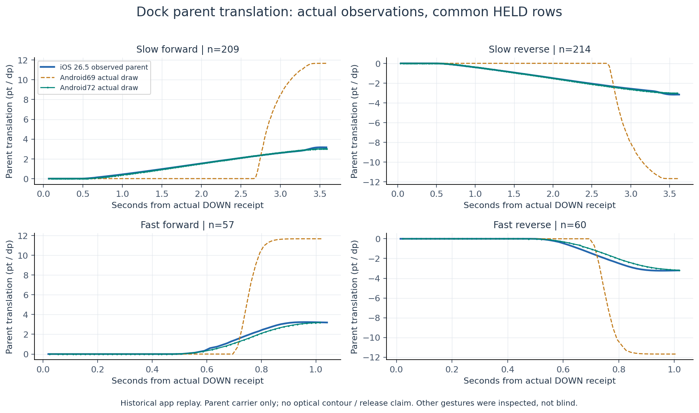

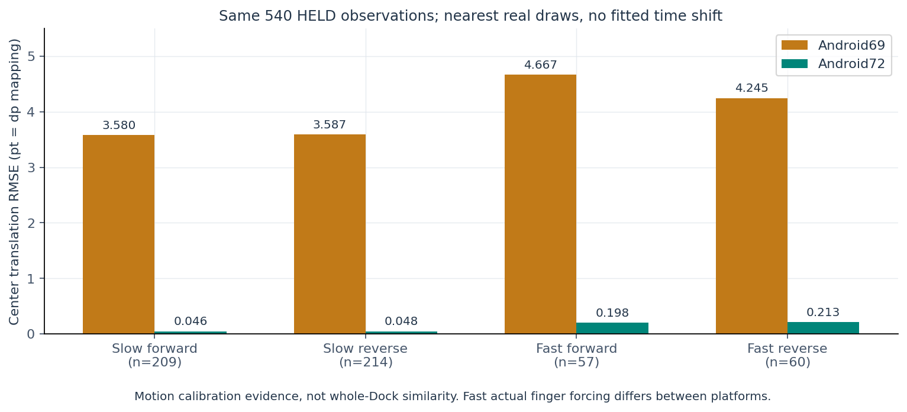

| Gesture | Common HELD observations | Android69 RMSE | Android72 RMSE | Android72 max absolute error |
|---|---:|---:|---:|---:|
| Slow forward | 209 | 3.580 | 0.046 | 0.162 |
| Slow reverse | 214 | 3.587 | 0.048 | 0.153 |
| Fast forward | 57 | 4.667 | 0.198 | 0.390 |
| Fast reverse | 60 | 4.245 | 0.213 | 0.424 |

Units are pt / dp under an explicit **1 pt = 1 dp coordinate mapping**. Each platform is anchored to its own actual DOWN receipt. Native getter midpoint is paired with the nearest real Android draw midpoint; no fitted delay, time warping, interpolation of observations, or parameter refit is introduced. Connecting lines are visual guides between recorded samples. Native getter samples can reuse an Android draw and are not independent trials.

All 541 native eligible observations remain in [the two narrow CSVs](data/dock-android72.csv). The table uses the same 540 native row identities whose nearest draw is wholly held in both versions. One fast-reverse Android72 match falls after UP and is retained as `android_wholly_held=False`, not replaced by a farther draw.

**Interpretation.** This establishes a bounded improvement in the full **parent carrier's translation**, not the visible lens boundary, opacity, light transmission, common lift/scale law, release, cancellation, interruption, other tab counts, or arbitrary widths. The slow-forward sample calibrated the frozen parent model; the other gestures had already been inspected and are not blind tests. Actual fast input forcing differs: maximum same-time finger differences were about 42.552 / 22.410 dp for forward / reverse, and nearest-draw phase difference reached 25.711 ms. A smaller replay RMSE cannot prove a more exact native physical model.

Inputs: [Android69](data/dock-android69.csv), [Android72](data/dock-android72.csv), [same-row summary](data/dock-summary.json). Original group: `android-dock-parent-response-72/independent-dock-parent-review/device-parent-comparison`.

## 2. Menu: visible corner shape and the value of retaining a threshold family

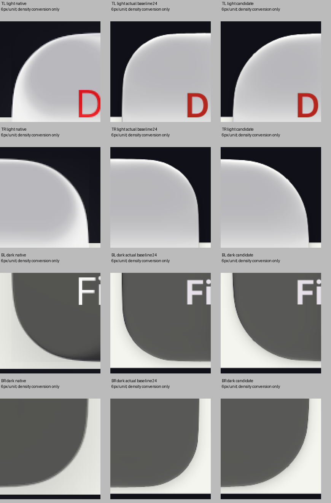

Columns are native / Android Menu24 / Android Menu32. Rows are top-left, top-right, bottom-left, bottom-right. The first two use the light calibration scene; the last two use the dark evaluation scene. The montage uses only a six-pixels-per-unit density conversion, preserving anti-aliasing and material differences.

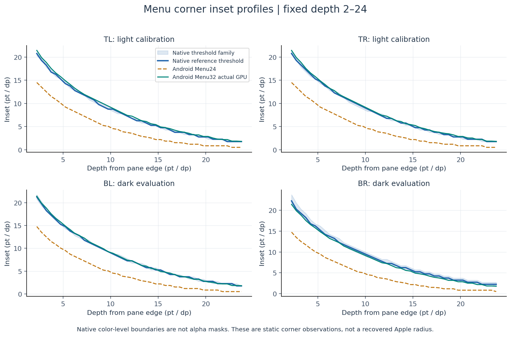

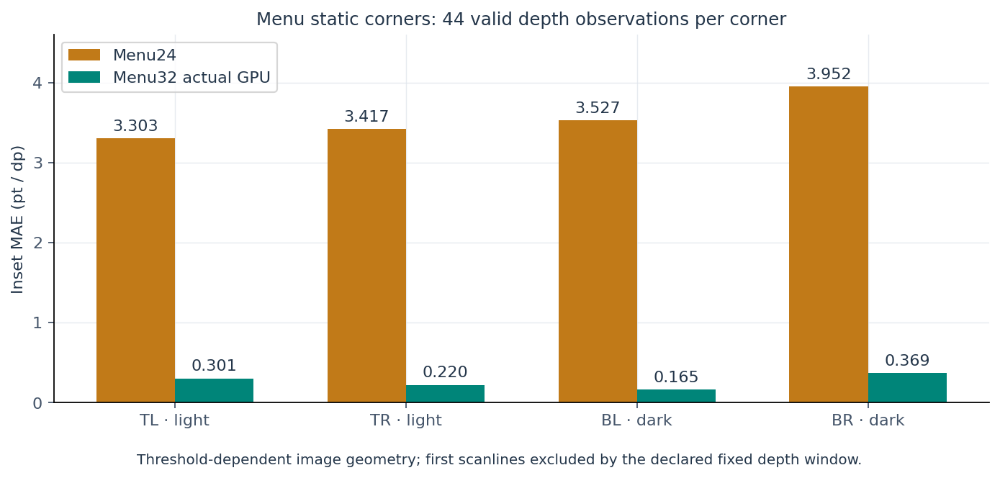

| Corner / scene | Valid depths | Menu24 inset MAE | Menu32 inset MAE |
|---|---:|---:|---:|
| Top-left / light | 44 | 3.303 | 0.301 |
| Top-right / light | 44 | 3.417 | 0.220 |
| Bottom-left / dark | 44 | 3.527 | 0.165 |
| Bottom-right / dark | 44 | 3.952 | 0.369 |

The fixed depth window is 2–24 pt / dp. Native color-level boundaries and their threshold family are compared with actual GPU window coverage; they are **not an extracted native alpha mask**. The input scene, world origin, density, and pane rectangle were checked before evaluating the candidate. Two high-contrast scenes each had 314,415 opaque window pixels exactly matching the composited display. This establishes capture consistency, not native optical parity.

**Interpretation.** Increasing the empirical continuous-corner parameter to Menu32 substantially improved this static shape experiment, including the separately evaluated dark corners. “32” is a candidate label and application parameter, not an Apple internal radius. First-scanline and threshold uncertainty remain in the full table. Material, edge highlight, text, animation and arbitrary surface sizes require separate evaluation.

Input: [corner profiles](data/menu-corners.csv). Original group: `menu-alert-visible-corners-20261113/menu32-full-gpu-validation`.

The separately declared `fine_grid-dark` secondary diagnostic uses native `maxRGB < 110/130/150` and Android Window coverage 64/128/192; its middle thresholds are 130 and 128. Keeping usable depths 2–24 gives 44 rows per corner. Their reference-threshold MAEs are TL 1.576, TR 0.513, BL 0.475, and BR 0.915 dp. TL retains a **15.004201 dp** maximum at depth 4.75 pt: native reference inset 0.75 pt versus Android 15.754201 dp. The native grid / rim / shadow dip contaminates this scene; it was not promoted to an alpha mask or used to tune Menu32.

The [176 secondary rows](data/menu-secondary-grid.csv) preserve all three threshold crossings. The [historical residual summary](data/historical-residual-summary.json) records exact archive paths and SHA-256 for the numerical source and original method report, plus recomputed secondary statistics. These are separate from the primary figure and corner table above.

## 3. Slider: an independent native-only deformation profile

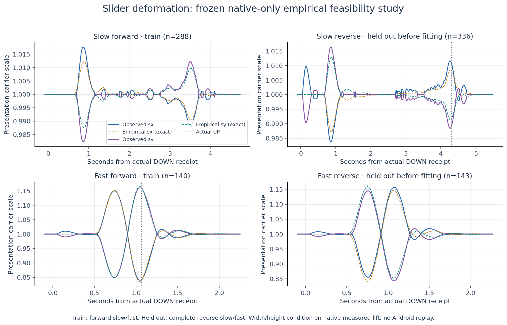

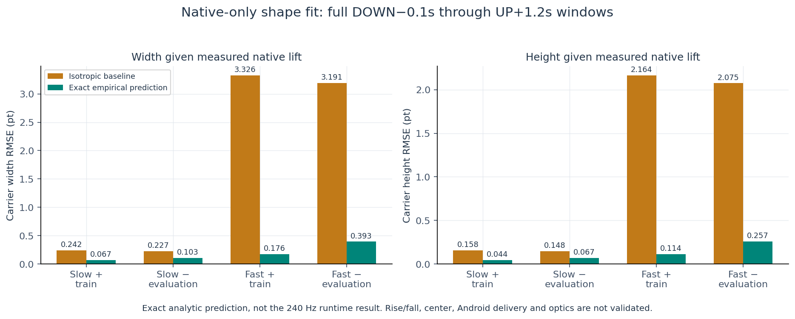

| Gesture | Split | Frames | Width RMSE: isotropic → empirical | Height RMSE: isotropic → empirical |
|---|---|---:|---:|---:|
| Slow forward | Train | 288 | 0.242 → 0.067 pt | 0.158 → 0.044 pt |
| Slow reverse | Held out before fitting | 336 | 0.227 → 0.103 pt | 0.148 → 0.067 pt |
| Fast forward | Train | 140 | 3.326 → 0.176 pt | 2.164 → 0.114 pt |
| Fast reverse | Held out before fitting | 143 | 3.191 → 0.393 pt | 2.075 → 0.257 pt |

The split was locked before fitting: forward slow/fast trained; complete reverse slow/fast were evaluated only after train-only selection. All 907 observed frame rows are retained, from DOWN−0.1 s through UP+1.2 s. The vertical dotted line marks each actual UP. Actual main-thread delivered input drives the model with no clock-offset parameter. The isotropic baseline keeps the same measured native lift but removes the independent X/Y deformation.

The model is a causal acceleration cascade:

```text
p'' = kf (u − p) − 2 ζf √kf p'
a'' = ki (p'' − a) − 2 √ki a'
q'' = a − 2 ζd √kd q' − kd q
sx = 1 + gx(sign(q)) q
sy = 1 − gy(sign(q)) q
```

Parameters are empirical estimates, not recovered UIKit constants. The plotted dashed predictions use the frozen **exact analytic calculation**, not a running Android device or the production 240 Hz integrator. The exported [fit summary](data/slider-fit-summary.json) keeps the search method, parameter limits and residuals. In particular, the follower damping ratio hit its explored upper bound, so the profile is not uniquely identifiable as a physical native mechanism.

**Interpretation.** This supports a separately estimated Slider deformation profile and rejects an isotropic-only model for these fast gestures. Width/height predictions explicitly condition on **measured native lift**. It therefore does not validate rise/fall, center translation, Android's actual input delivery, the runtime integration clock, release business callbacks, optical contour, material, or complete Slider parity. Two held-out gestures are evidence of bounded generalization, not a population study.

Inputs: [907 frozen observations and predictions](data/slider-native-fit.csv), [protocol](data/slider-protocol.json), [fit summary](data/slider-fit-summary.json). Original group: `android-native-replay-66/independent-slider-gap-review`.

## 4. Sheet: the same material across four backgrounds and two themes

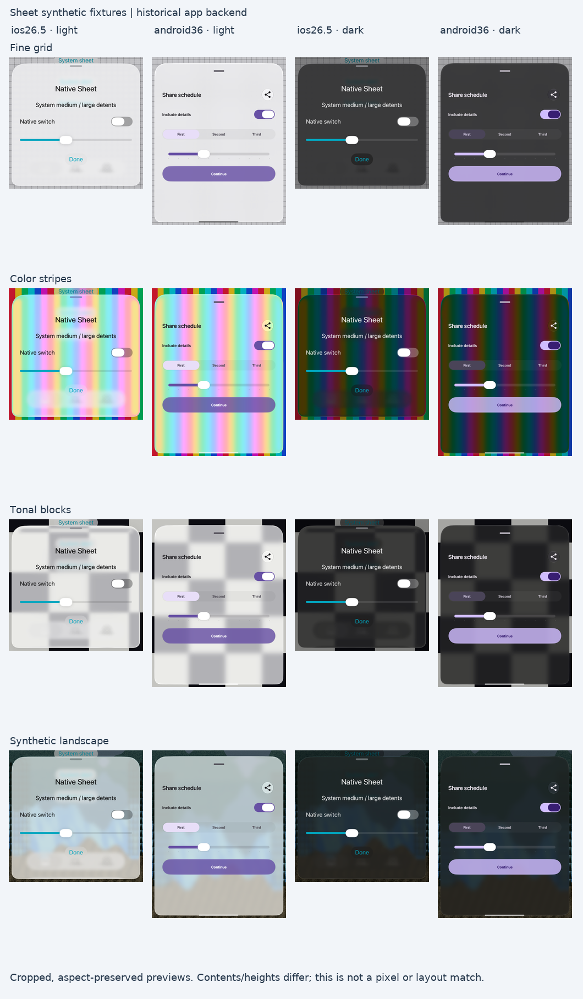

Each row changes the background; columns are iOS light / Android light / iOS dark / Android dark. The montage crops off system bars and the upper scene, preserves each preview's aspect ratio, and aligns cells for reading. It does **not** geometrically register or stretch sheet contents. Native and Android fixture contents, pane heights, controls and typography differ visibly; this experiment concerns a foreground-free material region rather than a 1:1 sheet layout.

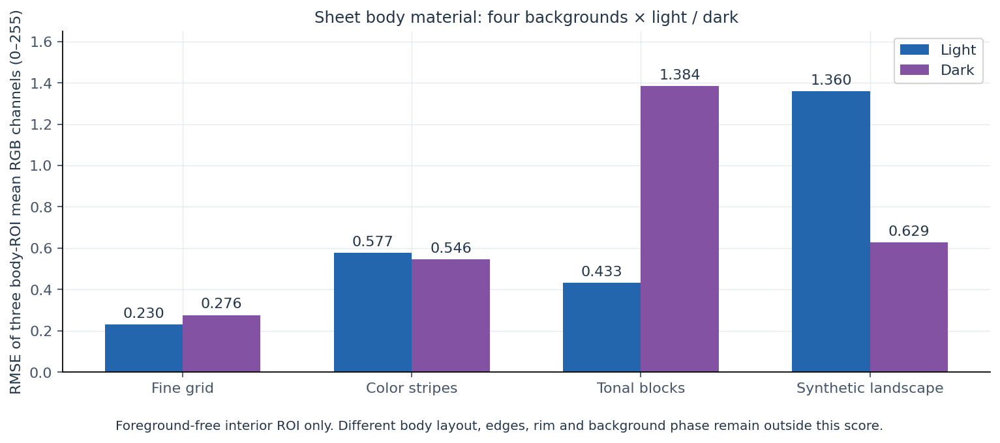

| Background | Light mean-RGB RMSE | Dark mean-RGB RMSE |
|---|---:|---:|
| Fine grid | 0.230 | 0.276 |
| Color stripes | 0.577 | 0.546 |
| Tonal blocks | 0.433 | 1.384 |
| Synthetic landscape | 1.360 | 0.629 |

These numbers are **RMSE of three mean RGB channels, on a 0–255 code-value scale**, within the declared foreground-free body ROI. They are not per-pixel whole-panel RMSE, PSNR, physical transmittance or a similarity percentage. The figure is a record of the fitted historical app material, not an independent blind evaluation. Edge profiles, fixed background phase differences, corners and directional highlights are deliberately outside this mean statistic.

**Interpretation.** The eight scenes prevent a flattering single background from hiding theme and spatial-frequency sensitivity. Good agreement of local mean color does not establish blur-kernel equivalence or rim/refraction fidelity. The source's same-coordinate color-stripe profile RMSE was 3.582 light / 2.403 dark; a flat mean can remain close while spatial response differs.

Input: [eight body ROIs and RGB means](data/sheet-body.csv). Original group: `native-static-optics/sheet-comparison-rim-4/eight-rest`.

### Additional archived profile summaries

The body-error figure plots **only mean-RGB errors**. The following full horizontal-profile values are separately extracted archived statistics, not a second series in that image:

| Background | Light horizontal-profile RGB RMSE | Dark horizontal-profile RGB RMSE |
|---|---:|---:|
| Fine grid | 0.412 | 0.303 |
| Color stripes | 3.582 | 2.403 |
| Tonal blocks | 1.234 | 1.554 |
| Synthetic landscape | 1.395 | 0.695 |

The neutral / fine-grid edge comparison retains the failed light top adjustment. Edge values use a 16-logical-unit tangential average, original pixel-center interpolation, and the complete inward 0–6 logical-unit RGB profile:

| Edge | Light rim3 | Light rim4 | Dark rim3 | Dark rim4 |
|---|---:|---:|---:|---:|
| Left | 5.552 | 2.004 | 12.778 | 8.082 |
| Right | 9.019 | 6.100 | 10.327 | 8.332 |
| Top | 3.144 | 3.992 | 11.637 | 10.280 |
| Bottom | 5.039 | 4.885 | 8.079 | 7.759 |

All values are 8-bit RGB code values. The light top full-profile error worsens even though a local peak can improve. Dark edges retain appreciable residuals. Different dimmed surroundings, backing controls, rasterization, and mismatched inputs at some actual edges prevent a material-only attribution or physical-alpha interpretation.

The [eight body-profile rows](data/sheet-historical-profiles.csv), [16 edge rows](data/sheet-historical-edges.csv), and [historical residual summary](data/historical-residual-summary.json) identify exact source paths / SHA-256, stages, windows, and units. The Sheet statistics are direct extracts of existing archive summaries. Public verification checks these extracts and their cross-table consistency; `render_figures.py` does not remeasure full profiles or edge pixels, refit material, or capture a new device result.

## 5. Slider optical gap: keep the unsuccessful material evidence visible

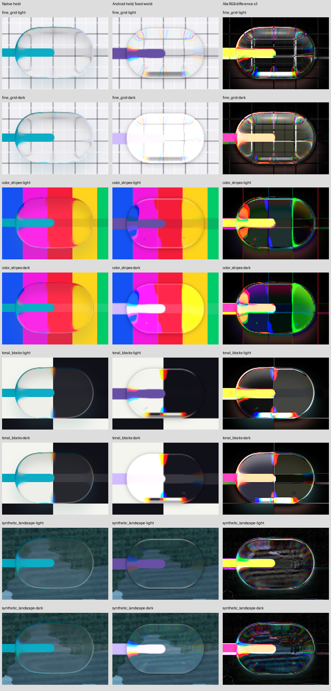

This is the **historical Android72 baseline**, not the final current runtime state. It is included because it demonstrates why geometry and a successful motion fit cannot stand in for material evaluation. Columns are native, Android at the fixed world mapping, and absolute RGB difference ×3. The third column includes the teal-vs-purple rail mismatch and receives **no whole-crop material score**. Native and Android light/dark behavior, extra color fringes, dark-theme whitening, lower rim and end caps visibly differ.

A small lower-inner diagnostic excludes the rail and its halo (`|y−430| ≤ 8 pt`) and a conservative title-influence region. Its direct native/Android RGB MAE was:

| Background | Light lower-inner MAE | Dark lower-inner MAE |
|---|---:|---:|
| Fine grid | 6.875 | 18.283 |
| Color stripes | 14.852 | 8.554 |
| Tonal blocks | 22.361 | 23.838 |
| Synthetic landscape | 15.005 | 11.860 |

Those are local image diagnostics on the same 0–255 RGB scale, not alpha or physical opacity estimates. A single bounded fixture translation was derived from the first REST image and held fixed across all scenes and states; no per-scene registration or color normalization was performed. The native held image was taken inside real DOWN/UP after at least 0.65 s. Android used a real active DOWN and a controlled settled Compose clock at 1.6 s, so the pair is **settled-state evidence, not matched natural-time animation**. Source phase/rasterization and refracted foreground differences remain confounders.

The original methodology defines six windows and preserves the raw crop, actual geometry and independent source baselines. The gap motivated subsequent bounded experiments; this atlas does not turn that motivation into a claim that the gap is now closed.

Inputs: [optical methodology](data/slider-optical-method.json), [eight held local residuals](data/slider-optical-residuals.json). Original group: `android-dock-parent-response-72/independent-slider-optical-review`.

## 6. Toggle: visible rise and release reference, native only

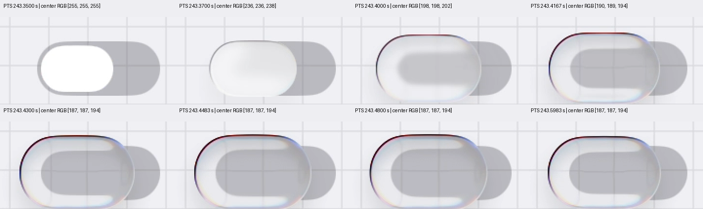

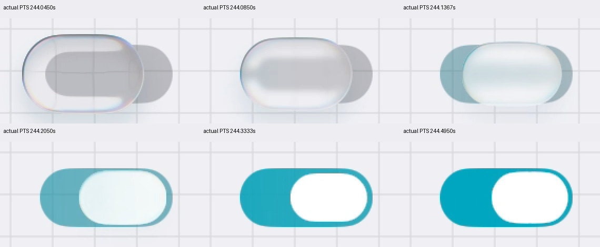

The first contact sheet uses original video PTS 243.350–243.598 s; the second uses 244.045–244.495 s. Frames are cropped and enlarged decoded pixels, **without generated or interpolated animation frames**. The source is a clean UIKit hold in the custom iOS reference fixture, on a light fine-grid scene. This is not a matched Android run or evidence that the current public library reproduces the timeline.

The first sequence shows the background becoming visible through the lens as its geometry grows. The second shows movement, theme-colored track fill and recovery of the solid white thumb during contraction. It must not be reduced to a geometry-only holder opacity measurement; the native holder itself remained opacity 1 in the trace.

A fixed 10 × 10 source-pixel center patch, while the lens was stationary, was projected between the settled HELD RGB and white. The exported [native observations](data/toggle-white-mixture.csv) show approximate white-mixture proxies of **0.72, 0.15, 0.03 and 0.00** at about **50, 84, 100 and 117 ms** from DOWN. This is an image-space mixture proxy, **not native layer alpha or physical transmittance**. The video/trace registration has roughly one frame of uncertainty; decoded video quantization and backdrop response affect the numbers. A fixed patch cannot measure release opacity because the lens moves across different background and track colors. No matched Android optical run accompanies this subset, so the atlas makes no Toggle parity verdict.

Original group: `native-analysis/optical-review`. Only the two synthetic-fixture contact sheets and small native proxy table are republished; the raw device video remains outside this repository.

## Reproduction and audit boundary

```sh
python3 -m pip install matplotlib Pillow
python3 docs/evidence/render_figures.py
python3 docs/evidence/verify_evidence.py
```

The renderer reads only committed small CSV/JSON/crops. It recalculates Dock common-row selection, Menu fixed-window errors, Slider exact-prediction errors and Sheet mean-color bars; it does not rerun the original optimization or recapture devices. SHA-256 source records identify the original archive bytes; anyone with that archive can re-export via `export_sources.py /path/to/archive`. This is **figure reproducibility**, not independent experimental replication. Full device videos, raw getter traces and historical failed runs remain in the separate research archive.

The figures use standard Matplotlib/Pillow output. All source crops were visually inspected before publication. No cross-platform screenshots were retouched to remove a surface mismatch. File names, local data and captions distinguish historical app calibration, native-only fitting, actual GPU observations and current public API availability.
