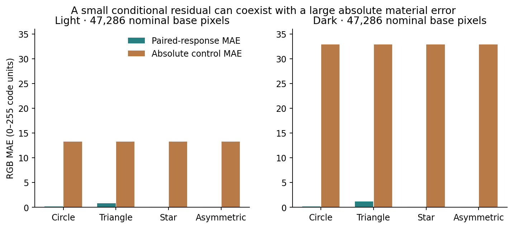

# 受控光学资产的公开与恢复

这个目录只保存可重建输入和已经公开观察过的静态诊断。阅读入口是[受控光学研究](../../controlled-optical-studies.md)，逐文件身份在 [sources.json](sources.json)，制图数字在 [figure-data.json](figure-data.json)，图像身份在 [figure-manifest.json](figure-manifest.json)。原始报告中的失败、null、未执行阶段和设计限制随原件保留。



这个例子解释为什么不能只看局部误差：固定场景中很小的条件差分，仍可伴随很大的绝对控制图误差。它是历史静态诊断，不是当前默认材质的验收。

## 发布校验

在仓库根目录运行：

```sh
python3 docs/evidence/optical-inputs-20261115/verify_publication.py
```

校验器只使用 Python 标准库；读取公开包、当前绑定的源码和文档，不调用 Gradle/Xcode、设备、光学分析器或网络。它检查全部原件/压缩件的文件哈希和解压后身份、冻结生成器身份、已发布输入元数据之间的关联、图与数据身份、源码快照以及新文档的本地链接。它不重新解码捕获图像，不重新计算光学结果。脚本本身用 AST 解析检查，不生成 `__pycache__`。

归档 Markdown 不重写，以免破坏冻结 README 的身份。校验报告把其历史缺失链接单独列为 `archival_link_observations`；它们可能指向原工作区的捕获文件、未公开逐点原始大文件或因压缩变名的 CSV。只有本文和新研究入口的文件链接属于完整公开链接门禁，不能把归档例外写成“全库所有链接均可访问”。

## 从无损压缩恢复原字节

`sources.json` 的 `processing` 明确区分逐字节复制与确定性无损 gzip。恢复某张表可直接运行：

```sh
gzip -dc docs/evidence/optical-inputs-20261115/archive/glass-plain-context-20261114/calibration-results/native-android-differential.csv.gz > /tmp/sleepy-native-android-differential.csv
```

恢复后用该记录的 `source_sha256` 校验，不要用压缩件的 `published_sha256`。原本就以 `.jsonl.gz` 保存的组件记录是逐字节复制，它的 source identity 仍是原 gzip 文件身份；不应擅自多解压一层后拿不同字节对比。

后续 headroom 的 `strips.csv`、`metrics.csv`、`regressions.csv` 共约 139.5MB 原字节，完整作为确定性无损 gzip 公开；`omitted_numeric_identities` 为空。其独立审计、压缩报告与汇总也随库公开。原工作区的庞大逐点 JSON 没有重复拷贝，完整逐点状态与同 ID 表保留在这个公开包中。

## 纯输入重建

两批原始冻结依赖均为 Python 3.9.6、NumPy 2.0.2、Pillow 11.3.0、LittleCMS 2.17。使用匹配这些版本的解释器，不要修改或重新生成 freeze。输入图的像素身份之外，PNG 压缩和 ICC 的字节身份也必须匹配。

以下命令的目标必须是仓库外的新建或空目录；命令会重建 calibration **和** test 的输入及 oracle，不读取任何测试捕获输出：

```sh
/path/to/frozen/python3 docs/evidence/optical-inputs-20261115/rebuild_inputs.py --destination /tmp/sleepy-optical-input-rebuild --kind all
```

`--kind noise`、`shapes` 或 `flat` 可只恢复某一批。若当前解释器不是冻结环境，也可以用 `--python /path/to/frozen/python3` 指定实际执行解释器。工具先校验依赖和冻结源哈希，再将原始生成器、协议、README、ICC 与现有 freeze 复制到空目标。只调用原生成器的 `--generate`、`--verify`，随后逐项比对公开的原始 manifest；任何失败保留返回码、标准输出和错误收据，不替换种子、不放宽身份。

历史 `generate_material_sweep.py` 除生成 8 张固定 RGB 输入外，还会从旧机器路径复制 APK，因此这里**不执行或导入**它。`flat` 分支按原 manifest 的尺寸、RGB 和 ICC，以同样的 Pillow `Image.new`/`save` 创建源图，再对照原 PNG/像素哈希；它是独立纯输入恢复工具，不能冒充原历史采集生成过程重跑成功。

本次公开整理已在匹配的冻结环境中实际重建 40 张源图：noise 和 shapes 的 4 份 manifest 与原公开身份完全相同，原始 `--generate`/`--verify` 均返回 0，flat 的 8 张 PNG/像素哈希全部匹配。[rebuild-verification.json](rebuild-verification.json)保存依赖、原进程输出、manifest 哈希与 helper 身份。留存收据后删除了 87 个、32,776,673 字节的临时生成文件；另一台设备可按同一命令重建。这个结果不声称不同依赖下 PNG 字节仍能相同，源图恢复成功也不代表原生/Android 光学验证通过。

## 重绘文中的新增图

需要 NumPy、Pillow、matplotlib。四组成对 PNG/SVG 图从已发布数值读取，肩部/headroom 图是方程示意，不拟合原生数据。校准源图裁片的两个完整源 PNG 可先由上面的 noise 分支恢复，再运行：

```sh
python3 docs/evidence/optical-inputs-20261115/redraw_figures.py --calibration-source-root /tmp/sleepy-optical-input-rebuild/glass-noise-20261114/calibration
```

不传 `--calibration-source-root` 时只重绘数值/方程图，并将本次 figure-manifest 写成这 8 个文件；要保持当前 9 图清单，应使用上述完整命令。SVG 元数据和绘图库版本可能改变字节，重新生成后必须重新运行发布校验，不要把绘图库变化解释为数据变化。`figure-data.json` 记录用于柱状图的完整选择；所有 4 个历史幂指数场景和 8 个 plain-scroll 场景均保留。

## 本包不包含的操作与结论

本包没有 APK、构建缓存、xcresult、视频或原始全屏设备截图；没有打开 RGB 噪声 n01–n04 或孤立形状 test 的捕获输出；没有新采集、参数拟合和设备操作。动态 v4 是尚未冻结/执行的协议草案。headroom 的 GPU 结果保留角点退步和 false-255，候选仍默认关闭。当前公共源码的精确身份与关闭状态见 [runtime-source-identities.json](runtime-source-identities.json)，不应把参数实现或文档完成当成原生外观已验收。
