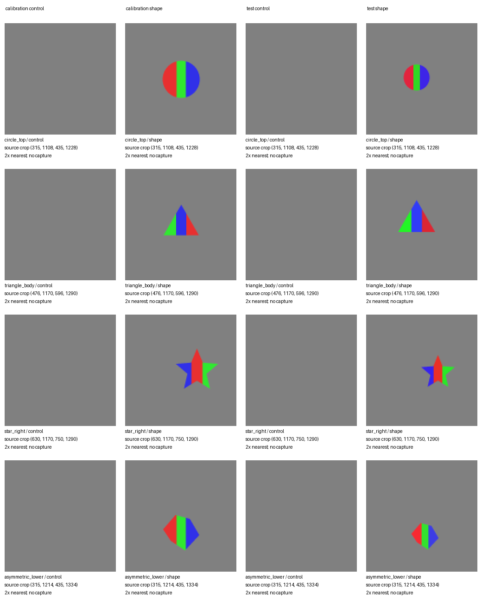

# Isolated multicolor shape pairs

This packet is a **targeted static diagnostic**, informed by the preserved dot-pilot rejection audit. Each calibration/test set contains four shape/control pairs: circle at the known upper edge, triangle in the body, star at the right end, and an asymmetric polygon at the lower edge. These regions use the already frozen Dock geometry. They are not an overall scene-generalization sample.



The atlas contains only generated source crops, enlarged with nearest-neighbor sampling and labeled outside the crops. It contains no native/Android capture and makes no parity claim. The full fixture inputs remain 750×1334 opaque RGB sRGB PNGs. All eight controls are byte-identical RGB128 backgrounds; each shape input differs by exactly one three-color object. Calibration uses fixed geometry. Independently seeded test inputs jitter center, radius and colors within the predeclared bounds.

`protocol.json` fixes regions, seeds, exact shape definitions, color bands and rasterization before generation. `freeze.json` binds that protocol, this README, `generate.py`, ICC bytes and dependency versions. The generator has no screenshot, network, device or product input. It refuses changed frozen source or dependencies. Each split has a fixture manifest with schema1, set/split IDs, `id`, `file` and SHA256 plus supplementary source-pixel/pair metadata hashes. `test/manifest.json` uses `split: holdout`; this means a fresh seed test of the targeted design, not design blindness or natural-scene representativeness.

For each pair, the metadata preserves source IDs, seed/draws, exact float64 boundary vertices or analytic circle, ideal center/circumradius, RGB bands, pixel/point/world coordinates, source area and pixel-center moments. Every color-band mask is saved as lossless per-row integer coverage RLE with denominator16, representing the declared4×4 subpixel membership exactly. The masks reconstruct every source pixel, including AA boundaries and color-band crossings. Coverage area is distinct from a continuous analytic area and observed native response area.

Run, in order:

```sh
python3 generate.py --freeze
python3 generate.py --generate
python3 generate.py --verify
```

Freeze once. `--generate` writes both complete registered splits and the source atlas. `--verify` reconstructs the stimuli from the frozen seeds and from the saved coverage tables independently, checks manifest/source/pixel/metadata/profile hashes, opaque RGB dimensions, all control identity and16 input IDs. This is input verification only. Neither command captures a device, changes the product, calibrates the renderer or establishes optical correctness.

The paired difference can support detection and morphology of a conditional visible response. It does not prove linearity, a physical PSF, unique thickness/IOR, or the absence of material adaptation and foreground/lens masking. Root must freeze the analysis using calibration and record capture state/repeats before reading the independent test outputs. Preserve unresolved responses and all failed acquisitions. Do not revise these inputs after viewing test captures.
