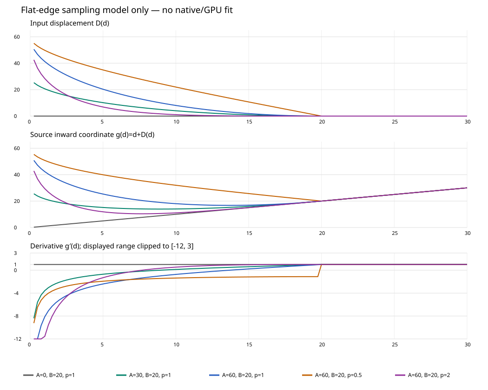

# Alert / Sheet 非线性采样映射审查

本轮只读普通 Alert / Sheet 的正折射路径与本轮非周期探针数值，不改 Dock、源码、设备或构建。当前结果不支持直接把 refraction 或 power 调大；先测清采样映射及其导数，才能决定下一步改哪个自由度。这里没有恢复原生物理厚度，也没有新截图或旧 heldout 图像解码。

## 1. 位移和“看起来拉伸”不是同一个量

在平直边沿，令 d 为从边界向内的距离，n 为朝外的法向。当前 AGSL 的采样坐标是：

```text
S(q) = q - n(q) D(d)
A = min(refraction, refractionLimit * halfMinor)
B = max(min(bevel, halfMinor * .5), .001)
r = 1 - d/B                 (0 < d < B)
F = 1 - sqrt(1-r²)
D(d) = A F^p
g(d) = d + D(d)              # 实际读取的 source 向内坐标
```

令 Q=sqrt(1-r²)，则 F′=−r/(BQ)，F″=1/(B²Q³)：

```text
g′ = 1 + A p F^(p-1) F′
g″ = A p [(p-1) F^(p-2) (F′)² + F^(p-1) F″]
```

局部源坐标到图像的有符号伸缩是 **1/g′**，前提是该局部分支可逆。g′<0 表示顺序反转，g′=0 是折返点，|g′|>1 可以把结构压缩；这些都不能用 D 的大小代替。

以两种面板当前默认 A=60、B=20、p=1 的平直模型为例：

- 折返点在 d=13.6754pt；最低可采样 source 向内坐标 g=16.7544pt。
- source 向内坐标 20pt 分别出现在 output 的 8pt 和 20pt，同一源位置有两条分支。
- output d=8pt 时，A=30 的 g′=−0.125，|1/g′|=8；把 A 加到 60 后 g′=−1.25，|1/g′|=0.8。增加位移在这个位置反而把结构压缩了十倍。这是模型反例，不是对原生的测量。
- A 本身受短边半径上限限制，增加 refraction 超过上限后不会继续增加位移。



图上的导数显示范围截为 [−12,3]；完整数值保存在 `scalar-mapping-model.csv`。p=1 是基线；其余曲线只是自由度诊断，不是推荐参数。CPU Double 导数与该模型自身有限差分的最大差值为 7.62e−7；这不证明 AGSL 或原生的数值等价。

## 2. 单独改 power 仍有结构限制

p 不能改变 D(0)=A、bevel 结束位置 B，也不能修正 inset 或 normal 场。边缘 d→0 时，任意有限 p>0 都保留 D′≈−Ap/sqrt(2Bd) 的奇异斜率。调整 p 只是改变其系数和肩部形状。

在 d→B− 时，D≈A[(B−d)²/(2B²)]^p：

- p>.5 时 D′→0，与外部无位移区一阶相接。
- p=.5 时 D′→−A/(sqrt(2)B)。A60/B20 时 g′→−1.1213，而 B 外 g′=1，存在导数跳变。
- p<.5 时，肩部导数发散；不能把其更宽的变形直接解释为更自然。

在弯曲边缘还需要审查 normal 场。一般雅可比为 `J=I−n⊗∇D−D∇n`。只有当 inset 是真实局部距离、∇d=−n 时，才能简写为 `I+D′nnᵀ−D∇n`。即使平直法向曲线正确，切向曲率项仍会影响局部缩放；如果当前轮廓求解的距离或法向有偏差，单一 A/p 无法单独修正。下一步应该保留固定点上的 d、n、D、S 和完整 2×2 数值雅可比，不能把一个方向的 RGB 斜率当成全部几何。

## 3. 现有非周期数据能支持什么

复用的都是当前 `panel_probe_shapes` / `panel_probe_coordinate` 校准数据，提取结果及失败门槛保存在 `current-probe-observations.json`；没有重选 ROI 或重解码截图。

在 Alert y=269.75pt（距顶12.25pt），S02 的固定局部观测为：

|条件|50% crossing，固定平滑 pt|原始10–90%宽度 pt|对比幅度，encoded counts|局部门槛|
|---|---:|---:|---:|---|
|原生|104.590|12.533|49.882|通过|
|Android 基线60|105.507|24.143|42.721|失败：次峰|
|Android refraction0|104.461|24.572|47.033|失败：次峰|
|Android body radius8|106.190|13.905|53.612|通过|

body8 的局部边缘更清晰，但 crossing 仍右偏约1.60pt；这并不说明应该增大或减小某个折射幅度。body8 数据沿用分析字段名 `rim_blur`，提取文件额外标记为 `alert_body_radius8`，避免把它误认为旧的负 rimBlur 候选。

S02 是向上三角形，理想右边界约为 **source x=.5·source y−31**。若局部采样是 `(source x, source y)=(output x+U, b+g(d))`，所见右边缘只有：

```text
Δx ≈ .5 D(d) − U(d)
```

一个斜边无法分开法向 D 和切向 U。source 竖缝 x77pt 则位于另一个切向位置，并在 y265pt 处跨 source 颜色行。它不能与 S02 的单条边无条件拼成同一点的二维映射。body8 对该缝在 y269.75 的 crossing 为77.559pt，原生75.360pt；二者局部门槛通过，仍然只能称可测的渲染轮廓差异。Sheet S07 的原生局部扫描通过14行，而 body8 对照下的 Sheet 候选通过0行，不能从未识别的 Sheet 对应关系反推折射参数。

refraction0 把部分 S02 crossing 拉近，却未消除宽边，且顶部行对比度明显失配；body8 改善宽度后仍有位置误差。这些反例说明颜色、模糊、法向采样、切向采样应分开诊断。

## 4. 最小几何诊断：固定双斜边，量宽度与中心

建议新增独立版本的静态 source，保持一个**宽实心梯形**，两侧是斜率相反的直线。形状的封口离相关 source 足迹足够远，避免 S02 那样只剩一个被截断的斜边。该建议尚未生成图片或采集。

用真实世界坐标定义 u=source y−b、v=source x−c：

```text
左边 v = −a−m u
右边 v =  a+m u
a=20pt，m=.25，source u∈[−64,128]pt
```

Alert 暂定 (c,b)=(187.5,257.5)pt；Sheet 暂定 (90,317.5)pt，在其顶边左侧避开中央 grabber。必须先证明两个边缘处于原生和 Android 都可用的平直、无前景区域，再冻结实际 ROI、source PNG 哈希和 oracle；这些坐标不沿用旧 ROI 的验收资格，也不允许用截图配准补救失败。

若该窄条内映射沿切向近似不变，左右输出 crossing 为 L/R，则：

```text
W(d)=R−L = 2a+2m g(d)
C(d)=(R+L)/2 = c−U(d)
g(d)=(W−2a)/(2m)
D(d)=g(d)−d
U(d)=c−C(d)
g′=W′/(2m)，g″=W″/(2m)
```

这样，宽度承担法向映射诊断，中心承担切向位移诊断；不会再把“横向边变宽”直接解释为法向位移更大。报告 g′的符号、接近0的区段、分支顺序及 g″，同时保留原始 RGB/对比度/10–90%宽度。轮廓不能识别时就不计算映射。

可识别性检查最少包含以下内容：

1. 同一几何使用灰度60/190及其完全相反的填色，分别采集。对比反转后 crossing 必须在声明的不确定度内一致，用于暴露高光、色调或空间变化模糊引起的边缘偏置；反转一致也不等于恢复了孤立 blur kernel。
2. 用第二个半宽 a=24pt、相同中心/斜率再做同样对比反转。两种宽度得出的 g/U 必须相容；否则“局部切向不变”的前提被证伪，转向二维场诊断，不能继续套标量公式。因此条件式最小估计为一对图，带必要前提核验的最小组为四张 source/载体。
3. 实际 before-display 的采样足迹应有可核对的同一底图，前景/底层控件影响分别记录。直接前景 mask 无法排除背后控件被宽核混入；不满足时保留为混合上下文。
4. 继续使用原非周期计划的对比、次峰、平台和定位门槛；不补齐缺失边、不挑最近的 crossing、不抹掉重复分支。保持750×1334原始像素、375×667世界，不平移、缩放或 warp 输出截图。
5. 先报告 d=.25..19.75pt、间隔.5pt的 crossing。导数使用预先固定 h=4pt 的中心差分，仅在两端都合格时计算；边缘只能报告对应区间中点的割线，不能外推 d=0 导数。

2px/pt 下，每条边定位至少±.25pt。m=.25 时，最坏的 g 误差下限已达±1pt；h=4pt 的 g′/g″确定性传播上界分别为约±.25、±.25/pt，实际平台/模型误差还需另计。最外层1–2pt的连续导数仍不可据此精确恢复，应明确标记分辨率限制，不能给出逐像素高精度或原生物理厚度结论。

## 文件

- `analyze_mapping.py`：仅标准库，重算本目录的数学模型和现有数值提取。
- `input-provenance.json`：本次使用的源码/非周期数值文件及SHA256；它是源审查记录，不是新APK构建冻结。
- `scalar-mapping-model.csv` / `.svg`：位移、映射、一二阶导数、局部分支伸缩。
- `model-derivative-self-check.json`：模型自身解析导数与有限差分检查。
- `current-probe-observations.json`：固定行上的现有数值、资格和失败门槛。
- `diagnosis.json` / `proposed-diagnostic-plan.json`：结论和下一步最小诊断的机器可读草案。

当前仅提出诊断，不改材质参数。先统一新输入几何构建并锁定实际 source，再决定是否开展这组采集；普通面板的轮廓、光学和高光都不从单个数值归纳为整体完成。
