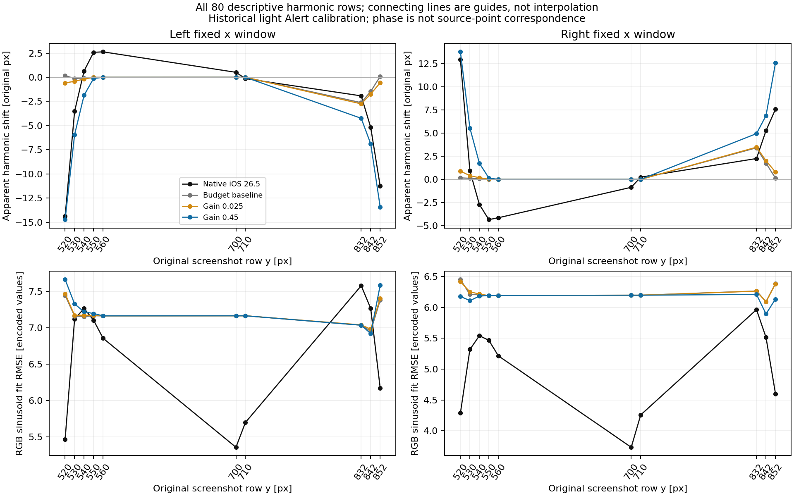

# Panel lateral-sampling supplement: 2026-11-15

This package accompanies the [supplement report](../../panel-lateral-sampling-study.md). It preserves historical calibration failures, two engineering candidates and focused Sleepy application regressions. It contains no independent holdout or native-equivalence acceptance.



## Contents

| Path | Scope |
| --- | --- |
| `archive/analysis-stripe-curvature-20261115/` | Frozen plan, provenance, analyzer, all 8,256 rows, failures, original diagnostic figures and interpretation |
| `archive/analysis-mapping-audit/paired-slope-feasibility-analysis/` | Later bounded operator implementation and 69 synthetic checks; no real paired-slope capture |
| `archive/lateral-sampling-results/` | All 80 harmonic observations and 24 whole-Window delta records |
| `archive/panels-lateral045-20261115/` | Plan, losslessly compressed matrix, metrics and capture receipt for 16 REST panels |
| `app-validation/` | Application test-source snapshots and available XML records; these are not registered runtime-module tests |
| `inputs/` | 23 hash-deduplicated component-crop/source PNG inputs, including material rectangles from all 16 candidate Windows |
| `portable-inputs.json` | Portable public paths keyed by the original file identities, separate from frozen local-path records |
| `sources.json` | Source and published SHA-256/length, including deterministic gzip transformations |
| `figure-processing.json` | Original crop coordinates, display resize and alpha-preview operations |

The source records identify application builds by hashes. Full phone screenshots and UI XML remain outside this repository. APKs, build caches, Xcode result bundles and the complete prior capture tree are excluded. The original matrix also names composited-display and background captures outside this bounded export. Missing files are not reconstructed by their hashes.

## Reproduce the published figures and check integrity

```sh
python3 -m pip install matplotlib Pillow numpy
python3 docs/evidence/panels-lateral-20261115/render_figures.py
python3 docs/evidence/panels-lateral-20261115/verify_publication.py
python3 docs/evidence/panels-20261115/verify_publication.py
```

The new verifier checks byte-exact source identity, lossless gzip, component dimensions / retained pixels, test receipts and reported rows. It recomputes all 80 harmonic rows from the retained component pixels in original coordinates. For crops, an original SHA identifies the omitted file; the public crop cannot reconstruct or independently verify that original encoding. Figure rendering reads committed measurements. It does not rerun an Android/iOS capture, recover physical thickness, fit an optical model or validate the independent backend.

The frozen stripe scripts retain original local paths. `portable-inputs.json` maps the four first-condition image roles to component/source crops. It omits the raw AX export and full screenshots, so the frozen full-image diagnostic cannot be rerun unchanged. The complete original preparation environment is not distributed. The original 69-check operator freeze and original failed gates remain unchanged; a public hash check is not a new experimental pass.

The 76-test build receipt retains counts and XML hashes; those original three XML files were no longer present after the later focused run and are not included here. The later 18-test XML files are included and can be checked against their receipt. The final instrumentation log records three passing device layout/pointer tests. The earlier two-failure device log is retained separately.

The independent public runtime / sample build and seven host suites passed 56 tests under the [new source-bound receipt](../../../provenance/validation-20261115-lateral.json). Application captures and regressions remain a separate validation track.
