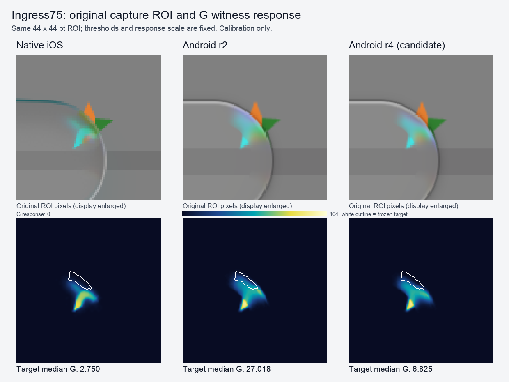

# Slider 绿色扰动诊断：保留改善，也保留反证

这轮只验证 Slider 的 G 差分响应。r3 的磨砂减半方案已拒绝；r4 有实质 G 改善，但原 RGB 的 5/6/8 多形状测试存在局部退化，因此不作为通用默认替代，生产恢复 r2 的 A=7.8、W=7.5。r2 仍是未验收的 checkpoint；尚无独立验收，不能据此宣称玻璃整体对齐。

[可搬移证据包与重放说明](design/evidence/glass-slider-green-witness-20261115/README.md)保留了 96 张原始像素 ROI 裁片、原始 source/spec、接受 index、几何回执、冻结分析规则及全部版本摘要。没有全屏截图或构建缓存。

## 设计与门槛

对同一 RGB 五角星分别输入 witness 和 control：R/B 源逐像素相同，control 的 G 全为 128，witness 仅在原 left-blue 多边形提高 G，最大 232。普通 flat 始终是 `st00_flat128`，没有把彩色 control 冒充 flat。

固定 ROI 为 `[165.5,397.5,209.5,441.5]`，共 1936 pt²。主目标为早期标定冻结的 283 个 0.25 pt 网格样本、17.6875 pt²。六姿态不做图像配准；阈值固定为 4、8、16、24。正式 v1.1 同时保留原始像素整数差分与编码字节的双线性 world-grid 差分。

六姿态的原始像素和 world grid flat RGB p99 都为零；r2/r3/r4 的实际 carrier bounds、矩阵、source origin 和 source sampling matrix 均一致。Android **effective opacity 未直接观测**，所以三版全部保留 `MAPPING_UNKNOWN_PIXEL_DIAGNOSTICS_ONLY`，不是完整光度可比验收。

## r3 为什么拒绝

r3 只将 Slider frost sigma 1.1 减至 0.55。ingress75 目标 G 中位数从 r2 的 27.018 降至 18.661，原生为 2.75；neutral138 子集也改善。然而 reverse68 中 20 个样本变亮，最大增加 17.966，P90 从 54.266 升至 63.267。完整 ROI 的 ingress75 RMSE 从 3.631 升至 3.678，full100 RMSE 从 2.306 升至 2.440、MAE 也退步。

面积缩小没有抵消局部更强的误差，因此恢复 sigma 1.1。[完整 r3 反证](design/evidence/glass-slider-green-witness-20261115/summaries/r3-rejection.md)与其官方输出一并保留。

## r4 的改善与剩余偏差

r4 保留 sigma 1.1，测试窄肩 common transport 候选（A=11.25、W=6.5）。这些参数来自有限标定候选，不是唯一 native 逆解；它最终因原 RGB 多形状退化未被选为默认，G 改善作为有效实验结果保留。下表为相同 world grid 上 G 正支持面积（pt²），顺序均为 **阈值 4 / 8 / 16 / 24**。

| 姿态与范围 | 原生 | Android r2 | Android r4 |
|---|---|---|---|
| ingress75 冻结目标 | 7.375 / 3.9375 / 0.625 / 0.0625 | 17 / 15.4375 / 12.625 / 9.8125 | 10.125 / 8.375 / 5.875 / 3.3125 |
| ingress75 完整 ROI | 68.5625 / 54.8125 / 41.1875 / 32.625 | 82.75 / 72.8125 / 60.1875 / 50.875 | 73.5625 / 65.0625 / 53.625 / 44.9375 |
| full100 完整 ROI | 74.875 / 64.375 / 54.75 / 46.625 | 74.875 / 67.5625 / 57.3125 / 50.3125 | 72.3125 / 65.375 / 55.4375 / 48.0625 |

ingress75 目标全部 283 样本变暗，中位数 27.018→6.825，RMSE 25.493→9.928，但高阈支持仍远多于原生。完整 ROI 的 RMSE 在 ingress50、75、full100 分别从 2.281→1.386、3.631→2.376、2.306→1.763，MAE 也都改善。ingress10 RMSE 1.81447→1.81883 小幅退步。

reverse68、neutral138 由 **r2 原输入和 r2 几何**冻结，不因 r4 结果重选。reverse68 全部变暗，RMSE 35.948→16.583，但 G>24 面积仍为 2.75 pt²，原生只有 0.0625。neutral138 RMSE 16.160→2.924，G>24 降为零，但 G>8、G>16 仍有 0.625、0.1875 pt²，原生均为零。它的中位数甚至低于原生，不能用中位数改善掩盖剩余上尾。

所有姿态、所有四阈值均无负 G 支持。Android R/B 固定 ROI 的 witness-control 差分逐原始像素全零，仍没有原生的跨通道响应。

## 新增错误必须单独计算

ingress75 目标的假阳性数量从 `154/184/192/156` 降为 `44/71/84/52`，没有新增假阳性，也没有漏掉原生的正支持。但完整 ROI 实际**新增** `29/30/30/35` 个假阳性，同时移除 `180/162/148/146` 个；不能把净下降写成“没有新错误”。

full100 完整 ROI 实际新增 `1/1/5/8` 个假阳性，移除 `40/33/40/42` 个。原生正支持的漏检数从 `88/60/49/50` 变为 `90/63/44/52`，阈值 4、8、24 有净退步。阈值 4 总面积从原本数值一致变成不足，也在四阈表中保留。每个样本面积为 1/16 pt²。

支持集合的[逐阈值实际新增/移除记录](design/evidence/glass-slider-green-witness-20261115/summaries/r3-r4-actual-support-sets.json)同时包含 r3 与 r4，原始像素和 world-grid 的[完整摘要](design/evidence/glass-slider-green-witness-20261115/summaries/analysis-summary.json)保留所有原有区域和正负结果。

## 重现与解释边界

证据包可在另一台电脑用 Python、NumPy、Pillow 重放。工具校验原 metadata/source 字节及包内哈希，解析原几何回执，调用未改动 v1.1 算法，从带保护边的原始像素裁片重新计算全部 ROI 指标，核对官方完整输出、r2 子集和真实支持集合。

首次便携重放已核对 4 个版本、24 个姿态的全部官方 ROI 指标，并通过 r2 子集重建与 r3/r4 实际支持集合验证；[记录在此](design/evidence/glass-slider-green-witness-20261115/validation/replay-summary.json)。对照图仅用包内数据重新生成后逐像素一致。

裁片不能重新证明未打包的全屏 PNG 哈希或采集就绪性；这些哈希与原 root 路径作为来源记录保留。此处没有新的真机采集或独立 holdout。G-only 的两个输入振幅不能唯一分辨位移、模糊、角度衰减与颜色耦合，也不能证明非线性或物理厚度。恢复 r2 不代表 r2 通过验收；此包也不作为 Dock、背板、高光或动态对齐的完成声明。
