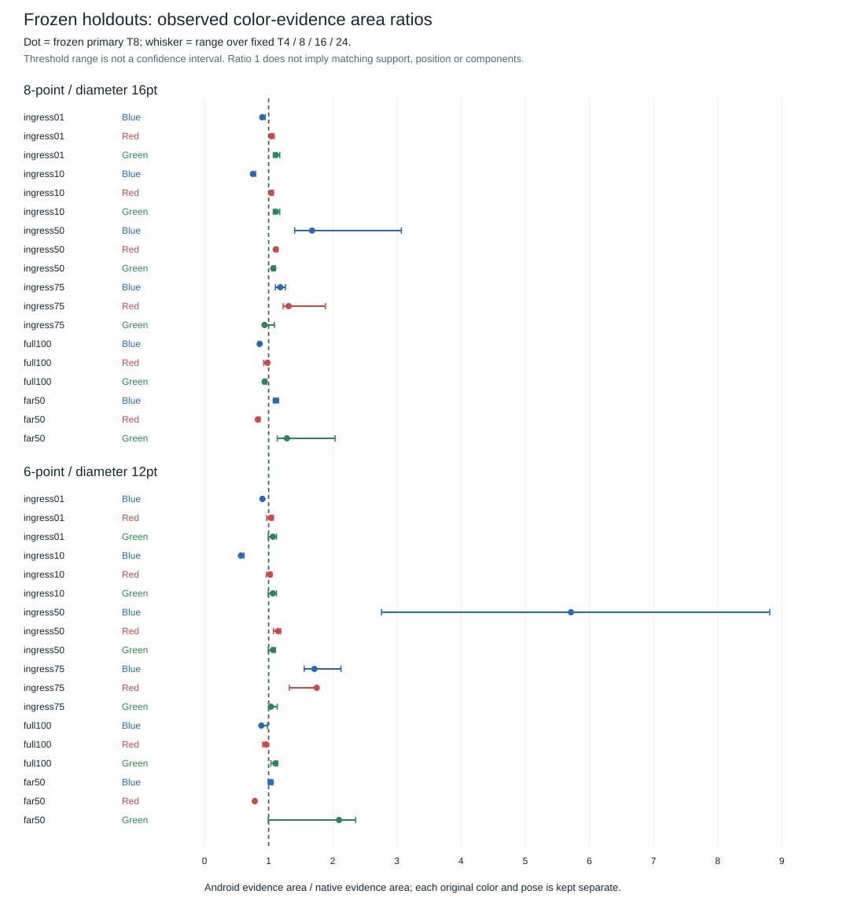
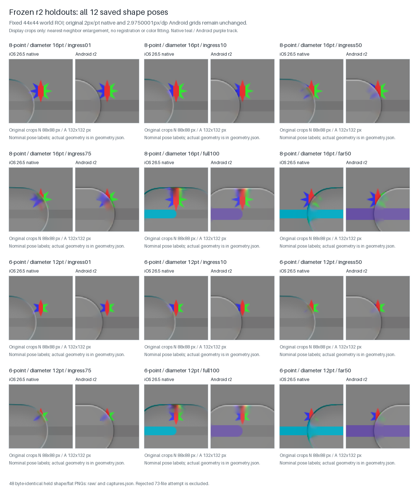

# Frozen single-slider holdout validation — 2026-11-15

**Both retained holdouts fail to establish native-equivalent color transport.** The eight-point 16pt star and six-point 12pt star expose unresolved differences after the [r2 five-point calibration](glass-slider-star-calibration.md). The production material parameters and frozen measurement criteria were unchanged. Neither holdout was used to fit this candidate; there is no overall acceptance percentage.

This report records only the existing r2 validation exercise. Later witness/control diagnostics are separate and are not used to reinterpret these rows as passes.

The subsequent r4 runs reuse these already consumed sources as [regression comparisons](glass-slider-shoulder-experiments.md), alongside the separate [G witness/control diagnostic](glass-slider-green-witness.md). They are not fresh holdouts. Their mixed results led to restoring the unaccepted r2 checkpoint; the original validation failures below remain unchanged.

## Frozen sources and criteria

| Holdout | Diameter | Known AA-weighted source area | Original source SHA-256 |
|---|---:|---:|---|
| `st04_rgb_star8_d16` | 16pt | 88.1875 world² | `83cb048741de1602df35034cd5e27092437a3bc5756a4bf8d2db7f2b8b1014e4` |
| `st06_rgb_star6_d12` | 12pt | 48.6875 world² | `7627c5b06834869c3e2d99e6b545c8a5b007acc0b2cc917f92773394017477d2` |

Both original manifests/specifications retain `holdout` roles. The [frozen policy](design/evidence/glass-slider-holdout-20261115/frozen-policy.json) predates holdout capture, requires explicit `--input-role holdout` and preserves the original 30 mathematical helper ASTs. Each shape retains six poses, three original color regions and thresholds 4/8/16/24 encoded byte units; 8 remains the predeclared primary threshold.

The signal is independent chroma(shape minus same-pose flat) projected on each original color direction, with cosine≥0.8, in the same fixed world ROI [165.5,397.5,209.5,441.5]. No parameter fitting, threshold selection, image registration, color-profile normalization, morphology, component selection or optical-contour completion was added. Native measurements use their original 2px/pt grid; Android uses actual density 2.9750001px/dp, a recorded 1116×1984 source layout and separate x/y source scaling. Contact-sheet crops are display-only.

The production single-slider refraction remains 7.8dp with a 7.5dp quadratic shoulder. Source hashes confirm `GlassSlider`, `SliderVisuals`, the shader and style are unchanged from r2 calibration. The capture fixture gained frozen holdout-role loading, whose hash is separately recorded. Both holdouts used identical frozen production/test sources and APKs; the clean six-point reacquisition changed acquisition directory identity only.

## Results

Dots use threshold 8. Whiskers show the range over the four fixed thresholds, **not** confidence intervals. The dashed ratio=1 line means equal observed evidence area only; it does not establish equal position, support, components, optical rays or visual appearance.

| Shape / nominal pose / region | Native area | Android area | A/N area | Centroid distance | Components N/A |
|---|---:|---:|---:|---:|---:|
| 8-point / ingress50 / blue | 39.000 | 65.419 | 1.677 | 0.958 | 1/1 |
| 8-point / full100 / blue | 55.000 | 47.341 | 0.861 | 0.984 | 1/1 |
| 8-point / far50 / green | 41.750 | 53.669 | 1.285 | 0.391 | 2/2 |
| 6-point / ingress50 / blue | 3.500 | 19.999 | 5.714 | 1.429 | 3/2 |
| 6-point / ingress75 / red | 7.750 | 13.558 | 1.749 | 2.182 | 1/2 |
| 6-point / far50 / green | 7.000 | 14.688 | 2.098 | 0.790 | 1/2 |

Areas are world units²; centroid distance is in world units. These selected rows explain the failures; [all 36 primary rows](design/evidence/glass-slider-holdout-20261115/numerical-primary.json) and [all 144 fixed color/pose/threshold rows](design/evidence/glass-slider-holdout-20261115/numerical-fixed.json), plus 48 whole-evidence threshold rows, remain in machine-readable form.

For the eight-point star, ingress50 blue area ratio rises to 2.528 at threshold16 and 3.070 at threshold24. Native blue evidence fragments into three components while Android remains one. The small whole-color centroid distance at primary8 (0.192) conceals a whole-evidence area ratio of 1.324; pooling colors or using centroid alone would hide the failure.

For the six-point star, the native ingress50 blue area denominator is only 3.5 world². It is retained explicitly rather than converted into a global error percentage. At far50 and threshold24, green areas become almost equal (native 2.500, Android 2.486), yet centroids remain 1.416 world units apart and component counts remain 1/2. Choosing that threshold after seeing its area agreement would conceal other disagreements.

All 48 original held shape/flat PNGs remain byte-identical in [the packet](design/evidence/glass-slider-holdout-20261115/README.md). The native track is teal and Android uses theme purple; no display color fitting hides that difference. The figure shows only the 24 shape screenshots, while all 24 matching flat screenshots remain available for the recorded differencing.

## Geometry, rail and identification limits

Pose labels are nominal requested stages, not measured optical percentages. Actual public carrier centers and bounds are retained in [geometry.json](design/evidence/glass-slider-holdout-20261115/geometry.json). Eight-point Android/native center residuals span 0.003…0.075 world units; six-point residuals span 0.018…0.225. Android carriers are approximately 0.133 world units wider and 0.108 taller. Six-point ingress75 discrete capsule/source overlap is 0.7657 native versus 0.7311 Android. This matters for a small source near an edge; the evidence does not uniquely attribute every discrepancy to one optical parameter.

Capsule overlap integrates known original source subpixel samples inside a capsule approximating public carrier bounds. It is not native alpha or physical lens coverage. Shape/flat subtraction also does not identify source-to-output optical rays. Visible unoccluded source portions remain in ingress/exit evidence. Every capture retains the conservative rail-confounded-domain flag for y=422…438; this band was not selectively removed. No color-evidence pixels hit the fixed ROI boundary in any of the 144 color/pose/threshold rows, which rules out that particular clipping artifact without resolving rail or optical ambiguity.

## Acquisition record and rejected attempt

Both native sources passed their saved strict verifier: 12/12 held endpoints and 6/6 shape/flat pairs each. Android eight-point passed the 49-file original package and frozen pointer/readiness/settling/pair index checks.

The first Android six-point attempt reused an output directory and returned 73 files: 49 current references plus 24 byte-identical old eight-point residuals. Nine shared-name flat Window PNGs lacked independent current-generation identity. The package was rejected as formal holdout evidence and was never optically analyzed or compared. Only its [bounded incident summary](design/evidence/glass-slider-holdout-20261115/rejected-six-point-incident.json) is carried here.

The formal six-point evidence uses `android-quadratic-validation-clean-r1`, with a unique run containing the frozen spec hash. The capture host confirmed its remote destination absent before capture; the independent auditor records this as host-reported provenance rather than claiming to have checked the device itself. The clean package contains exactly 49 current references and no residues. All 17 independent identity checks and subsequent frozen hashes/pointer/readiness/settling/six-pair index checks passed. The source, spec, APKs and material were unchanged. Reacquisition corrects an acquisition identity problem; it is not a third independent holdout.

[verification.json](design/evidence/glass-slider-holdout-20261115/verification.json) preserves compact receipts, source/APK hashes, strict-verifier counts, clean-audit checks and original report hashes. Packaging this report executed no new runtime tests, builds or device operations.

This validation is limited to two source shapes/sizes, one light theme and six settled poses per shape. It does not validate full motion, acceleration, elastic endpoints, dark themes, all backgrounds or other controls. The two holdouts remain failures of native-equivalence validation. Any later candidate informed by these observations must disclose this reuse and be evaluated on an untouched set.
