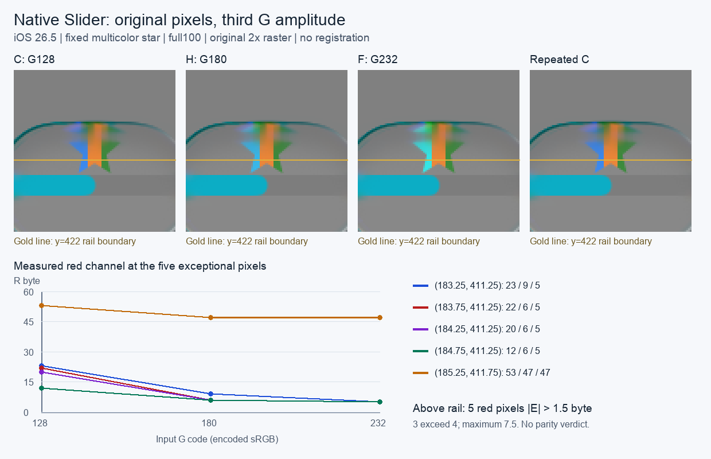

# Slider：第三个 G 幅度的原像素诊断

本文保留当时的 midpoint 诊断与后续计划口径。后来已完成的八轮 RGB 响应与四轮 signed-G 测量见[当前图文与证据索引](current-evidence-20261116.md#slider-native)；下文“尚未准备”等句只描述本报告时点，不代表当前状态。

**颜色诊断；产品仍为 r2 未验收检查点。** 当前 single 为 refraction 7.8 / shoulder 7.5；range 为 refraction 2.15、无该 shoulder。五／六／八角星仍用于空间形变回归，七角星未消费。本轮没有改变材质、构建应用或增加独立验收。

在同一 16pt 多色五角星上，既有 G128 control（C）与 G232 witness（F）之间新增 G180（H），并复拍同一 control。仅原 left-blue 多边形的 G 改变；R/B 源逐字节不变，原轮廓、RGB 分区、coverage16、sRGB ICC 和源坐标均保留。两份新捕获复用原生二进制，各有 12 个真实 held endpoint／6 对 shape-flat，原严格回执通过。



图上方是 full100 原像素的最近邻展示，金线仅标注 y=422 轨道边界；下方曲线直接读取原始 2× RGB 字节。图不是测量栅格，不经配准、插帧、色彩拟合或轮廓补全。

## 结果与例外

四轮 carrier bounds、center、presentation matrix、opacity、source origin 与 sampling matrix 的最大跨轮变化均为 0；每轮 flat 相对旧 control flat 的全部 ROI RGB 字节差为 0。复拍 control 的 shape-minus-flat 相对旧 control 在完整固定 ROI 逐字节一致。

固定 ROI 为 `[165.5,397.5,209.5,441.5]`，分析原截图像素 `[331,795,419,883]`。中点残差定义为：

```text
E = (H − Hflat) − 0.5(F − Fflat) − 0.5(C − Cflat)
```

其中共享同一个 C；复拍 control 只检查漂移。轨道上方 `y<422`，全部六姿态中只有 **full100 红通道五个像素**的 `|E|>1.5 byte`，其中三个 `>4`，最大 7.5；没有 `>8`。G/B 在所有六姿态均不超过 1.5。所有例外及轨道混杂区域仍保留，不据此给出总体通过。

| 原生坐标 pt | carrier inset pt | C RGB | H RGB | F RGB | E_R |
|---|---:|---|---|---|---:|
| 183.25,411.25 | .35 | 23,91,175 | 9,110,164 | 5,127,153 | −5 |
| 183.75,411.25 | .35 | 22,94,113 | 6,119,101 | 5,145,87 | −7.5 |
| 184.25,411.25 | .35 | 20,97,70 | 6,121,60 | 5,146,47 | −6.5 |
| 184.75,411.25 | .35 | 12,99,54 | 6,121,44 | 5,143,34 | −2.5 |
| 185.25,411.75 | .85 | 53,117,64 | 47,144,62 | 47,171,59 | −3 |

前四点 full 的 R 同为 5，最后一点 half/full 的 R 同为 47。这与位置相关的平台／裁切相容，但未识别 native 内部层次、混合次序或唯一原因。其他像素近中点不能证明全局线性；这五点也不能证明物理非线性、特定 saturation 或真实厚度。

## 冻结规则与复现

G180 是 encoded-sRGB 中点；完整源像素在线性光下只对应 G 增量约 0.4069597，AA 另有最多 ±0.5 输入 byte 舍入误差，不能直接转成输出误差界。固定 inset 分箱、所有六姿态、原始整数字节和阈值 4/8/16/24 均保留。

原 v1 计划与脚本另行归档。独立审阅在新像素分析前发现 pooled-round p99 会稀释单轮漂移，故 v1.1 改为逐轮逐 RGB 的空间 p99，任一超过 3 即拒绝；采集已开始的修订时点明确记录，没有放宽门槛。最终四轮 flat 与复拍 control 的最大差亦为零，不仅是 p99 为零。

[便携证据包](design/evidence/glass-slider-midpoint-20261115/README.md)包含 24 张新增原像素 ROI，复用相邻 G 证据包的 C/F 原 ROI；保留六份原 NPZ、完整官方统计的无损归档、原计划、脚本、严格回执、源身份和 SHA。Python、NumPy、Pillow 即可在另一设备重新计算全部官方 ROI 统计与 inset 分箱，并逐数组核对六份原 NPZ。它不重跑省略的全 trace 验证，也不能从裁片重新证明完整 PNG 哈希。没有携带 243 MB 原 trace、APK 或构建缓存。

下一项仍需区分位置相关色彩响应、颜色转换与通道采样顺序，以及直接背景和光学层混合。单个 G 方向不能识别完整颜色矩阵或采样核，均匀输入只能用于颜色诊断，不能替代多色星形的形变输入。既有 [G 差分诊断](glass-slider-green-witness.md)、[r3/r4 反证](glass-slider-shoulder-experiments.md)与 [r2 记录](glass-slider-star-calibration.md)继续有效；本轮不改变 Dock、背板、高光或动态的验收状态。

## 下一次继续点

目标仍 active。下一步拟在 full100 单姿态，以整画布和原 left_blue coverage mask 分别做 +20 R/G/B 的六对颜色响应诊断；**尚未准备 source、冻结或采集**，须先另建明确 full100-only 的 protocol，再保留普通 `st00_flat128` 名称及各输入身份。该颜色诊断不替代多色星形形变追踪，不消费七角星；不改当前背板、Material Design 或业务布局。
