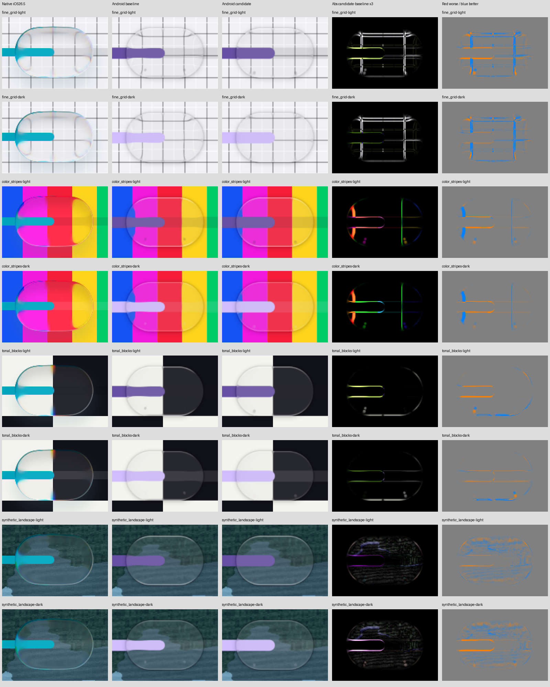

# Glass slider rail and refraction checkpoint — 2026-11-15

**Historical rail checkpoint.** The current single-slider r2 uses refraction 7.8 with a 7.5dp quadratic shoulder; Range retains refraction 2.15 without that shoulder. Both remain unaccepted optical checkpoints. See the [later star calibration](glass-slider-star-calibration.md) and [shoulder experiments](glass-slider-shoulder-experiments.md). The measurements and material descriptions below refer to the earlier rail checkpoint.

At the maximum value, the old rail stopped at the transparent thumb's center. Its outer half sampled only the background. The Liquid Glass rail now spans the full holder, including both endpoint halves. Material Design continues to use its official slider implementation.

Intermediate values retain their existing thumb-center coordinates. Ticks, original-value ghosts, input mapping and thumb motion are unchanged. Near either domain boundary, the active segment extends continuously under the remaining half-thumb over an 8dp approach band. Gradient rails retain their old value anchors and extend their clamped endpoint colors instead of compressing the gradient into a wider interval. RTL mirrors the same geometry.

The single and range lenses also use the existing positive `refraction = 2.15` shader profile instead of `-2.15`. This changes both source displacement and angular response; it is not an isolated reversal of sample direction. Dock, panels and other control profiles are unchanged.

## Native reference and remaining differences

The reference is the existing iOS 26.5 / 23F77 capture of an actual SwiftUI Slider, not a drawn replacement. At one quarter, eight held captures place the active end at the thumb center, about 113pt. Therefore the repair preserves the shorter center travel rather than mapping values across the full rail width.

The original slow and fast video samples show the active rail extending beyond that center as it approaches the maximum. This starts before the business value reaches one. The bounded 8dp smoothstep is an engineering approximation: descriptive residuals over the 36 slow samples are RMSE 0.953pt and maximum 2.536pt. The fast reference also stretches the whole rail roughly 4pt beyond the nominal holder. That extra overdrive stretch is not implemented here; the new source rail still ends at the holder. These observations do not identify a UIKit timing law or establish parity at every speed.

The range material currently shares the single-slider profile. Endpoint captures verify its production rendering, but the native single-slider optical comparison below does not independently calibrate a native range component. The available range reference combines two real UISliders with a host-drawn track.

## Fixed optical comparison

Four fixed backgrounds—fine grid, color stripes, tonal blocks and a synthetic landscape—were compared in light and dark themes, at rest and while held. Existing coordinates and fourteen overlapping region masks were retained without registration or fitting. These are reused calibration inputs, not an independent holdout.

- All eight REST thumb crops and all eight background crops are pixel-identical to the old material.
- HELD direct-error records: 81 improved, 14 regressed, 17 unchanged. Own-source-effect records: 80 improved, 15 regressed, 17 unchanged. Counts overlap and are not independent samples or a similarity percentage.
- In the light fine-grid upper-right interior, direct RGB MAE fell from 24.171 to 12.354. The left-lower endcap regressed from 9.388 to 10.639. All 29 MAE regressions across both metrics, and disagreements between MAE and RMSE, remain in the numerical evidence.
- The comparison captures combined rail and material changes. It does not isolate the causal effect of one parameter. A final capture using the spatial endpoint implementation separately checks that the quarter-value optical crops remain unchanged from the compared candidate.

Full regional rows: [CSV](design/evidence/glass-slider-rail-20261115/all-regional-errors.csv). Native same-frame endpoint readings: [CSV](design/evidence/glass-slider-rail-20261115/native-rail-centers.csv). Descriptive spatial residuals: [JSON](design/evidence/glass-slider-rail-20261115/endpoint-spatial-check.json).

## Verification

- Five new native-pixel rail regression tests fail on the old implementation and pass with the fix. They cover single/range endpoints, RTL, intermediate value mapping and gradient anchors.
- 59 focused JVM checks pass with zero failures, errors or skips, including existing official-Material pixel comparisons and slider input/deformation checks. Debug and instrumentation APK builds succeed.
- Actual API36 production controls were captured in six endpoint scenes: single maximum/minimum, RTL maximum, both range handles, and hue 0/360. The run preserves sixteen control captures, six clean backgrounds, real attached geometry, pointer/callback events and hardware PixelCopy plus display-readiness checks. Every hold ends with CANCEL; no UP is synthesized. This is settled endpoint evidence, not a dynamic timing verdict.
- Four-background optical capture was repeated with the final spatial rail implementation. Device/host capture hashes match. The installed production APK SHA-256 is `2d41beb5474cb67cef6b35e6b1ce10e55f52cb9d5a608ce8c941b6365b00a69f`; subsequent source edits only clarify material comments.

The complete local acquisition sets are `slider-rail-20261115/{baseline-optics,candidate-optics,final-optics,slider-rail-endpoints-r2-20261115}`. Failed fixture observations and rejected timing experiments are retained separately. This checkpoint fixes the half-covered source rail and improves the measured interior refraction; corner response, fast overdrive and complete dynamic equivalence remain open.
