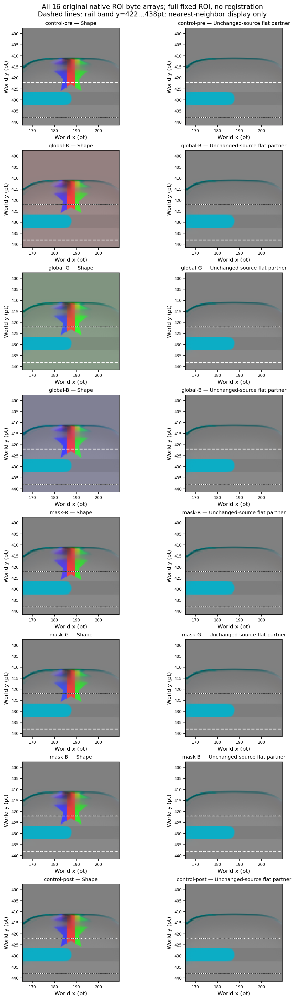
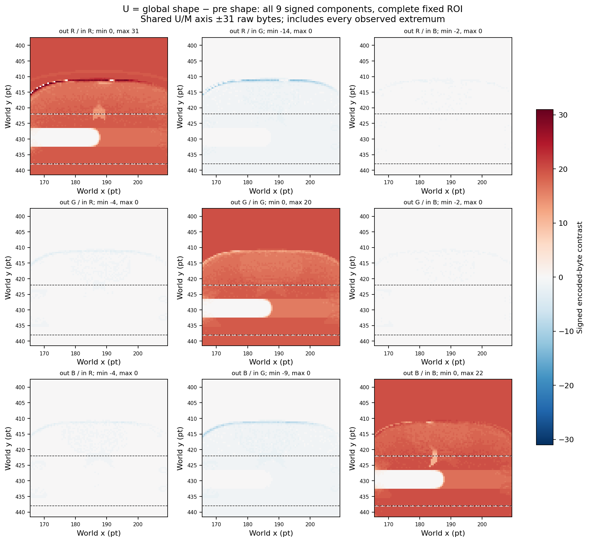
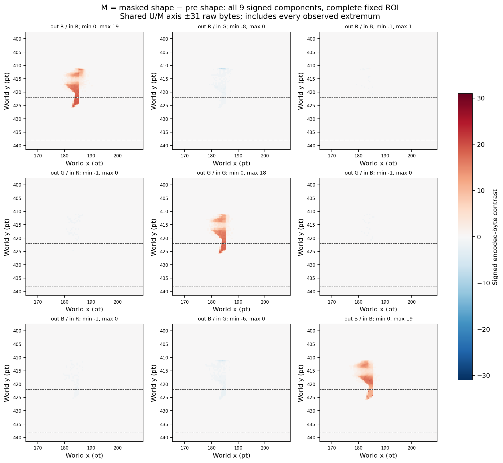
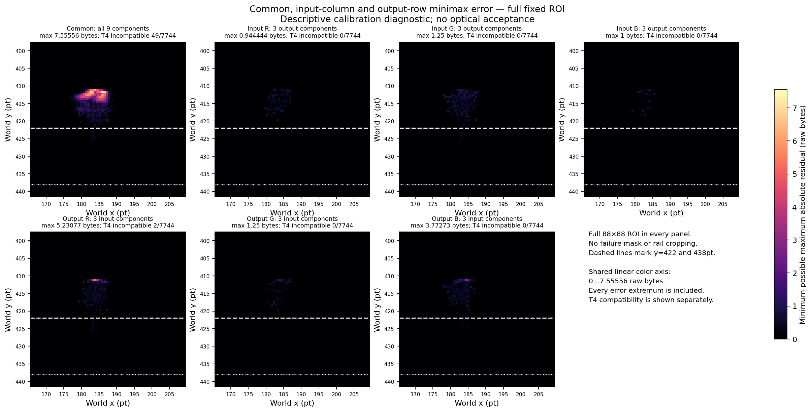
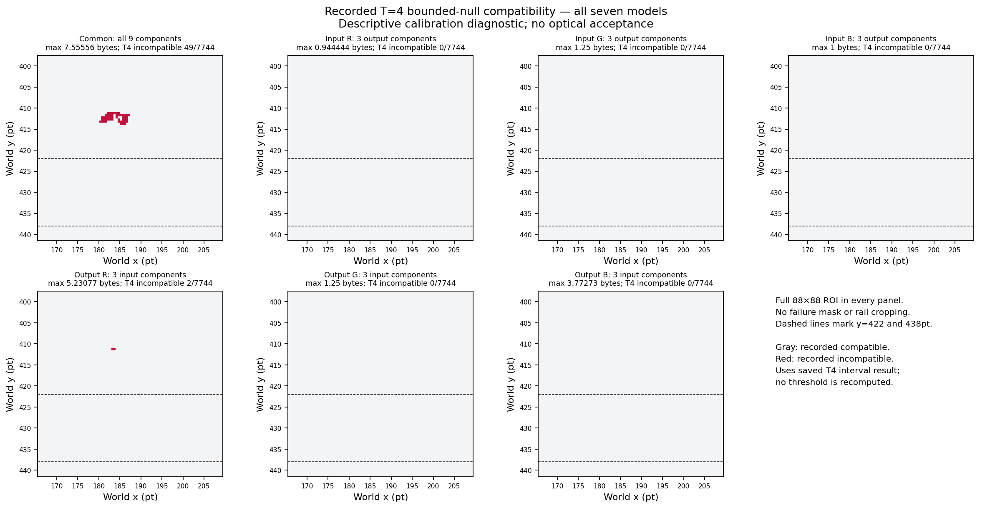
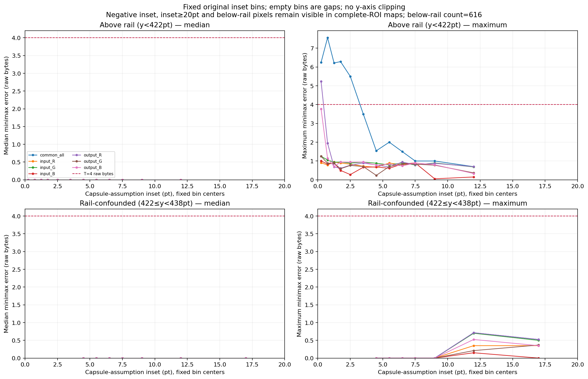

# Slider：full100 的 RGB 有限扰动诊断

2026 年 11 月 16 日，在 iOS 26.5（23F77）原生 Slider 上完成八轮、十六张正式 held 截图。每轮只有 `full100`，包含一张多色五角星与一张未改动的普通 flat。十六个端点、八对 shape/flat 均通过冻结的严格检查。产品代码与材质参数没有改变，光学验收状态也没有改变。

本轮检验一个具体限制：在同一输出像素，是否存在 `0≤α≤1`，使全九个 RGB 输入/输出分量都满足 `M≈αU`。预设主容差为 4 个原始输出字节。完整 ROI 有 **49 个像素不相容**，其中主分析域 32 个、轨道上方边缘/外侧补集 17 个。放宽为每个输入列或每个输出行各自一个 α 后，两类模型在主分析域都相容；现有数据不能识别它们的处理顺序。

## 原始输入与正式截图

基线使用原多色五角星 `st01_rgb_star_d16`，直径 16pt，源图 750×1334px、375×667pt、2px/pt。没有使用上一轮 G128 中点诊断作为基线。五角星顶点、三个 RGB 区域、coverage16 抗锯齿计数、坐标与 sRGB ICC 字节全部保留。

采集次序固定为 `control-pre → global-R/G/B → mask-R/G/B → control-post`。global 轮将整张原图一个通道的 encoded 字节加 20；mask 轮只在原 `left_blue` coverage16 内加入 `floor((20×count+8)/16)`，整数中点向上取整。其他通道逐字节不变。最大输入值为 252，没有输入裁切。每轮配对的 `st00_flat128` 都是同一份原始 RGB128 PNG。



图 1 保留十六张原生截图在固定 ROI 内的全部 RGB 字节，使用最近邻展示。虚线标记轨道混杂带 `422≤y<438pt`。所有图都保留完整 88×88px ROI，不删轨道、不删边缘、不隐藏失败区域。图像的展示缩放不参与数值分析。

固定源空间 ROI 为 `[165.5,397.5,209.5,441.5]pt`，对应原截图半开像素区间 `[331,795,419,883]`。主域定义为 `y<422pt` 且 carrier 胶囊近似 inset≥1pt，共 1,630 像素。`y<422pt`、inset<1pt 的 2,682 像素包含胶囊外侧，不能把它全部当作已知原生光学边缘。

跨十六次观察，记录的 owner/carrier bounds、center、presentation matrix、opacity 的最大范围均为 0；源映射声明亦不变。每轮 flat 相对 pre-flat，在完整固定 ROI 的每个 RGB 字节上差值均为 0；post-shape 与 pre-shape 同样逐字节一致。源矩阵来自固定映射元数据，这里没有新增独立仿射测量，也没有用零漂移推断原生内部光学层完全不变。

## 九分量响应

设输出通道为 i、被扰动输入通道为 j，直接读取原图字节：

```text
U_ij(x) = global-j-shape_i(x) − pre-shape_i(x)
M_ij(x) = mask-j-shape_i(x) − pre-shape_i(x)
Jglobal = U / 20
Jmask   = M / 20
```

矩阵行是输出 R/G/B，列是输入 R/G/B。flat 只用于几何与漂移检查，没有从 U/M 中减去，避免移除待检验的 DC 响应。这些量是 encoded 空间内的有限割线，不能直接称为线性光颜色矩阵或无穷小 Jacobian。





图 2、3 共用 −31…31 原始字节色轴，每个面板写出自身最小值与最大值，没有截掉强响应或负的交叉通道响应。两种输入的空间范围不同：global 改整幅背景，mask 只改一个局部颜色区域。两者的差异仍可能混入 transfer/gamma、有限步长非线性、局部颜色适应、平台/裁切及直接背景与光学层的混合。

## α 区间检验与保留例外

冻结的待检验模型要求一个公共非负空间核，再接局部颜色混合；在 encoded 响应仿射且该核对 RGB 共享的条件下，`M=αU` 是它的必要限制。每个分量给出闭区间 `|M_ij−αU_ij|≤T`，再与 `[0,1]` 相交。空交集记为不相容。零、负响应都参与约束。

| 固定区域 | 像素数 | T1 不相容 | T4 不相容 | T8 不相容 |
|---|---:|---:|---:|---:|
| 完整 ROI | 7,744 | 146 | 49 | 0 |
| 轨道上方 | 4,312 | 146 | 49 | 0 |
| 主域：轨道上方且 inset≥1pt | 1,630 | 120 | 32 | 0 |
| 轨道上方且 inset<1pt，含外侧 | 2,682 | 26 | 17 | 0 |
| 轨道混杂带 | 2,816 | 0 | 0 | 0 |
| 轨道下方 | 616 | 0 | 0 | 0 |

T16/T24 也全部保留，公共模型的不相容数均为 0。所有 49 个 T4 像素位于原坐标 `x=180.25…187.25pt、y=411.25…413.75pt`，胶囊近似 inset 为 `0.35…2.85pt`。这些坐标是事后描述，没有用来重选 ROI、掩模或阈值。





图 4 的共用误差轴为 `0…7.555555555561159` 原始字节，包含全部观察极值。图 5 直接显示保存的 T4 区间结果，公共模型 49 点全部保留。轨道没有覆盖这些异常点。

| α 约束族 | 完整 ROI 的 T4 不相容数 | 主域 T4 不相容数 |
|---|---:|---:|
| 九分量共用一个 α | 49 | 32 |
| 每输入列独立 α：R / G / B | 0 / 0 / 0 | 0 / 0 / 0 |
| 每输出行独立 α：R / G / B | 2 / 0 / 0 | 0 / 0 / 0 |

输出 R 的两个例外位于 `(183.25,411.25)`、`(183.75,411.25)pt`，inset 为 0.35pt。输入 G 在 T1 仍有三个不相容像素；T4 相容不代表精确相等。输入列模型与输出行模型在整个主域都相容，单个空间 mask 无法判别通道采样发生在颜色处理之前还是之后。



图 6 使用原先固定的 `[0,.5,1,1.5,2,3,4,5,6,7,8,10,14,20]pt` 分箱，空箱留空。曲线没有手动设置误差上限；负 inset、inset≥20pt 与轨道下方像素仍在完整 ROI 图内。胶囊由公开 carrier 矩形近似，不能等同于原生 alpha 轮廓或厚度。

## 独立核查与两个拒收记录

[独立核查收据](../research/slider-color-response-20261116/independent-check.json)直接从十六张正式原 PNG 重算 U/M，没有导入分析器函数。α 约束使用 int64 有理数交叉乘积相交，逐像素比较全部 T1/T4/T8 区间与位图；32 区域×7 模型×3 容差共 672 项计数全部一致。这是已经完成的独立核查；脚本依赖原机器本地 capture 布局，不作为新机器复现入口。

数值边界也保留了。坐标 `(182.25,413.25)pt` 的描述性 minimax 为 `4.000000000000002`，但精确闭区间在 T4 相容。直接统计浮点残差 `>4` 会得到 50；正式区间不相容数是 49。本报告采用区间计数，没有把浮点舍入误当作新增失败点。

两项采集事故均有记录：

| 记录 | 拒收原因与处理 |
|---|---|
| [run-ID format incident](../research/slider-color-response-20261116/native-tools/run-id-format-incident.json) | 初始两次 session 的原始 XCTest 名称与清理后的目录/session 名称不同，collector 在严格验证前拒绝；光学 PNG 没有解码或分析。修正名称校验后归档旧 freeze/scripts，正式八轮从 pre-control 重新开始。原生应用、输入、模型与阈值未改。 |
| [mask-G missing-flat incident](../research/slider-color-response-20261116/mask-G-missing-flat-incident.json) | observer 在普通 flat 的 held 截图前观察到 UP，整对拒收。按同一冻结 collector 与输入重采整对，没有保留失败 shape 来拼配，也没有调整门槛。 |

失败尝试不进入正式十六张截图或响应分析。兼容源没有新增原生采集，七角星独立留出仍未消费。

## 在另一台机器重放

[便携验证收据](../research/slider-color-response-20261116/portable-validation.json)已用 [evidence/manifest.json](../research/slider-color-response-20261116/evidence/manifest.json) 重放冻结分析器。包内 66 个文件共 10,973,900 字节，包括十六张完整原 PNG、原 capture/strict/index/events/session 元数据与参考分析。原收据、原路径、原字节保持原样；独立适配器只映射声明过的旧 round 根目录。153 个数组的键、类型、形状、数值及整个 NPZ 字节一致，JSON 仅声明路径归一后完全一致。

在仓库根目录、macOS/Linux 的 Python 3 环境执行：

```sh
study=research/slider-color-response-20261116
python3 -m venv "$study/.local/replay-venv"
"$study/.local/replay-venv/bin/python" -m pip install numpy pillow matplotlib
"$study/.local/replay-venv/bin/python" "$study/portable-evidence.py" replay \
  --study "$study" \
  --evidence "$study/evidence" \
  --output "$study/.local/replay-new-machine" \
  --compare "$study/evidence/reference-analysis" \
  --manifest-sha256 d1f2d2be9a2cb984cf9ffb8c8a85ee8f9e11ce892be998c9c95666e5644554f6
"$study/.local/replay-venv/bin/python" "$study/plot-response.py" \
  --analysis "$study/.local/replay-new-machine" \
  --output "$study/.local/replay-new-machine-figures"
```

两个输出目录必须尚不存在。结果比较写入 `.local/replay-new-machine/portable-replay.json`；图与色轴、极值、失败计数、哈希写入新的图目录。只重放分析时需要 NumPy、Pillow，Matplotlib 供绘图使用。无需 Xcode、模拟器或手机。

便携包不带 trace 归档和 xcresult，也没有读取、复制或重新验证它们。原收据保留其 hash/size 声明；新机器重放的是保留证据与冻结响应分析，不能代替省略的原始触控/呈现 trace 严格验证。[协议](../research/slider-color-response-20261116/PROTOCOL.md)、[冻结记录](../research/slider-color-response-20261116/freeze.json)、[源验证](../research/slider-color-response-20261116/source-verification.json)、[图清单](../research/slider-color-response-20261116/figures-response/figure-manifest.json)可逐项追查。

## 这轮证据的用途

公共 α 限制在预设 T4 下失败，说明当前 encoded 仿射、RGB 共享空间响应的简化不足以解释全部像素。输入列模型相容保留了输入相关响应这一候选，输出行模型在主域也相容，不能从现有结果选择唯一处理顺序。T8 下全部相容也必须一起报告，不能把 T4 当作通用物理误差界。

本轮没有识别唯一位移、模糊核、色散、物理厚度、原生光学 alpha 或内部层次；也没有把当前数值拟合成生产 RGB 折射偏移。Dock 边界高光、背板厚度、透射、磨砂、边缘拉伸、动态时序与其他尺寸/背景/控件的验收仍需各自证据。当前产品保持原参数，未据本轮报告宣称修复或通过。
