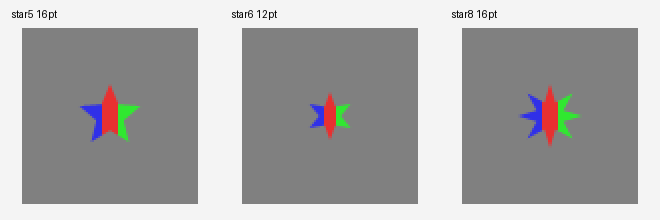
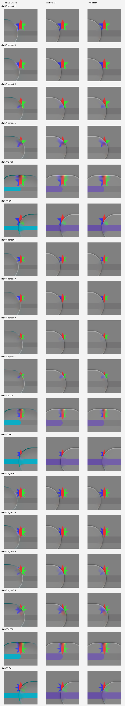

# 单滑杆肩部实验：拒绝 r3/r4 通用替代

r3 半磨砂与 r4 窄肩部均出现实质反例，**拒绝作为通用替代**。当前恢复 r2 `A7.8/W7.5/frost1.1`，它仍是**未验收 checkpoint**。没有从这些结果推导“99%一致”或其他综合相似度。七角独立输入尚未采集。

本增量在已有[五角校准包](design/evidence/glass-slider-star-20261115/README.md)与[原 r2 六/八角 holdout 包](design/evidence/glass-slider-holdout-20261115/README.md)之上复用原图、源 PNG 与冻结工具。六角、八角已经看过并参与后续判断，本轮明确是 **already-consumed regression data, not independent validation**；原始 manifest 与工具输入角色继续保持 `holdout`，没有改名绕过校验。



输入保留原本的蓝、红、绿分区与源像素，不重新生成素材。上图只用于展示；[sources.json](design/evidence/glass-slider-shoulder-experiments-20261115/sources.json)用相对路径及 SHA-256 连接完整源/spec/manifest。

## 改动与反例

| 候选 | 唯一生产参数改动 | 保留的反例 | 决定 |
|---|---|---|---|
| r3，五角 | 单滑杆 frost band blur1.1→0.55，D与肩宽不变 | ingress75蓝色上边界在全部四阈均不动；红色高阈退化、far50绿色低阈缺损 | 拒绝通用替代 |
| r4，五角 | common profile A7.8/W7.5→A11.25/W6.5，frost恢复1.1 | ingress75蓝上边界有所改善，但full100蓝面积/质心四阈全退化；新增预先指出的R/B支持 | 拒绝通用替代 |
| r4，六角 | 同一已固定r4参数 | ingress75蓝改善、红全阈退化；full100蓝面积/质心全阈退化 | 已消费回归反例 |
| r4，八角 | 同一已固定r4参数 | ingress75蓝面积全阈退化，而full100蓝反而全阈改善 | 已消费回归反例 |

这些反例说明，改动可以改善一处方向性拉伸而损害另一形状或颜色。Whole的平均位置变好不抹去单色退化；证据面积减少也不等于没有新增像素。所有四阈4/8/16/24、三色和Whole都在[384行完整表](design/evidence/glass-slider-shoulder-experiments-20261115/measurements/all-thresholds.tsv)与压缩描述符中。

## 全部六姿态与关键对照



上图每个形状保留六个姿态，使用各自实际像素网格的固定世界ROI，最近邻放大展示。没有配准或颜色拟合；轨道原生青色和安卓主题色仍存在，不能当成玻璃本体颜色差的自动校正依据。r3原图与flat都在[增量包](design/evidence/glass-slider-shoulder-experiments-20261115/README.md)，没有只挑好看的姿态。

### r3：五角16pt，frost1.1→0.55

[四阈完整96行表](design/evidence/glass-slider-shoulder-experiments-20261115/measurements/star5-r3-thresholds.tsv)。下表保留全部六姿态，列中为主阈8的“面积误差变化 / 质心误差变化”，负数仅代表该描述符更接近原生。

| 姿态 | 蓝 | 红 | 绿 | Whole |
|---|---|---|---|---|
| ingress01 | +0.000 / +0.000 | +0.000 / +0.000 | +0.000 / +0.000 | +0.000 / +0.000 |
| ingress10 | +0.000 / +0.000 | +0.000 / +0.000 | +0.000 / +0.000 | +0.000 / +0.000 |
| ingress50 | -20.902 / -0.548 | +0.000 / +0.000 | +0.000 / +0.000 | -20.902 / -0.219 |
| ingress75 | -2.373 / -0.103 | +0.904 / +0.009 | +0.000 / +0.000 | -1.469 / -0.035 |
| full100 | +0.226 / +0.103 | +0.000 / +0.012 | -0.678 / -0.144 | -0.904 / -0.023 |
| far50 | +0.000 / +0.000 | +0.000 / +0.000 | -7.594 / -0.064 | -5.634 / +0.512 |

### r4：五角16pt，A7.8/W7.5→A11.25/W6.5

[四阈完整96行表](design/evidence/glass-slider-shoulder-experiments-20261115/measurements/star5-r4-thresholds.tsv)。下表保留全部六姿态，列中为主阈8的“面积误差变化 / 质心误差变化”，负数仅代表该描述符更接近原生。

| 姿态 | 蓝 | 红 | 绿 | Whole |
|---|---|---|---|---|
| ingress01 | +0.000 / +0.000 | +0.000 / +0.000 | +0.000 / +0.000 | +0.000 / +0.000 |
| ingress10 | +0.113 / +0.000 | +0.000 / +0.000 | +0.000 / +0.000 | +0.113 / +0.006 |
| ingress50 | -12.880 / -0.860 | +0.791 / +0.112 | +0.000 / +0.000 | -12.090 / -0.243 |
| ingress75 | -0.904 / -0.802 | -1.921 / -0.663 | +0.678 / -0.025 | -3.503 / -0.242 |
| full100 | +1.921 / +0.220 | +0.012 / -0.039 | -2.373 / -0.145 | -0.836 / +0.025 |
| far50 | +0.226 / -0.027 | -0.904 / -0.100 | -1.808 / +0.220 | -0.678 / +0.165 |

### r4：六角12pt，已消费回归

[四阈完整96行表](design/evidence/glass-slider-shoulder-experiments-20261115/measurements/star6-r4-thresholds.tsv)。下表保留全部六姿态，列中为主阈8的“面积误差变化 / 质心误差变化”，负数仅代表该描述符更接近原生。

| 姿态 | 蓝 | 红 | 绿 | Whole |
|---|---|---|---|---|
| ingress01 | +0.000 / +0.000 | +0.000 / +0.000 | +0.000 / +0.000 | +0.000 / +0.000 |
| ingress10 | +0.000 / +0.000 | +0.000 / +0.000 | +0.000 / +0.000 | +0.000 / +0.000 |
| ingress50 | -5.536 / -0.856 | +0.226 / +0.029 | +0.000 / +0.000 | -5.310 / -0.099 |
| ingress75 | -2.712 / -0.186 | +1.356 / +0.338 | +0.000 / +0.000 | -1.356 / +0.111 |
| full100 | +1.243 / +0.164 | -0.339 / -0.060 | -0.565 / -0.080 | +1.469 / +0.030 |
| far50 | +0.000 / +0.000 | -0.452 / -0.058 | -1.243 / -0.311 | -0.791 / -0.024 |

### r4：八角16pt，已消费回归

[四阈完整96行表](design/evidence/glass-slider-shoulder-experiments-20261115/measurements/star8-r4-thresholds.tsv)。下表保留全部六姿态，列中为主阈8的“面积误差变化 / 质心误差变化”，负数仅代表该描述符更接近原生。

| 姿态 | 蓝 | 红 | 绿 | Whole |
|---|---|---|---|---|
| ingress01 | +0.000 / +0.000 | +0.000 / +0.000 | +0.000 / +0.000 | +0.000 / +0.000 |
| ingress10 | +0.000 / +0.000 | +0.000 / +0.000 | +0.000 / +0.000 | +0.000 / +0.000 |
| ingress50 | -10.621 / -0.254 | +0.678 / +0.062 | +0.000 / +0.000 | -9.943 / +0.004 |
| ingress75 | +5.988 / +0.137 | -4.180 / -0.101 | +0.226 / +0.006 | +1.582 / +0.052 |
| full100 | -4.971 / -0.568 | +1.921 / +0.236 | -1.193 / -0.496 | -7.344 / -0.268 |
| far50 | +0.000 / +0.000 | -1.130 / -0.134 | -6.101 / -0.186 | -4.971 / -0.069 |

## 几何、支持变化和有限模型的限制

原有A/W两参数作用于整个轮廓，包含顶部直段。`D2(s)=7.8*max(1-s/7.5,0)^2` 与 `D4(s)=11.25*max(1-s/6.5,0)^2` 在s≈3.907475交叉：r4在浅处位移更大、深处更小。这不是已经识别出的iOS厚度，也不是仅修改两端圆帽。固定色散下取样位置会经过不同源颜色，阈值支持同时受移动与衰减影响。

[实际支持重放表](design/evidence/glass-slider-shoulder-experiments-20261115/measurements/replayed-actual-support.tsv)保留4组各72行增删交集。原五角ingress75主阈8蓝总量576→568，同时新增84、移除92；红新增26、移除43。原报告中预先指出的45个above-rail B目标在r4全部超过24，而r2没有一个超过8；这些是固定坐标的带符号通道观测，不是native alpha或已识别的真实射线。完整既有signed-grid/目标结果随[五角actual-support](design/evidence/glass-slider-shoulder-experiments-20261115/measurements/star5-r4-actual-support-changes.json.gz)保留。

[五角](design/evidence/glass-slider-shoulder-experiments-20261115/measurements/star5-r4-carrier-normal-support-localization.json.gz)、[六角](design/evidence/glass-slider-shoulder-experiments-20261115/measurements/star6-r4-carrier-normal-support-localization.json.gz)、[八角](design/evidence/glass-slider-shoulder-experiments-20261115/measurements/star8-r4-carrier-normal-support-localization.json.gz)的全部72行定位使用已采集carrier的声明胶囊近似，无法恢复native内部法线或光学alpha。

三个输入的full100实际carrier同为`[159.04657,410.84705,57.48671,37.30590]`；主阈8所有改变的蓝像素都在声明模型的nx²=0直段。五角新增6/移除23、六角1/12、八角45/1。因此只读备选`mix(D2,D4,nx²)`或`mix(D2,D4,nx⁴)`在这里必定回到r2：可以消除五/六角相对r2的退化，同时必定舍弃八角full100的r4改善。

ingress75新增蓝支持的nx²中位数为五角0.823、六角0.764、八角0.742。方向门控没有把“有利”和“有害”的像素分成互不重叠区间。nx⁴会减少多数圆帽位置的r4权重，但多色采样与阈值支持不保证单调；这两个有限备选未实现成新GPU候选，没有新的捕获或验收。当前停止A/W盲扫，保留r2未验收checkpoint。

## 采集身份、恢复与复现层级

四组新捕获各有49个原始采集文件，原哈希核验无残留；每组r2/candidate的12个shape/flat场景几何、输入映射、值及事件去除wall uptime后相同。背景Window PNG字节一致，Screen应用内容与光学ROI一致。五角旧r2与r3/r4 fixture仅有显式calibration/holdout loader改动，双方均按calibration执行；六/八角fixture与test APK完全相同。完整原source哈希、历史spec哈希、采集身份检查及计划见[provenance](design/evidence/glass-slider-shoulder-experiments-20261115/provenance/acquisitions.json)。

[恢复收据](design/evidence/glass-slider-shoulder-experiments-20261115/provenance/restored-r2-checkpoint.json)记录34项检查、构建及安装恢复r2。它证明恢复操作，不证明视觉验收。

| 层级 | 这份可搬移包能做的事 | 不会据此声称的事 |
|---|---|---|
| 文件完整性 | 新48张完整原始Window PNG、共享72张native/r2原PNG及相对依赖SHA校验 | 不能由裁片或另一张Window图重验未携带的全屏Screen文件hash |
| 固定ROI测量 | 用冻结核心helper从原PNG重放384行面积/质心/边界/误差和288行实际支持增删 | 不是重跑native完整presentation/endpoint trace或49文件全采集验收 |
| 历史附加诊断 | 保留signed-grid、预先目标、normal定位、原报告与source hash | 最小checker不重算这些探索模型，不将其写成native射线识别 |
| 展示图 | 原像素固定ROI最近邻放大，保留全部六姿态表 | 展示缩放图不是测量原图，不证明动作时序、深色或所有背景等价 |

新增Window与归档Screen的RGB光学ROI逐字节相同，映射/ROI校验结果放在[captures.json](design/evidence/glass-slider-shoulder-experiments-20261115/captures.json)。原Screen整体hash只是历史标识，未携带的文件不能在另一设备上重新验算。原spec保留在既有包的字节级文件中，含历史provenance字符串；本增量可导航路径均为相对路径。

在保留两个兄弟证据包的目录中，Python3、NumPy与Pillow即可执行：

```sh
cd docs/design/evidence/glass-slider-shoulder-experiments-20261115
python3 -m pip install -r requirements.txt
python3 check-evidence.py
shasum -a 256 -c SHA256SUMS
```

[README](design/evidence/glass-slider-shoulder-experiments-20261115/README.md)给出包清单；[validation.json](design/evidence/glass-slider-shoulder-experiments-20261115/validation.json)记录实际重放范围。包目标≤8MB，重复大图、全量数组、APK、构建缓存和设备私有trace均不复制。该证据只覆盖静态light-theme单滑杆实验，不改变Dock、Tab、Toggle、半幅弹窗或其他控件的验收状态。
