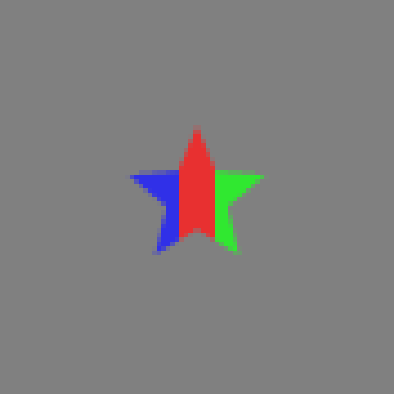
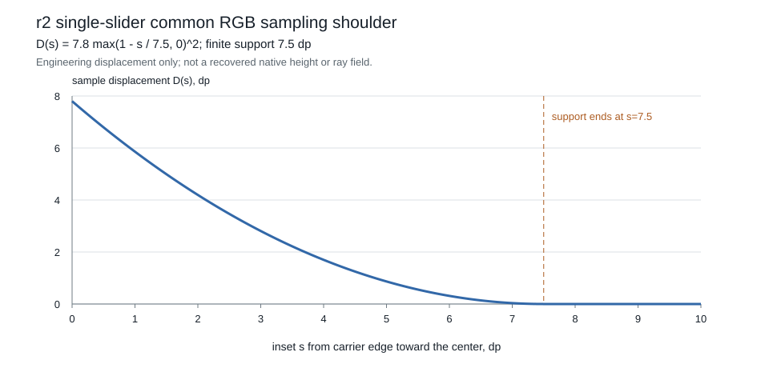
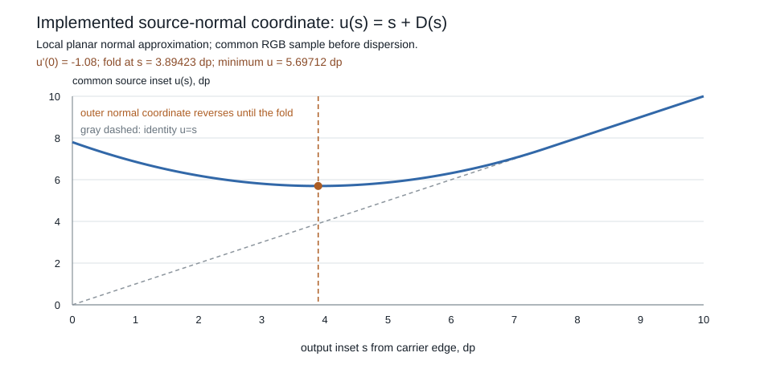
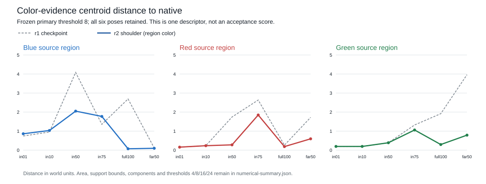
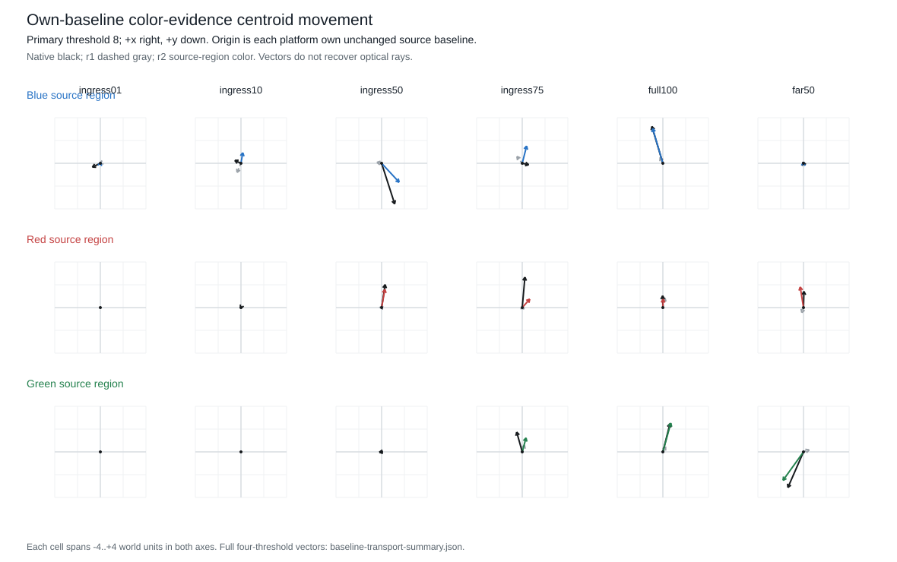

# Single-slider star transport calibration — 2026-11-15

This checkpoint implements a finite quadratic refraction shoulder for the Android Liquid Glass **single slider** and measures its color transport against a real iOS 26.5 native Slider. The fully covered pose and far-side partial pose improve substantially; early ingress and the blue region at `ingress75` retain clear failures. It is a calibration result, with no acceptance percentage or claim of complete native equivalence.

This is later than the [rail/refraction checkpoint](glass-slider-rail-checkpoint.md), whose original 2.15 profile and verification remain historical. In this candidate the single slider uses 7.8dp common RGB refraction and a 7.5dp quadratic shoulder. The range slider still uses the earlier checkpoint profile. Dock, sheet, dialog, Toggle and Tab profiles are outside this candidate.

Later [G witness/control diagnostics](glass-slider-green-witness.md) and [five/six/eight-star experiments](glass-slider-shoulder-experiments.md) retain the rejected r3/r4 alternatives. The production profile was restored to this r2 checkpoint after mixed multi-shape results; this does not turn r2's retained failures into passes. The evidence below remains the original r2 calibration record.

## Source and capture design

The known source is a 16pt five-point star centered at (187.5, 419.5), split into blue, red and green regions on an RGB(128,128,128) background. Its outer radius is 8pt and inner radius is 0.45 times that radius. The original 750×1334 sRGB input uses exact 4×4 area samples per output pixel, with full-canvas region coverage-count and binary-support masks. Its source SHA-256 is `9757bdb14092023996f2bd46d30b682799aac1fe06c221b7cad256c991e46724`.

The AA-weighted source area is 84.65625 world units² from 5,418 original subpixel samples. The continuous polygon area is 84.641076; those two denominators are deliberately distinct. Coverage masks are known source geometry, not native glass alpha.



Six independently held poses place the lens at near-edge ingress, greater ingress, approximate half/three-quarter/full overlap, then the far edge. Pose names are **nominal requested labels**, not achieved optical percentages. Every pose has an independently captured flat source at the same actual carrier bounds, allowing shape-minus-flat color evidence.

The native reference is iOS 26.5 (23F77), 375×667pt at 2px/pt and 60Hz, with Reduce Motion, Reduce Transparency and darker system colors disabled. The actual native Slider receives a real pointer sequence. All 12 native held endpoints and all six shape/flat pairs pass the saved strict endpoint verifier. It checks delivered endpoint timing, the capture interval, actual presented owner/carrier geometry, matrix and opacity stability. Unknown public carrier `cornerRadius` is retained as unknown; it does not become an inferred optical contour.

Android uses the real production `GlassSlider`, `GlassHost`, `GlassBackground` and shader on an API36 device. Its original integer source layout is 1116×1984px at actual density 2.9750001px/dp. Source-to-screen x/y mappings are recorded separately; the corresponding source-to-actual-dp scales are 1.0003361008290386 and 0.9998361827376697. Measurement pixels remain on that actual density grid. Android screenshots are never normalized to native @2 for measurement.

The Android run delivers DOWN, a slop-establishing MOVE, another inverse-mapped MOVE, a settled HELD screenshot and cleanup CANCEL. It does not set the business value directly or synthesize an UP commit. The 1600ms Compose settling clock and actual dispatch/capture uptime are both retained; 1600ms is **not** a measured wall-clock motion duration. PixelCopy and independent composited-display readiness require at least 99.5% RGB3 agreement. All 49 original host/device files hash-match, and the instrumentation capture test passes.


The native track is teal and Android uses its purple theme color. Direct raw RGB equality would therefore be misleading. The screenshots above preserve that difference, and the [flat controls](design/evidence/glass-slider-star-20261115/figures/six-pose-flat-controls.png) show the corresponding material/track backgrounds. The display figure uses nearest-neighbor crops only; its dimensions are not the measurement raster.

## Frozen measurement

The fixed 44×44 world ROI is (165.5,397.5)–(209.5,441.5). Shape-minus-same-pose-flat RGB is projected independently onto the original three chroma directions, with a direction cosine of at least 0.8. Projection thresholds 4, 8, 16 and 24 byte units are all retained; threshold 8 was frozen as primary before this candidate was analyzed. The whole-color evidence is their union. Every connected component and multi-region ambiguity remains visible to the analysis.

There is no morphology, largest-component selection, image registration, color fitting, ICC normalization or invisible-contour completion. Original pixel cell edges define measured area and support bounds. The rail-confounded source band y=422…438 is flagged rather than removed. Capsule overlap is a discrete integral of original source subpixel samples inside a capsule approximating the actual public carrier rectangle. It is a geometric pose descriptor, not measured optical alpha.

The frozen source masks, thresholds, ROI and mathematical measurement helpers are unchanged between r1 and r2. All 12 Android shape/flat scenes retain identical carrier bounds, held values and source mappings between candidates, and their source-baseline ROIs are byte-identical. Frozen tools, source hashes and the [provenance checks](design/evidence/glass-slider-star-20261115/r1-r2-provenance-checks.json) remain in the packet.

## Implemented support and sampling curve

The [actual shader](../runtime/src/androidMain/assets/shaders/liquid_glass.agsl) now accepts a finite shoulder supplied by [the style profile](../runtime/src/androidMain/kotlin/com/lingion/sleepy/ui/component/liquidglass/LiquidGlassStyle.kt) and [shader binding](../runtime/src/androidMain/kotlin/com/lingion/sleepy/ui/component/liquidglass/LiquidGlassShader.kt). For inset s inside the carrier contour:

```text
W = max(min(widthDp, halfMinor × 0.5), 0.001)
R = min(refraction, max(refractionLimit, 0) × halfMinor)
D(s) = R × max(1 − s / W, 0)²
sample shift = −normal × D(s)
```

The captured single-slider candidate uses refraction=7.8, widthDp=7.5 and blend=1.0. With the observed half-minor size around 18.65dp, neither clamp changes these values, so D(s)=7.8 max(1−s/7.5,0)². It reaches zero at 7.5dp rather than extending a nearly uniform shift through the center. The common RGB sampling displacement is an engineering parameter; it is **not** recovered physical glass thickness or a measured native ray field.



The displacement curve must not be mistaken for a monotone output-to-source map. Along a locally planar inward normal, the common RGB source inset is **u(s)=s+D(s)**, before channel-specific dispersion. Its derivative is u′(0)=1−2×7.8/7.5=**−1.08** at the edge. It turns at s=**3.89423dp**, where the minimum source inset is **5.69712dp**. Thus increasing output inset reverses the source-normal coordinate through the outer 3.89423dp: the current engineering sampler has a real fold. This is an explicit property of the implemented Android mapping, not evidence that native iOS uses this same curve, nor a physical thickness measurement. Curved-carrier normals and channel-specific dispersion add effects beyond this local one-dimensional approximation.



The existing frost band, dispersion, geometry, blur, tint, brightness and rim settings remain unchanged by this candidate. In particular, the fully held checkpoint still has blur=0, saturation=1, brightness=1, frostBand=(1.5,7.0,0.5,1.1), dispersion=5.0 and dispersionProfile=6.5. `rangeSliderLens` deliberately retains the checkpoint common refraction=2.15 without the new shoulder. The packet includes [exact supporting excerpts](design/evidence/glass-slider-star-20261115/source-support.md) and [recorded source hashes](design/evidence/glass-slider-star-20261115/profile.json).

## Measured results and retained failures

The following table is Android-to-native **color-evidence centroid distance**, in world units, at frozen primary threshold 8. A smaller value is closer only for this descriptor; area, contour support, direction and other thresholds must also be examined.

| Nominal pose | Blue r1 → r2 | Red r1 → r2 | Green r1 → r2 |
|---|---:|---:|---:|
| ingress01 | 0.742 → 0.862 | 0.159 → 0.159 | 0.196 → 0.196 |
| ingress10 | 0.955 → 1.034 | 0.234 → 0.234 | 0.196 → 0.196 |
| ingress50 | 4.084 → 2.050 | 1.742 → 0.279 | 0.389 → 0.389 |
| ingress75 | 1.357 → 1.772 | 2.633 → 1.848 | 1.323 → 1.060 |
| full100 | 2.690 → 0.073 | 0.261 → 0.187 | 1.917 → 0.296 |
| far50 | 0.109 → 0.098 | 1.722 → 0.596 | 3.964 → 0.789 |



At `full100`, the native blue and green top support is y=411.0. Android r1 gives y=415.1260; r2 gives y=411.4286. Blue area changes from 34.5738 to 58.7529 against native 60.75. Green area changes from 34.7997 to 53.5555 against native 49.0, so it now overshoots rather than simply matching. The main transport direction and side extent improve, but an accurate centroid alone does not imply an accurate outline.

At `far50`, green movement is corrected from the wrong side to the native direction. Native own-baseline green centroid movement is (−1.368,+3.128); r1 is (+0.490,−0.173); r2 is (−1.795,+2.495). Green area remains too large: native 27.5, r1 42.1439, r2 37.0595. Its top support is still too high at y=416.1344 against native y=420.0.

The following failures remain part of the result:

- `ingress01`: blue centroid distance and area disagreement worsen at **all four** thresholds.
- `ingress10`: blue improves at threshold 4 but worsens at 8, 16 and 24. Threshold 4 must not be selected after the fact as the verdict. Red and green are unchanged.
- `ingress50`: blue centroid distance improves at all thresholds, while area disagreement worsens at 4 and 8 and improves at 16 and 24. The descriptors disagree.
- `ingress75`: blue centroid distance worsens at every threshold. Its right support improves from 185.8823 to 190.2521 against native 190.5, but its top overshoots from 415.1260 to 412.7731 against native 416.0. Blue area grows from 37.6236 to 65.0801 against native 49.5.
- `ingress75` red remains insufficiently compressed: area falls from 43.7257 to 25.4219 against native 15.75. Native red moves upward 2.6695 from its own baseline; r2 moves upward only 0.7419 and rightward 0.6596.
- `ingress75` green area 22.4843 looks close to native 22.5, yet its left bound is 189.5798 against native 184.5. Area agreement conceals a support error.



The movement plot subtracts each platform's own unchanged source baseline rather than silently treating the Android source resampling as refraction. These are aggregate color-evidence centroid vectors, not individual tracked source points or optical rays. In particular, `ingress75` blue has native movement (+0.563,+0.127), while r2 is (+0.386,−1.515): the vertical direction is still wrong.

Full threshold-specific areas, centroids, bounds, covariance, axes, component counts, boundary flags and errors are in [numerical-summary.json](design/evidence/glass-slider-star-20261115/numerical-summary.json). The [own-baseline summary](design/evidence/glass-slider-star-20261115/baseline-transport-summary.json) retains all four thresholds and both candidates. No failure is dropped from those tables.

## Verification and scope

The saved build reports **93 focused JVM checks passed**, with zero failures, errors or skips: 54 shader contract, 27 style reference, seven quadratic shoulder and five track coverage checks. Debug and instrumentation APKs built successfully. The actual Android capture run also confirms production shader compile/bind for light single/range controls at lift 0, 0.5 and 1; that check does not independently calibrate range optics or exhaust every GPU driver. [verification.json](design/evidence/glass-slider-star-20261115/verification.json) preserves the test classes, XML hashes, APK hashes and compact native/Android acquisition receipts. These are existing recorded runs; packaging the evidence does not represent a new test execution.

The portable [evidence packet](design/evidence/glass-slider-star-20261115/README.md) includes 24 byte-identical held screenshots, two byte-identical Android source baseline screenshots, original source/spec/masks, frozen measurement tools, numerical summaries, source excerpts and SHA-256 inventory. Its [figure script](design/evidence/glass-slider-star-20261115/reproduce-figures.py) regenerates the plots and display comparisons from those packaged files.

This report is deliberately limited to one reused calibration star, one size, the light theme and six settled poses. It does not test every background, dark theme, time step, motion speed, control size, two-handle overlap or interaction state. Encoded screenshot channels are analyzed without cross-platform color-profile normalization. A public carrier rectangle is an approximation rather than a recovered native material boundary. No native physical thickness, complete alpha field or source-to-output ray correspondence is identified.

Separate six- and eight-point star holdouts use frozen `holdout` roles and separately hashed specifications. Their capture/analysis is a distinct validation exercise; no holdout result is used to fit this r2 curve or presented as a calibration observation here. This packet establishes a reproducible checkpoint with both improvements and failures, not completion of the wider iOS material alignment goal.
