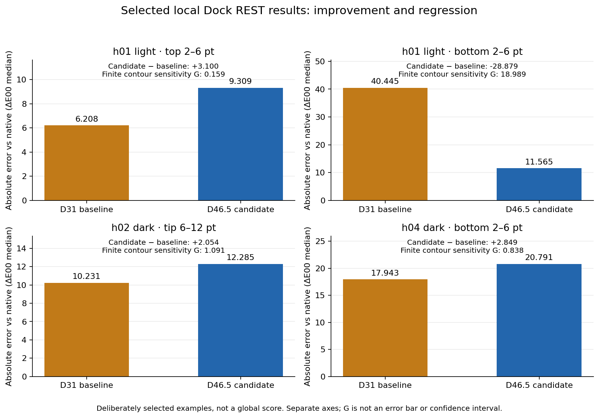
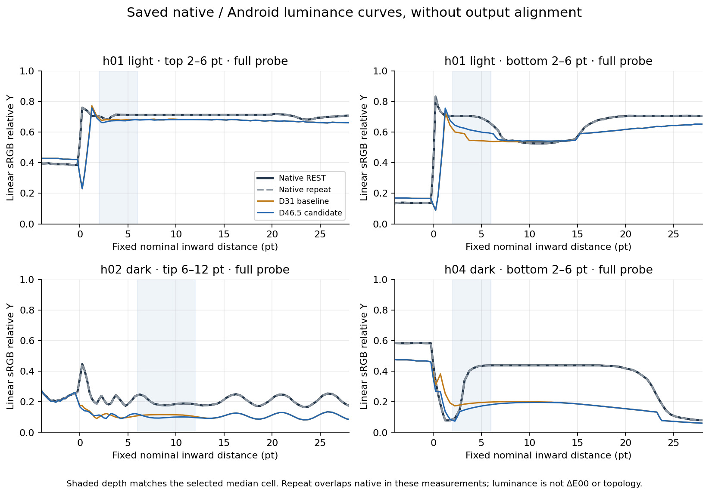

# Fixed Dock REST challenge: measured gains and retained regressions

The frozen **D46.5 / b15.5** candidate improves some local responses on eight newly preregistered synthetic backgrounds, but **12 measurement cells trigger the frozen engineering review rule**. This contradicts an interpretation that the candidate improves every new background region. The candidate is **not accepted** by this report. No whole-control score, similarity percentage, pass rate or native-equivalence verdict is computed.

These captures use the historical **Sleepy application backend**, comparing its old D31 baseline and frozen candidate with native iOS 26.5 (23F77). They do not validate this public repository's official Kyant AndroidLiquidGlass 2.0.0 backend, nor publish the unaccepted candidate as its runtime.

[Completed-result summary and source hashes](evidence/holdout/summary.json) · [All 656 paired cells](evidence/holdout/candidate-minus-baseline.csv) · [All 12 review cells](evidence/holdout/engineering-review-triggers.csv) · [Local renderer](evidence/holdout/render_figures.py) · [Validation boundaries](validation-boundaries.md)

## 1. Design and observables

Eight fixed input PNGs cover about seven designed stimulus families: horizontal steps; two signed oblique chirps; multiscale checker; low-contrast weave; off-center spots; broad chroma gradient; and band-limited texture. The chirps share a family. Light/dark are paired conditions, producing 16 scenes. The native fixture is a four-item SwiftUI TabView Dock at REST, with a 375×667 logical-unit world and 2 pixels per unit; exact shared RGB8/sRGB input files are 750×1334 pixels.

The eight inputs are design units, not a random sample of photographs. Themes, directions, depth bands, overlapping ROIs, nearby sample points and pixels are correlated. The stimulus design and ROIs used geometry and problems found during earlier calibration, then were frozen before reading the new outputs. This tests unseen render responses; it is not blind from problem discovery onward.

The analyzer, color implementation and test vectors, protocol, input manifest and exact sampling were frozen before the new outputs were read. The run used these frozen bytes. It fitted no output translation, scale, exposure or color correction. All 32 Android source records have the expected base rectangle `[21,584,354,646]`, zero nominal edge residual and an identity world mapping. A matching rectangle does not establish equality between native continuous contours and the nominal capsule.

Actual public `UITabBar.effectiveInterfaceStyle` was observed within each capture's acquisition brackets. Both REST captures agree in all 16 scenes, and the Android declared theme matches that public trait. The CSV's historical names `native_effective_theme` and `material_matches` must be read at this scope: **public effective traits do not expose native private material-shader adaptation**, and do not establish an identical rendering algorithm.

The completed analysis retains 3,392 non-foreground error rows, 96 foreground diagnostics, 656 candidate-minus-baseline cells, 656 native-repeat cells and 41,280 normal-curve rows. These counts describe multiple roles, offsets and summaries, not independent trials.

## 2. Representative absolute errors: a gain does not erase a regression



This figure deliberately selects one large improvement and three regressions; it is not a random sample or a summary over backgrounds. Bars are absolute ΔE00 median errors against native REST. Each panel has a separate vertical range. The printed change is candidate minus baseline. `G` is finite nominal-contour sensitivity, not a confidence interval or an error bar.

| Input / theme | Direction and inward depth | Baseline → candidate ΔE00 median | Change | G |
| --- | --- | ---: | ---: | ---: |
| h01 horizontal steps / light | bottom, 2–6 pt | 40.445 → 11.565 | −28.879 | 18.989 |
| h01 horizontal steps / light | top, 2–6 pt | 6.208 → 9.309 | +3.100 | 0.159 |
| h02 +31° chirp / dark | tip, 6–12 pt | 10.231 → 12.285 | +2.054 | 1.091 |
| h04 multiscale checker / dark | bottom, 2–6 pt | 17.943 → 20.791 | +2.849 | 0.838 |

### Full measured luminance probes for those examples



Black is native REST, dashed grey is its repeat, orange is D31 and blue is D46.5. Curves retain saved values at fixed nominal positions; no output alignment is fitted. The shaded band identifies the corresponding median cell above. The ordinate is **linear-sRGB relative Y**, not a similarity measure or physical light transmission. Native repeat overlaps native REST in these sampled curves. Luminance agreement cannot replace ΔE00, source-step displacement, color-island or topology inspection.

The [2,064 exported curve rows](evidence/holdout/representative-normal-curves.csv) are selected by exactly four scene/probe keys and include all four roles and all 129 inward distances per key. Their selection is stated in [summary.json](evidence/holdout/summary.json). The full 41,280-row archive is identified by SHA256 there; this smaller public subset does not pretend to contain every original curve.

## 3. All 12 engineering review cells

`Δ` denotes candidate error minus baseline error. `G` is the conservative sum of each role's maximum metric change under nominal contour offsets −0.5/0/+0.5 pt, keeping observed pixels fixed. The table rounds for display; triggers used unrounded CSV values. Corresponding native REST-repeat residuals are zero for every listed metric.

| Input / requested theme | Region / direction / inward depth | Trigger metric | Baseline → candidate | Δ | G |
| --- | --- | --- | --- | --- | --- |
| h01 / light | ROI `top_2_6pt` | ΔE00 median | 6.049 → 8.848 | +2.799 | 0.214 |
| h01 / light | top, 2–6 pt | ΔE00 median | 6.208 → 9.309 | +3.100 | 0.159 |
| h01 / light | top, 6–12 pt | ΔE00 P95 | 5.697 → 7.453 | +1.756 | 0.848 |
| h01 / light | bottom, 6–12 pt | ΔE00 median | 8.814 → 10.091 | +1.277 | 0.112 |
| h01 / dark | ROI `top_2_6pt` | ΔE00 median | 18.914 → 21.480 | +2.566 | 0.156 |
| h01 / dark | top, 2–6 pt | ΔE00 median | 18.808 → 20.966 | +2.157 | 0.561 |
| h02 / light | upper45, 6–12 pt | Linear Y MAE | 0.02134 → 0.03479 | +0.01345 | 0.00399 |
| h02 / dark | tip, 6–12 pt | ΔE00 median; linear Y MAE | 10.231 → 12.285; 0.08285 → 0.09588 | +2.054; +0.01304 | 1.091; 0.00818 |
| h02 / dark | upper45, 6–12 pt | ΔE00 P95 | 17.418 → 19.584 | +2.166 | 1.212 |
| h04 / light | bottom, 2–6 pt | ΔE00 median | 4.485 → 6.344 | +1.859 | 0.448 |
| h04 / light | bottom, 6–12 pt | Linear Y MAE | 0.07089 → 0.08315 | +0.01226 | 0.00273 |
| h04 / dark | bottom, 2–6 pt | ΔE00 median | 17.943 → 20.791 | +2.849 | 0.838 |

These are **two ROI cells and ten normal/depth cells**, not twelve independent errors. The top ROI spans x132–295 pt while the top normal probe spans x252–268 pt; their 2–6 pt cells overlap in each theme. Other directions and depths also share the same source image and renderer state. One cell may trigger more than one metric, as h02 dark tip does; counting each metric as another independent failure would be incorrect.

The frozen rule flags ΔE00 median/P95 increases that exceed **both 1.0 and 10%**, or linear Y MAE increases that exceed **both 0.01 and 10%**, also strictly exceeding the corresponding native-repeat residual and `G`. Only eligible non-foreground cells with applicable contour sensitivity and matching public traits enter this rule. It is an engineering review screen, **not statistical significance, a perceptual threshold or an absolute acceptance rule**. An unflagged or ineligible cell does not pass by default.

Metrics can move in opposite directions. h01 light top 2–6 pt has worse median, yet its P95 improves from 25.546 to 13.311. h04 light bottom 2–6 pt has worse median, while P95 improves from 20.748 to 9.446 and Y MAE improves from 0.11995 to 0.10892. A single favorable metric cannot replace this mixed result.

## 4. Other backgrounds and remaining absolute residuals

The following examples describe a chosen direction/depth, **not overall performance per background**. They are not summed, averaged or converted into a pass proportion. Complete cells, including all observed regressions, remain in [the 656-row table](evidence/holdout/candidate-minus-baseline.csv).

| Input / theme | Direction, depth | ΔE00 median baseline → candidate | Change | G | Reading |
| --- | --- | ---: | ---: | ---: | --- |
| h03 −47° chirp / dark | top, 2–6 pt | 24.339 → 19.640 | −4.700 | 2.416 | Local gain; substantial absolute error remains |
| h04 checker / dark | upper45, 2–6 pt | 34.596 → 21.951 | −12.646 | 2.252 | This corner improves while bottom median regresses |
| h05 weave / dark | lower45, 6–12 pt | 11.874 → 12.212 | +0.338 | 0.045 | Increase exceeds this finite sensitivity, but not the absolute/relative trigger |
| h06 spots / dark | lower45, 0.5–2 pt | 20.859 → 15.246 | −5.613 | 1.777 | Local outer-edge gain only |
| h07 chroma gradient / light | upper45, 0.5–2 pt | 5.603 → 4.936 | −0.667 | 13.755 | Nominal improvement is below G; not a stable resolved gain |
| h08 band-limited texture / dark | upper45, 2–6 pt | 16.303 → 14.333 | −1.969 | 0.981 | Local gain does not erase other cells |

The fixed `body_lower_unselected` ROI retains dark-theme median ΔE00 errors of **13.686, 12.860 and 18.068** for h05/h06/h07, against baselines 13.692/12.860/17.982. h06 is unchanged and h07 slightly worse. Fixed body rectangles have contour sensitivity N/A; absence of an engineering trigger cannot establish native agreement there.

Another unflagged result must remain visible: h04 dark lower45, 2–6 pt worsens from 14.873 to 22.691 in median (+7.818), but its `G=15.815` prevents the conservative trigger. P95 improves from 40.441 to 32.632. This is a mixed response needing regional/structural inspection, not evidence of “no regression”.

## 5. Repeat stability, source guards and uncertainty limits

All reported Y bias/MAE/RMSE/P95 and ΔE00 median/mean/P95/max values are zero in the **656 native-repeat cells**. Of 16 full PNG pairs, 15 have identical byte hashes; one pair differs in bytes but has zero decoded residual in every measured cell. This report does not infer whether its difference concerns unmeasured pixels or PNG metadata.

Separate attachments, capture clocks, AX records, the same PID and unique session windows establish the repeated sources. The conservative acquisition separation lower bounds range from **0.381 to 0.496 seconds**. This describes observed REST stability in that capture, not a noise distribution, dynamic stability, independent population samples or a pixel-count confidence interval. The original native index hash is retained in [summary.json](evidence/holdout/summary.json).

Android bare-background guards match the original input exactly. Native screenshots differ slightly from the uncomposited source at the remote guard: linear Y MAE is approximately 0.00023–0.00323 and ΔE00 P95 is approximately 0.368–0.924 across scenes. Shared input bytes were verified; the native screenshot is not a complete compositor-input dump. No guard-based color normalization or subtraction was applied. Exact scene values are in [source-guards.csv](evidence/holdout/source-guards.csv).

`G` changes nominal contour membership while leaving observed coordinates fixed. It is a finite sensitivity check, not fitted registration, a complete geometry-error distribution or an uncertainty to subtract from optical error. Matching base rectangles does not validate native continuous corners, blur neighborhoods or nested sampling layers.

## 6. Reproduction and remaining work

With Python 3 and matplotlib installed, render the committed small dataset locally:

```sh
python3 docs/evidence/holdout/render_figures.py
```

The renderer verifies exported input hashes and redraws two PNG/SVG figures from saved numbers. It performs no new capture, photometry, fitting, interpolation, device access, network operation or runtime change. [figure-manifest.json](evidence/holdout/figure-manifest.json) records outputs. Original archive sources and exact byte hashes are in [summary.json](evidence/holdout/summary.json); [export_from_archive.py](evidence/holdout/export_from_archive.py) documents byte copies and the explicit curve selection. Re-export requires the original archive. This is reproducibility of the public **charts and cited cells**, not a claim that the subset can rerun original screenshot analysis.

The [protocol](evidence/holdout/protocol.json), [sampling](evidence/holdout/sampling-spec.json) and [analysis freeze](evidence/holdout/frozen-analysis.json) are included as exact methodological records. Source hashes identify bytes; local timestamps are not independent third-party proof of blinding.

Independent source-step/edge loci, color-island, transport and topology review remains outstanding; photometric gains cannot pass those checks. The frozen analyzer has not completed Sheet verification. Other controls, size families, natural photographs, nested surfaces, taps, holds, acceleration, endpoint stretching, rise/fall opacity and overshoot remain outside this fixed-Dock REST analysis. If these results are used to tune the candidate, the set becomes calibration and further extrapolation requires another preregistered unseen set. **No candidate acceptance or global score follows from these results.**
