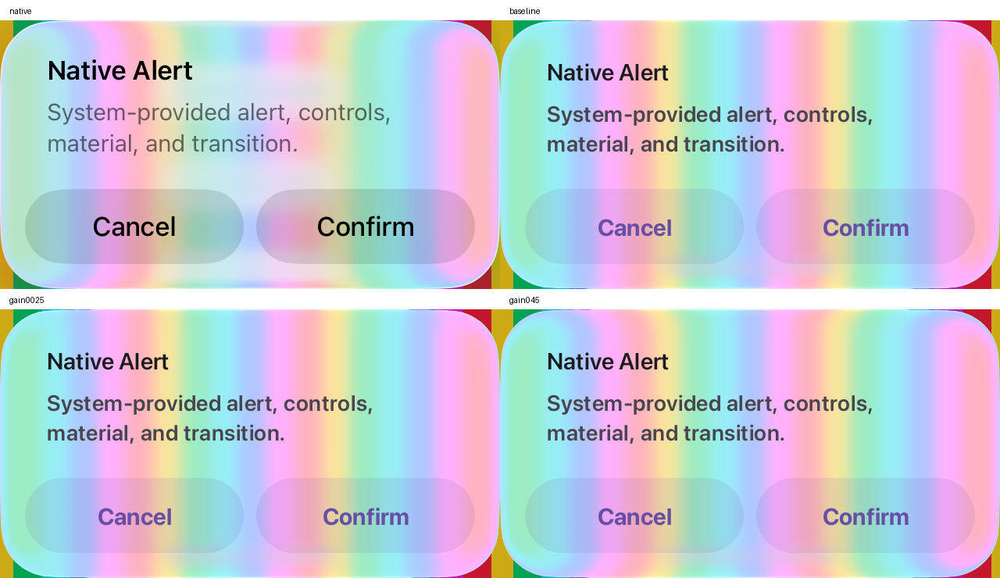
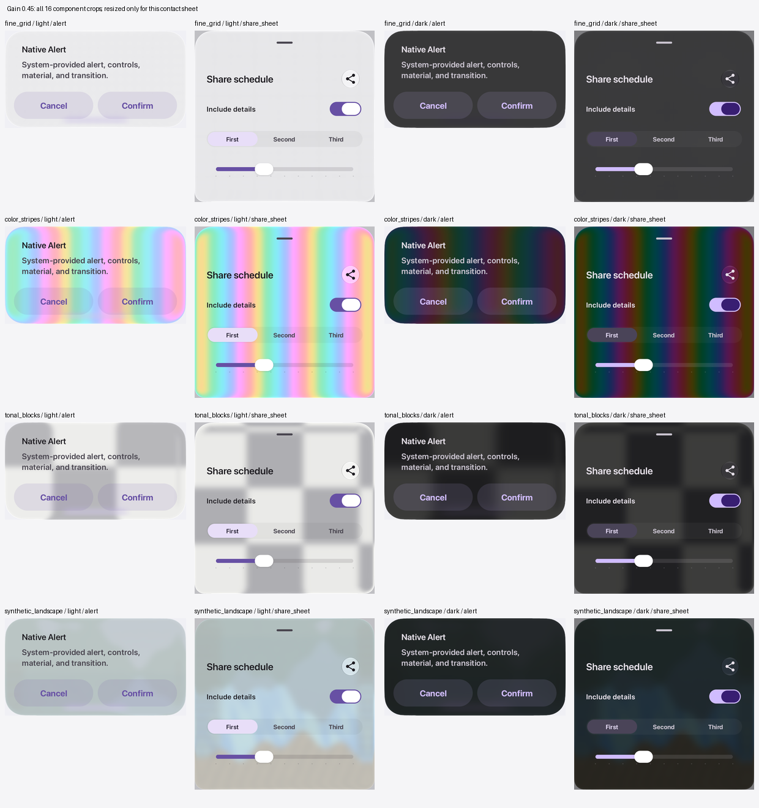
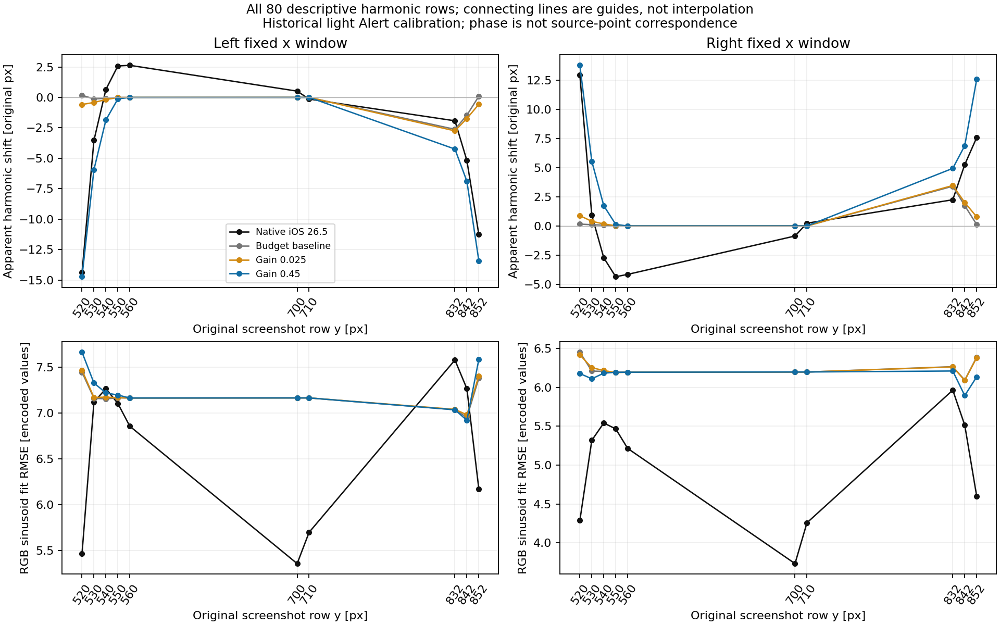
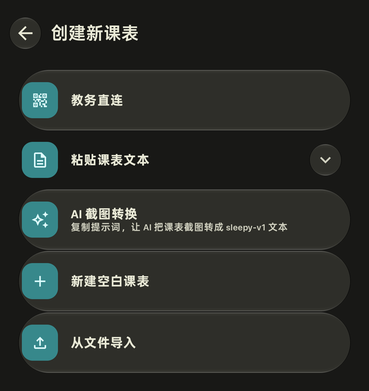

# Panel edge sampling: a stronger lateral field with retained inner-edge errors

2026-11-15. Supplement to the unchanged [panel material study](panel-material-study.md).

## Abstract

A lateral reverse-sampling term has been implemented for positive-refraction Alert and Sheet materials. The earlier coefficient 0.025 produces less than one original pixel of apparent displacement at the selected upper stripe row. A second engineering candidate, 0.45, produces −14.731 / +13.757 px on the left / right windows at y520, against −14.394 / +12.928 px for native iOS 26.5. Inner rows retain a direction mismatch, and lower rows do not improve consistently. The phase diagnostic is descriptive: it does not identify a source-point map, native lens thickness or a physical refraction coefficient.

The new candidate was captured on 16 static application panels. Separate focused application checks passed: 76 JVM tests, three device button-layout/pointer tests, and a later 18-test button/date-picker run. These checks have different scopes. Neither the screenshots nor the button tests validate the independent public backend, a complete public control adapter, an independent optical holdout or every-frame native parity.

Figure 1. Original 640×344 px pane crops, arranged for display without screenshot warping. Rows are native / baseline, then 0.025 / 0.45. Foreground fonts and action controls differ. They remain visible as context and are not evidence of a shared optical model. The [source identities and transformations](evidence/panels-lateral-20261115/sources.json) accompany the images.

## 1. Source stages and experimental boundary

The material change is bound to Sleepy commit `183114ade357eb65916a5d0464de4c9eef5fd9fb`. The subsequent application-button and date-picker work is bound to `386d4c09a78234c4bc04507f6ef4952d856de3f4`. The [current runtime import manifest](../provenance/runtime-import.json) identifies the independently imported files. Application builds and captures are bound separately by the [0.45 build receipt](evidence/panels-lateral-20261115/archive/lateral045-buttons-build-result.json).

The matrix uses the existing fine grid, saturated stripes, tonal blocks and synthetic landscape in light and dark themes, with Alert and Sheet at REST: 4×2×2 = 16 panels. These backgrounds had already been inspected and used for engineering decisions. They are calibration, not holdout. No noise-test or dynamic-test acceptance follows from this run.

The actual API 36 application fixture uses a 375×667 dp source world and density 2. The historical native reference uses 375×667 pt at 2× on iOS 26.5. The comparison convention is 1 dp = 1 pt; physical device dimensions are not equated. Attached layout coordinates place the Alert pane at `[55,515,695,859]px`. Its actual Window starts at `[46,509]px`; Window and composited-display images remain distinct. The Sheet material rectangle is `[8,317.5,367,659]dp`, compared with the historical native public AX rectangle `[8,317.7,367,659]pt`. These rectangles do not identify material alpha contours.

The [capture receipt](evidence/panels-lateral-20261115/archive/panels-lateral045-20261115/capture-result.json) records 16 geometry-checked captures. The [losslessly compressed matrix](evidence/panels-lateral-20261115/archive/panels-lateral045-20261115/matrix.json.gz) retains source geometry, placement, input metadata and fixture limits. All 16 observed material rectangles are published as integer component crops through [portable-inputs.json](evidence/panels-lateral-20261115/portable-inputs.json). Rejected display attempts are not measurement images.

Figure 2. Every candidate Window pane, cropped at its observed material-layout rectangle and resized only for this contact sheet. Transparent preview pixels are composited over `#F0F0F5`. Measurement images retain their original pixels and alpha. No native counterpart is added to this matrix to imply that all 16 panels passed an optical comparison.

## 2. What changed in the renderer

For the positive-refraction panel branch, let x be the centered horizontal coordinate, h the half width, d the existing nonnegative refraction depth, and n_y the vertical component of the unchanged surface normal. The added horizontal backward-sampling displacement is

\[
\Delta s_x=-\operatorname{clamp}\left(\frac{x}{\max(h,10^{-3})},-1,1\right)d\,n_y^2\,g.
\]

The function reads inward on each horizontal half, so a source stripe can appear to bow outward near the upper and lower rim. It is zero on the center line, where the underlying depth is zero, and along a vertical straight side where n_y is zero. This is an engineering sampling field. The existing contour normal still drives coverage, lighting and dispersion.

The style default is g=0. Alert and Sheet presets select g=0.45 in both themes. Other presets retain zero; the negative-refraction lens branch bypasses this term. The host substitutes zero for nonfinite values and clamps the uniform to `[0,0.5]`. Scaling preserves the field's coefficient, and interpolation includes it. Those source properties are checked by the application shader/style suites. They are not measurements of Apple's implementation.

This change does not retune the frost, tint, rim coefficients or geometric silhouette. It cannot by itself answer the separate question of background sharpness or the outermost highlight. A sharper color feature or an edge luminance peak requires its own recorded contrast and sampling analysis.

The [0.025 plan](evidence/panels-lateral-20261115/archive/lateral0025-plan.json) and [0.45 plan](evidence/panels-lateral-20261115/archive/lateral045-plan.json) are preserved. The later plan has a known drafting residue: one `limits` entry still says “.025 is an engineering coefficient,” while `gain`, run identity and build sources select 0.45. This supplement explains that inconsistency rather than changing the archived record.

## 3. The frozen stripe diagnostic remains inconclusive

Before the new candidates, a bounded diagnostic examined four fixed source boundaries at x54, 324, 72 and 306 pt on the historical light Alert. Native, Android screen and actual Window images were analyzed separately. Two color tracks and 344 scan rows produced 24 series and 8,256 row records. The [frozen plan](evidence/panels-lateral-20261115/archive/analysis-stripe-curvature-20261115/PLAN.md), [results](evidence/panels-lateral-20261115/archive/analysis-stripe-curvature-20261115/RESULTS.md), [interpretation](evidence/panels-lateral-20261115/archive/analysis-stripe-curvature-20261115/INTERPRETATION.md) and full row archive are retained without relaxed gates.

Native primary centers at x54 and x324 pass all 18 prescribed reference rows. Their references are 53.7866 and 324.0777 pt. Android primary centers fail all 18 rows because of plateau spread and secondary peaks. A paired primary center-relative displacement curve therefore remains unavailable. A secondary feature whose center passes on Android cannot replace the failed native primary pairing.

Every top24 and bottom24 region has zero complete eligible h=4 pt derivative supports. Edge tilt and curvature remain unavailable. Sparse apparent crossings, failed branches and channel plateaus are all retained; interpolating across those gaps would create unsupported derivatives. Raw encoded and normalized-sRGB tracks agree through the explicitly checked legal PNG color declaration. That agreement does not repair spatial identifiability.

The later paired-slope operator has an implementation freeze with 69 synthetic checks. This updates the earlier publication's preparation-only status. No real paired-slope experiment passed: implementation checks on synthetic arrays are distinct from a capture, a real-data optical gate or a unique two-dimensional inverse solution. The [original implementation freeze](evidence/panels-lateral-20261115/archive/analysis-mapping-audit/paired-slope-feasibility-analysis/implementation-freeze.json) is unchanged.

## 4. Supplementary harmonic observation

The supplementary method fits `[1,cos(2πx/216),sin(2πx/216)]` to each RGB channel on fixed left `[150,300]px` and right `[450,600]px` windows. Each selected row is compared with the fixed y700–718 reference band. A complex cross-channel phase sum gives an apparent horizontal shift. The period, windows and ten rows are recorded in the [plan](evidence/panels-lateral-20261115/archive/lateral-harmonic-plan.json); [all 80 observations](evidence/panels-lateral-20261115/archive/lateral-sampling-results/harmonic-results.json) retain per-channel shifts and RGB fit residuals.

This method was used after observing the stripe-identifiability failure and for engineering candidate selection. It does not supersede that failure. Partial periods, curved masks, different tone/blur response and folded source features can bias phase. No acceptance threshold was derived from these rows.

Figure 3. All ten rows, both windows and four source stages. Lines connect sampled observations for display; they are not inferred measurements between rows. RGB fit error is plotted alongside phase so a close phase cannot conceal the remaining color residual.

| Original y [px] | Native left [px] | 0.45 left [px] | Native right [px] | 0.45 right [px] |
| --- | ---: | ---: | ---: | ---: |
| 520 | −14.394 | −14.731 | 12.928 | 13.757 |
| 530 | −3.523 | −5.930 | 0.915 | 5.537 |
| 540 | 0.659 | −1.852 | −2.725 | 1.737 |
| 550 | 2.582 | −0.125 | −4.349 | 0.134 |
| 560 | 2.633 | −0.002 | −4.148 | −0.001 |
| 832 | −1.923 | −4.245 | 2.244 | 4.933 |
| 842 | −5.184 | −6.889 | 5.251 | 6.871 |
| 852 | −11.270 | −13.424 | 7.569 | 12.554 |

At y520, the baseline left/right shifts are 0.176 / 0.159 px and the 0.025 shifts are −0.585 / 0.881 px. The 0.45 candidate approaches the native upper-row phase. Native inner rows reverse direction while the candidate largely decays toward zero. At the lower rows, 0.45 overshoots several native values. This is a local improvement with retained residuals, not a uniformly better trajectory.

The [24 Window-delta records](evidence/panels-lateral-20261115/archive/lateral-sampling-results/baseline-deltas.json) include eight unchanged background Windows. They constrain source stability in that comparison. Changed whole-Window pixels include foreground and button differences; they cannot all be attributed to the material field. These baseline records are published, but the complete earlier 24-image input set is not duplicated here, so that entire comparison cannot be independently reconstructed from this supplement alone.

## 5. Application buttons and date pickers are a separate validation track

Ordinary application buttons use a separate visible body and accessible activation target. A 48 or 56 dp outer target no longer forces the visible glass body to that height. The initial optical-body minimum is 33.5 dp, informed by native AX observations; AX does not measure the visible material contour. Deliberate custom shapes remain available. Standard Sleepy Material shape presets are conditionally released so the glass default can take effect, while Material keeps its preset.

Ordinary button activation differs from Alert footer actions. The application test covers pressing within touch padding, holding, moving outside the activation bounds, release, cancellation and disabled behavior. Date-picker controls route through glass wrappers on the glass path; Material's date picker and input behavior retain their own branch.

| Recorded validation | Result | What it covers |
| --- | --- | --- |
| Shader contract / style reference / press motion JVM suites | 50 + 23 + 3 = 76; zero failures, errors or skips | Uniform/source contracts, presets and numerical press behavior |
| Final `GlassStandaloneButtonLayoutTest` device run | 3 passing tests | Body/target layout, held/out-of-bounds pointer continuity, cancellation and Material/disabled behavior |
| Later button/date-picker JVM suites | 6 + 6 + 6 = 18; zero failures, errors or skips | Material reference pixel/pressed checks, picker transparency and focus transitions |

The [build receipt](evidence/panels-lateral-20261115/archive/lateral045-buttons-build-result.json), [final device log](evidence/panels-lateral-20261115/archive/button-layout-fixed-device.log) and [later regression receipt](evidence/panels-lateral-20261115/archive/buttons-datepicker-regression-result.json) preserve those scopes. The earlier [two-failure device log](evidence/panels-lateral-20261115/archive/button-layout-device.log) remains available: leaving the activation bounds prematurely lost the held state, and an earlier Material height assertion observed about 40.336 dp against a 48 dp expectation. The final test source records the corrected checks. The earlier run is not relabelled as a pass.

Figure 4. One actual application page, with status/navigation areas cropped and the remaining integer crop reduced for display. It illustrates ordinary action buttons and icon controls in Sleepy. It is not an iOS comparison or proof that these application adapters are shipped in the independent library. The component crop and exact original hash / crop operation are included; the full phone screenshot and UI XML remain outside this repository.

The original XML files for the 76-test run were no longer present after the later focused run. Their hashes and counts survive in its original receipt. The 18-test XML files are included and match the later receipt. Device instrumentation is preserved as its text log. These different evidence levels remain explicit; missing XMLs are not recreated.

## 6. Reproduction, publication integrity and remaining work

The [evidence package](evidence/panels-lateral-20261115/README.md) contains 23 deduplicated component-crop/source inputs, including material crops from all 16 candidate Windows, archived plans/results, application test-source snapshots and processing records. Its figure renderer reads only committed data and reports every harmonic row. Its integrity verifier checks hashes, gzip restoration, crop dimensions / retained pixels, row counts and test receipts without building or contacting a device. It also recomputes all 80 harmonic observations from the retained component pixels, using the recorded original coordinate origin. This is a reproducibility check of that descriptive diagnostic, not an optical acceptance gate.

The earlier `panels-20261115` package and its hash-bound report remain unchanged. Its publication verifier is still a check of that historical package. The historical independent 56-test runtime build is bound to the [pre-lateral manifest](../provenance/runtime-import-20261115-pre-lateral.json) and its [original receipt](../provenance/validation-20261115.json); it cannot certify a newer runtime manifest. The independent runtime and sample build was subsequently rerun against source `386d4c09a78234c4bc04507f6ef4952d856de3f4`: seven host suites passed 56 tests with zero failures, errors or skips. Its [new receipt](../provenance/validation-20261115-lateral.json) binds the current import-manifest hash. This is separate from the application observations above and supplies no new independent-backend optical acceptance.

The frozen stripe analyzer retains original local paths. Public component inputs have a separate portable overlay, but the original full screenshots, AX export, preparation environment and complete capture archive are not distributed. A crop cannot reconstruct an omitted original file or independently confirm its recorded hash. The frozen full-image stripe analyzer therefore cannot be rerun unchanged from this package. Figure reconstruction, all 80 harmonic rows and retained-pixel / publication integrity can be checked here. A fresh device experiment, physical thickness, full blur support, source-point correspondence, independent-backend optical acceptance, size-family coverage and complete dynamic control validation remain uncompleted.
