# Alert and Sheet material study: sharpness, nonlinear sampling and thin-edge reflection

**2026-11-15 · iOS26.5 reference · Android production-path calibration · candidate not accepted**

## Abstract

This study separates three visible properties of native glass panels: recognizable background color transitions, their nonlinear deformation near the boundary, and the narrow outer highlight. A single stronger refraction parameter or brighter border does not solve all three. We compare real iOS26.5 Alert/Sheet output with recorded Android GPU output, retaining original source bytes, world coordinates, actual pane geometry, foreground masks, color curves, failed feature gates and every background-specific regression.

The current Alert body8 experiment substantially narrows some apparent color transitions but leaves location, contrast and rim residuals. A later budget-normalized reflection increment removes the prescribed124-pixel red plateau and restores visible side highlights. It remains a mixed candidate: against additive reflection, new-probe raw corner error improves22 tracks and worsens22, while D1/D2 error worsens39/40 of48 tracks. Sheet API12→10 produces one eligible local contour row out of14 and still mismatches native. These are bounded engineering observations, not recovered Apple internals, a physical thickness estimate, an independent-test pass or a reproduction percentage.

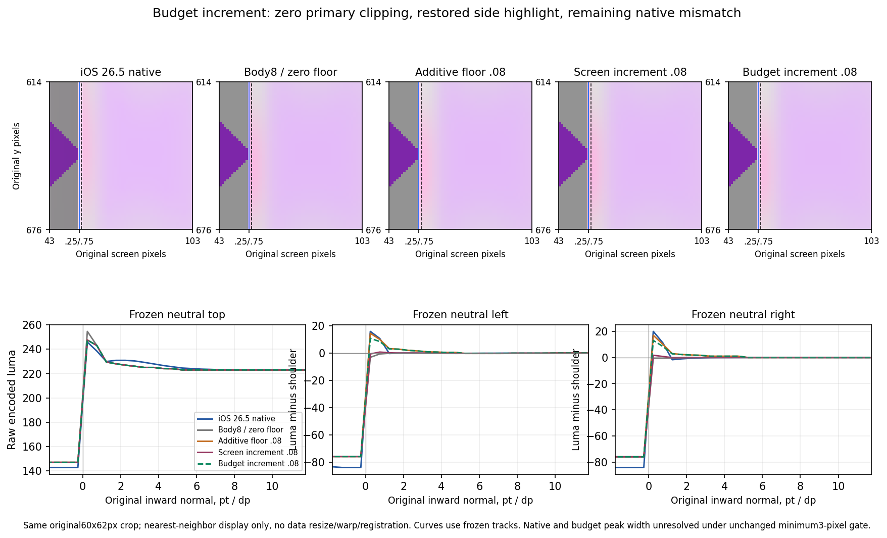

**Figure1.** Every colored-side crop is the same original60×62px support. The blue/black markers identify the prescribed0.25/0.75pt columns. The top curve remains exactly unchanged between additive, screen and budget, while the budget side peaks recover part of the light lost by screen-only composition. The remaining native differences are retained. No image registration, source warp or color correction is used.

## 1. Research object and evidence boundary

The native reference is iOS26.5, build23F77, on a375×667pt test world at2pixels/pt. The nonperiodic native captures use normal transparency and motion. REST repeats are pixel-identical in all four native source/carrier conditions; this measures capture stability, not four additional independent tests. The Android captures use the Sleepy application production path on API36 under an explicit1pt=1dp world-coordinate convention. The foreground controls and backing UI differ between platforms.

This repository's reusable public backend and sample remain distinct from Sleepy's customized application backdrop. An application-path material result does not automatically validate the independent public backend, every device, a production settings page or all controls. This study adds Alert/Sheet evidence; it does not re-score or certify Dock, Toggle, Tab, menus or animation.

Two nonperiodic source images—an identified shape field and a unique coordinate-cell field—are calibration inputs. The earlier four backgrounds (fine grid, saturated color stripes, tonal blocks and fixed-seed procedural landscape) were already observed and used in engineering decisions; light/dark makes eight conditions, not eight independent background families. No unpublished noise or heldout input enters this study. The synthetic landscape is not a natural photograph.

## 2. Geometry, foreground and color protocol

| Quantity | Frozen value |
| --- | --- |
| Source world |750×1334 original pixels;375×667pt/dp|
| Alert pane |`[55,515,695,859]px` = `[27.5,257.5,347.5,429.5]pt`|
| Alert actual Window |`[46,509,704,865]px`,658×356px|
| Sheet material raster |`[16,635,734,1318]px`|
| Native Sheet accessibility rectangle |`[8,317.7,367,659]pt`; kept distinct from317.5pt raster top|
| Foreground exclusion |Union of native accessibility and actual Android layout boxes, expanded2pt|
| Curve sample interval |0.5pt, original raster centers|
| Derivative smoothing |Fixed sigma0.75pt,7samples, reflected endpoints; never crosses a masked gap|
| Final corner derivative support |At least16 contiguous original clear pixels|
| Narrow-peak width gate |At least3 original half-height pixels; unresolved values remain unresolved|

No screenshot is resized, registered, recentered or warped for measurements. The small contact sheets are display layouts; exact original pane crops and hashes are public. Raw decoded RGB and ICC-normalized sRGB are independently checked equal. Encoded RGB/luma, RGB/pt and RGB/pt² are kept distinct. They do not measure linear radiance, physical transparency, index of refraction or lens thickness.

Backing controls can enter a broad material footprint even when direct foreground is masked. All16 source shapes are audited separately in both carriers; none has complete clear, unclipped material-only support for a whole-feature centroid. We do not complete clipped shapes with exterior pixels, select a convenient surviving edge, or call one scalar contour a recovered2D mapping. The Sheet top-center strip remains masked by the conservative grabber/content exclusion; no replacement top ROI is chosen. Lower Sheet/Alert context limitations stay labeled.

## 3. Why displacement, stretching and brightness are separate

The inspected Android planar model samples an inward source coordinate `g(d)=d+D(d)`. Its local inverse stretch, where the branch is invertible, is `1/g′(d)`, not the displacement magnitude `D`. A negative derivative reverses ordering; zero is a fold. Therefore increasing a refraction amplitude can increase compression or introduce a second sampled branch rather than supply the desired native stretching.

For the inspected engineering model with amplitude60, band20 and power1, the scalar fold occurs at13.6754pt and the minimum sampled source coordinate is16.7544pt. At output8pt, changing amplitude30→60 changes the model derivative from−0.125 to−1.25: inverse-stretch magnitude drops8→0.8. This is a source-model counterexample, not a measurement or identification of Apple's field. The underlying formulas, full untruncated numbers and derivative self-check are archived.

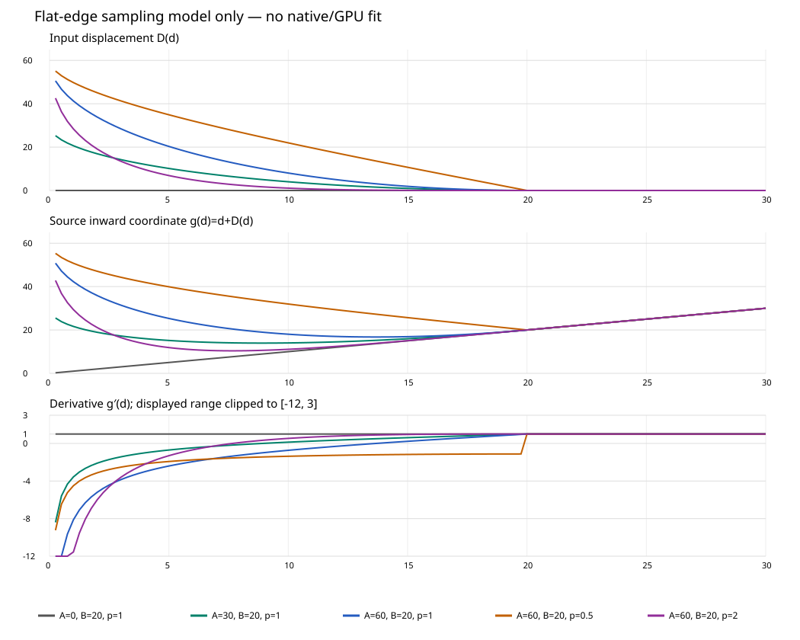

**Figure2.** Theory only. Displayed derivative limits are clipped in the figure, while the CSV preserves full numbers. The model's finite-difference self-check tests its own algebra; it does not validate native optics. Likewise, a brighter outer pixel is not a thickness measurement, and a smaller fixed-pixel RGB error is not automatically a better identifiable source correspondence.

## 4. Mechanism ablations and retained failures

| Intervention | Measured result | Interpretation |
| --- | --- | --- |
|Dark exterior correction|Historical exterior gain moves from about0.40 Alert /0.68 Sheet toward native0.52; actual Alert Windows and deep pane controls remain unchanged|Scrim correction, not thickness recovery|
|Alert profile power1→0.5|Light stripe left/right RGB RMSE16.760→23.648 and10.636→24.153; top color-centroid span increases but remains far below native|Rejected as general bend correction|
|Alert rimBlur8 only|Mixed historical edges; light top color-centroid span0.417→0.307 versus native3.134|Edge-frost change alone does not recover native bending|
|Refraction60→0|Some descriptive crossings move closer, broad transitions remain; near-top contrast46.19 versus native18.69|Rejected; one crossing cannot cancel contrast failure|
|Clear-edge candidate|S02 raw width at y269.75 becomes27.04pt versus native12.53 and baseline24.14|Rejected; wider/weaker identified feature|
|Unified negative-rim blur convention|Local S02 width22.13pt at y269.75 versus native12.53; isolation gate still fails|Partial mechanism response only|
|Alert body radius8, constant rim|Same row width13.91pt, crossing106.19pt versus native104.59, contrast53.61 versus49.88|Sharper locally; position, contrast and highlight still mismatch|
|Input-raster geometry repair|All4 accepted REST actual Windows exactly unchanged|Rendering-control result, not material improvement|
|CPU outline removal|Top peak moves outward, but142/190 first-row pixels become RGB255|Rejected white plateau|
|Flat0.06 plus additive angular floor0.08|Top clipping resolves; fixed left red clips62/62 and30/62 at0.25/0.75pt|Rejected colored-side saturation|
|Sheet true-radius mode12 control|Both Sheet and both Alert actual Windows exactly unchanged|Valid mode control, no appearance gain|
|Sheet API12→10|Only1/14 local rows eligible; its width12.324pt versus native9.648|Local API-response experiment; Sheet parity rejected|
|Screen-only added floor|Prescribed124 points no longer clip; neutral side contrast falls to0.805/1.736 versus native16.002/19.995|Clipping repair passes; required side highlight fails|
|Budget-normalized added floor|Prescribed124 points remain unclipped; side contrast10.854/13.082; substantial corner/background regressions remain|Mixed candidate, not final acceptance|

The local contour numbers are descriptive whenever their unchanged visibility/secondary-peak gates fail. For example, the original S02 native scan passes18/32 rows, and the coordinate seam25/32; failed rows remain in the exports. Exact S02/S07 operational plateau scans were localized inside previously frozen supports after initial native/baseline review and frozen before the later candidate decodes. They are exploratory calibration localization, not retrospectively independent confirmatory tests.

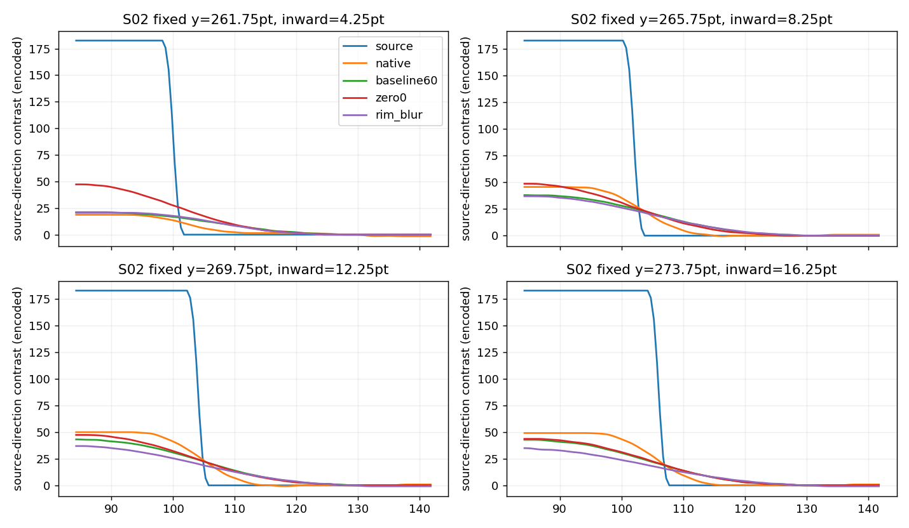

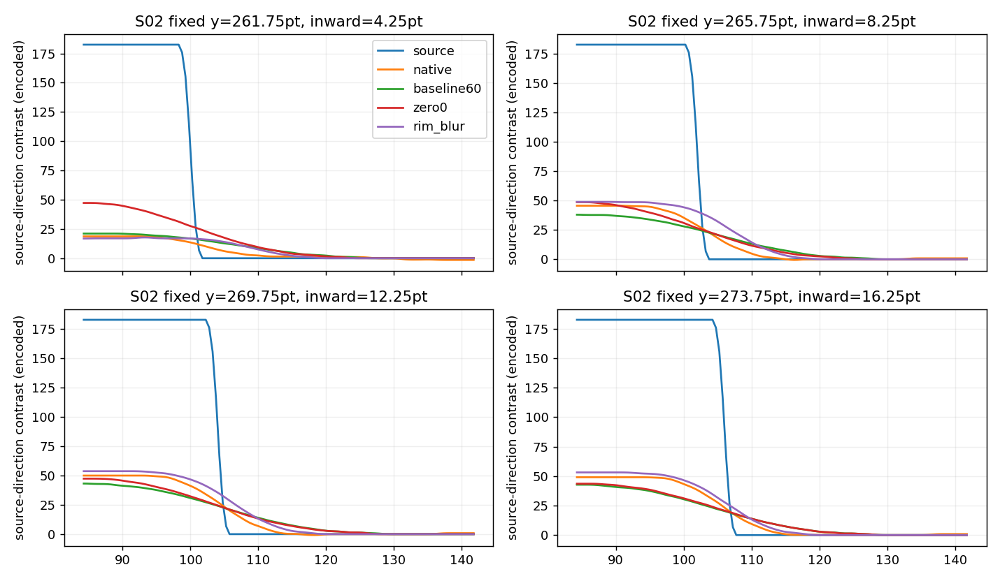

**Figures3–4.** Original-source color projections, raw/smoothed curves and gate failures expose the sharpness difference and its partial improvement. Apparent10–90 width combines blur, coordinate deformation, color mixing and sampling. No standalone blur kernel or physical sigma is recovered. A source width below the0.5pt sample interval is not subpixel measurement resolution.

## 5. Sheet12→10: a smaller input, a different execution route

PhaseA introduces the true-radius API at12 and proves exact unchanged actual Window output against the prior mode. PhaseB changes the configured input12→10. The implementation has exact shared bands only at2.5/12/16, so12 uses shared12 and10 follows the local-preblur fallback. The source/build receipt binds that fact before candidate decode. This is an API-input engineering response with a deterministic routing change, not a one-Gaussian-path radius experiment. No radius6 was tested or selected.

Native S07 passes14/14 rows; phaseA12 passes0/14 and phaseB10 passes1/14. The eligible candidate row y335.75pt has width12.324 versus9.648pt native, smoothed50% crossing96.385 versus95.696pt, and contrast26.609 versus30.010 encoded counts. The other13 candidate rows fail the unchanged secondary-peak rule; smoothing does not make them identified measurements. Individual position sampling floor is at least±0.25pt before systematic context error.

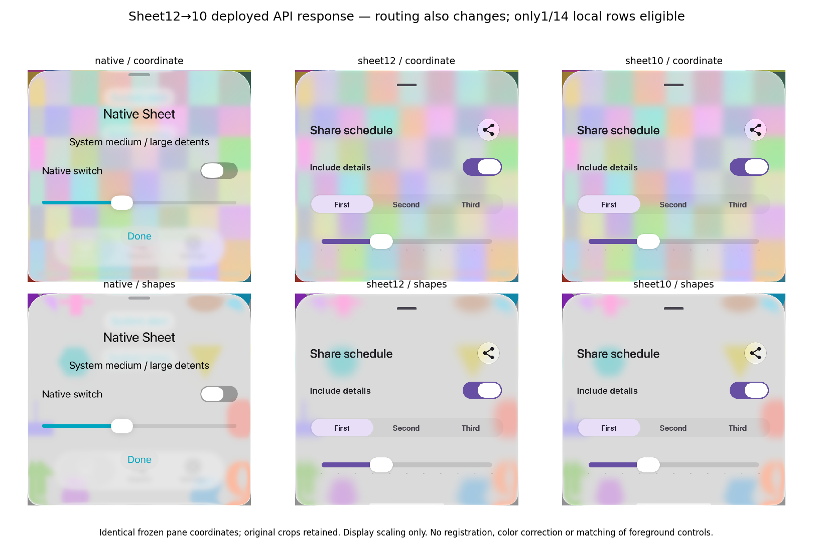

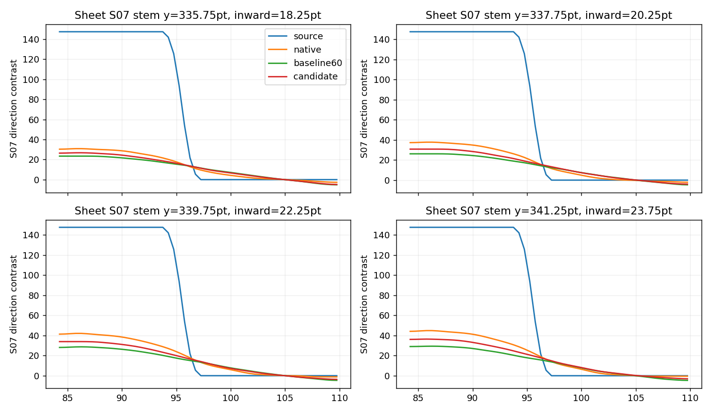

**Figures5–6.** Same original pane coordinates and original foreground differences. The full14-row table and180 fixed segment/bin deltas are archived. Top-right0..<2 and2..<4pt regress on the shapes source even where deeper top-left regions improve. The masked top-center rim, bottom backing context and incomplete whole-feature support remain unresolved. This light-source phase alone makes no dark-native pixel-parity claim.

## 6. Budget reflection: model and prescribed gates

The inherited additive shine remains unchanged. Let `c` be coverage, `G` be the already composed working RGB, and `d` the registered added angular-floor signal:

```text
H = max(c − G, 0)                    // per-channel remaining headroom
E = c × d
Y = dot(H, [.2126, .7152, .0722])
alpha = dockOneMinusExp(E/Y)         // only when Y>0; existing stable primitive
out = G + alpha × H
```

The original floor adds an equal scalar before a cap; on bright colored material it can exhaust one channel first. Screen-only composition treats the signal as opacity and multiplies it by the small available headroom, losing most of the desired side light. The registered exponential restores the scalar budget to first order whenE/Y is small and approaches the available headroom smoothly. It was chosen structurally before the new GPU pixels, not by candidate MAE, and adds no fitted intensity/width. Its weighted increment is `Y(1−exp(−E/Y))`, not exact preservation of the original finite budget and not Apple's measured law.

The light Alert remains blur8/refraction60/profile1, CPU side0/corner0/flat0.06, shine0.16 and floor0.08. The zero-delta branch is preserved. Sheet10, dark, Menu, Dock and Material Design are outside this formula change. Real-number boundedness is not an8-bit no-clipping guarantee: inherited saturation, finite precision and output quantization are measured separately below.

The main prescribed gate follows124 original colored-side pixels,62 at each inset0.25/0.75pt, plus eight original8.25..11.75pt shoulder samples at every tangent. Budget has zero0/255 channels at all124 points. Additive has62 and30 red255 samples respectively; native and body8 have none. Every budget shoulder value remains exactly equal to additive and screen.

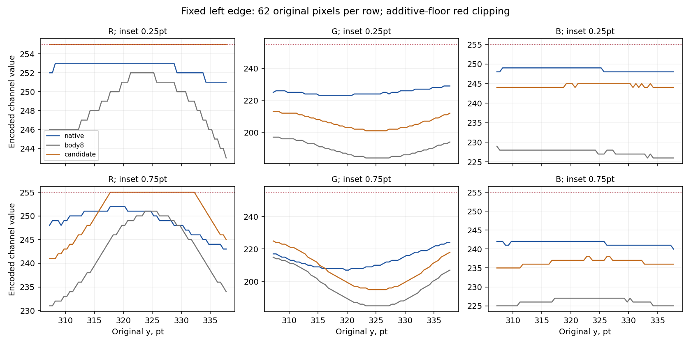

**Figure7.** The plateau is a red-channel saturation, not an all-white pixel count. Full RGB, all same-tangent shoulder values and response vectors are preserved; no average substitutes for these samples.

### 6.1 Neutral peaks and unchanged top

The following numbers are raw peak0..<4pt minus original8..<12pt shoulder, using the same frozen neutral top and left/right tangent intervals. They are encoded luma counts.

| Platform | Top | Left | Right |
| --- | --- | --- | --- |
| native | 22.94872 | 16.00170 | 19.99542 |
| body8 | 31.65263 | 0.05215 | 0.00000 |
| additive | 24.55789 | 14.63445 | 17.01585 |
| screen | 24.55789 | 0.80537 | 1.73610 |
| candidate | 24.55789 | 10.85398 | 13.08223 |

Budget restores the original8-count side-visibility gate and the native0.25pt raster argmax. Its contrast remains5.148/6.913 counts below native. Native and budget each have only two original half-height pixels, so the minimum3-pixel FWHM gate remains unresolved. Interpolated crossings are retained only as diagnostics, not continuous optical-width accuracy.

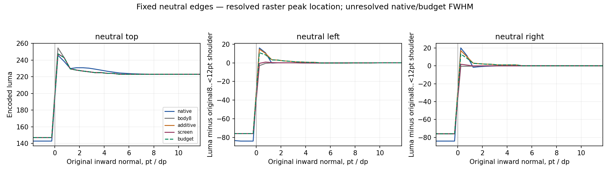

The central top is an exact zero-delta control between additive, screen and budget: full display `[280,503,470,539]` has27360 unchanged RGBA channels; actual Window intersection `[280,509,470,539]` has22800. Original exterior rows503..<509 lie outside the actual Window and remain explicitly unavailable there, separately checked in display. No padded Window, shifted ROI or full-width-top invariance is invented.

### 6.2 Exact non-rim controls

| Control | Observed result |
| --- | --- |
|New2 Sheet10 actual Window/visible app/deep80/body|Exact unchanged against the declared Sheet10 reference|
|New2 Alert deep80 and all original body ROIs|Exact unchanged against additive|
|New2 Alert central top|Exact unchanged against additive and screen|
|History8 dark carriers, actual Window+visible app against additive/original/screen|48/48 exact zero checks|
|History4 light Alert deep80/body/top against additive and screen|56/56 exact zero checks|
|History4 light Sheet10 against the existing screen-batch Sheet10|8/8 Window/app exact zero checks|
|History light Sheet10 against additive/original12|Combined12→10 response; not an unchanged-control claim|

System-context differences in complete display captures are retained separately. Exact actual Window controls do not mean every status/navigation overlay pixel across runs was identical.

## 7. Every background, every reference and retained regressions

The light matrices below include all four previously observed historical backgrounds. The native and Android foregrounds are deliberately left different. No color correction, resampling alignment or retouching makes the panels match.

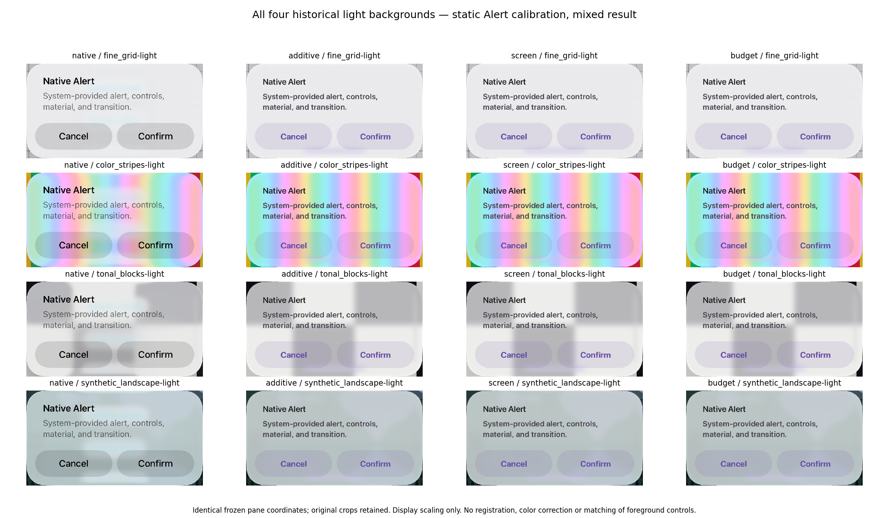

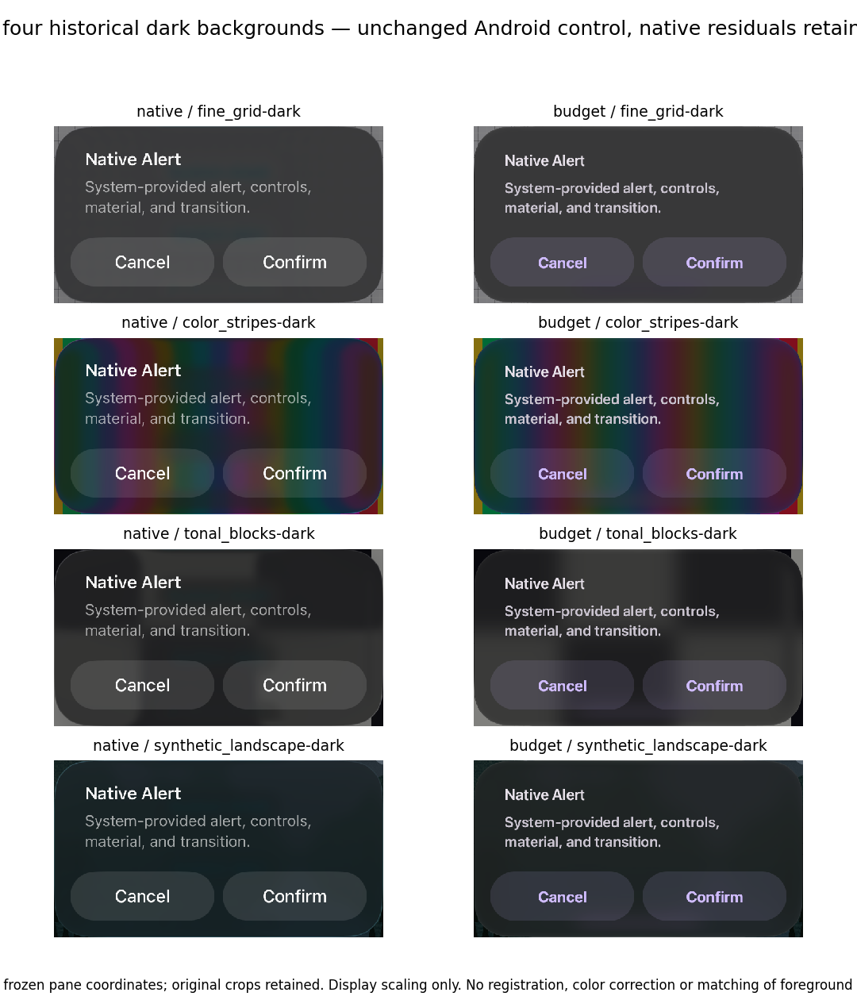

### 7.1 Original historical raw RGB RMSE

Each cell is improved/regressed/unchanged relative to native. Four straight edges use their original eligible inward support,24 corner-depth tracks their original scans, and four body ROIs their original masks. These are correlated diagnostic counts, not acceptance rates. The `original` reference includes prior blur+rim+composition changes; only additive/screen comparisons isolate the current composition difference at constant light Alert settings.

| Background | Reference | Straight RGB RMSE | Corner RGB RMSE | Body RGB RMSE |
| --- | --- | --- | --- | --- |
| fine_grid-light | additive | 3/1/0 | 10/14/0 | 0/0/4 |
| fine_grid-light | screen | 2/2/0 | 12/12/0 | 0/0/4 |
| fine_grid-light | original | 4/0/0 | 24/0/0 | 1/3/0 |
| color_stripes-light | additive | 3/1/0 | 21/3/0 | 0/0/4 |
| color_stripes-light | screen | 4/0/0 | 24/0/0 | 0/0/4 |
| color_stripes-light | original | 3/1/0 | 11/13/0 | 0/4/0 |
| tonal_blocks-light | additive | 1/3/0 | 13/9/2 | 0/0/4 |
| tonal_blocks-light | screen | 3/1/0 | 15/9/0 | 0/0/4 |
| tonal_blocks-light | original | 3/1/0 | 23/1/0 | 2/2/0 |
| synthetic_landscape-light | additive | 0/4/0 | 1/23/0 | 0/0/4 |
| synthetic_landscape-light | screen | 4/0/0 | 24/0/0 | 0/0/4 |
| synthetic_landscape-light | original | 4/0/0 | 24/0/0 | 1/3/0 |

All dark body/straight/corner outputs remain unchanged against all three references. Landscape regresses on all four raw straight RMSE tracks against additive; tonal regresses on three. Those negatives remain visible even where the current method improves the rejected screen-only result.

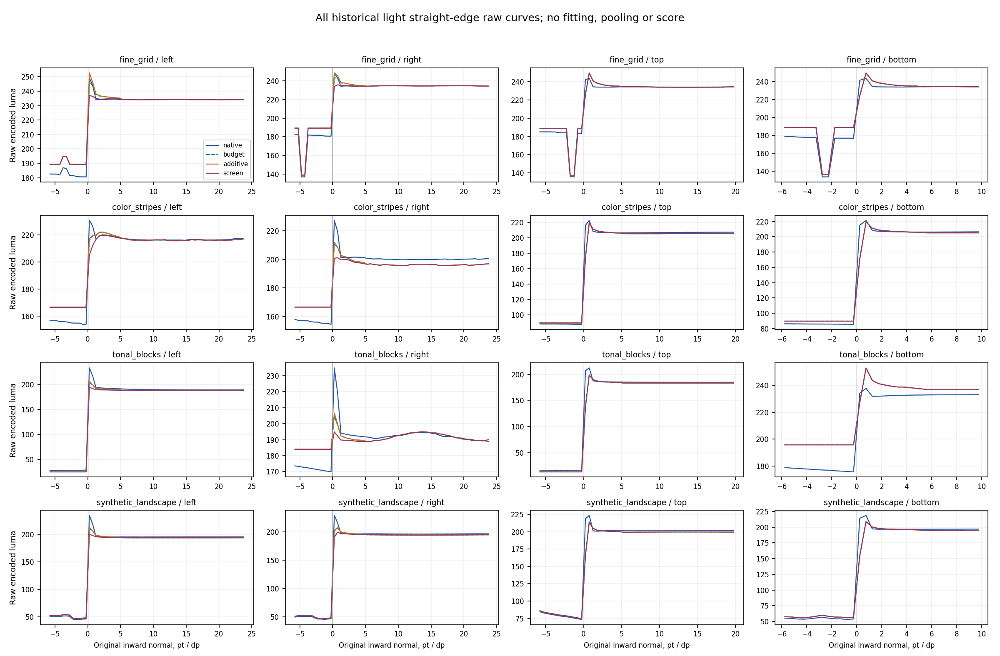

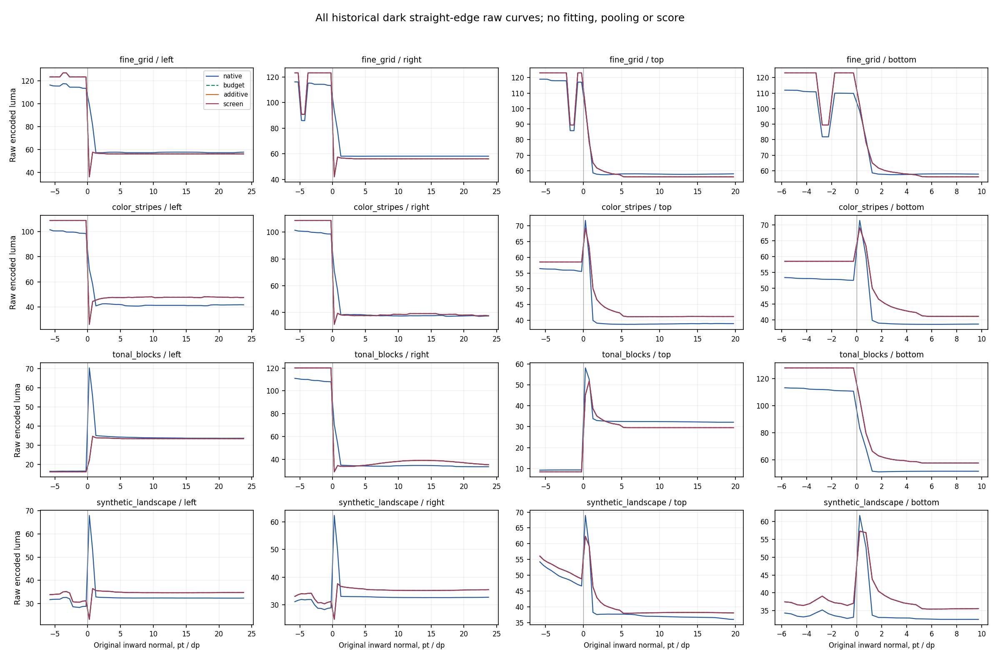

**Figures10–11.** A compact display of raw encoded luma, not a replacement for full RGB/chroma. All original RGB, smoothing, D1/D2 and masking data remain public. No curve is shifted, time/space warped or pooled into a similarity score.

### 7.2 New-probe corner mean RGB MAE

The two new calibration sources contribute48 fixed Alert corner tracks. Whole-scan results are kept separate by raw/smooth/D1/D2. Each cell is improved/regressed/unchanged.

| Reference | Raw MAE | Smooth MAE | D1 MAE | D2 MAE |
| --- | --- | --- | --- | --- |
| body8 | 31/15/2 | 38/10/0 | 39/9/0 | 34/14/0 |
| additive | 22/22/4 | 15/31/2 | 6/39/3 | 6/40/2 |
| screen | 36/11/1 | 42/6/0 | 46/2/0 | 42/6/0 |

The39 D1 and40 D2 regressions against additive prevent an all-corner improvement claim. Removing primary clipping is not sufficient to accept a highlight transfer function.

### 7.3 Historical corner mean MAE with16-original-pixel support

The following final interpretation recomputes smoothing and derivatives from original raw corner curves with at least16 contiguous clear pixels. Earlier historical CSVs preserve7-support derivative columns solely as provenance; those legacy derivatives are not used in this table. MAE can differ in direction from the preceding RMSE because it weights errors differently; neither table is silently substituted for the other.

| Background | Reference | Raw MAE | Smooth MAE | D1 MAE | D2 MAE |
| --- | --- | --- | --- | --- | --- |
| fine_grid-light | additive | 13/9/2 | 13/11/0 | 2/22/0 | 2/22/0 |
| fine_grid-light | screen | 7/16/1 | 8/16/0 | 21/3/0 | 19/5/0 |
| fine_grid-light | original | 24/0/0 | 21/3/0 | 24/0/0 | 24/0/0 |
| color_stripes-light | additive | 22/2/0 | 24/0/0 | 17/7/0 | 15/9/0 |
| color_stripes-light | screen | 24/0/0 | 24/0/0 | 24/0/0 | 24/0/0 |
| color_stripes-light | original | 3/21/0 | 3/21/0 | 24/0/0 | 24/0/0 |
| tonal_blocks-light | additive | 13/9/2 | 7/15/2 | 5/15/4 | 5/17/2 |
| tonal_blocks-light | screen | 12/12/0 | 15/9/0 | 19/3/2 | 22/2/0 |
| tonal_blocks-light | original | 17/7/0 | 15/9/0 | 24/0/0 | 24/0/0 |
| synthetic_landscape-light | additive | 1/20/3 | 1/23/0 | 4/19/1 | 7/16/1 |
| synthetic_landscape-light | screen | 23/1/0 | 24/0/0 | 24/0/0 | 24/0/0 |
| synthetic_landscape-light | original | 23/1/0 | 24/0/0 | 24/0/0 | 24/0/0 |

Every corner/depth and inward-only/whole-scan result is in the accompanying machine-readable exports. The summary preserves all directions rather than averaging away a difficult background.

## 8. Endpoint clipping: a reference-dependent result

New4 fixed Alert inward samples introduce no0/255 channel endpoints versus body8. History introduces none versus additive, but that cannot be generalized to every reference or original pixel. Overlapping fixed tracks retain repeated samples; the following are channel-sample counts, not unique pixels:

| Reference | New0 | New255 | Rows with new0 / new255 |
| --- | ---: | ---: | --- |
|additive|0|0|0 /0|
|screen|0|1|0 /1|
|original factory|0|2548|0 /219|
|native|110|5556|99 /502|

The one new255 against screen is the blue channel on the color-stripes light right straight row, inset2.25pt, one sample among62. Additive already has255 there. Inherited native/factory-relative saturation and dark reference differences remain in the complete pointwise exports. A blanket “all inward samples unclipped” statement would be false.

## 9. Data integrity, export and reproduction

The budget plan and seven analysis scripts were frozen before the first candidate pixel decode. The279 baseline/source/script hashes were reverified identical after analysis. New4 and the complete history16 each received a separate predecode freeze. The first budget history run stopped after6 captures under a system blue usage reminder; only the explicitly handed-back complete r2 batch enters optical analysis. Failure receipts remain preserved. No failed image was used to fill a missing condition.

The public package includes606 recorded scripts/tables/plans/reports/capture metadata, ten byte-exact existing figures and50 exact synthetic pane crops, with original and published SHA-256 values. Large repeated numeric exports are losslessly gzip-compressed:316.4MB of source text becomes39.1MB before figures/crops. There is no APK, build cache, raw device video, full status-bar screenshot or unpublished heldout input. Redrawing and hash verification use only public files.

- [Source/publication hashes and exact crop transformations](evidence/panels-20261115/sources.json)
- [Portable redraw, exact restoration and verification instructions](evidence/panels-20261115/REDRAWING.md)
- [Portable plot renderer](evidence/panels-20261115/redraw_figures.py)
- [Publication verifier](evidence/panels-20261115/verify_publication.py)
- [Complete budget decision](evidence/panels-20261115/archive/analysis-rim-evidence/budget-decision.md)
- [Budget controls, all-reference summaries and limits](evidence/panels-20261115/archive/analysis-rim-evidence/budget-result.json)
- [All retained budget negative rows](evidence/panels-20261115/archive/analysis-rim-evidence/budget-regressions.json.gz)
- [Background/edge/corner/depth regression index](evidence/panels-20261115/archive/analysis-rim-evidence/budget-regression-index.csv)
- [All14 Sheet rows and all180 bin changes](evidence/panels-20261115/archive/analysis-native-probes/sheet-radius10/report.md)
- [Nonperiodic native feasibility and failed contour gates](evidence/panels-20261115/archive/analysis-native-probes/report.md)
- [All eight profile-power conditions](evidence/panels-20261115/archive/analysis-alert-profile-half/README.md)
- [All eight rimBlur8 conditions](evidence/panels-20261115/archive/analysis-alert-frost8/README.md)
- [Rejected additive-floor experiment](evidence/panels-20261115/archive/analysis-rim-evidence/rim-bounded-decision.md)
- [Rejected screen-floor experiment](evidence/panels-20261115/archive/analysis-rim-evidence/rim-screen-decision.md)
- [Sampling-map model and identifiability audit](evidence/panels-20261115/archive/analysis-mapping-audit/README.md)

All negative rows remain archived:732 new-probe Alert field/scope regressions,34 historical straight field regressions,690 historical corner16 field/scope regressions and12 original-factory-relative body regressions. Repeated scopes/references are not independent trials. Some historical report paths describe their original workstation; the portable entry point is this page and the redraw instructions, not an expectation that an old absolute source path exists elsewhere.

## 10. Limits and next boundary

The evidence supports a sharper local Alert response and partial recovery of outer-side reflection, while rejecting several attractive but incorrect mechanisms. It does not recover a unique2D native displacement field, physical lens thickness, native blur kernel, linear-light transport, complete feature correspondence or a universal perception metric. The native narrow highlight is under-resolved at this capture scale. Backing contexts differ, important Sheet top pixels are masked, and independent background/size/dynamic verification remains outside this calibration.

Full motion at different speeds, accelerations, angles and sizes must follow static identifiability and retain all intermediate states. This report does not start that experiment or claim frame-by-frame agreement. The current candidate remains reviewable research with public negative evidence; it is not marked aligned or complete.
