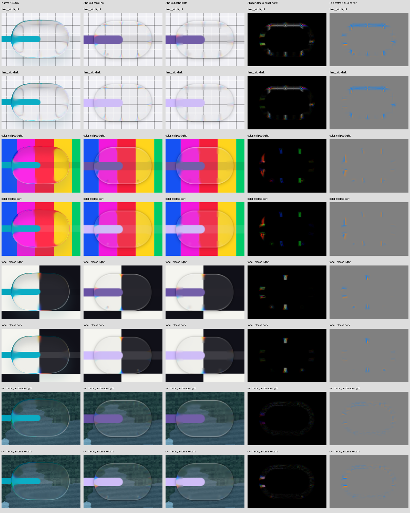

# Slider material checkpoint: a local frost-band experiment

**2026-11-15 · iOS 26.5 reference · historical Sleepy application backend · candidate not accepted**

**Historical report.** This +2.15 frost arm is not the current single-slider profile. The current unaccepted r2 checkpoint uses single refraction **7.8 / shoulder width 7.5**, while range retains refraction **2.15 with no shoulder**. See the [current star calibration](glass-slider-star-calibration.md), [rejected shoulder alternatives](glass-slider-shoulder-experiments.md), and [G-response diagnostic](glass-slider-green-witness.md).

This checkpoint tests an inset-local replacement for the slider's existing frost response while keeping its positive source-transport field, geometry and narrow dispersion fixed. It improves several measured regions, retains regressions and does not establish native equivalence. The captures come from Sleepy's customized application backend. Copying the material implementation into this repository does **not** validate equivalent pixels on its independent public backend.

The intended native structure remains a largely clear center, stronger magnification/refraction toward the edge, and conspicuous channel separation confined to the narrowest outer band. A frost plateau is a filtering experiment; it cannot stand in for the required spatial refraction field or demonstrate glass thickness. Those source-field and cap residuals remain open.



**Figure 1.** Rows retain all four backgrounds—fine grid, saturated stripes, tonal blocks and synthetic landscape—in both themes. Columns are native iOS 26.5, the already calibrated narrow-dispersion Android baseline, this candidate, absolute candidate-minus-baseline RGB difference displayed at ×3, and direct-error change (red worse, blue better). The fourth column is not a native-error image. Full crops retain the different rail colors; the material metrics exclude the rail/halo and a conservative native-title influence region. Contact-sheet enlargement is for display, not an image-registration or color-correction step.

## Experiment and baseline identity

The **baseline is the narrow-dispersion arm**, with positive refraction `+2.15 dp`, bevel `5.5 dp`, dispersion amplitude `5`, and quadratic dispersion support `6.5 dp`. It is not the original Sleepy product baseline, Slider72, or an unchanged public sample. This experiment adds only the local frost replacement below to that comparison arm:

```text
d = actual surface inset, in dp
g = smoothstep(1.5, 2.0, d) * (1 - smoothstep(6.5, 7.0, d))
totalFrost = mix(inheritedFrost, 1.1, g)
```

The runtime representation is `LiquidGlassFrostBand(1.5, 7.0, .5, 1.1)`. It replaces total frost inside the gated band; it does not add another `1.1 dp` to every sample or blur the whole face. During rise/fall, the replacement radius and inherited frost strengths use the same lift multiplier while their inset supports remain fixed. A null band keeps the inherited shader branch. See the imported [style](../runtime/src/androidMain/kotlin/com/lingion/sleepy/ui/component/liquidglass/LiquidGlassStyle.kt), [uniform binding](../runtime/src/androidMain/kotlin/com/lingion/sleepy/ui/component/liquidglass/LiquidGlassShader.kt) and [AGSL](../runtime/src/androidMain/assets/shaders/liquid_glass.agsl).

At this historical stage, the two style factories shared the frost-band material. Their current source-transport profiles differ as stated above. The paired images and numbers here concern **one single-slider fixture**. Material reuse is not an independent Range fit, a complete public slider adapter or acceptance of either control.

## Recorded changes, including regressions

Each condition contributes 14 fixed, partly overlapping regional records. The table uses encoded RGB MAE direction and retains every strict change without a suppression threshold.

| HELD comparison against the narrow-dispersion baseline | Improved | Regressed | Unchanged |
| --- | ---: | ---: | ---: |
| Direct native error | 68 | 26 | 18 |
| Own-source effect error | 69 | 25 | 18 |

These are **112 overlapping records per metric, not independent trials or a similarity percentage**. Own-source error compares each rendered-minus-own-source effect with the corresponding native effect; it does not recover physical opacity or undo source mismatch. MAE and RMSE change direction disagree on 19 direct and 16 own-source records, so the MAE counts cannot summarize every error statistic. All 112 REST records per metric are unchanged against this arm; that is a control for the scope of this increment, not a native-parity result.

The fixed fine-grid/light interior MAE falls from `7.014765` to `4.867338`, but its lower-rim-and-shape record rises from `11.832609` to `11.912319`. On stripes/light, the left lower endcap/corner MAE rises from `13.453125` to `13.647569`. Cap bending, angular response, the contour and parts of the lower rim still differ from native. No regression is discarded because another mask improved. The [complete regional CSV](evidence/slider-material-20261115/all-regional-errors.csv) and [compact checkpoint data](evidence/slider-material-20261115/checkpoint-data.json) retain both error metrics, all strict changes, source receipts and summary splits.

## Why this diagnostic was tried, and what was rejected

The [fixed plateau-frost diagnostic](evidence/slider-material-20261115/plateau-frost-diagnostic.md) compares 14 central blue-channel rows in each theme. The existing monotone contour-frost envelope could not supply the near-constant broad response at both deeper and shallower rows while preserving the adjacent sharper face. Its fixed W8 counterexample over-broadens shallower rows when adjusted to reach the deeper one. The gated plateau was chosen from those already observed rows. That report's Gaussian-variance surrogate is **not** an actual GPU rendering, a recovered native point-spread function or the numerical result in the table above.

A separate [raised-shoulder source-field arm](evidence/slider-material-20261115/raised-shoulder-review.md) was rejected after actual captures distorted broad interior content and horizontal lines. Mathematical smoothness and a non-folding query field were insufficient. Its temporary API was removed. This failure does not establish the present source field as correct, nor justify replacing edge refraction with more frost.

## Calibration, endpoints and publication boundary

The four backgrounds and two themes are **eight previously observed calibration conditions**, not an independent holdout. Landscape is reported separately in the saved analysis, but it is a synthetic, previously observed scene and is not promoted to an unseen test set. Repeated themes, pixels and overlapping masks do not add independent experimental units.

Measurements keep the declared world coordinates and raster convention, without per-scene alignment, source warping, sharpening, contrast fitting or color normalization. The frozen masks are a historical Android72-derived sampling model, not an alpha mask or proof of native corner geometry. Native HELD is bracketed by actual DOWN/UP after at least 0.65 s; Android uses active held state with a controlled Compose clock settled at least 1.6 s. This is stable-state evidence, not matched natural-time animation or every-frame acceptance. The [saved methodology](evidence/slider-material-20261115/methodology.json) preserves the masks, exclusions and original capture-stage scope.

Endpoint work cited alongside this checkpoint reaches **holder/carrier geometry only**. It does not measure the complete visible outer edge of a fully raised glass lens, its alpha support or optical continuity at overdrag. No full held-edge, release, multi-size or dynamic acceptance follows. The application checkpoint also does not revalidate Dock or panels.

The source and evidence above describe the recorded historical checkpoint. Current publication and source identities are recorded separately in the repository import manifest and validation log. This document claims neither a public-backend optical pass nor publication of a native-equivalent control.
