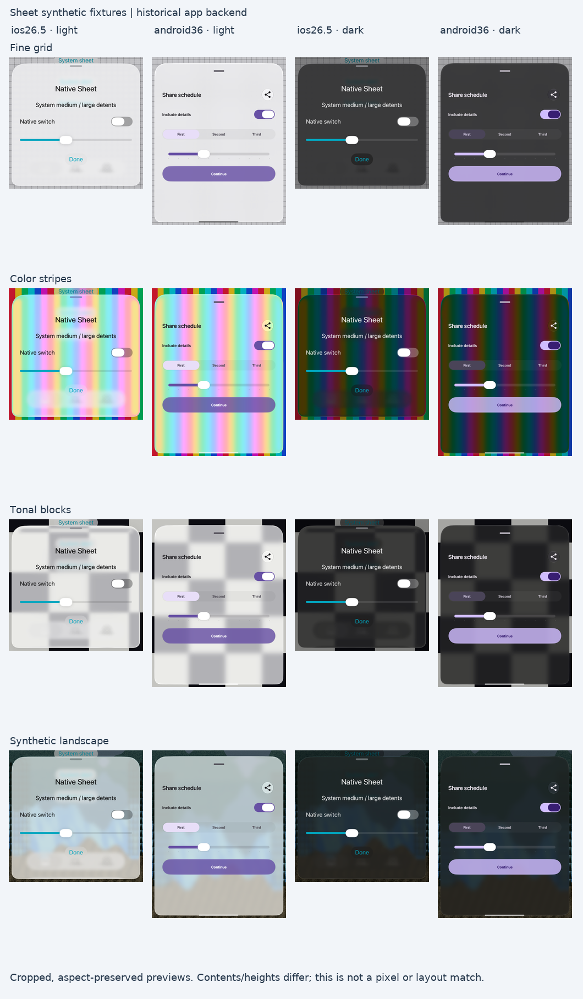
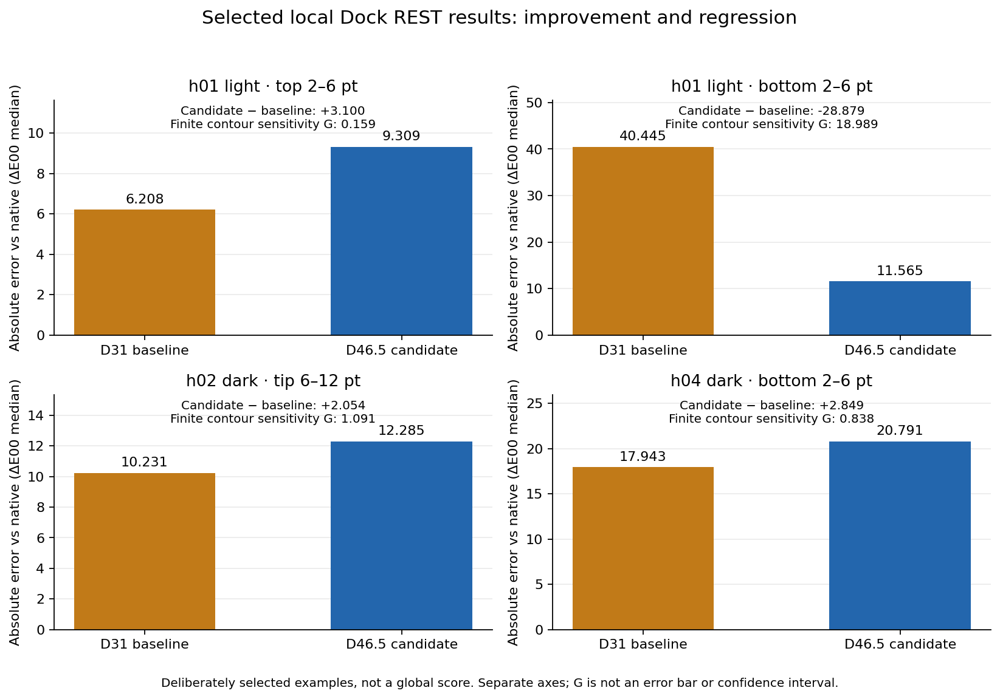
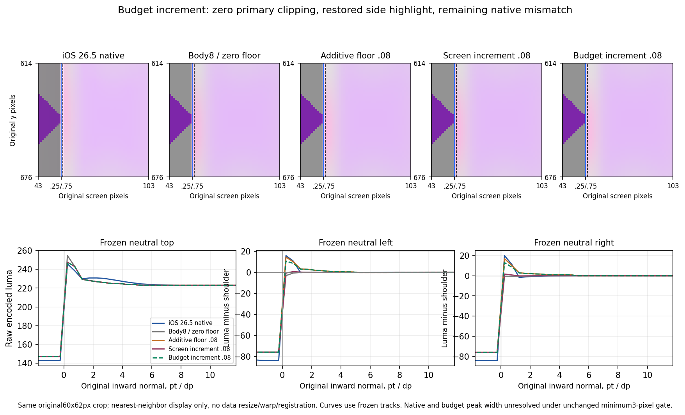

# Candidate status and validation boundaries

This current-status index was updated on **November 16, 2026**. Historical Dock/panel conclusions below retain their original stage boundaries. The [current evidence and image index](current-evidence-20261116.md#english) adds the later Toggle, Slider and menu records. No global holdout score or comprehensive native-equivalence verdict is computed.

| Evidence stage | What is established | Boundary |
| --- | --- | --- |
| Current independent source identity | 38 imports bound to `5f3ea867`; scope reconciliation retains byte equivalence | Latest slider build receipt ran `9533cf7f` / original manifest, with 56 host tests; no new-HEAD rerun or sample device optics acceptance |
| Historical new-background Dock REST | Fixed photometry complete, including 12 review cells | Candidate not accepted; transport / topology review and Sheet validation on that set still outstanding |
| Current Alert highlight budget | Specified clipping removed; neutral-side contrast partially restored | Corner-derivative and background regressions retained; application backend only |
| Current Sheet API-input 12→10 calibration | Analysis complete; one of 14 local rows eligible | Candidate unaccepted; does not complete the historical new-background Sheet validation |
| Native clean-r2 fixture | Full REST repeats and fixed source regions exact; public / AX geometry unchanged | Original ICC-only overall gate remains false; legal sRGB metadata recorded separately |
| Paired-slope feasibility | Later analyzer frozen with 69 synthetic implementation checks | No real paired-slope capture or optical pass |
| Alert / Sheet lateral-field calibration | 16 static application panels; all 80 descriptive harmonic rows retained | Upper-row improvement, inner-direction and lower-edge errors; no optical acceptance |
| Application button / date-picker regression | Separate final 76 JVM, three device-button and later 18 JVM checks pass | App-only adapters; does not establish every-entry routing or independent public control completion |
| Toggle ordinary taps and core replay | Eight native taps, 16 events, 838 frames; actual runtime replay executed | Transient residuals and clock/layer differences remain; no Android GPU or natural-time acceptance |
| Slider finite RGB / signed G | Native eight-round RGB and four-round signed-G diagnostics completed | Shared-response simplifications fail at stated gates; no unique optical pipeline or product parameter |
| Android Slider composite / geometry | Compatible analysis executed; quantization/residual decomposition reproducible | Original bounds/matrix gates still fail, opacity unknown; full100 is not the business endpoint |
| Menu carrier fix / later observers | Five red regressions, 48 green checks; external terminal/layer observers compiled | Prior GPU failures retained; no fix-bound GPU capture or observer execution |

The [slider build receipt](../provenance/validation-20261115-slider.json) binds its [original slider manifest](../provenance/runtime-import-20261115-slider-original.json); the [scope reconciliation](../provenance/scope-cleanup-20261116.json) separately binds current import identity. The [lateral receipt](../provenance/validation-20261115-lateral.json) and [earlier receipt](../provenance/validation-20261115.json) bind their archived manifests. None is relabeled as a new execution. The [panel material report](panel-material-study.md) describes application-path results, without validating the public backend's pixels.

Additional inputs, protocols and research assets are linked from the [controlled optical study index](controlled-optical-studies.md). Each study keeps its own prepared / collected / executed status; linking an asset does not promote it to a validated experiment.

## What is calibration, and what was withdrawn

The four historical optical backgrounds are fine grid, saturated vertical stripes, tonal blocks and a fixed-seed procedural landscape. Light/dark creates eight conditions, not eight independent background families. All were viewed and used in candidate selection and are therefore **calibration**. The procedural landscape is not a natural photograph. Previously inspected motion trajectories and retrospective fits retain the individual limits stated in the [evidence atlas](evidence/RESULTS.md).

The `bevel 20→6` experiment altered the GPU edge while preserving its checked center/exterior pixels. Subsequent native cap comparisons contradicted its source-color extension, so the candidate was **withdrawn**. The [Android-only report](edge-profile-update.md) remains a rejected mechanical experiment, including its harder D-shaped high-contrast inner edge. Passing those mechanical checks was never evidence of native parity.

At the 2026-11-14 checkpoint, Sleepy's frozen production-path Dock candidate used **actual D=46.5pt and b=15.5pt**; Sheet used refraction60/bevel20 with its then-existing clamping, colors and compositing. These identify the historical run below, not every later source revision. They are engineering parameters, not measurements of native thickness, IOR or transparency. Later nonlinear Dock rim improvements do not retrospectively change this recorded photometry. The application backend differs from the independent public backend, so these runs do not automatically validate this repository's sample.

Known failures remain public. For example, the historical Sheet light top-edge profile RMSE worsened from **3.144 to 3.992 RGB code values**, while dark edge profiles retained roughly **7.759–10.280** error. See the [complete table and source records](evidence/RESULTS.md#4-sheet-the-same-material-across-four-backgrounds-and-two-themes). Those calibration values are separate from the completed new-background Dock results below.

## The new set is a bounded challenge, not a population sample

The preregistered set `sleepy-holdout-20261114-seed20261114` contains eight exact shared RGB8/sRGB PNG inputs at 750×1334 pixels, rendered in a 375×667 world @2:

| Inputs | New stimulus coverage |
| --- | --- |
| h01_horizontal_steps | Nonperiodic horizontal color steps with unequal widths |
| h02_chirp_pos / h03_chirp_neg | +31° / −47° chirps, new phases and continuously varying spatial frequency |
| h04_multiscale_checker | 3/7/19/53pt checker cells in four separate zones |
| h05_low_contrast_weave | Low-amplitude luminance/chroma texture |
| h06_offcenter_spots | Local light/dark Gaussian structures at multiple scales |
| h07_broad_chroma_gradient | Broad nonseparable chroma changes |
| h08_bandlimited_texture | Six fixed wavelengths/directions with seeded phases |

This is about seven designed stimulus families; the two chirps share one family. **Dock REST photometry is complete**, with local gains and **12 engineering review cells**, not a global score or acceptance. Independent transport/topology review and **Sheet validation on this set** remain outstanding. The stimuli target gaps learned from old calibration, with some spots/steps placed using known control geometry. ROIs and directions were also informed by the old observations, then frozen before new output inspection. This can test unseen render responses, but is not blind from problem discovery through scoring or random sampling from a defined real-photo population.

Not every frequency reaches every boundary. Checker scales occupy separate quadrants, and the right Dock cap mainly encounters the 53pt zone. A horizontal-step input is locally uniform along some horizontal tip probes. Weak/flat/ambiguous periodic regions cannot establish correct displacement and must be marked insufficient excitation rather than passed.

Requested themes, depth layers, ROIs and pixels share inputs and state; they are not independent population samples. Two REST captures separated by at least 0.25s describe capture stability only. Spatial interpolation does not increase the original pixel resolution. No pixel-count confidence interval, universal perceptual threshold, aggregate similarity percentage, 99.99% verdict or every-millisecond agreement follows.

## Completed Dock photometry, with retained failures

For h01 light, bottom 2–6 pt ΔE00 median improves **40.445→11.565**, while top 2–6 pt worsens **6.208→9.309** (`G=0.159`). h02 dark tip 6–12 pt worsens **10.231→12.285** (`G=1.091`), and h04 dark bottom 2–6 pt worsens **17.943→20.791** (`G=0.838`). The full [result report](holdout-dock-results.md) retains all 12 triggered cells, mixed metric directions, unflagged regressions, native repeats, source guards and reconstruction limits.

The 12 cells comprise two ROI and ten normal/depth summaries. Top ROIs overlap top probes, and other measurements share inputs; **twelve cells are not twelve independent errors or trials**. The [656-cell table](evidence/holdout/candidate-minus-baseline.csv) is not converted to a pass rate. All 656 native-repeat measurement cells have zero reported Y/ΔE00 residuals in this capture; this is observed two-capture REST stability, not a general noise model. Actual public UITabBar traits were observed, but do not expose private native material adaptation. Body and directional residuals remain, so the candidate is **not accepted** and this historical application run does not validate the independent public backend.

## Freeze and decision rules

The research archive records these identities. The public [small result exports and source manifest](evidence/holdout/summary.json) reproduce cited cells and charts; complete raw captures and all original analyzer tables are not distributed here:

| Record | SHA256 |
| --- | --- |
| Preregistered `protocol.json` | `61e7e45f7728eae53cda2b8b2e6c7f1a2c32f439ff20490b45426d9500fa40a4` |
| Shared `inputs/manifest.json` | `33bf9b7d34bfba3537318aac7adf5d08bb6876e1fd41b704e472d10909a2ccf8` |
| Frozen Dock analyzer | `9dfad1e0a6664013a31743295eb3720251aded697c0083f9cd79e259ca3403bf` |
| Exact sampling specification | `4a8a4fff71562cc896725cf7558c180b3ac2590b684b23e6754ecb7915ac75d6` |
| Analysis freeze record | `ba4dba6459e9d81e60069051a370f7fb5d9524d924a638a22c14a982818a80c7` |
| Completed native Dock index | `04236b47219cead46d7a4877bb3c4c5d000fa60fef86b72ec2ce71355271d2a8` |

Archive groups are `artifacts/glass-holdout-20261114/{protocol.json,protocol-limitations.md,inputs/manifest.json,analysis/}` and `artifacts/glass-thickness-profile-20261114/{native-edge-analysis,quantitative-comparison}/`. Hashes identify the recorded bytes; local timestamp fields are not an independent third-party attestation of blindness. The production freeze covers three material source files, not automatically the whole APK, host/compositing path or OS. The completed Dock run records build/input identities and actual source geometry, and associates captures with observed public effective traits; that observation does not reveal private native shader state.

Two decisions stay separate: absolute native residuals, and same-cell candidate-minus-baseline change. Report all backgrounds, roles, requested/effective themes, directions and depth bands, with native repeat variability and all predeclared −0.5/0/+0.5pt contour-membership sensitivities. Keep observed world pixels fixed; do not choose a favorable output registration. Retain failures and material-theme mismatches. Engineering regression triggers do not become an absolute pass merely because none fires.

The frozen new-background photometry analyzer completed the four-tab **Dock** only, while that protocol also requests native **Sheet** captures. Collecting Sheet images does not complete Sheet analysis **on that set**; the later 12→10 calibration is separate. Source-step loci, extra color islands and topology require separate transport review; smaller luminance or ΔE residuals cannot substitute for that review. If any output is used to tune material, this set becomes calibration, all failures remain, and further validation requires another preregistered unseen set.

## Remaining minimum checks

Current experiments first address static Alert / Sheet materials and source-coordinate identifiability. Subsequent coverage should add unseen real photographs spanning low contrast, fine texture, backlighting and saturated colors; additional genuine native size/density configurations; and control-specific tap/hold/slow-fast/endpoint-release sequences for Toggle, Tab, Dock and single/dual-thumb sliders. Fix input bytes, selection/crop rules, geometry, actions and metrics before capture. Match actual delivered touch times and real frame timestamps rather than requested gesture speed or interpolated video frames.

This is a minimum coverage expansion, not a statistically sufficient universal sample. The present holdout is fixed-size **REST only** and does not validate acceleration, overshoot, rise/fall opacity, settling, real photographs, nested surface families or all public controls.

## Panel composition checkpoint — 2026-11-15

The current budget-normalized Alert increment is compared with native iOS 26.5, body8, additive light and screen-only light under fixed geometry, blur and refraction. Its headroom calculation is in encoded working RGB, **not linear-light radiometry**. No new strength or width was fitted after viewing candidate output. The [panel report](panel-material-study.md) retains fixed regions, masks, controls, raw samples and all references.

The prescribed 124 colored-side pixels no longer contain 0/255 channels; original shoulder samples are unchanged. Neutral left / right peak-minus-shoulder contrast is **10.85398 / 13.08223**, versus native **16.00170 / 19.99542**, at the same 0.25pt raw peak inset. Only two original pixels lie at half height, so width remains unresolved under the unchanged three-pixel minimum. Against additive, 48 new corner tracks give raw-MAE counts **22 improved / 22 regressed / 4 unchanged**; D1 and D2 regress on **39 and 40** tracks. Historical landscape regresses on all four raw straight-edge RMSE tracks and tonal blocks on three. These scopes overlap and are not independent trial counts.

Central-top, deep-body, dark and specified Sheet10 zero-delta controls constrain the change's scope. They do not validate the whole top, all Sheet parameters, actual near-edge source displacement, physical thickness or blur support. The application backend and panel layout remain distinct from the public sample. A runtime mechanism being imported byte-for-byte does not reproduce the application's backend, adapter or parameter selection.

The current Sheet API-input 12→10 analysis is complete, with exactly one eligible local row out of 14: apparent width 12.324pt against native 9.648pt. The other 13 retain the frozen secondary-peak failure. Shared preblur at 12 and the local fallback at 10 make this a routing-and-input experiment, not one isolated Gaussian-radius path. It remains unaccepted calibration. It does not replace the uncompleted Sheet validation on the separate 2026-11-14 new-background set.

## Native clean-r2: preserve the failed gate and the metadata supplement

The clean fixture removes the show-sheet / show-alert / show-menu source buttons without hiding the expected native modal. The [published result](evidence/panels-20261115/archive/analysis-mapping-audit/native-clean-analysis/RESULTS.md), [frozen decision](evidence/panels-20261115/archive/analysis-mapping-audit/native-clean-analysis/decision.json) and [metadata supplement](evidence/panels-20261115/archive/analysis-mapping-audit/native-clean-analysis/supplemental-metadata-and-geometry.json) retain their distinct roles. The original title trigger and original public / AX geometry gates pass. All eight REST / repeat public carrier and AX observations have exactly zero numeric geometry delta from the earlier fixture; this does not identify a material silhouette or alpha contour.

Four full-image REST / repeat pairs each contain **1,000,500 pixels at 750×1334**, with strict zero decoded RGBA difference and no crop, mask, tolerance, registration or warp. Native PNGs are RGB8; RGBA conversion supplies opaque alpha. All **68** fixed clean-before / dismiss-after source-core, collar, S07 and former-button comparisons are exact. The 60pt collar is a predefined source check, not an upper bound on native blur support.

The original analyzer's overall gate remains **false**, solely because its `embedded_profile_available_for_normalized_sRGB_all` check required Pillow's ICC field. Every one of the 16 native screenshots instead has exactly one legal sRGB chunk with payload `00`, no iCCP chunk and valid PNG chunk CRCs. That is a standardized color declaration; ICC absence is not the same as an unmarked image. The separate supplement records it without changing the original algorithm, gate or decision. The script's normalized-labelled raw fallback is not independent ICC conversion evidence.

Full clean-before / dismiss-after differences are separately retained: coordinate Alert and Sheet each have 836 changed pixels in `[691,8,739,31]px`; shapes Alert has zero; shapes Sheet has 848 changed pixels with bounding box `[31,11,721,1329]px` and every connected component retained. Exact fixed-source checks cannot be substituted for full-image identity.

| Archived clean-r2 record | SHA-256 |
| --- | --- |
| Capture plan | `43d85ae6373c1946f962fd530fbf0d31559ca15df04bb61efb079b3e5fc4f970` |
| Frozen analyzer | `a54297463748be1e26803e763643fead962824a5b0b1441c48419ce34a13c8aa` |
| Original decision | `0f5bde5188ea690bc381ac322d86f54ef2da300e1f7f10066ac90252b23b0685` |

These identities locate the research archive's `glass-panel-thickness-20261115/analysis-mapping-audit/native-clean-analysis` stage. The public export includes its analyzer, records and report; full original device captures are not distributed. Provenance receipts cannot make omitted raw inputs independently reconstructible. Stability and fixed-source exactness justify preparing a new feasibility observation; they do not establish an inverse solution, unique 2D map, native central optical tangent invariance, actual blur support, physical thickness or parity. Old source-contaminated pixels cannot be pooled into the clean condition.

## Paired-slope feasibility: historical preparation and later synthetic implementation

Four unchanged proposed sources use two nominal widths and normal / reversed contrast. The prospective light-only matrix separates native Alert and current Android Alert, with clean-before / REST / repeat / dismiss-after phases. Fixed local gates retain contrast, competing peaks, crossing multiplicity, plateau variation, foreground exclusion and localization failures. Only eligible paired sides could yield **apparent** width, center and fixed-spacing secants in nominal AX coordinates. The proposed top50 diagnostic is not proof of a true optical silhouette or tangent.

The original [plan, capture-handoff schema and README](evidence/panels-20261115/archive/analysis-mapping-audit/paired-slope-feasibility-analysis/README.md) are an unchanged preparation snapshot. A later [implementation freeze](evidence/panels-lateral-20261115/archive/analysis-mapping-audit/paired-slope-feasibility-analysis/implementation-freeze.json) records 69 passing synthetic checks before real PNG decoding. This is a bounded operator implementation, with an unresolved raw-receipt contract and top50 material-contrast direction. **No real paired-slope capture, real-data optical pass, fit or acceptance exists.** A valid handoff JSON or a synthetic check alone passes no optical gate. These records do not identify a unique source map, physical thickness or similarity percentage.

## Lateral-field supplement remains a calibration candidate

The [supplement](panel-lateral-sampling-study.md) records gain 0.45 on 16 REST application panels using previously observed backgrounds. At y520 the apparent harmonic shifts are closer to native, but inner rows retain opposite direction and lower rows overshoot several reference values. All 80 rows and RGB fit errors remain public; no threshold is fitted to turn them into a pass. The earlier stripe diagnostic retains 8,256 rows, failed Android primary center references and no complete top24 / bottom24 derivative support. Harmonic phase does not repair that identifiability failure.

The public package contains 23 deduplicated component-crop/source inputs. Original phone screenshots and UI XML remain outside the repository. Recorded original hashes identify omitted source files, while retained-pixel hashes verify included crops; these are different checks. A portable verifier recomputes the harmonic observations, not the frozen full-image / AX stripe analysis. No new optical holdout, size-family, sharpness, outer-highlight or dynamic acceptance follows. Source / assembly / numerical validation of the independent backend remains separate under its new 56-test receipt.
