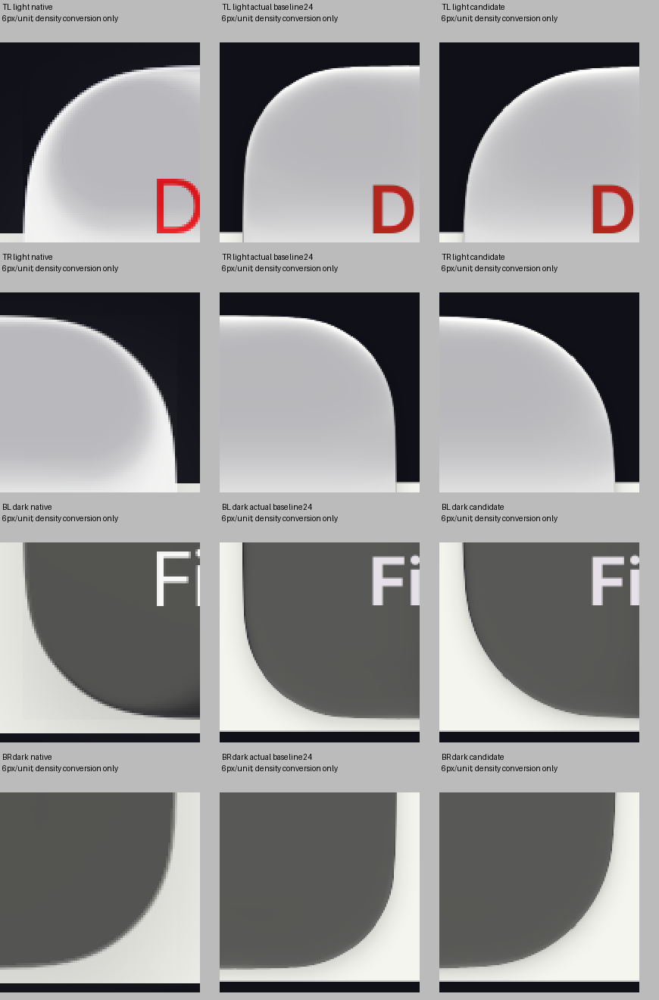

# Language GPU C/U/E diagnostic

This is an explicit research fixture in the asset repository. A separately recorded [combined external-host build](../host-integration-20261116/build.json) compiled this exact prepared version against clean Sleepy `e935c5e3`; it has not been installed or executed on a GPU. It does not establish that the menu has or lacks material, that either baseline is a valid final regression oracle, or that any original threshold passes.



This existing corner comparison supplies visual context only. It is not a C/U/E capture and does not validate this prepared diagnostic.

The frozen input is the complete `LanguageMenuMotionCaptureTest.kt` read from A at preparation time, SHA-256 `94b488726ac48e666160f786c5881c53b960fc948016a74a7235a923be2f9639`. The parent supplied ref `693c3b51`; the preparation process verifies source bytes and does not query Git. A is read only to this workflow. All source, preparation receipts, build logs and pulled research results belong under this asset study directory. No default Sleepy or asset runtime source set is changed.

## What is measured

| Stage | Product state | Test-only drawing change |
| --- | --- | --- |
| C | Menu closed, original source card visible | None |
| U | Menu closed, the same child composition, size and semantics remain attached | The existing source wrapper's `drawWithContent` omits only `drawContent()` |
| C_restored | Menu closed again, source drawing restored and GPU-submitted | None |
| E | Real public pointer down/up opens the unchanged product menu; original natural settling wait | None |

Each stage captures a first settled GPU request named `stable`, waits another 350ms, then captures `late`. These names are requests, not evidence of stability. The original capture implementation is retained byte for byte: hardware-accelerated windows, per-window HWUI commit callback, the existing 80ms presentation delay, and `UiAutomation.takeScreenshot()`. A commit is not a compositor fence. The independent real-time recomposer, input path, neutral background, grid, dimensions, menu layout, and `gpuRowProbe` algorithm are also byte-preserved.

U changes a snapshot state value read only by the wrapper's draw lambda. It does not remove the composable, alter size/placement, change selected language, disable GlassHost, switch UI style, or draw a substitute fill. A non-snapshot draw counter witnesses that suppression and restoration were actually drawn. Both C_restored captures finish before the natural open. Expanded handoff semantics report whether the original product source has alpha zero in the `motion` phase.

The analysis uses the original five per-row ROIs: `right-48dp..right-30dp`, `centerY±8dp`, rounded exactly as in the original probe. It reports source-card/value bounds and the rectangular overlap fraction, so a claim that C is foreground-free can be checked rather than assumed. Bounds and overlaps do not prove which glyph pixels were present; inspect C as well.

PNG roundtrips must reproduce each original GPU bitmap exactly before those files are used for deferred analysis. Captures are recycled immediately; pair analysis holds only two decoded full-screen bitmaps. All five rows are measured before any coverage assertion. The report contains:

- E−C and E−U, for both stable and late captures: prior/actual mean RGB, original mean absolute RGB delta, original `>=6.0` result, mean RGB distance from row one and original `<=5.0` result.
- C−U to expose the baseline's source-card contribution; restored C−C to expose restoration changes.
- Stable-to-late pixel deltas for C, U, restored C and E, including exact ROI pixel equality. No new tolerance is used to claim stability.
- Original screen row bounds, ROI floating bounds and rounded pixel edges; source/value bounds; density; capture times, bitmap metadata, pointer state and draw witness.

After all evidence is written, JUnit checks control geometry and source-drawing validity. It requires exact pixel equality for C/U in sampled row ROIs outside the source rectangle, C_restored/C in every sampled ROI, and each stage's stable/late ROIs. The equality claims have only this ROI scope; they are not whole-screen claims. A change produces complete measurements but invalidates this settled sampling control, without introducing a new tolerance. JUnit then runs the original C `>=6`/`<=5` assertions and the candidate U predicates with exactly the same numbers. The known C failure is deliberately retained and may keep this diagnostic red; U's complete results are already in JSON even if C fails first. Late outcomes are recorded independently. No green result is assumed or promised.

## Auditable preparation

Run from L, or use absolute paths:

```sh
python3 research/control-regression-diagnostics-20261116/language-gpu/prepare-fixture.py
python3 research/control-regression-diagnostics-20261116/language-gpu/prepare-fixture.py --check
python3 research/control-regression-diagnostics-20261116/language-gpu/prepare-fixture.py --self-test
python3 research/control-regression-diagnostics-20261116/language-gpu/verify-static.py --record
```

`source/LanguageMenuMotionCaptureTest.kt` is the unmodified frozen A file. `triplet-body.kt.inc` is the replacement test and its new research helpers. `prepare-fixture.py` makes explicit, uniqueness-checked transformations, protects five original sections byte for byte, and creates the reviewable aliased class plus `prepared/preparation.json`. `--check` recomputes the output without writing it. The default preparation and static verification need only this asset directory. Either script accepts optional `--origin "$SLEEPY_CHECKOUT"` to additionally read/hash an original product checkout, or `--origin "$ORIGINAL_SOURCE_FILE"` to check the file directly. The product-relative `SOURCE_PATH` is recorded; personal paths are not. A local origin argument in a static receipt is replaced by `<LOCAL_ORIGIN>`. Regeneration after reviewed edits also requires updating the output hash pinned in `overlay.init.gradle`.

Only the generated aliased class is attached by the independent init script. The two unrelated scenario functions remain available as source context but lose their `@Test` annotation in the derived class. The frozen original stays intact. The slider host's files are neither modified nor loaded.

## Root-agent build and device handoff

The root agent owns Gradle, device operations and Git. The commands below are an explicit handoff, not a record that they ran. Set `GLASS_ASSETS` to the local asset-repository root and `SLEEPY_CHECKOUT` to the read-only product source checkout used as the existing instrumentation host:

```sh
LANGUAGE_STUDY="$GLASS_ASSETS/research/control-regression-diagnostics-20261116/language-gpu"
cd "$SLEEPY_CHECKOUT"
./gradlew -I "$LANGUAGE_STUDY/overlay.init.gradle" \
  -PlanguageResearchSources="$LANGUAGE_STUDY/prepared/sources" \
  :app:assembleDebugAndroidTest
```

Use the root agent's established APK installation/runner process. The exact selected class is `com.lingion.sleepy.ui.component.AssetLanguageGpuTripletDiagnosticTest`; the required instrumentation argument is `languageGpuTripletCheck=true`. Supply a new `languageRunId`, because the test refuses an existing run directory. The unchanged app build configuration uses `com.lingion.sleepy.SleepyRenderTestRunner` and the debug application suffix `.debug`; confirm installed package IDs on the root-owned device before invoking instrumentation. For example, an established installed debug test runner may be invoked with:

```sh
adb shell am instrument -w \
  -e class com.lingion.sleepy.ui.component.AssetLanguageGpuTripletDiagnosticTest \
  -e languageGpuTripletCheck true \
  -e languageRunId language-triplet-001 \
  com.lingion.sleepy.debug.test/com.lingion.sleepy.SleepyRenderTestRunner
```

The device output is `targetContext.getExternalFilesDir(null)/language-gpu-triplet/<runId>/`: eight PNG files and `gpu-triplet.json`. The root agent should pull that directory into `results/<runId>/` here and store build/instrumentation logs here. The report is incrementally written, including failures; a partial report has `SAMPLING_NOT_COMPLETE` and must not be treated as complete data. A completed measurement has `ALL_FIVE_ROWS_MEASURED_NOT_AN_OPTICAL_ACCEPTANCE`, which is separate from `junit_passed`.

## Decision limits

If first-row E−C is below 6 while E−U is above 6, the contrast-baseline hypothesis gains direct GPU evidence. Inspect all five rows, C−U, restored-C and temporal controls before attributing the old failure. If E−U also stays below 6, keep that result: a light Menu tint against this neutral source may lack sufficient contrast for the existing predicate. Do not darken the fixture, lower the threshold or infer missing material from that scalar alone.

This fixture does not inject the historical one-row clipping fault or a no-material fault, and it has no independent positive material reference. A final regression oracle still needs a negative-control demonstration that missing/one-row material fails. A static source check, U witness or passing screenshot difference does not supply that demonstration. Copyright, Material Design behavior and business layout are outside this study and unchanged.

The eight historical Floating receipts/logs in the parent study directory are separate evidence; their successful APK builds and failing device tests are not language-triplet validation. Their published copies redact only the adb device selector and local personal path prefixes. `../PUBLICATION.json` records original/public hashes and exact replacement rules; byte-preserved originals are private under the parent's ignored `.local/raw/`. Historical `log_sha256` values continue to identify those originals. No language GPU capture is included in this directory.
