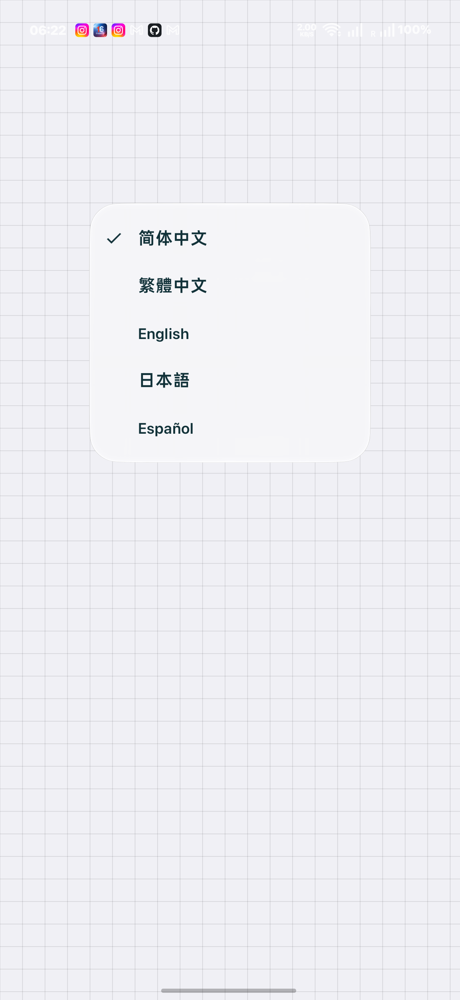

# Language triplet · first GPU run

[当前图文与证据索引 / Current illustrated evidence index](../../../../../docs/current-evidence-20261116.md#menu)

Executed on 2026-11-15 UTC / 2026-11-16 Asia/Shanghai. **JUnit failed; optical acceptance remains false.** All five rows were measured before the assertion. This run and its images belong only to the asset repository; no production rendering change accompanies it.

The screenshot is diagnostic evidence, not proof of iOS parity. [Complete measurements](gpu-triplet.json), [host and APK identities](host.json), and [instrumentation output](instrumentation.log) preserve the actual result. The earlier [preflight incident](../language-triplet-20261115T222026Z/preflight-incident.json) stopped before installation or instrumentation because the expected documentation-comment literal was stale; it is separate from this GPU failure.

## Execution and validity

The existing main APK was hash-verified and reused; it was not reinstalled. Only the previously built external-host test APK was installed and its installed hash verified. No APK was rebuilt or copied into this repository. The nine device PNG/JSON files matched their host hashes. The command completed in 9.105 seconds with shell exit 0, but the JUnit result was failure.

The first expanded row's top changed from `566.01019287109375` to `566.0` pixels between stable and late observations. All five rows had approximately `0.0102px` of vertical residual; x bounds were unchanged. The original exact-geometry control therefore fails. E stable/late full-screen pixels are identical, and rounded row ROIs are identical, but neither fact waives the Float geometry assertion. No tolerance or production animation was changed.

Drawing suppression/restoration witnesses, retained source/value bounds, restored-C ROI equality and all stage temporal ROI comparisons pass. C/U changes stay within the source rectangle. U temporal and C-restoration full-screen differences are confined to the bottom system area; these are not whole-screen equality claims. All eight PNGs use RGB, with decoded alpha 255.

## Complete row measurements

Stable and late results are identical. Original predicates remain `delta >= 6` and row uniformity `<= 5`.

| Row | E−C mean absolute RGB | E−U mean absolute RGB | E mean RGB distance from first row |
| --- | ---: | ---: | ---: |
| zh-CN | 4.3052321691 | 5.1731566974 | 0 |
| zh-TW | 6.2024621972 | 6.2024621972 | 0.0262277532 |
| en | 6.1790445604 | 6.1790445604 | 0.0028101164 |
| ja | 6.1856014987 | 6.1856014987 | 0.0093670547 |
| es | 6.1989830055 | 6.1989830055 | 0.0227485615 |

Both baselines leave the first row below 6. The original card contributes `0.8679245283` to that ROI's mean difference, but removing it does not make the predicate pass. The first U ROI samples only vertical grid lines while the other four include a horizontal crossing; their baseline means differ by approximately `1.0031` RGB codes. All 2,491 pixels in each E ROI are brighter than U. These observations diagnose contrast and sampling; they do not prove complete or missing glass material.

The run lacks no-material and one-row-material fault controls. Its exact settled-geometry control is red. Those limits remain explicit; neither a weak scalar nor similar E means justify adjusting runtime material, lowering thresholds or declaring acceptance.
