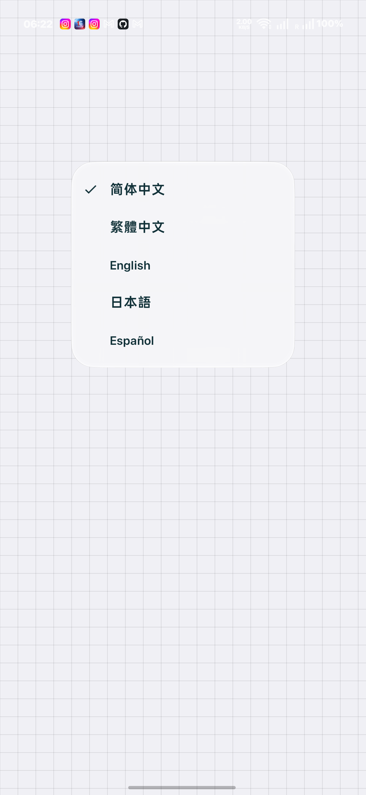

# 单选菜单玻璃载体对齐 / Choice-menu carrier alignment

[当前图文与证据索引 / Current illustrated evidence index](../../docs/current-evidence-20261116.md#menu)

本轮修复应用适配器的亚像素定位错误。产品 PR 为 [Sleepy #446](https://github.com/lingion/sleepy/pull/446)，head `ac646d9b11c9455690ea805f56270ff4cf4ba874`，仅两份生产源码和一份必要产品回归。研究证据只保存本库。

图片是[既有失败运行](../control-regression-diagnostics-20261116/language-gpu/results/language-triplet-20261115T222128Z/README.md)的原图链接，没有复制或修饰。该运行的精确终态几何控制失败仍然有效；此图只提供发现坐标问题时的历史场景，不能证明本轮修复后的光学效果。

## 根因与实现

历史 E_late 记录中菜单为 `(236.5,536)..(980.5,1221)`px，五行前景使用浮点平移。旧材料载体用相同浮点包围盒生成局部轮廓，却以 `IntOffset(carrier.left.toInt(), carrier.top.toInt())` 放置。因此左边界实际为 `236+0=236`px，比文字少 0.5px。运动中的任意小数原点也会产生同类误差；这与先前约 0.0102px 的非终态时序残差属于不同问题。

修复将 source-card 与 menu 两个光学轮廓的公共载体改为最小整数像素包络：左上向下取整，右下向上取整。载体放置、分配尺寸、两个局部轮廓共用同一个实际原点。原始浮点世界轮廓和前景坐标保留，尺寸向外包容两个轮廓，避免独立四舍五入向内裁边。材质参数、弹簧、交接时序及 Material Design 路由沿用原实现。

## 验证与边界

| 步骤 | 实际结果 |
| --- | --- |
| 新测试独立提交 `ea16f7d4`，旧浮点 carrier | [5/5 以预期 AssertionError 失败](validation/red.json)，没有编译或导入错误 |
| 仅改生产 carrier，测试原字节冻结 | [5 类共 48 项通过](validation/green.json)，含语言菜单、MD 单选菜单和精确轮廓回归 |
| 默认 `compileDebugAndroidTestKotlin` | 成功；没有安装或执行 instrumentation |

新测试覆盖半像素终态、独立双轮廓、负坐标、微小轮廓分配，以及 1/2.75/2.975/4 density 下共 720 个实际开合模型样本。用例检查整数原点、每边不足一像素的最小包络、世界轮廓重建和真实 Dp→px 分配；这些是布局算术测试，不是视频帧或 GPU 测量。原测试没有放宽、删除或忽略。

红色阶段保留了失败摘要、源文件和原 XML 的 SHA-256；原红色 XML 已被后续绿色执行覆盖，没有随本研究发布。因此读者可以检查失败断言和复现命令，但不能仅从公开摘要独立重算原红色 XML 的哈希。绿色记录列出当前实际 XML 的哈希及逐类结果。没有把缺少独立归档的早期过程作为本报告的验证依据。

ADB 当前无连接。扩大后的画布包络仍需真实 GPU 验证边缘、采样原点和缓存，语言菜单原材质门限失败及退出末帧卡顿尚未解决。已编译的旧 LG/SL test APK 绑定其原主 APK，不能拿旧 APK 当作本修复的设备证据。自然时序、光学等效和全控件验收均未完成。

## 云端交付状态

[发布收据](validation/publication.json)固定本轮产品 head、文件范围和云端状态。该 head 的 [CI](https://github.com/lingion/sleepy/actions/runs/43791466670) 与 [Debug 构建](https://github.com/lingion/sleepy/actions/runs/43791466828)均已完成，10 项检查全部成功。普通 squash 合并被目标分支策略拒绝，随后实读 PR 仍为 OPEN/BLOCKED、mergeCommit 为空；未使用管理员合并或修改保护规则。这是产品 PR 的合并限制，不是验证失败，也不表示已经合并。清理 PR #443 与 #445 已合并，研究不回填 Sleepy。

发布核验共 41 项，本轮适用 30 项。以下 11 项不适用，保持未执行，不冒充通过；没有遗漏的适用安装或发布门槛。后续仅在相应分发面发生变更时执行。

| 未执行的核验项 | 原因与本次影响 |
| --- | --- |
| 9 市场稳定标识 | 没有市场配置变更，无影响 |
| 10 多宿主目录对齐 | 没有宿主目录变更，无影响 |
| 11 重复元数据一致性 | 没有分发元数据变更，无影响 |
| 13 技能校验 | 没有技能变更，无影响 |
| 14 插件或包校验 | 没有插件或包变更，无影响 |
| 15 宿主严格分发校验 | 没有分发面变更，无影响 |
| 31 静态站点部署 | 没有站点变更或部署，无影响 |
| 32 干净环境分发校验 | 没有安装或市场内容变更，无影响 |
| 33 分发源安装或升级 | 没有安装或升级行为变更，无影响 |
| 34 安装产物标识及版本 | 本次不产生安装产物，无影响 |
| 35 临时宿主环境清理 | 没有创建临时宿主配置，无影响 |

## English

This fixes an application-adapter coordinate inconsistency, not an optical calibration. In the historical E_late capture, the menu/content starts at x=236.5px. Its old material outline was local to the floating-point carrier, while the carrier was placed at integer x=236px, shifting the material by −0.5px. The separate earlier 0.0102px terminal-observation failure remains unresolved.

The carrier now encloses both original optical contours in the smallest outward-rounded integer-pixel rectangle. Placement, allocation and local contours use one real origin; the floating-point world contours and foreground remain unchanged. Only two production files and one necessary regression belong to Sleepy #446. This study, reports and image links remain in the asset repository.

Five new tests failed for the expected boundary assertions before the fix, then passed unchanged along with existing regressions: 48 tests in five classes. The 720 model samples across four densities are layout arithmetic, not captured video/GPU frames. Default instrumentation compilation succeeded. No Android device was available, so GPU edges, source sampling, the previous material failure and dismissal-frame behavior remain pending. The historical image above is explicitly pre-fix evidence, not a new comparison or native-parity claim.

The red receipt preserves an assertion summary and hashes, but its original XML was overwritten by the green run and is not published. Its raw XML hash cannot be independently recomputed from the summary. Both remote workflows completed successfully with ten passing checks. An ordinary squash merge was rejected by the base-branch policy; the PR remained open and blocked on re-read. No protection was bypassed. Research cleanup PRs #443 and #445 are already merged.
