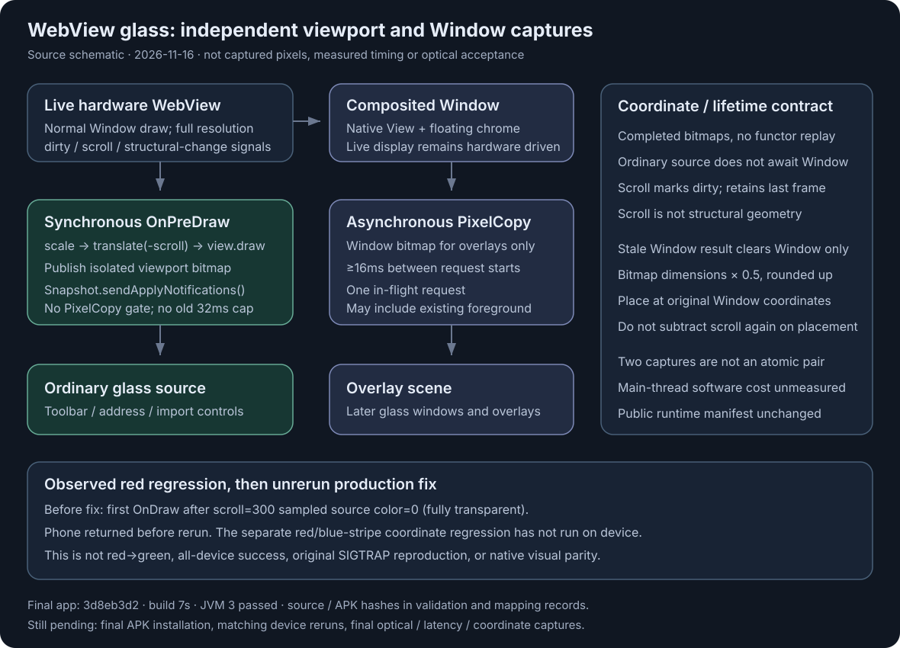

# 教务导入：原生 WebView 与玻璃采样隔离

[English](#english) · [当前证据与图片索引](../../docs/current-evidence-20261116.md#webview) · [主 README](../../README.md) · [实现快照](implementation)

更新：2026-11-16。此页记录本轮 Sleepy Android 教务导入页面的**应用适配方案、已经复现的滚动空白与待设备复验修复**。最终应用 [PR #447](https://github.com/lingion/sleepy/pull/447) 提交为 `3d8eb3d22c351dbfe9ed66d7b0cfee004d1606f7`；[验证记录](validation.json)绑定主/test APK 身份及本地构建：7 秒成功、3 项 JVM 检查零失败。手机交还用户前，滚动后首个绘制的 source 采样得到 `color=0`，回归真实失败；随后修复尚未在设备重跑。此页保留较早候选的布局实拍，当前不是最终修复实拍、全设备通过报告或公共 runtime 新版本验收。



**图 1 · 源码结构与调度示意。** 普通浮动控件在 `OnPreDraw` 后读取原生 View 的独立同步快照；覆盖层读取另行异步完成的窗口像素。两个来源的发布不再相互等待。图中不是实拍、实测时长或光学验收。


**图 2 · 较早候选的布局实拍。** 2026-11-16 16:30 的 Android 页面，显示单行独立返回/地址/动作、下一行学校名与分离的底部提示/导入按钮。该图来自后续连续性修复之前的异步采样候选；当时 WIP 二进制 SHA 未采集，不能绑定到最终 `3d8eb3d2`，也不能证明最终版本的光学、滚动坐标、延迟或无闪白。保留其用途为布局示例，不把这张图改称最终修复效果。

## 崩溃证据与尚未证明的因果

用户报告：开启 Liquid Glass 后，进入教务导入页面立即闪退，所有设备均可复现。设备历史 crash buffer 中已经观察到 Sleepy 的原生 `RenderThread` 崩溃：`SIGTRAP`，栈经过 `libwebviewchromium`、`drawVk`、`WebViewFunctor` 与 Skia Vulkan 的 layer 渲染链。该栈指向原生绘制路径；没有据此推定某个未符号化 Chromium `CHECK` 的具体条件。

旧页面把 live WebView 注册为玻璃普通 source，外层 host 还会录制整个 scene；后续 prefix 和 filter pass 可重放这些 retained layer。原生 functor 进入多层录制/离屏重放，与当前崩溃链路吻合，是本轮隔离的依据。**目前本地 HTML 夹具尚未复现同一个原始 SIGTRAP**，所以结构修复、回归测试和用户报告的崩溃不能合并成“已证明所有设备根因完全相同”的结论。

## 两条采样通道

| 路径 | 输入与用途 | 保留的边界 |
| --- | --- | --- |
| live WebView | 在 Android Window 的正常绘制路径直接显示，维持原来的硬件渲染与全分辨率内容 | 不把 live WebView 或其 functor 录入 retained glass scene/source/filter pass |
| 普通 source | `OnPreDraw` 在 View dirty、滚动或结构几何变化时同步执行 `scale → translate(-scroll) → view.draw`，独立发布 bitmap | 只包含 View 内容，不从窗口截图回采浮动 toolbar、输入框或其他玻璃前景；不等待 PixelCopy |
| overlay scene | 异步 `Window PixelCopy` 获取已经合成的窗口像素，供后续覆盖层采样；请求起始间隔至少 16ms，同时只有一个 in-flight 请求 | 窗口可包含原有前景，故不能拿这张图替代普通 source；它不是 live functor 重放 |

隔离 composable 是 WebView viewport 的空 sibling，不包住 live WebView。它先注册 native scene，再绑定实际 View；host 有 native scene 时直接绘制正常内容，以已完成的窗口 bitmap 建立 overlay scene。普通 source 则单独使用 native bitmap，不包含光学消费者。

`view.draw` 的一次性 bitmap 快照并不等于把 live WebView 设成软件层：本轮不调用 `setLayerType(LAYER_TYPE_SOFTWARE)` 来降级网页，也不全局禁用硬件加速或玻璃主题。网页登录、JS bridge、Cookie、UA 切换和解析协议仍由既有业务路径负责。

普通快照发布后调用 `Snapshot.sendApplyNotifications()`，因为 `OnPreDraw` 晚于该帧通常的 Compose snapshot 分发；这一通知让 source layer 与其消费者的 draw 观察者能在同一次 traversal 收到更新。这是源码调度方案，不是修复后首帧通过的设备结果。

两通道不是原子同帧捕获：native View 快照先绘制，窗口 PixelCopy 随后异步完成；窗口 copy 未完成不再阻塞普通 source。该设计避免把原生 functor 送入 retained pass，但尚不能由源码证明窗口与 View 图在动画、滚动或键盘变化时毫秒级一致。软件 WebView composition 在主线程同步进行，其成本尚未测量，不能由“同步”推导出没有卡顿。

## 已复现的滚动空白与修复依据

旧版把 scroll 放进窗口结构 geometry。每次滚动先清空已有 source，再等与 Window PixelCopy 绑定的异步采样；copy 期间 scroll 改变又让回调拒绝该帧。普通 source 因而可能空白，并受旧 32ms 请求间隔限制。

新增的真实设备回归 `glassBackdropIsNotBlankOnTheFirstScrolledFrame` 不等待异步恢复：先确认初始 source 不透明，执行 `scrollTo(0, 300)`，再在首个 `OnDraw` 直接调用 `drawViewport` 采样 WebView 中心。实际得到 **`color=0`（完全透明）**，未达到 `alpha > 200`；[原始回归输出](evidence/scroll-first-frame-red.txt)保留断言、测试名和堆栈。这是已观察的失败，不是推测，也不是原始 native SIGTRAP 的复现。

当前修复将 ordinary viewport 的捕获和发布移至 `OnPreDraw`，与 Window copy 分离。scroll 只标脏，不再属于结构身份，也不因滚动清空已有 frame。窗口 token、原点、尺寸、viewport 或 generation 真正变化时才作废结构；过期 Window 回调仅清自己的 window frame，不得擦掉新发布的 viewport。普通 source 不再使用旧 32ms 硬上限；异步 Window 请求单独使用 16ms 最小间隔和单 in-flight 限制。

**设备状态：** 上述 red 后用户取走手机，随后修复没有再做设备运行。后加入的 `nativeBackdropTracksTheVisibleScrolledPageCoordinates` 使用红蓝水平条纹，在 scroll=300/600/900/1200 比较 source 中心与真实屏幕同坐标的颜色；它也尚未设备执行。本轮不能写作 red→green，不能把早先较宽松的设备测试通过移用于这两个新断言。

## 为什么快照必须先减去 scroll

以下是本轮读取的官方上游源码，不是对当前设备 WebView 二进制的反编译或版本鉴定：

| 官方来源与固定提交 | 可核对的坐标行为 |
| --- | --- |
| [AOSP `View.java`](https://android.googlesource.com/platform/frameworks/base/+/1cdfff555f4a21f71ccc978290e2e212e2f8b168/core/java/android/view/View.java)，`createSnapshot`（约 L24359–24376） | 先 `computeScroll()`，然后 `canvas.scale(scale, scale)`、`canvas.translate(-mScrollX, -mScrollY)`，最后 `draw(canvas)`；正常保留绘制也先应用负 scroll |
| [Chromium `AwContents.java`](https://chromium.googlesource.com/chromium/src/+/456aadadba5f4aafd6368b7cf28f1ccc3c02c2ac/android_webview/java/src/org/chromium/android_webview/AwContents.java)，L4908–4953 | 同步并读取容器 scroll，传给 native `onDraw`；绘制后只补偿绘制期间发生的 scroll 差值，不替调用方提供初始负 scroll |
| [Chromium `aw_contents.cc`](https://chromium.googlesource.com/chromium/src/+/456aadadba5f4aafd6368b7cf28f1ccc3c02c2ac/android_webview/browser/aw_contents.cc)，L1253–1260 | 软件绘制把 scroll 传给 `SoftwareCanvasHolder::Create`，再调用 `OnDrawSoftware` |
| [Chromium `java_browser_view_renderer_helper.cc`](https://chromium.googlesource.com/chromium/src/+/456aadadba5f4aafd6368b7cf28f1ccc3c02c2ac/android_webview/browser/gfx/java_browser_view_renderer_helper.cc)，L62–72、L163–178 | 可直接使用 Java 软件 Canvas 的 `JavaCanvasHolder` 显式执行正向 `canvas_->translate(scroll.x(), scroll.y())`，补偿框架正常绘制的负 scroll |

因此直接调用 `view.draw(Canvas(bitmap))` 时也要保留框架的基准变换：

```kotlin
canvas.scale(bitmap.width.toFloat() / view.width, bitmap.height.toFloat() / view.height)
canvas.translate(-view.scrollX.toFloat(), -view.scrollY.toFloat())
view.draw(canvas)
```

若 source 缩放系数为 `s`，正常软件路径中的基准平移与补偿为 `s × (-scroll + scroll) = 0`；遗漏调用方的负平移则剩下 `s × scroll`，会把像素移向 bitmap 外，留下透明区并产生错位。该推导只说明上述源码路径的坐标约定，不等于已测得当前设备所有 WebView 实现的相同行为。bitmap 放回原 Window 原点时不再重复减 scroll；新条纹回归用于核对实际屏幕映射，结果待设备。

## 采样尺寸、坐标与生命周期

两张 bitmap 的宽、高分别按原尺寸的 `0.5` 向上取整，最小为 1 像素。每张图的名义像素数约为对应全尺寸图的四分之一；这描述分配策略，**不是已测得的内存峰值或帧率**。live WebView 仍全分辨率显示。

窗口尺寸、原生 View 原点、viewport 裁切与 View 尺寸保留原始窗口像素坐标；scroll 单独作为 View 快照的绘制变换与 dirty 信号，不进入结构 geometry。绘制采样图时再映射回原尺寸，不把半尺寸 bitmap 坐标当作布局坐标；因此降采样不会主动把控件或网页缩为一半。

实现限制同时保留：

- 普通 viewport 在 `OnPreDraw` 由 dirty、滚动与结构变化驱动同步捕获；不与 PixelCopy 配对发布，也不承诺每个显示帧都得到新的网页 compositor 内容。
- Window PixelCopy 请求起始间隔至少 16ms，同时只保留一个 in-flight 请求；这个限制不节流普通 source。窗口 token、结构几何或 generation 不匹配时丢弃过期 Window 结果，仅清 Window frame；detach/dispose 清理观察者与待执行回调。
- 已发布 bitmap 可能仍被 retained layer 使用，不原地覆写或立即回收；真实内存占用和回收节奏仍需设备观察。
- PixelCopy 尚无结果、源暂无数据或快照失败时，不伪造完成像素。键盘、窗口切换和快速滚动下的刷新与性能仍待实测。

## 本轮导入页布局

改动只覆盖教务导入二级页面的 Liquid Glass chrome。WebView 作为整页内容，顶部没有连续的大色块背板，各控件浮动在网页上。

顶行固定为：**返回 → 可收缩地址胶囊 → 编辑/确认 → 可选教务入口 → UA → 刷新**。学校名单独下一行。按钮保持独立玻璃外形和 48dp 触达槽位；地址编辑保留真实 state-based 输入、选区、水平滚动、URI 键盘与 Go 提交，点击地址也可进入编辑。底部提示使用自己的小玻璃胶囊，与导入按钮分离。

在 320dp 布局算术中，常规学校的地址槽剩余 104dp；存在额外教务入口时为 54dp。该结果仅验证固定槽位与间距可装入一行，不是大字体、设备像素或实际截图验收。窄地址框通过单行滚动编辑，不以换行挤开按钮。

Android 侧是基于 Compose 的真实可编辑输入和现有玻璃组件，参考 iOS 26.5 原生外观；**没有在 Android 上运行 UIKit**。Material Design 的布局与控件分支保持独立，未把这套浮动布局推广到其他业务页面。

## 验证与图片状态

| 项目 | 当前事实 |
| --- | --- |
| 用户报告与历史 native crash | 已有上述崩溃链路；“全设备 100%”属于用户反馈范围，并非本报告自行执行的覆盖率 |
| 原始 SIGTRAP 的本地 HTML 重现 | 尚未复现同一个原始 native signal |
| 滚动首帧空白回归 | 真机实际 red：scroll=300，首个 `OnDraw` 的 native source `color=0`；后续修复尚未设备重跑 |
| 滚动坐标条纹回归 | 已加入；用 source 中心和同屏中心颜色比较，尚未设备执行 |
| 应用源码隔离方案 | 最终应用提交 `3d8eb3d22c351dbfe9ed66d7b0cfee004d1606f7`；[4 份源码快照和逐文件哈希映射](source-mapping.json)，属于应用 adapter |
| 最终本地构建/JVM | `BUILD SUCCESSFUL in 7s`；3 项 `JwNativeGlassBoundaryTest` 零失败、错误或跳过；主 APK 与 androidTest APK 均构建，身份见[验证记录](validation.json) |
| 产品回归、安装与设备运行 | 较早候选的[2 项设备测试通过记录](evidence/pre-continuity-two-tests.txt)不能覆盖后来复现的首帧空白；最终 APK 尚未安装或设备重跑 |
| 导入页实际截图 | 图 2 为 16:30 较早异步候选的布局实拍，WIP 二进制 SHA 未采；不是最终同步修复效果。图 1 为结构示意 |
| 窗口/IME/滚动与边缘表单可达性 | 待实际验证；WebView 全屏绘制不能自行证明浮动控件从不遮挡网页交互 |
| 公共 runtime manifest | 本轮仅应用 adapter；未更新那 38 个公共 runtime 导入的来源身份 |

`implementation/` 的 4 份最终应用实现由[source-mapping.json](source-mapping.json)逐文件绑定上述提交、字节数、SHA-256 与 Git blob；它不替代公共 runtime 的 38 项清单。[validation.json](validation.json)记录最终主 APK 为 31,593,754 bytes、SHA-256 `fead3054e92d6b4e8eda790a75f92080caaa0303abbe37527958a4662b10c60c`，test APK 为 2,176,994 bytes、SHA-256 `2d2d457def98674150f6f94589bde9c4b5c480dd2d0492fac22be88d1bcefbb5`。APK 不随资产仓库分发。源码检查、编译、旧候选局部设备验证、真实 red 与最终设备复验保持分开，旧冻结证据未改写。

<a id="english"></a>
## English summary

This November 16, 2026 report describes an **application adapter, a reproduced blank source, and an unrerun fix**. Application [PR #447](https://github.com/lingion/sleepy/pull/447) points to `3d8eb3d22c351dbfe9ed66d7b0cfee004d1606f7`. The [validation record](validation.json) binds the final main/test APK hashes and the successful 7-second build with three passing JVM checks. It is not a new acceptance result for the public runtime, and the final APK has not been installed or rerun on device.

Historical device logs contain a native Sleepy `RenderThread` `SIGTRAP` through WebView Vulkan drawing and Skia layer rendering. The old hierarchy recorded and replayed live WebView content in glass scene/source/filter passes. That relationship motivates isolation; the local-HTML fixture **has not reproduced the same original SIGTRAP**, and the report does not claim universal causal proof or all-device success.

The live WebView remains hardware rendered and full resolution in the normal Window draw. Only completed pixels enter retained glass passes:

1. Ordinary sources synchronously capture the native View during `OnPreDraw` when dirty, scrolling or structurally changed: `scale → translate(-scroll) → view.draw`. They publish independently and notify Compose draw observers with `Snapshot.sendApplyNotifications()`. They do not wait for Window copying or read floating chrome back into the source.
2. Overlay scenes use asynchronous Window `PixelCopy` of the already-composited scene. This image may include existing foreground chrome and is not substituted for the ordinary source. Only this path retains the 16ms minimum request interval and single in-flight copy.

A one-off software Canvas snapshot does not set the live WebView to software rendering. The implementation does not disable glass or global hardware acceleration. The View snapshot and asynchronous Window copy are not an atomic same-frame pair.

Both bitmaps use half the source width and height, rounded up. Original Window geometry is retained and images are mapped back into full-size coordinates. Scroll is a capture transform/dirty signal, no longer structural identity. Scrolling retains the previous frame, and an obsolete Window callback clears only its own Window frame. Published images are not immediately overwritten or recycled. The old 32ms gate no longer blocks ordinary sources. Synchronous WebView software composition still has an unmeasured main-thread cost; allocation bounds do not establish peak memory or smoothness.

The real-device regression sampled the native source in the first `OnDraw` after `scrollTo(0, 300)` and observed **`color=0`, fully transparent**. This is a recorded red result, distinct from the original SIGTRAP. The phone was returned before the subsequent production fix could be rerun. A new red/blue-stripe coordinate comparison at scroll=300/600/900/1200 is present but has not run on device. Earlier passing tests do not establish either new assertion.

The pinned official AOSP/Chromium links above document the coordinate contract: AOSP snapshots apply scale and negative scroll before drawing; Chromium's software Canvas holder applies positive scroll to compensate. Omitting the caller's baseline translation leaves an erroneous `scale × scroll` displacement. This is source evidence, not identification of the device WebView build or a substitute for the pending coordinate regression. Image placement does not subtract scroll again.

The Liquid Glass import toolbar has one row containing Back, a flexible address field, Edit/Confirm, an optional adapter action, UA and Refresh. The school name has its own following line. Bottom instructions and the import action are separate. The Android input is a real Compose state-based field styled with an iOS 26.5 reference; UIKit does not run on Android. Material Design and unrelated app layouts are outside this change.

Figure 1 is a source-derived architecture schematic, **not a screenshot or measurement**. Figure 2 is a real 16:30 layout capture of an earlier asynchronous candidate; its WIP binary SHA was not recorded, so it is not bound to the final revision and proves no final optical, coordinate or latency result. The [two earlier device passes](evidence/pre-continuity-two-tests.txt) and [later red first-scroll-frame output](evidence/scroll-first-frame-red.txt) retain their distinct scopes. Final IME/Window behavior, edge-form reachability, memory and device outcomes still require the matching implementation build. The [four-file application snapshot mapping](source-mapping.json) is separate from the unchanged 38-file public runtime provenance manifest; frozen historical studies are not rewritten.
