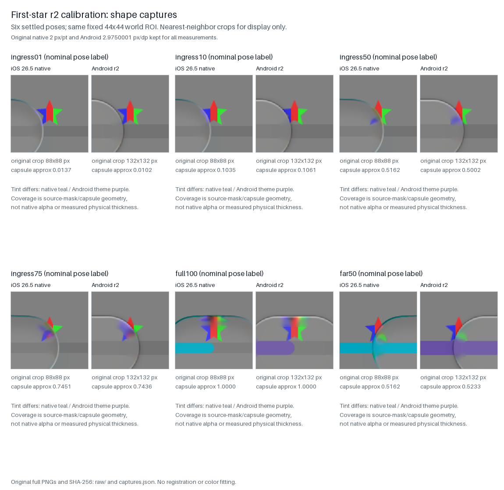

# External Android Slider research host

This opt-in entry point compiles one frozen optical fixture against Sleepy's existing `:app` instrumentation host. It keeps research source generation in this asset repository. It does **not** provide an independent runtime API or a standalone Android test application.

The selected test needs Sleepy's `GlassSlider` adapters, theme providers, `OpticalCaptureWindow`, capture/geometry helpers, AndroidJUnit/Compose dependencies and `SleepyRenderTestRunner`. It remains an SDK 33+ optical research fixture. Compiling it does not establish optical parity or execute a capture.



This is an existing real comparison, not output from this new entry point. It preserves visible differences for investigation; **the material has not passed optical acceptance**. The entry point introduces no stage filter or fixture behavior changes. Existing opt-in runs may acquire six poses; a bounded stage selection would require a separate declared patch.

## Prepare and verify

Run from this repository's root:

```sh
python3 research/slider-android-host/prepare-overlay.py
python3 research/slider-android-host/prepare-overlay.py --check
python3 research/slider-android-host/prepare-overlay.py --self-test
python3 research/slider-android-host/verify-static.py --record
```

Preparation selects only `NativeSliderOpticalWorldRenderTest.kt` from the two Android exports in `../slider-fixtures/SOURCE-MAP.json`. It verifies the map and selected source hashes, then changes the single class declaration to `AssetNativeSliderOpticalWorldRenderTest`. Every other byte is preserved. `GlassSliderRailEndpointRenderTest.kt` is not copied or injected. Frozen fixture files are read only.

The generated Kotlin source and receipt live under ignored `.local/`:

```text
.local/preparation.json
.local/sources/com/lingion/sleepy/ui/component/AssetNativeSliderOpticalWorldRenderTest.kt
```

The script is idempotent for matching output and refuses to overwrite a modified overlay. Remove only this directory's `.local/` if a fresh regeneration is needed. Do not copy generated sources into the Sleepy repository.

## Explicit Gradle invocation

Set absolute paths for the asset repository and an existing compatible Sleepy checkout. The source directory must be outside that checkout:

```sh
GLASS_ASSETS=/absolute/path/to/sleepy-liquid-glass
SLEEPY_ANDROID=/absolute/path/to/sleepy

"$SLEEPY_ANDROID/gradlew" -p "$SLEEPY_ANDROID" \
  -I "$GLASS_ASSETS/research/slider-android-host/overlay.init.gradle" \
  -PglassResearchSources="$GLASS_ASSETS/research/slider-android-host/.local/sources" \
  :app:assembleDebugAndroidTest
```

Both `-I` and `-PglassResearchSources` are explicit. A normal Sleepy build does not load this init script and does not inject any asset sources. No host Gradle file, source file, dependency, CI configuration or test discovery setting is changed. When opted in, the script attaches the source to `androidTest.kotlin.srcDir` for AGP's built-in Kotlin support and checks that the alias is unique across `:app` source sets.

The command above builds instrumentation only. A later device run must explicitly filter the aliased class, for example by adding these arguments to the same `-I`/`-P` invocation:

```text
:app:connectedDebugAndroidTest
-Pandroid.testInstrumentationRunnerArguments.class=com.lingion.sleepy.ui.component.AssetNativeSliderOpticalWorldRenderTest
```

The fixture's existing opt-in instrumentation arguments and source-image preparation still apply; this entry point does not enable them automatically. Keep device capture and build verification separate from static preparation.

## Frozen provenance

| Item | Identity |
| --- | --- |
| Sleepy source commit | `db1e2470db900d4642b27339c9cef31523ab75f3` |
| Original source | `app/src/androidTest/java/com/lingion/sleepy/ui/component/NativeSliderOpticalWorldRenderTest.kt` |
| Original Git blob | `9d534052fedc25c069cea4fc2f2b7924dbbaba90` |
| Original bytes | `71695` |
| SOURCE-MAP SHA-256 | `4743df6a03b68f30fe5f0071b9d23a23aa5db6042696e60c5cf063cfa9227032` |
| Original source SHA-256 | `1735702b83f009b1bfe2e01af82571b14017edb5f1dec851916b170a978cdb5e` |
| Renamed source SHA-256 | `2ab0164e70f7374f9851e03631c35613ba838152aa8ef10c107347dd33965da5` |

The map hash is pinned rather than silently accepting a newer fixture export. A provenance update therefore requires a reviewed change to these constants and the init script. The generated receipt records both identities and the rename.

## Validation boundary

`static-verification.json` records preparation, hash/rename checks and pure in-memory rejection checks. It also records source inspection of the Gradle entry point. It does not claim that Gradle configuration, Kotlin compilation, installation or a device capture has passed. Those require a separate explicit host run.

The current host uses AGP 9.5.1 built-in Kotlin. The `AndroidSourceSet.getKotlin()` and `AndroidSourceDirectorySet.srcDir(Object)` signatures were inspected in its installed Gradle API JAR. Android's [built-in Kotlin migration guide](https://developer.android.com/build/migrate-to-built-in-kotlin) documents the Kotlin source-set requirement; Gradle's [init script documentation](https://docs.gradle.org/current/userguide/init_scripts.html) documents `-I` and `beforeProject`.
