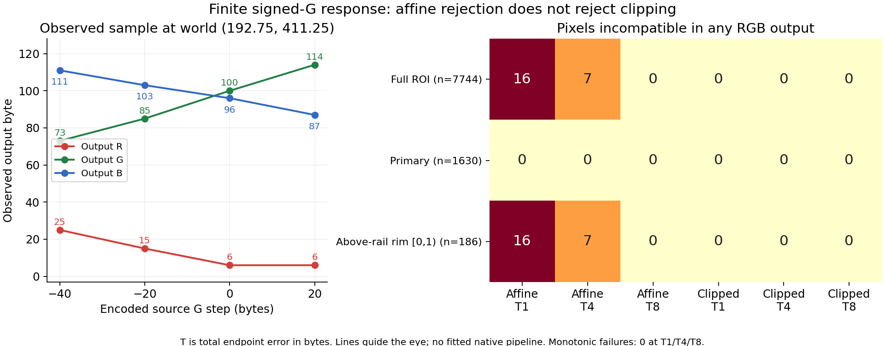

# 有限 RGB 响应：未裁切模型的边界

[当前图文与证据索引 / Current illustrated evidence index](../../docs/current-evidence-20261116.md#slider-native)

本目录只分析已公开八轮校准中的有限 +20 encoded-sRGB 响应矩阵。没有新采集，也没有修改应用参数。[原始计划](PLAN.md)、[完整报告](REPORT.md)和[结果](results-final/analysis.json)保留四种逐像素线性族及固定径向候选的全部正负结果。



图来自[后续有符号 G 测量](../slider-signedG-response-20261116/README.md)，不是本目录新生成的矩阵拟合图。它说明解释时必须保留裁切的可能：未裁切模型失败不能排除“颜色混合后裁切、再叠加偏置”的管线。对应[数学反例和限制](../slider-linear-response-20261116/LIMITS.md)已在后续采集前冻结；四个有限步进与 clipped-affine 兼容，也不能证明原生内部确实使用该结构。

原拟合的 edge 0–3pt 域有 563 像素：scalar、brightness+saturation、独立对角+shared luma、output-row 四族在 T4 下分别有 127、60、5、0 个不相容像素。这里的“失败”仅针对明确测试的**未裁切 encoded-affine 族**。逐像素六参数上界不是建议的生产参数；本目录没有 Android 对应响应矩阵，不能直接从原生矩阵推导修正值。

PNG 标签审计见 [native-color-metadata.json](native-color-metadata.json)：16 张原生输出都声明 sRGB intent 0，16 张输入共用同一 ICC。该核对排除了所见文件的编码标签混用，未识别 UIKit 内部工作空间。

从资产仓库根目录复核合成模型：

```sh
python3 research/slider-color-model-20261116/analyze-model.py --self-test
python3 research/slider-color-model-20261116/analyze-model.py --output /new/empty/output
```

第二条命令会读取已消费的原响应数组；输出目录必须不存在。数值重复记录见 [numerical-repeat.json](numerical-repeat.json)。独立测试、产品材质验收和全控件对齐仍未完成。
