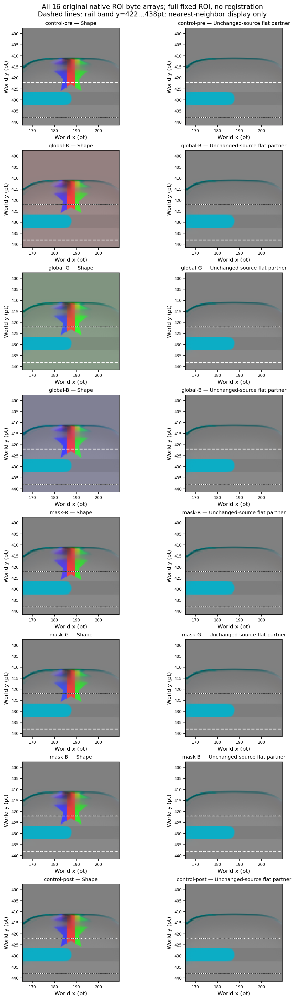

# Slider encoded-RGB response diagnostic

The iOS 26.5 (23F77) native Slider study is complete: **eight rounds, sixteen strictly verified held screenshots, full100 only**. All recorded cross-round public geometry ranges are zero. Every ordinary-flat ROI and the post/pre shape ROI have zero RGB-byte drift. The frozen analysis, independent original-PNG audit and portable replay agree.

At the prespecified T=4 raw-byte tolerance, one alpha shared by all nine input/output components is incompatible at **49 of 7,744 ROI pixels**: 32 in the 1,630-pixel primary domain and 17 in its above-rail rim/outside complement. Separate input-column and output-row families are both compatible throughout the primary domain. These observations do not identify processing order, a unique spatial kernel or physical thickness. Product code and material parameters were unchanged; this is **calibration evidence, with no optical acceptance**.



The figure displays the complete fixed ROI from every original held screenshot. Dashed lines mark the rail band at y=422 and 438pt. Nearest-neighbor display preserves visible pixel structure; the rendered figure is separate from measurement PNGs. The [illustrated report](../../docs/glass-slider-rgb-response-diagnostic.md) explains all six figures and interpretation limits.

## Sources and acquisition

The baseline is the original multicolor `st01_rgb_star_d16`, not the earlier G128 diagnostic. Its 750 × 1334 RGB grid, 16pt five-point geometry, coverage16 masks, coordinates and exact embedded sRGB ICC bytes remain unchanged. Input perturbations range no higher than 252, with no clipping.

| Order | Round | Change to original multicolor PNG |
|---:|---|---|
| 1 | `control-pre` | Original PNG bytes unchanged |
| 2 | `global-R` | Add 20 encoded bytes to R at every pixel |
| 3 | `global-G` | Add 20 encoded bytes to G at every pixel |
| 4 | `global-B` | Add 20 encoded bytes to B at every pixel |
| 5 | `mask-R` | Add coverage-weighted 20 to R in original `left_blue` mask |
| 6 | `mask-G` | Add coverage-weighted 20 to G in original `left_blue` mask |
| 7 | `mask-B` | Add coverage-weighted 20 to B in original `left_blue` mask |
| 8 | `control-post` | Original PNG bytes unchanged |

Masked increments use `floor((20 × coverage_count + 8) / 16)`, nearest integer with ties rounded up. Other channels remain byte-identical. Every paired flat is the original `st00_flat128`, never perturbed or relabeled. The six original stage definitions remain for loader compatibility, while only `full100` is scheduled. The other six registered source PNGs are copied and hashed only; no seven-point native observation or independent holdout was consumed.

The [frozen protocol](PROTOCOL.md), [freeze receipt](freeze.json), [source verification](source-verification.json) and [ordered input index](inputs/rounds.json) retain the pre-capture definitions. The prepared input package contains 137 files totaling 764,286 bytes. Source preparation is complete; `prepare-inputs.py` refuses to overwrite it.

## Fixed-domain results

Counts below use closed alpha-interval feasibility, not a floating minimax residual threshold.

| Domain | Pixels | Common T1 incompatible | Common T4 incompatible | Common T8 incompatible |
|---|---:|---:|---:|---:|
| Complete fixed ROI | 7,744 | 146 | 49 | 0 |
| Above rail, inset ≥1pt: primary | 1,630 | 120 | 32 | 0 |
| Above rail, inset <1pt: rim/outside complement | 2,682 | 26 | 17 | 0 |
| Rail-confounded band | 2,816 | 0 | 0 | 0 |
| Below rail | 616 | 0 | 0 | 0 |

The three input-column families have no T4 incompatibilities anywhere. Output R has two at inset 0.35pt; output G/B have none. All six separate input/output families are compatible in the primary domain. Input G still has three T1 incompatibilities in the complete ROI. Compatibility at T4 does not establish exact equality or select between input-conditioned and output-conditioned explanations.

| Figure | Contents |
|---|---|
| [Original native arrays](figures-response/native-eight-rounds-full-ROI.png) | All sixteen complete ROI arrays |
| [U: global contrasts](figures-response/U-global-all-nine-components-full-ROI.png) | All nine signed output/input components |
| [M: masked contrasts](figures-response/M-mask-all-nine-components-full-ROI.png) | All nine signed output/input components |
| [Minimax error](figures-response/minimax-error-all-models-full-ROI.png) | Common, three input and three output families |
| [Recorded T4 compatibility](figures-response/T4-compatibility-all-models-full-ROI.png) | All failures retained across the complete ROI |
| [Fixed inset curves](figures-response/fixed-inset-minimax-error-curves.png) | Median and maximum error in the frozen bins |

U/M share a signed color axis of −31…31 raw bytes. Error maps include the full observed maximum, 7.555555555561159 bytes. No plotted value is clipped. The [figure manifest](figures-response/figure-manifest.json) records axes, maxima, failure counts and image hashes.

The [independent audit](independent-check.json) directly recomputes U/M from all sixteen original held PNGs, then intersects signed constraints using integer-rational cross-products. All stored intervals, compatibility arrays and 672 region/model/tolerance count checks agree. At (182.25, 413.25)pt, the numerical minimax value is `4.000000000000002` while the closed T4 interval remains compatible. The authoritative common T4 count is 49, not 50. This is an existing audit receipt; the independent script requires the original local capture layout.

## Portable evidence and replay

[Portable validation](portable-validation.json) records a 66-file, 10,973,900-byte [evidence package](evidence/manifest.json): sixteen original full-size PNGs, original receipts/indexes/events/session metadata, and reference analysis. Files retain their original bytes and hashes. Declared original absolute round paths are mapped by a separate replay adapter; receipts are not rewritten. All 153 arrays and the NPZ archive reproduce exactly, and the analysis JSON matches after the declared path normalization.

Trace archives and xcresults are excluded. Their original hash/size declarations remain in capture receipts; portable replay does not rerun the omitted raw-trace endpoint verification. It rechecks retained original evidence and executes the frozen response analysis.

From the repository root on another macOS/Linux machine with Python 3, run:

```sh
study=research/slider-color-response-20261116
python3 -m venv "$study/.local/replay-venv"
"$study/.local/replay-venv/bin/python" -m pip install numpy pillow matplotlib
"$study/.local/replay-venv/bin/python" "$study/portable-evidence.py" replay \
  --study "$study" \
  --evidence "$study/evidence" \
  --output "$study/.local/replay-new-machine" \
  --compare "$study/evidence/reference-analysis" \
  --manifest-sha256 d1f2d2be9a2cb984cf9ffb8c8a85ee8f9e11ce892be998c9c95666e5644554f6
"$study/.local/replay-venv/bin/python" "$study/plot-response.py" \
  --analysis "$study/.local/replay-new-machine" \
  --output "$study/.local/replay-new-machine-figures"
```

Keep both output directories absent before execution; the tools refuse overwrites. Read `.local/replay-new-machine/portable-replay.json` for the exact replay comparison. No Xcode, simulator, Android device, private rendering API or fresh capture is needed. Analysis alone needs NumPy and Pillow; Matplotlib is used for figures.

## Retained incidents and limits

Two rejected attempts remain documented. The [run-ID format incident](native-tools/run-id-format-incident.json) rejected two initial sessions before strict verification because the collector compared a raw XCTest name with the sanitized session name. Their optical PNGs were not decoded or analyzed. The collector identity check was corrected, the prior freeze/scripts were archived, and the formal eight-round sequence restarted under the current freeze. The [mask-G missing-flat incident](mask-G-missing-flat-incident.json) rejected the entire pair when the observer encountered UP before the flat held screenshot. The unchanged collector and inputs reacquired the entire pair; no threshold changed and no failed image entered analysis.

This one mask and finite encoded +20 perturbation cannot distinguish channel-dependent sampling, transfer/gamma effects, adaptive color, clipping or layer mixtures. Both separate input and output families remain viable in the primary domain. No RGB-specific refraction offset is inferred for production. The result also does not establish Dock/backing-panel thickness, softer highlights, edge stretch, animation timing or parity across other backgrounds, sizes and controls.
