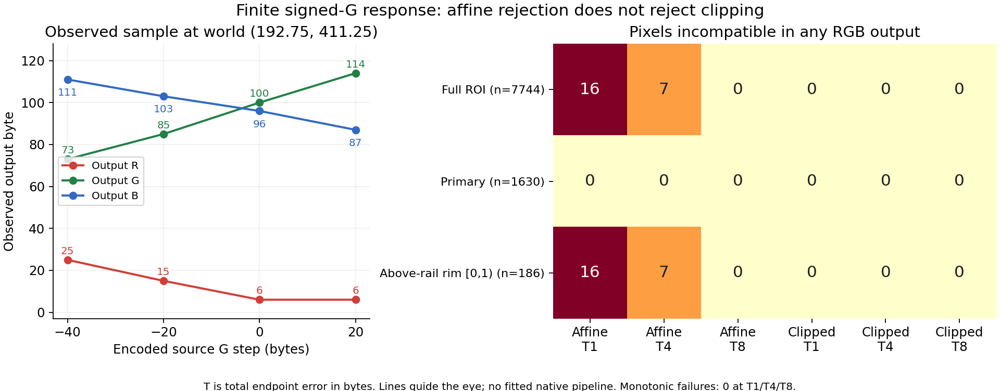

# Finite signed-G model diagnostic

The terminal-sRGB proposal in [PLAN.md](PLAN.md) remains paused. The executed signed-G diagnostic is specified in [NEXT-TEST.md](NEXT-TEST.md), with the unclipped-model limitation and explicit clamp counterexample in [LIMITS.md](LIMITS.md).

The unchanged `analyze-signed-g.py` separately tests signed affine, clipped-affine and general monotonic compatibility for RGB at `t=[-40,-20,0,+20]`. T1/T4/T8 are total **endpoint** errors in encoded bytes. The 15 contiguous clipped branches are eliminated analytically; synthetic tests precede loading the collected arrays.

At T4, 7 ROI pixels reject affine, all in the above-rail `[0,1)` carrier rim; every tested output remains compatible with clipped-affine and monotonic descriptions at T1/T4/T8. The primary region rejects none of these descriptions. Compatibility with independent per-channel/pixel parameters does not identify the native pipeline, prove shared saturation or constitute optical/product acceptance.

See [signed-results/analysis.json](signed-results/analysis.json) for all fixed domains, and the [D evidence README](../slider-signedG-response-20261116/README.md) for original PNG provenance, the actual measured RGB values and the portable replay command. That replay reproduced all 21 F arrays and the entire NPZ container exactly; JSON equality required only declared absolute-path normalisation. No new acquisition or product change was performed for these figures.
