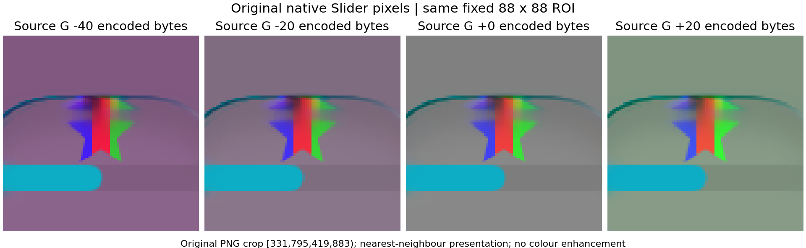
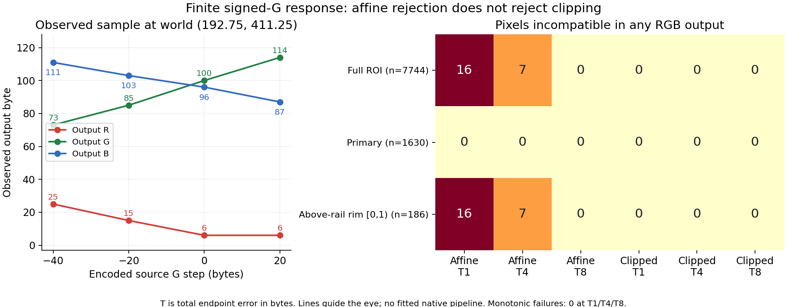

# Native Slider: signed green-channel response

This finite endpoint experiment separates an encoded affine response from a response with clipping. All **8 newly captured endpoints** passed the original strict acquisition checks. At a total endpoint allowance of **T4 bytes**, an ordinary affine model is incompatible at **7 of 7,744 ROI pixels**, all within the above-rail carrier rim `[0,1)` pt. The single-channel clipped-affine and general monotonic descriptions are compatible at every tested pixel/output channel at T1, T4 and T8. This is a colour-response diagnostic, **not product or optical acceptance**.



The four panels show the same original 88 × 88 output-pixel crop at encoded source G steps `[-40,-20,0,+20]`. The material, native Slider, rail and endpoint geometry were held fixed. The source is the original five-point RGB star on a neutral background. −40 does not source-clip its minimum G value of 48; the collector separately binds every input byte to its frozen manifest.

## Acquisition and controls

Four new rounds contain one shape/flat pair each: control-pre, G−20, G−40 and control-post. Every round passed `verifiedHeldEndpoints=2` and `verifiedShapeFlatPairs=1`: eight new endpoints in total. The previously published control and +G20 pairs supply four already verified endpoints for the conditional merge.

The frozen collector found zero geometry range across the compared public carrier bounds, zero maximum absolute difference for every flat **within the fixed ROI**, and zero difference between both new shape-control ROIs and the old published original ROI. These are ROI pixel comparisons, not claims that entire PNG files or full screens are byte-identical. The original whole-PNG SHA values remain distinct and are preserved in the export manifest.

The exact collection result is [analysis/collection.json](analysis/collection.json); the unchanged acquisition protocol is [PROTOCOL.md](PROTOCOL.md). Capture identity, prepared-source identities, simulator identity and declared native-binary identities remain in each original receipt. Replay verifies those declarations against the freeze; it does not re-create or execute the original binaries.

## What changed when G was reduced



At the fixed world sample `(192.75,411.25)`, measured RGB is:

| Encoded source G step | −40 | −20 | 0 | +20 |
|---|---:|---:|---:|---:|
| Output R | 25 | 15 | 6 | 6 |
| Output G | 73 | 85 | 100 | 114 |
| Output B | 111 | 103 | 96 | 87 |

R remaining at 6 for the positive step, then recovering for negative steps, is compatible with a floor. That observation does not uniquely identify an internal clamp. The ordinary affine simplification and the clipped family must be distinguished.

The table counts pixels incompatible in **any** RGB output. The primary mask is `y<422, inset>=1`; the above-rail rim mask is `y<422, 0<=inset<1`. The inset is a public-carrier capsule approximation, not recovered optical alpha.

| Domain / description | T1 | T4 | T8 |
|---|---:|---:|---:|
| Full ROI: affine | 16 | 7 | 0 |
| Primary: affine | 0 | 0 | 0 |
| Above-rail rim `[0,1)`: affine | 16 | 7 | 0 |
| Full ROI: clipped-affine | 0 | 0 | 0 |
| Full ROI: monotonic | 0 | 0 | 0 |

T is the **total allowed error at each observed endpoint**, in encoded bytes; it is not the earlier finite-difference residual tolerance and has no additional half-byte allowance. R/B are constrained to nonincrease with G, and G to nondecrease. The unchanged [F analyzer](../slider-linear-response-20261116/README.md) analytically enumerates all 15 contiguous low-platform / linear / high-platform branches. It fits no arbitrary 3 × 3 matrix and performs no pixelwise LP search.

Each output channel and pixel has independent clipped-affine parameters. Compatibility therefore does not prove shared saturation, a physical lens, a particular processing order, a native pipeline, or any Android correction. An encoded clipped-affine rejection would also leave other monotonic transfers, including a linear-light clamp followed by encoding, possible. Dynamic behaviour, other colours, sizes, backgrounds and controls are outside this finite study.

## Portable original evidence and exact replay

[evidence/manifest.json](evidence/manifest.json) binds **32 original files, 2,788,670 bytes**: 8 PNGs, 4 receipts, 4 strict verifications, 4 indices, 4 event files and 8 session files. Each is an unchanged byte copy with its original SHA. Whole-screen PNGs are retained for exact replay; public figures show only the fixed ROI.

Clone the complete asset repository, including its existing sibling research directories. This directory intentionally reuses the 245 existing frozen dependencies rather than committing another copy. From the repository root:

```sh
python3 research/slider-signedG-response-20261116/portable-signed.py verify
```

The verifier copies the hash-checked sibling dependencies and exported originals into a temporary asset root, runs the **unchanged** `collect-signed.py` and `analyze-signed-g.py`, compares outputs, then removes that temporary root. The recorded [portable-validation.json](portable-validation.json) reports:

- D: all 6 arrays and the complete NPZ container bytes exactly equal the published result.
- F: all 21 arrays and the complete NPZ container bytes exactly equal the published result.
- Both JSON reports exactly equal after normalising only absolute path keys/values under the two declared asset roots. Numeric results, statuses and hash values are not ignored.
- Temporary root removed; no trace archive, xcresult, DerivedData or app-binary payload read or copied.

Trace archive hashes/sizes remain verbatim receipt declarations; the omitted archives are not reverified. The replay validates existing evidence and deterministic analysis, not a fresh capture or product build. Python with NumPy and Pillow is required; figure regeneration additionally uses Matplotlib.

The parent `.gitignore` is frozen and was preserved. Two new, separately hash-bound rules in `inputs/.gitignore` and `evidence/.gitignore` unignore only their own `rounds` subtrees so that inputs and exported originals travel with the clone. They do not affect the freeze or numerical analysis; original acquisition `rounds/` and `.local/` caches remain ignored. These two configuration files are listed separately from the 32 original evidence artifacts.

## Figure provenance and presentation

[figures/figure-sources.json](figures/figure-sources.json) binds the real source arrays, analysis report, figure generator and both generated PNGs. The source crop is half-open original PNG pixels `[331,795,419,883)`, at 2 px/pt. Native ROI presentation uses nearest-neighbour scaling only; there is no colour enhancement, sharpening, denoising, gamma change or saturation adjustment. RGB curves use the fixed original row 27 / column 54 sample; straight segments guide the eye and are not a fitted response. Compatibility counts are copied from the existing F result.

```sh
python3 research/slider-signedG-response-20261116/render-signed.py
```

Frozen files, plans, the collector and the F analyzer were not edited during this packaging pass. No new experiment, device capture, build or Sleepy product change was made.
