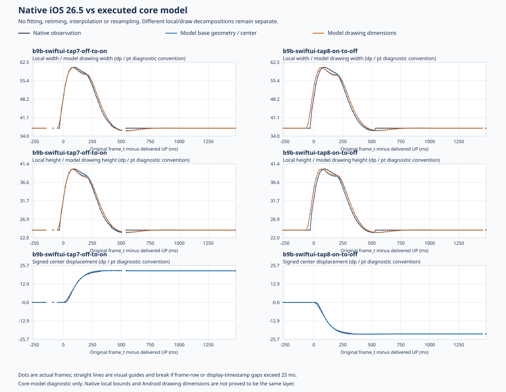

# Toggle tap: external runtime replay

[当前图文与证据索引 / Current illustrated evidence index](../../docs/current-evidence-20261116.md#toggle)

**Executed and audited: core-model diagnostic.** The external JVM replay completed successfully on November 16, 2026 in 2.699 seconds against Sleepy commit `cea1aa3c96fd668c8a99d8b5fa4528c094d1aead`. [execution.json](execution.json) and [execution.log](execution.log) retain the actual command, host identity and output hashes. Eight actual iOS 26.5 ordinary taps, 16 delivered DOWN/UP events and 838 observed carrier frames were replayed against the **compiled Sleepy runtime**. No copied spring model or fitted parameters were used. This establishes no Android GPU, optical, natural-motion or timing-sync acceptance.

All study files and generated exports belong in this asset repository. Nothing is attached to Sleepy's source sets, normal build, test discovery or CI.



The figure uses the first SwiftUI OFF→ON and ON→OFF segments by original input order, selected before analysis. Native local bounds, model base geometry and model drawing dimensions are separate series. Dots are actual samples; straight connectors are visual guides and break if consecutive frame-row times or display timestamps differ by more than 25 ms. The x axis retains original `ms_from_delivered_up`; nothing is retimed, fitted, interpolated or resampled. See also the [eight native-only trajectories](../toggle-tap-native26-20261116/native-tap-curves.svg).

[analysis.json](analysis.json) records unfitted per-segment RMSE, maximum absolute error with original source line/frame/time, actual observed minima/maxima for every series, and the actual UP+1200…1500 ms tail. Metrics include every selected original frame, including pre-DOWN and tail frames; they are not weighted toward the moving interval. Signed error is model minus native.

| Segment | Frames | Base W RMSE / max | Base H RMSE / max | Draw W RMSE / max | Draw H RMSE / max | Center RMSE / max |
|---|---:|---:|---:|---:|---:|---:|
| SwiftUI tap 7 OFF→ON | 102 | 0.551 / 2.006 | 0.376 / 1.369 | 0.564 / 2.006 | 0.383 / 1.369 | 0.240 / 1.268 |
| SwiftUI tap 8 ON→OFF | 106 | 1.072 / 6.260 | 0.731 / 4.273 | 1.077 / 6.260 | 0.732 / 4.273 | 0.247 / 1.340 |
| SwiftUI tap 9 OFF→ON | 104 | 0.555 / 2.150 | 0.379 / 1.468 | 0.566 / 2.150 | 0.386 / 1.468 | 0.247 / 1.296 |
| SwiftUI tap 10 ON→OFF | 106 | 1.062 / 6.204 | 0.725 / 4.234 | 1.068 / 6.204 | 0.724 / 4.234 | 0.249 / 1.331 |
| SwiftUI tap 11 OFF→ON | 106 | 1.515 / 6.364 | 1.034 / 4.344 | 1.529 / 6.364 | 1.028 / 4.344 | 0.250 / 1.323 |
| SwiftUI tap 12 ON→OFF | 104 | 1.471 / 6.345 | 1.004 / 4.331 | 1.460 / 6.345 | 1.021 / 4.331 | 0.253 / 1.331 |
| UIKit tap 6 OFF→ON | 107 | 1.439 / 6.199 | 0.982 / 4.231 | 1.458 / 6.199 | 0.971 / 4.231 | 0.231 / 1.221 |
| UIKit tap 7 ON→OFF | 103 | 1.025 / 6.943 | 0.699 / 4.739 | 1.054 / 6.943 | 0.683 / 4.739 | 0.234 / 1.219 |

Values use the explicit numerical dp/pt diagnostic convention. Native local-width observed maxima span 60.557…60.572; model base maxima span 60.499…60.510 and model drawing maxima span 60.397…60.567. Six of eight model width maxima occur one observed sample earlier than the native width maximum, about 16.6…17.1 ms under this logger-row schedule; two occur on the same row. This is an observed sample comparison, not an inferred continuous peak or proof of rendering latency. Each segment's 18 observed tail frames have native/base dimensions exactly 37×24 and native/model center displacement exactly ±22. Model drawing width remains within 36.998990…37.000942 and height within 24…24.000885 over these tails; those small deformation residuals are retained rather than called exact settling.

Native local bounds and the Android model's base/drawing dimensions may describe different layer and transform decompositions. Similar maxima or small diagnostic errors cannot establish pixel, optical, rendering or timing parity; the larger transient discrepancies remain visible in the full curves and recorded maxima.

```sh
python3 analyze.py --verify
```

The stdlib analyzer verifies all 24,302 native CSV cells byte-for-byte against prepared frame columns, including blank unrecorded fields. It also verifies all original sample counts, exactly two event injections per segment and their first-eligible-frame counts, finite recorded numerical values, every exported residual, execution/log/output hashes and unchanged pinned source/input/preparation identities. `--verify` reproduces and compares `analysis.json` and the SVG without writing; without it, creation refuses existing analysis outputs.

```sh
STUDY=/path/to/sleepy-liquid-glass/research/toggle-tap-model26-20261116
SLEEPY=/path/to/sleepy
python3 "$STUDY/prepare.py" --sleepy-root "$SLEEPY" --verify
cd "$SLEEPY"
./gradlew -I "$STUDY/replay.init.gradle" \
  -PglassToggleReplayStudy="$STUDY" :app:replayGlassToggleNative26 --console=plain
```

Prepared TSVs are included. On a fresh preparation without that directory, omit `--verify` to create it; creation refuses to overwrite an existing directory. A changed host source requires a reviewed new preparation, rather than bypassing its recorded identity.

The execution above used this task with `--offline`; the command block documents its entry point. The existing replay is retained, so a direct rerun refuses to overwrite it. The task compiles the existing unit-test target and uses `testDebugUnitTest.classpath` and its Java launcher for Java source-file mode. It registers one explicitly selected `JavaExec` task and does not execute the unit-test suite. Run it only with a Java launcher supporting source-file mode (Java 11+). It refuses changed host/study/prepared files and an existing `replay.csv`.

The preparation receipt pins six actual host source files, four study files, three native input artifacts and all three generated TSVs by SHA-256. Its original `prepared_unexecuted` state is preserved as historical preparation evidence; actual execution is separately recorded in `execution.json`. Native inputs are reused from [the native tap study](../toggle-tap-native26-20261116/README.md); no full session trace or video is copied. Initial/destination values come from that study's observed value event. Every baseline is the last actual carrier observation before delivered DOWN. No interpolated frames, synthetic endpoints, fitted alignment or smoothing are added.

## Clock and frame semantics

Native `sampleT`, `deliveredT`, row `t`, frame `frame_t` and display timestamp remain separate. Each segment uses a common artificial origin at delivered DOWN minus one second. Receipt/frame times are rounded to the nearest nanosecond; the separate sample clock is floored to milliseconds as required by the Android driver's API. Those quantized values and original source values/line numbers are retained in TSV/CSV. Sample values are relative replay times, not Android hardware uptime observations.

`frame_t` is the native logger's row enqueue time, **not** an exact per-node getter instant or video PTS. Feeding it to the Android model defines a diagnostic schedule; it cannot prove synchronized native and Android rendering. No correction using `displayTimestamp`, `captureStartT` or `captureEndT` is applied. Recorded blanks stay blank.

The actual `TimedGlassControlMotion` receives `begin(true,true)` and `release(target,true)`, matching the pointer path in `GlassSwitch`. Delivered events are queued in order before the first eligible replay frame. `DockInputClock` decides when they take effect: DOWN takes effect at its eligible frame end; other commands split the live interval at receipt. The replay resets its previous frame while the real driver is idle, matching `runTimestampedActiveFrameLoop`. It never calls `GlassControlMotion.tick` directly.

## Export interpretation

`replay.csv` retains every original carrier column and adds actual model state, undeformed local width/height, the exact current `GlassSwitch` drawing dimensions using real `glassLensWidth`/`glassLensHeight`, and both sets of width/height residuals against recorded native **local bounds**. The latter comparison is diagnostic: Android's drawing deformation and native local/world transform decomposition need not represent the same layer. Native world bounding width/height remain original columns, never relabeled as local bounds.

Model center displacement is `(position − initial) × 22 dp`; native center displacement is `(x + w/2) − pre-DOWN baseline` in window pt. These are signed displacements, not aligned absolute coordinates. The shared numerical dp/pt scale is an explicit diagnostic convention. Stretch uses the current switch's `0.25` drawing multiplier. No material-opacity, shader, refraction, pixel or frame-rate claim follows from this export.
