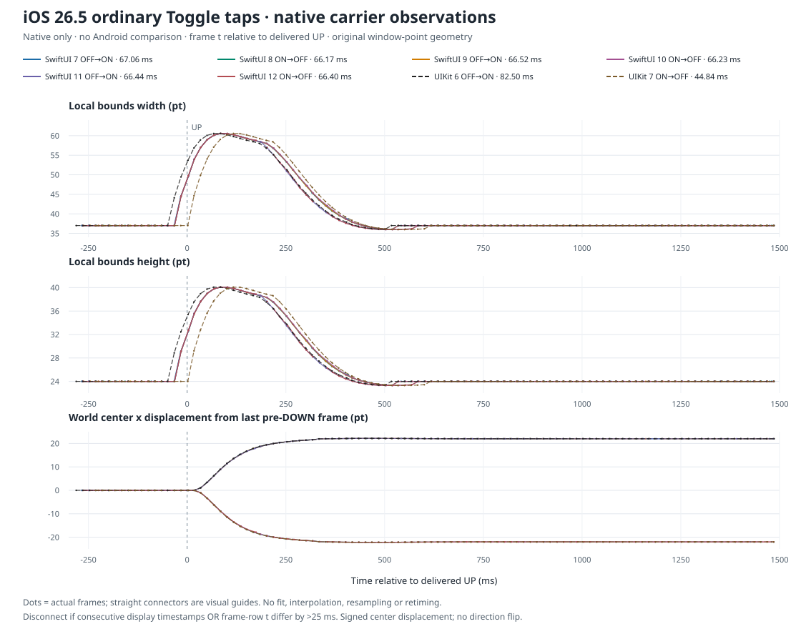

# iOS 26.5 ordinary Toggle taps

Eight observed taps: six SwiftUI taps (B9B touch IDs 7–12), then the first two UIKit taps in ToggleGrid (IDs 6/7). Both session files say `Version 26.5 (Build 23F77)`, 375×667 pt, scale 2, requested capture 60 Hz, reduce motion/transparency false. Native reference fixture evidence; no Android parity or material-alpha claim.

[sources.json](sources.json) retains both complete sessions, R-relative source paths, byte sizes, SHA-256 identities and selection/time rules. R denotes the original Sleepy reference workspace passed to the script; no machine-specific absolute path is embedded.

[inputs.json](inputs.json) retains original delivery and coalesced DOWN/UP rows and value events, all with original 1-based line numbers. Every selected delivery has phases `[0,3]`, `tapCount=1`, zero displacement and no move. Ordinary taps are distinct from the 450 ms hold/drag endpoint traces.

## Reproduce and verify

```sh
python3 export.py --source-root /path/to/original-sleepy-workspace
python3 export.py --source-root /path/to/original-sleepy-workspace --verify
```

The second command reads sources, recomputes every selected observation and compares every generated file byte-for-byte without writing. A separate table audit decodes each compact row, reconstructs every selected original frame/view dictionary and compares it to the original physical source line; it also independently enumerates complete time-window membership and validates the CSV/input rows. [verification.json](verification.json) retains counts and checks. Source SHA mismatches fail immediately. Only files in this study directory are generated; no full trace/video is copied. `manifest.json` covers generated outputs and the generator identity.

## Measured input and sampling

`sampleT` is the touch sample clock. `deliveredT` is the observer delivery clock. Frame `t` is row enqueue time; it is not the exact per-node getter instant. Rich B9B frames also retain capture start/end; earlier UIKit source frames never recorded those fields. All times remain separate.

Frames are selected inclusively by original frame `t`, from delivery DOWN−200 ms through delivery UP+1500 ms. No invented endpoints, resampling, fitting or interpolation. None of these eight windows includes the next delivered DOWN.

| Segment | Sample ms | Delivery ms | Actual frames | Observed Hz | >25 ms gaps | Largest gap ms | Estimated 60 Hz slots absent | Last frame after UP ms |
|---|---:|---:|---:|---:|---:|---:|---:|---:|
| b9b-swiftui-tap7-off-to-on | 66.371 | 67.063 | 102 | 57.714 | 2 | 61.005 | 4 | 1483.778 |
| b9b-swiftui-tap8-on-to-off | 66.667 | 66.174 | 106 | 59.434 | 1 | 33.333 | 1 | 1485.411 |
| b9b-swiftui-tap9-off-to-on | 66.667 | 66.517 | 104 | 58.857 | 2 | 33.333 | 2 | 1485.283 |
| b9b-swiftui-tap10-on-to-off | 66.667 | 66.228 | 106 | 60.000 | 0 | 16.667 | 0 | 1485.592 |
| b9b-swiftui-tap11-off-to-on | 66.667 | 66.443 | 106 | 60.000 | 0 | 16.667 | 0 | 1485.086 |
| b9b-swiftui-tap12-on-to-off | 66.667 | 66.399 | 104 | 58.857 | 2 | 39.952 | 2 | 1484.988 |
| grid-uikit-tap6-off-to-on | 66.667 | 82.503 | 107 | 60.000 | 0 | 16.667 | 0 | 1486.288 |
| grid-uikit-tap7-on-to-off | 66.667 | 44.844 | 103 | 59.829 | 0 | 21.520 | 0 | 1485.307 |

Observed Hz uses consecutive actual display timestamps; >25 ms gaps and the explicitly defined 60 Hz slot estimate describe sampling cadence, not proved rendered frame drops. All selected original frame IDs are consecutive, no selected frame reports traversal truncation, and every selected frame contains the target lens. Exact gap endpoints are in [summary.json](summary.json).

## Width, height and x trajectories



The reproducible SVG uses the same eight actual carrier series. Its x axis is original frame `t` minus delivered UP; y axes are local bounds width/height and signed world-center displacement `(x+w/2) − baseline`, where baseline is the last observed frame before that tap's delivered DOWN. OFF→ON and ON→OFF retain their actual signs. The eight legend durations are delivery durations. Each marker is an actual frame; straight connectors are visual guides, disconnected whenever either consecutive display timestamps or frame-row `t` differ by >25 ms. No points are added, fitted, interpolated, resampled or retimed. This is native evidence only, not an Android comparison. SVG screen coordinates are rounded to 0.001 px; original numerical values remain in the CSV/JSON.

[carrier.csv](carrier.csv) contains every selected carrier frame, original source line/frame number, original timing, local bounds, world x/y/w/h, recorded transform components, and recorded layer opacity. Blank CSV cells are unrecorded fields. World bounding width/height can differ from local bounds during transforms; x is the world left edge, not the lens center.

The following values are actual rows: local width maximum, that same row's local height and world left x, then the final selected row. The peak time uses frame row t relative to delivered UP; it is not a fitted peak or an exact getter time.

| Segment | Peak local W×H pt | World x at that row pt | Row after UP ms | Final local W×H pt | Final world x/y pt | Tail frames |
|---|---:|---:|---:|---:|---:|---:|
| b9b-swiftui-tap7-off-to-on | 60.564393×40.083633 | 293.217119 | 84.521 | 37×24 | 318/317 | 18 |
| b9b-swiftui-tap8-on-to-off | 60.571757×40.088660 | 297.376099 | 85.280 | 37×24 | 296/317 | 18 |
| b9b-swiftui-tap9-off-to-on | 60.568818×40.086653 | 293.214911 | 84.720 | 37×24 | 318/317 | 18 |
| b9b-swiftui-tap10-on-to-off | 60.570432×40.087755 | 297.376759 | 84.912 | 37×24 | 296/317 | 18 |
| b9b-swiftui-tap11-off-to-on | 60.571344×40.088377 | 293.213650 | 84.930 | 37×24 | 318/317 | 18 |
| b9b-swiftui-tap12-on-to-off | 60.569865×40.087368 | 297.377041 | 84.864 | 37×24 | 296/317 | 18 |
| grid-uikit-tap6-off-to-on | 60.556949×40.078553 | 290.491973 | 67.283 | 37×24 | 318/389.5 | 18 |
| grid-uikit-tap7-on-to-off | 60.572304×40.089033 | 292.900616 | 117.233 | 37×24 | 296/389.5 | 18 |

All 18 observed frames in each UP+1200…1500 ms tail have exact local/world 37×24 pt and constant destination x (318 pt ON, 296 pt OFF); y is 317 pt for B9B SwiftUI and 389.5 pt for ToggleGrid UIKit. Recorded m11/m22 and layer opacity are 1 in these tails. This establishes only the recorded geometry/opacity over that tail. Full-interval ranges and the preceding/first exact final-state rows remain in summary.json; no settling time between frames is asserted.

## Retained target nodes and limitations

[observations.json](observations.json) uses compact column arrays. Each `frame_rows` entry is `[source_line, frame_values, [[node_catalog_id, node_values], …]]`. Zip values with `frame_columns`/`node_columns`, retain only the frame's `recorded_frame_fields` or catalog's `recorded_fields`, and restore catalog path/class. This reconstructs each selected original frame context and each selected original view dictionary exactly. Every original recorded descendant beneath the lens is retained; node absence on a frame is not filled forward.

B9B records the UISwitch, _UILiquidLensView carrier and observed ClearGlassView, SDFView, SDFElementView and _UIPortalView descendants. Their paths can change with the native hierarchy. The earlier ToggleGrid logger records UISwitch, _UILiquidLensView and ClearGlassView here, and only m11/m22 of the transform. It does not record m12/m21/m41/m42, effectiveOpacity, presentationAvailable, captureStartT or captureEndT. Missing fields stay missing; identity transforms are not invented.

No recorded target class is explicitly named Solid. SDF/Portal classes are preserved as observed classes, not relabeled as a solid fill or as proof of material implementation. Unlogged native layers cannot be reconstructed. Carrier/descendant opacity (1 in these observations) is CALayer/view-chain opacity; it is never materialAlpha, optical alpha or proof that the material was opaque. These traces do not establish rendered pixel transparency, blur/refraction, or video synchronization.

Only small derived evidence and this script are stored here. No whole trace/video, Git operation, build, device operation, product edit or model fit is part of this study.
